# Daily Climate Analysis Maproom

## 1. Overview

The Daily Climate Analysis Maproom allows to analyze historical rainfall data collected from 1981 to the present across Ethiopia. These data were constructed by combining EMI’s quality-controlled station observations with satellite rainfall estimates through ENACTS initiative.

With this tool, you can examine historical rainfall amounts, wet and dry spells, rainfall intensity, and the number of wet or dry days over a selected period. The Maproom provides historical analysis rather than forecasts of future precipitation.

Examples of what this Maproom can help you investigate include:

- Climatological analysis of rainfall and temperature over the country.
- Increases or decreases in rainfall over time in a selected area.
- Relationships between wet or dry spells and patterns in vector-borne diseases.
- Areas where high rainfall intensity may have contributed to flooding.
- Areas that may have experienced drought.
- Overall precipitation patterns and trends.

Open the [Daily Climate Analysis Maproom : http://213.55.84.78:8484/maproom_pages?maproom=climate&component=analysis&page=daily](http://213.55.84.78:8484/maproom_pages?maproom=climate&component=analysis&page=daily).

To begin, use the map controls to select the variable, period, and statistic you want to analyze.

The main areas of the Daily Climate Analysis page are identified below.

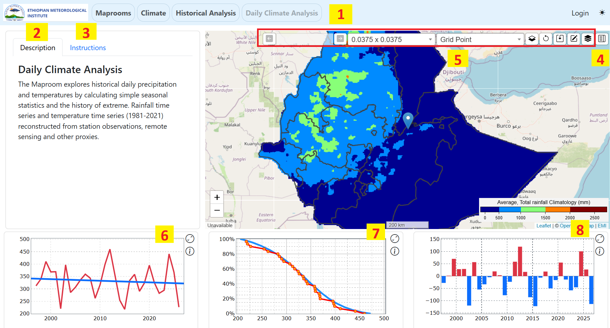

*Figure 1.1. Main areas of the Daily Climate Analysis Maproom.*

- **Menu 1:** Navigation path to the Daily Climate Analysis page.
- **Menu 2:** Description of the Daily Climate Analysis Maproom.
- **Menu 3:** General instructions for using the Maproom.
- **Menu 4:** Button for opening the map controls.
- **Menu 5:** Toolbar for navigating and interacting with the map.
- **Menu 6:** Time-series chart preview, which can be expanded to display the raw data.
- **Menu 7:** Probability chart preview, which can be expanded to display cumulative distribution and probability density functions.
- **Menu 8:** Anomaly chart preview, which can be expanded to display the anomaly chart.

## 2. Settings

### 2.1. Map control

Menus 1, 2, and 3 provide navigation and information features shared across Maproom pages. These are described in [Navigating Maprooms](common-navigation.md).

Select **Menu 4** to open the map controls. The available settings depend on the variable, display type, and seasonal statistic selected.

The following example shows the controls for **Rainfall**, with **Anomaly** selected as the display type.

<table>
  <tr>
    <td width="40%" valign="top">
      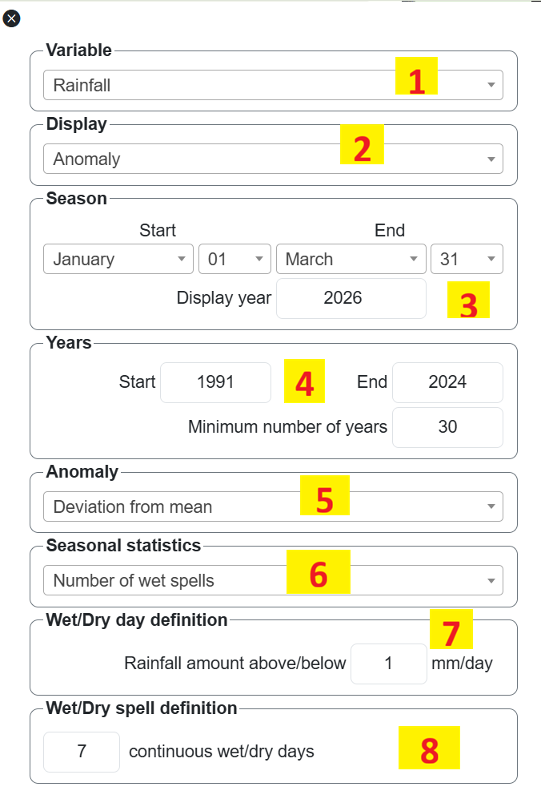
    </td>
    <td width="60%" valign="top">
      <h3>Map control menu</h3>

      
<strong>1. Variable:</strong> Choose between <strong>Rainfall</strong> and <strong>Temperature</strong>.

      
<strong>2. Display:</strong> Choose <strong>Climatology</strong>, <strong>Anomaly</strong>, or <strong>Selected year</strong>.

      
<strong>3. Season:</strong> Select the start month and day, followed by the end month and day. These fields define the interval to analyze. A <strong>Display year</strong> field is also available for the Anomaly and Selected year displays.

      
<strong>4. Years:</strong> Select the start year, end year, and minimum number of years required to calculate the climatology. These settings are used for the Climatology and Anomaly displays and are hidden when Selected year is chosen.

      
<strong>5. Anomaly:</strong> This setting appears when Anomaly is selected under Display. Choose <strong>Deviation from mean</strong>, <strong>Standardized anomaly</strong>, or <strong>Percentage of mean</strong>.

      
<strong>6. Seasonal statistics:</strong> Select the quantity to analyze. For Rainfall, the choices include total rainfall, number of wet or dry days, rainfall intensity, number of wet or dry spells, and longest wet or dry spell.

      
For Temperature, the choices include mean, minimum, and maximum temperature; number of cold or hot days; chilling degree days; heating degree days; and growing degree days.

      
<strong>7. Day definition:</strong> For Rainfall, <strong>Wet/Dry day definition</strong> appears when the selected statistic requires a rainfall threshold, such as the number of wet or dry days or rainfall intensity. For Temperature, <strong>Hot/Cold day definition</strong> provides the threshold for the relevant day-count statistics.

      
<strong>8. Spell definition:</strong> <strong>Wet/Dry spell definition</strong> appears when counting wet or dry spells. Enter the number of consecutive wet or dry days used in the calculation. For temperature degree-day statistics, this field is replaced by <strong>Base temperature definition</strong>.

      
<strong>Yearly seasonal statistics:</strong> When <strong>Climatology</strong> is selected, choose <strong>Average</strong>, <strong>Median</strong>, <strong>Standard deviation</strong>, <strong>Coefficient of variation</strong>, <strong>Probability of exceeding</strong>, or <strong>Probability of non-exceeding</strong>. This setting summarizes the annual values calculated using the selected Seasonal statistics and season definition.

      
<strong>Threshold:</strong> For either probability statistic, enter the threshold in the units of the selected quantity. For example, a threshold of <strong>15</strong> for Number of wet days evaluates the probability relative to 15 wet days during the defined season.

      
<strong>Probability units:</strong> Choose <strong>Percentage</strong> or <strong>Fraction</strong>. A probability of <strong>60%</strong> corresponds to a fraction of <strong>0.60</strong>.

    </td>
  </tr>
</table>

*Figure 2.1. Map controls for daily climate analysis. The numbered callouts identify the variable, display, season, years, anomaly method, seasonal statistic, day definition, and spell definition.*

### 2.2. Chart control

#### 2.2.1. Time-series chart

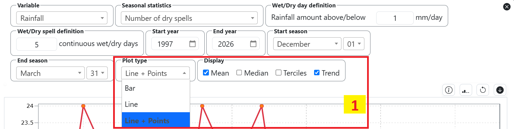

*Figure 2.2. Controls for the expanded time-series chart accessed through Menu 6. Callout 1 highlights the Plot type and Display settings.*

The expanded time-series chart provides the same types of analysis settings as the map controls: **Variable**, **Seasonal statistics**, season, and the definitions required by the selected statistic.

For **Rainfall**, these definitions include wet/dry-day thresholds and wet/dry-spell lengths. For **Temperature**, they include hot/cold-day thresholds or a base temperature, depending on the statistic.

The settings highlighted by callout 1 control how the time series is presented:

- **Plot type:** Choose **Bar**, **Line**, or **Line + Points**.
- **Display:** Add **Mean**, **Median**, **Terciles**, or **Trend** to the chart.

The chart also has its own **Start year** and **End year** fields. Check these settings when comparing the chart with the map.

#### 2.2.2. Probability chart

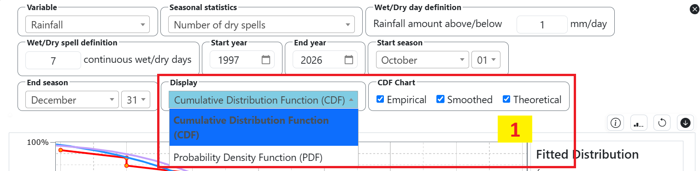

*Figure 2.3. Controls for the expanded probability chart accessed through Menu 7. Callout 1 highlights the distribution display and curve options.*

The expanded probability chart provides analysis settings similar to those in the map controls, including **Variable**, **Seasonal statistics**, season, and the relevant day or spell definitions.

The settings highlighted by callout 1 are specific to the probability chart:

- **Display:** Choose **Cumulative Distribution Function (CDF)** or **Probability Density Function (PDF)**.
- **CDF Chart:** Select the **Empirical**, **Smoothed**, and **Theoretical** curves to display.
- **PDF Chart:** When PDF is selected, choose **Histogram**, **Density (KDE)**, and **Theoretical** components, individually or together.

Use the chart’s start and end years to define the historical period included in the probability analysis.

#### 2.2.3. Anomaly chart

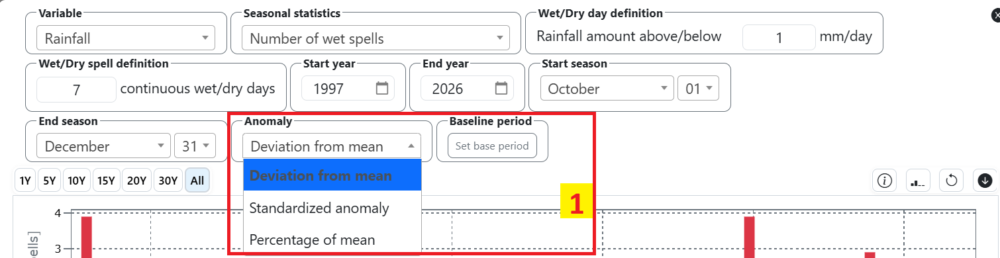

*Figure 2.4. Controls for the expanded anomaly chart accessed through Menu 8. Callout 1 highlights the anomaly method and baseline-period settings.*

The expanded anomaly chart provides analysis settings similar to those in the map controls, including **Variable**, **Seasonal statistics**, season, and the relevant day or spell definitions.

The settings highlighted by callout 1 determine how the anomalies are calculated:

- **Anomaly:** Choose **Deviation from mean**, **Standardized anomaly**, or **Percentage of mean**.
- **Baseline period:** Select **Set base period** to define the reference period used in the anomaly calculation.

The chart’s start and end years determine which seasons are displayed. The baseline period defines the reference against which those seasons are compared.

## 3. Application

### 3.1. Seasonal rainfall analysis

The following example illustrates the spatial analysis of rainfall during the **October–December** season.

<table>
  <tr>
    <td width="35%" valign="top">
      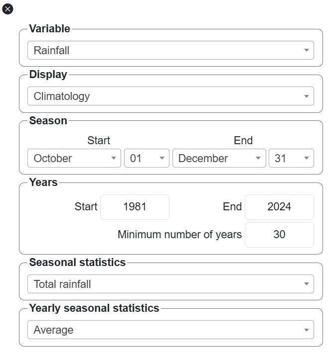
    </td>
    <td width="65%" valign="top">
      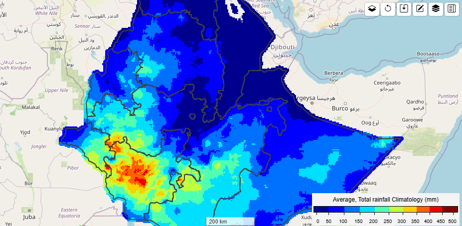
    </td>
  </tr>
</table>

*Figure 3.1. Map controls and the resulting seasonal rainfall climatology. The selected settings are Rainfall, Climatology, October 01–December 31, and Total rainfall, summarized using Average.*

The map displays average total rainfall for **October 01–December 31** over **1981–2024**. The **Minimum number of years** is set to **30**, so at least 30 valid seasonal values are required to calculate the climatology at a location. Additional valid years within the selected period can also contribute to the average.

The legend is expressed in **millimeters**, with labeled values extending from **0 to 500 mm**. For example, a location within the **100–150 mm** interval receives an average seasonal rainfall total between 100 and 150 mm. A location within the **400–450 mm** interval receives substantially more rainfall during the same season.

The map shows higher seasonal totals in parts of the southwest and lower totals across much of the north and east. Read each location’s color against the legend to identify its rainfall interval.

The following comparison presents three spatial views of rainfall conditions during the same October–December season.

<table>
  <tr>
    <td width="33%" valign="top">
      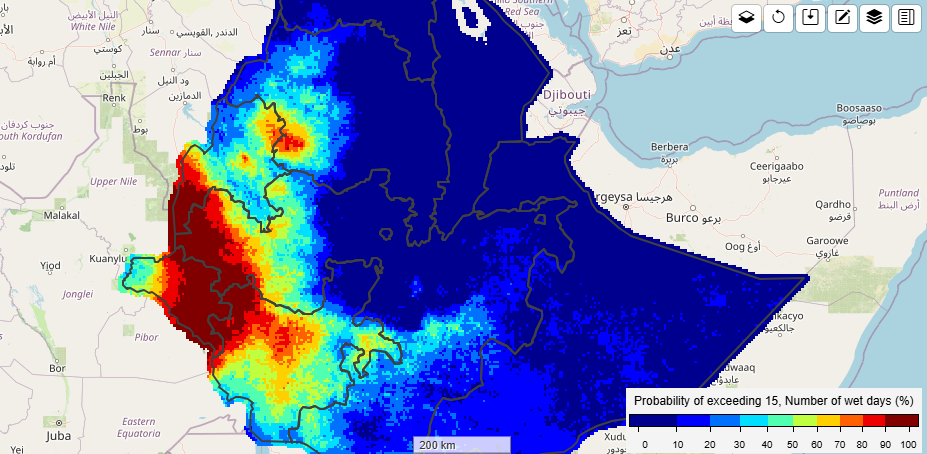
    </td>
    <td width="33%" valign="top">
      
    </td>
    <td width="33%" valign="top">
      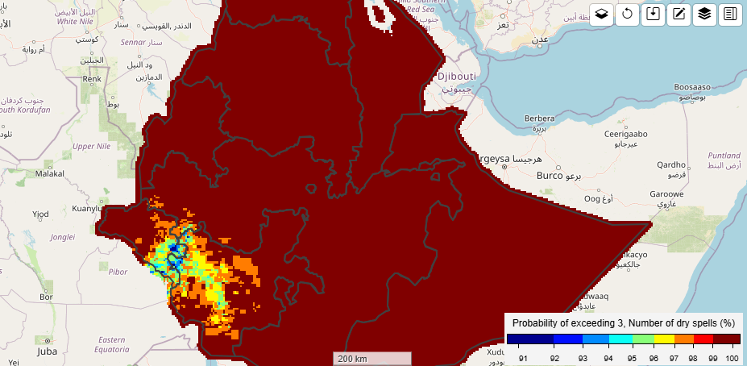
    </td>
  </tr>
</table>

*Figure 3.2. Comparison of the probability of exceeding 15 wet days, average total rainfall, and the probability of exceeding three dry spells.*

From left to right, the maps show:

- **Probability of exceeding 15 wet days:** The first map shows the estimated probability that the seasonal number of wet days is greater than **15**. Its legend is expressed as a percentage. An area within the **60–70%** interval has an estimated historical probability between 60% and 70% of exceeding 15 wet days.
- **Average total rainfall:** The second map shows average rainfall accumulated during the season, expressed in **millimeters**. Its labeled scale extends from **0 to 500 mm**.
- **Probability of exceeding three dry spells:** The third map shows the estimated probability that the calculated seasonal dry-spell count is **more than three**, using the selected day and spell definitions. Much of the map is near the upper end of the displayed scale, which has labels around **91–100%**. An area within the **99–100%** interval therefore has a very high estimated historical probability of exceeding that count.

The probability maps use different displayed ranges. Compare their numerical legends rather than assuming that the same color represents the same probability.

Together, these maps describe rainfall amount, the occurrence of wet days, and the occurrence of dry spells.

For temporal analysis, select a grid point, zone, or region and examine the corresponding chart previews. Expand a chart to inspect historical differences and review its variable, statistic, years, season, and relevant definitions.

### 3.2. Compare a selected season with the historical average

This example examines whether October–December rainfall in **2024** was above or below the historical average.

<table>
  <tr>
    <td width="35%" valign="top">
      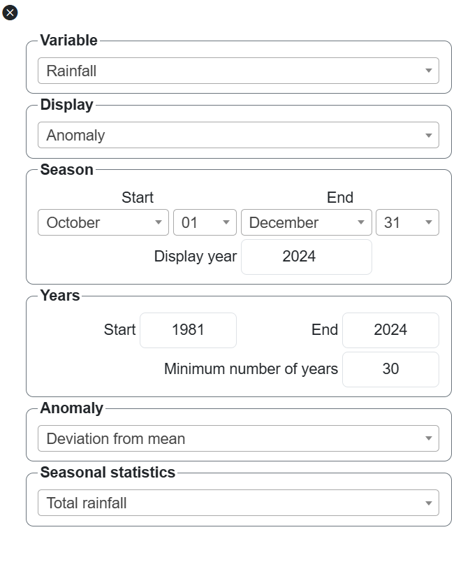
    </td>
    <td width="65%" valign="top">
      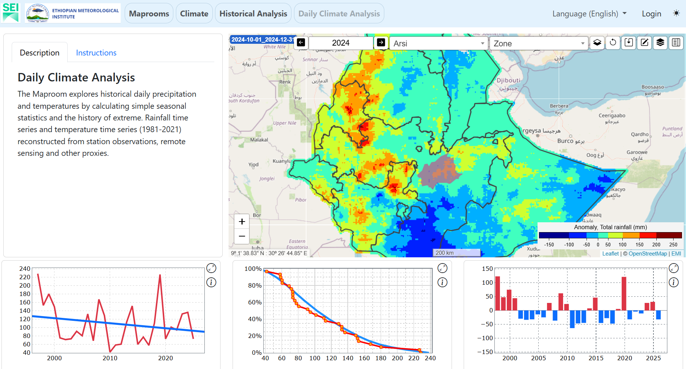
    </td>
  </tr>
</table>

*Figure 3.3. Rainfall anomalies for October 01–December 31, 2024. The selected settings are Rainfall, Anomaly, Total rainfall, and Deviation from mean. The reference period is 1981–2024, with a minimum of 30 valid years.*

The map shows the difference between rainfall accumulated during **October–December 2024** and average rainfall for the same season over **1981–2024**.

The legend expresses this difference in **millimeters**, with labeled values running from **−150 mm to +250 mm**:

- **Positive values** indicate rainfall above the reference average.
- **Negative values** indicate rainfall below the reference average.
- **Values near zero** indicate rainfall close to the reference average.

For example, locations within the **−100 to −50 mm** interval received between 50 and 100 mm less rainfall than their reference average. Locations within the **+100 to +150 mm** interval received between 100 and 150 mm more.

In this example, **Arsi Zone** is selected and highlighted on the map. The chart previews describe that zone:

- **Time-series chart, on the left:** Seasonal rainfall totals range approximately from **40 mm to 225 mm**. The blue fitted trend line slopes downward, from roughly **125 mm** near the beginning of the displayed period to around **90 mm** near the end.
- **Probability chart, in the center:** The exceedance probability decreases as the rainfall amount increases. Values near **40 mm** have probabilities close to the top of the scale, while amounts above **200 mm** have probabilities of only a few percent.
- **Anomaly chart, on the right:** The preview contains negative departures reaching approximately **−65 mm** and positive departures reaching approximately **+125 mm**. These values describe rainfall deficits and surpluses relative to the preview’s reference average.

Expand the anomaly chart to examine the historical departures in more detail and select another anomaly representation.

<table>
  <tr>
    <td>
      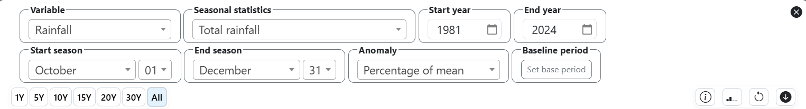
    </td>
  </tr>
  <tr>
    <td>
      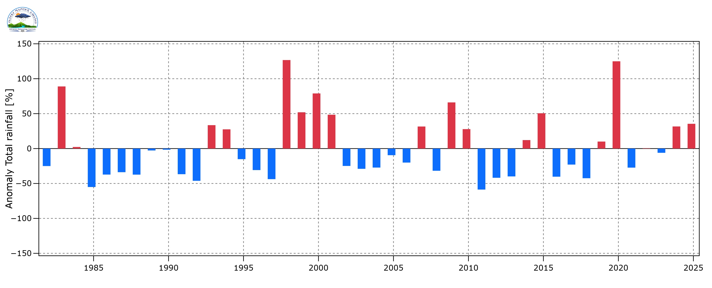
    </td>
  </tr>
</table>

*Figure 3.4. Expanded anomaly-chart controls and the exported rainfall anomaly chart. The controls show October 01–December 31, a displayed year range of 1981–2024, and Percentage of mean.*

The expanded chart uses **Percentage of mean**, whereas the map in Figure 3.3 uses **Deviation from mean**. Their units therefore differ: the map shows **millimeters**, while the expanded chart shows **percentages**.

In this implementation, the option labeled **Percentage of mean** expresses the percentage departure from the reference mean:

- **0%** indicates rainfall equal to the reference mean.
- **+50%** indicates rainfall 50% above the reference mean.
- **−50%** indicates rainfall 50% below the reference mean.

The exported chart contains large positive departures of approximately **+125%** around **1998** and **2020**, and a negative departure of approximately **−60%** around **2011**.

A departure of **+125%** means that seasonal rainfall was approximately **2.25 times** the reference average. A departure of **−60%** means that rainfall was approximately **40%** of that average.

Use **Set base period** to check the reference years and minimum number of years used by the chart. The displayed **Start year** and **End year** fields specify the chart’s analysis period; they do not show the baseline settings.

Keep the anomaly method and baseline consistent when comparing results directly.

### 3.3. Examine hot-day frequency and its historical distribution

This example examines the probability of experiencing **more than 30 hot days** during October–December. A hot day is defined here as a day when daily maximum temperature reaches or exceeds **32°C**.

<table>
  <tr>
    <td width="35%" valign="top">
      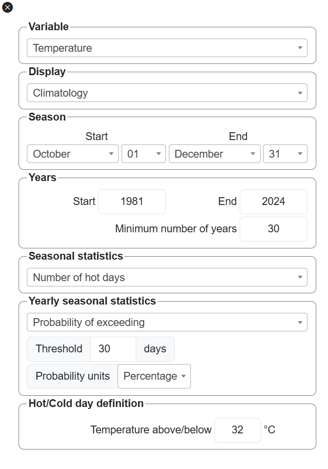
    </td>
    <td width="65%" valign="top">
      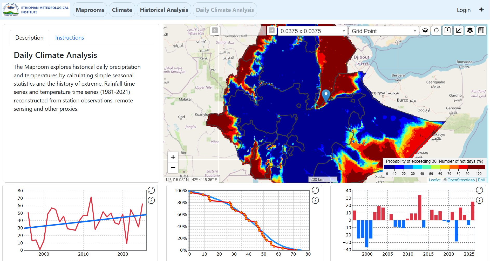
    </td>
  </tr>
</table>

*Figure 3.5. Probability of exceeding 30 hot days during October 01–December 31 over 1981–2024. The selected settings are Temperature, Climatology, Number of hot days, and Probability of exceeding. The hot-day temperature threshold is 32°C.*

The map displays an estimated historical **probability**, expressed as a percentage. It does not display the average number of hot days.

The controls use two different thresholds:

- **32°C** defines whether an individual day is counted as hot.
- **30 days** defines the seasonal count whose exceedance probability is mapped.

The reference years are **1981–2024**, and the **Minimum number of years** is **30**.

The legend runs from **0 to 100%**. Dark-blue areas are near the lower end of the probability scale, while dark-red areas are near the upper end.

For example, an area within the **90–100%** interval has an estimated historical probability between 90% and 100% of experiencing more than 30 days with daily maximum temperature at or above 32°C during the season.

A grid point is selected on the map. Its previews show:

- **Time-series chart:** Seasonal hot-day counts vary from approximately **0 to 70 days**. The blue fitted trend line rises from about **30 days** to approximately **47 days** across the displayed period.
- **Probability chart:** The curve shows how the estimated exceedance probability changes with the seasonal hot-day count.
- **Anomaly chart:** Departures range approximately from **−35 to +35 days**. A positive departure indicates more hot days than the reference average; a negative departure indicates fewer.

The map and charts have separate period settings. Check the expanded-chart controls before comparing their numerical results with the map.

<table>
  <tr>
    <td width="50%" valign="top">
      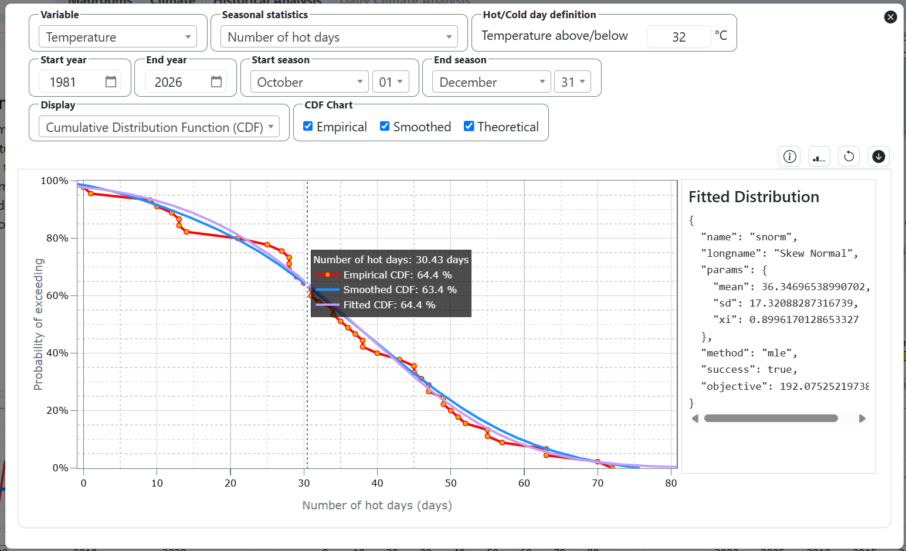
    </td>
    <td width="50%" valign="top">
      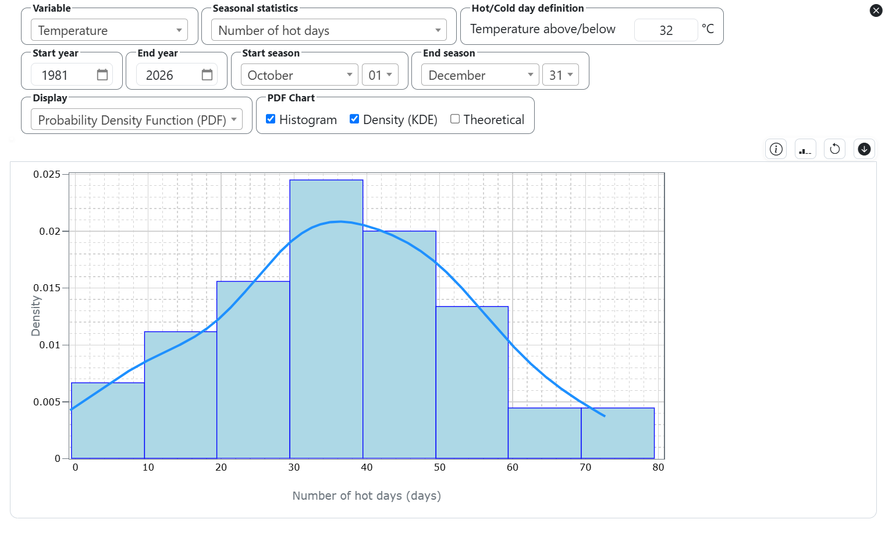
    </td>
  </tr>
</table>

*Figure 3.6. Probability views of seasonal hot-day counts at the selected grid point. Both charts use a 32°C temperature threshold, October 01–December 31, and historical years 1981–2026.*

The expanded charts cover **1981–2026**, whereas the map in Figure 3.5 uses **1981–2024**. Their historical periods therefore differ.

In the **CDF** display, the horizontal axis represents the number of hot days and the vertical axis represents **Probability of exceeding**.

At the pointer position of **30.43 days**, the tooltip reports:

- **Empirical CDF:** **64.4%**.
- **Smoothed CDF:** **63.4%**.
- **Fitted CDF:** **64.4%**.

These readings indicate an estimated historical exceedance probability of approximately **63–64%** near a seasonal count of **30 hot days**. The fractional value of 30.43 days is the pointer’s position on the chart.

The three curves provide different representations of the historical distribution: empirical, smoothed, and fitted.

In the **PDF** display, **Histogram** and **Density (KDE)** are selected, while **Theoretical** is not selected.

The tallest histogram interval is approximately **30–40 hot days**, with a density near **0.024**. The blue density curve also peaks around **35–40 days**, at approximately **0.021**.

These features indicate that seasonal counts around 30–40 hot days are more concentrated in the historical distribution than counts near either end of the displayed range. The vertical axis represents **density**, rather than an exceedance percentage.

Together, the map and charts show where frequent hot-day conditions are more likely, how seasonal counts vary between years, and how those counts are distributed over the historical record.

