# Dekadal Climate Analysis Maproom

## 1. Overview

The Dekadal Climate Analysis Maproom allows you to examine historical rainfall, maximum temperature, and minimum temperature from 1981 onward. These records were reconstructed from station observations and remote-sensing proxies.

A dekad is one of three periods within a calendar month:

| Dekad | Days included |
|---|---|
| Dekad 1 | Days 1–10. |
| Dekad 2 | Days 11–20. |
| Dekad 3 | Day 21 through the last day of the month. |

There are 36 dekads per year. The first two dekads contain ten days each; the third contains between eight and eleven days, depending on the month.

For example:

- January dek-1 represents January 01–10.
- March dek-2 represents March 11–20.
- April dek-3 represents April 21–30.

Use this Maproom to investigate:

- Geographic differences in rainfall and temperature for a selected dekad.
- Average conditions and variability across a historical baseline.
- Rainfall percentiles and the frequency of meeting a selected threshold.
- Changes in rainfall or temperature through time.
- Differences between the seasonal patterns of individual years.
- Departures from the historical average.
- The annual rainfall and temperature cycle at a selected location.

The Maproom provides historical analysis rather than forecasts.

Open the [Dekadal Climate Analysis Maproom](http://213.55.84.78:8484/maproom_pages?maproom=climate&component=analysis&page=dekadal).

The main areas of the page are identified below.

Dekadal Climate Analysis page with numbered callouts identifying its main tools.

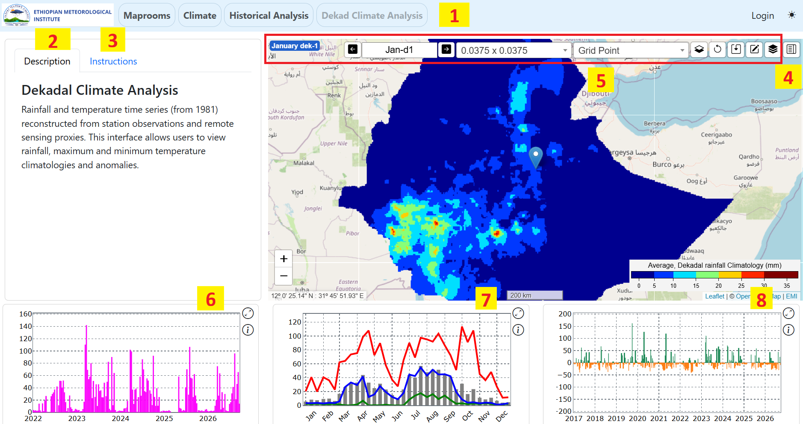

*Figure 1.1. Main areas of the Dekadal Climate Analysis Maproom. The illustrated map displays average rainfall climatology for January dekad 1.*

- Menu 1: Navigation path to the Dekadal Climate Analysis page.
- Menu 2: Description of the Maproom and its data.
- Menu 3: General instructions for using the Maproom.
- Menu 4: Button for opening the map controls.
- Menu 5: Toolbar for navigating between dekads and interacting with the map.
- Menu 6: Historical time-series preview, which can be expanded.
- Menu 7: Annual climatology preview, which can be expanded.
- Menu 8: Anomaly preview, which can be expanded.

The map shows geographic differences for the selected dekad. The charts describe the selected grid point or geographic area and can cover a longer period.

For shared navigation, location selection, map layers, chart appearance, and downloading results, see Navigating Maprooms [Navigating Maprooms](common-navigation.md).

## 2. Settings

### 2.1. Map control

Select Menu 4 to open the map controls.

The available fields depend on the variable and display type. The example below shows Rainfall, Climatology, and Frequency for January dekad 1.
<table>
  <tr>
    <td width="40%" valign="top">
      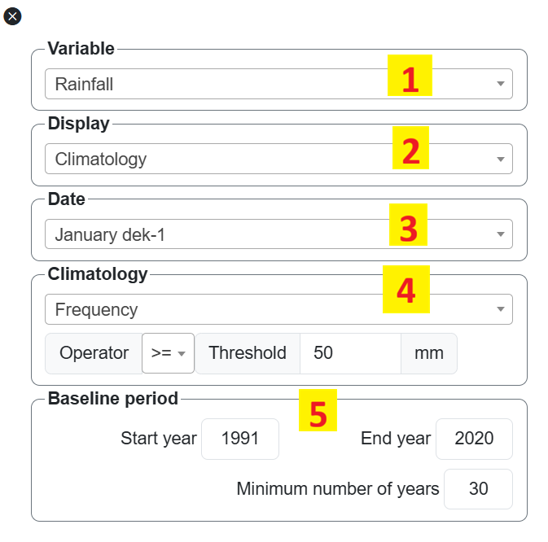
    </td>
    <td width="60%" valign="top">
      <h3>Map control menu</h3>

  
<strong>1. Variable:</strong> Choose <strong>Rainfall</strong>, <strong>Maximum temperature</strong>, or <strong>Minimum temperature</strong>. Rainfall values are expressed in millimeters; temperature values are expressed in degrees Celsius.

  
<strong>2. Display:</strong> Choose <strong>Climatology</strong>, <strong>Anomaly</strong>, or <strong>Dekadal data</strong>.

  
<strong>3. Date:</strong> Select the dekad to display. For Climatology, choose a recurring period such as January dekad 1. For Dekadal data or Anomaly, select a dekad in a specific year.

  
<strong>4. Climatology:</strong> Select <strong>Average</strong>, <strong>Standard deviation</strong>, <strong>Coefficient of variation</strong>, <strong>Percentile</strong>, or <strong>Frequency</strong>. Additional fields appear when a percentile or frequency calculation requires a value.

  
<strong>5. Baseline period:</strong> Set the start year, end year, and minimum number of valid years required for the calculation. The illustrated baseline is <strong>1991–2020</strong>, with a minimum of <strong>30 years</strong>.

</td>
  </tr>
</table>

*Figure 2.1. Dekadal map controls. The example calculates the frequency of January dekad-1 rainfall greater than or equal to 50 mm over 1991–2020.*

The display choices have different purposes:

| Display | Information shown |
|---|---|
| Climatology | A historical summary for the selected recurring dekad. |
| Dekadal data | The value for one dekad in a specific year. |
| Anomaly | The selected dekad’s departure from its reference climatology. |

When Climatology is selected, choose the required statistic:

| Statistic | Interpretation |
|---|---|
| Average | Mean value for the selected dekad across the baseline years. |
| Standard deviation | Spread of the historical values around their mean. |
| Coefficient of variation | Standard deviation expressed relative to the mean, as a percentage. |
| Percentile | A value marking a selected position in the historical distribution. |
| Frequency | Percentage of valid historical values meeting the selected condition. |

For Percentile, enter a percentile such as 95.

For Frequency, choose an operator and threshold. The available operators are >=, >, <=, and <.

In Figure 2.1, the condition is rainfall >= 50 mm. The threshold applies to rainfall accumulated during the selected dekad.

For Anomaly, choose Deviation from mean, Standardized anomaly, or Percentage of mean.

The minimum-year setting determines whether sufficient valid historical values are available. With a baseline of 1991–2020 and a minimum of 30 years, all 30 annual occurrences of the selected dekad must provide valid values for the calculation.

Close the panel to update the map. Use Redraw map if another update is required.

### 2.2. Chart control

#### 2.2.1. Time-series chart

Controls for the expanded dekadal time-series chart.

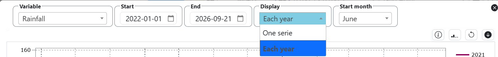

*Figure 2.2. Expanded time-series controls. The example selects Rainfall, January 2022 through September 2026, Each year, and a June start month.*

Select Menu 6 to expand the historical time series.

The controls include:

- **Variable**: Choose rainfall, maximum temperature, or minimum temperature.
- **Start and End**: Define the period included in the chart.
- **Display**: Choose One serie or Each year.
- **Start month**: When **Each year** is selected, choose the month at which the annual comparison begins.
- **Plot type:** When **One serie** is selected, choose **Bar**, **Line**, or **Line + Points**.

One serie displays the selected period chronologically.

Each year places successive annual cycles on the same horizontal axis, making it easier to compare rainfall timing and magnitude. With June selected, the comparison runs from June through May of the following year.

Date fields identify dekads using their starting days: 01, 11, and 21. For example, 2026-09-21 identifies September dekad 3, covering September 21–30.

#### 2.2.2. Annual climatology chart

Controls for the expanded annual climatology chart.

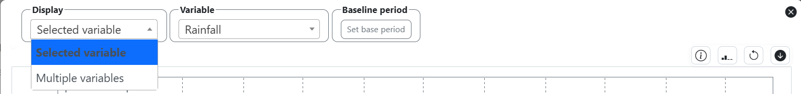

*Figure 2.3. Annual climatology controls, with Selected variable and Multiple variables as the available display choices.*

Select Menu 7 to expand the annual climatology.

The chart describes the typical annual cycle across the 36 dekads, using the baseline configured for the chart.

The display choices are:

- Selected variable: Examine one variable. For rainfall, the chart displays the mean and the 5th, 50th, and 95th percentiles.
- Multiple variables: Display rainfall, minimum temperature, and maximum temperature together.

Use Variable to choose the quantity shown in the Selected variable display.

Select Set base period to review or change the reference years and minimum number of valid years. Check these settings separately when comparing the chart with a map.

#### 2.2.3. Anomaly chart

Controls for the expanded dekadal anomaly chart.

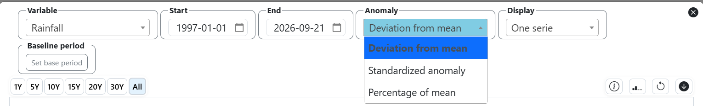

*Figure 2.4. Anomaly controls. The illustrated settings select Rainfall, January 1997 through September 2026, and Deviation from mean.*

Select Menu 8 to expand the anomaly chart.

The controls include:

- **Variable**: Select the quantity to analyze.
- **Start and End**: Define the displayed period.
- **Anomaly**: Choose Deviation from mean, Standardized anomaly, or Percentage of mean.
- Display: Choose One serie or By dekad.
- **Dekad:** When **By dekad** is selected, choose the recurring dekad to compare between years, such as January dekad 1.
- **Baseline period**: Select Set base period to configure the reference calculation.

One serie displays anomalies chronologically. By dekad allows you to focus on a selected recurring dekad and compare its anomalies between years.

The anomaly methods have different units:

| Method | Interpretation |
|---|---|
| Deviation from mean | Difference from the reference mean, in mm for rainfall or °C for temperature. |
| Standardized anomaly | Difference from the mean divided by the reference standard deviation; values have no units. |
| Percentage of mean | In the current calculation, percentage departure from the reference mean, with zero indicating the mean. |

For rainfall, a deviation of +20 mm means 20 mm above the reference average for that same dekad. A deviation of −20 mm means 20 mm below it.

Check the baseline separately from the displayed date range.

## 3. Application

### 3.1. Compare rainfall climatology, frequency, and percentiles

This example examines historical rainfall conditions for April dekad 3, covering April 21–30.
<table>
  <tr>
    <td width="35%" valign="top">
      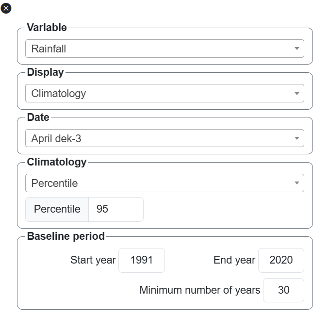
    </td>
    <td width="65%" valign="top">
      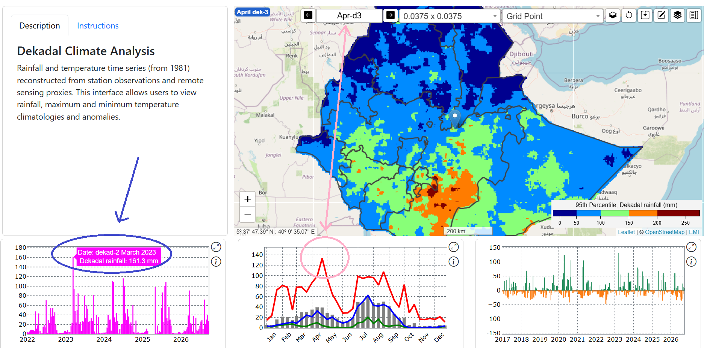
    </td>
  </tr>
</table>

*Figure 3.1. Rainfall analysis for April dekad 3. The map controls select Rainfall, Climatology, Percentile 95, and a baseline of 1991–2020 with a minimum of 30 years.*

The map displays the 95th percentile of rainfall accumulated during April 21–30 across the baseline years.

The legend is expressed in millimeters, with labeled values from 0 to 250 mm.

For example, a mapped value of 150 mm represents a rainfall amount at approximately the 95th percentile of that location’s historical April dekad-3 distribution. Approximately 95% of historical values fall at or below that amount.

The map shows higher upper-percentile rainfall amounts in parts of the south and lower amounts across much of the north.

A grid point is selected on the map. Its chart previews provide additional information:

- Time-series chart, on the left: The highlighted tooltip identifies March dekad 2, 2023, with rainfall of 161.3 mm. This is rainfall accumulated during March 11–20, 2023.
- Annual climatology chart, in the center: The chart shows how the mean and rainfall percentiles vary throughout the year.
- Anomaly chart, on the right: The displayed departures range approximately from −50 mm to +130 mm. Positive values indicate rainfall above the reference average for the corresponding dekad; negative values indicate rainfall below it.

The map’s selected April dekad and the March 2023 event highlighted in the time series refer to different periods. Read each chart’s date or tooltip before interpreting its values.

The following maps compare three ways of summarizing historical dekadal rainfall.
<table>
  <tr>
    <td width="33%" valign="top">
      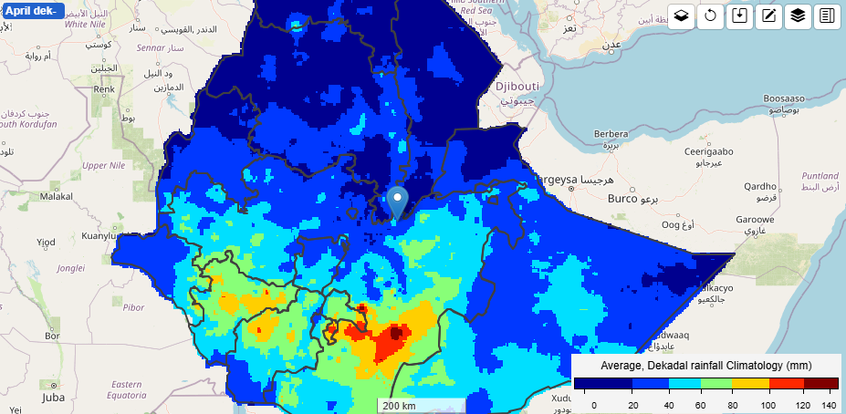
    </td>
    <td width="33%" valign="top">
      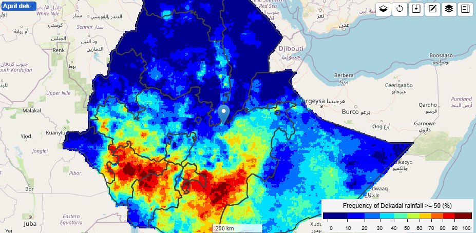
    </td>
    <td width="33%" valign="top">
      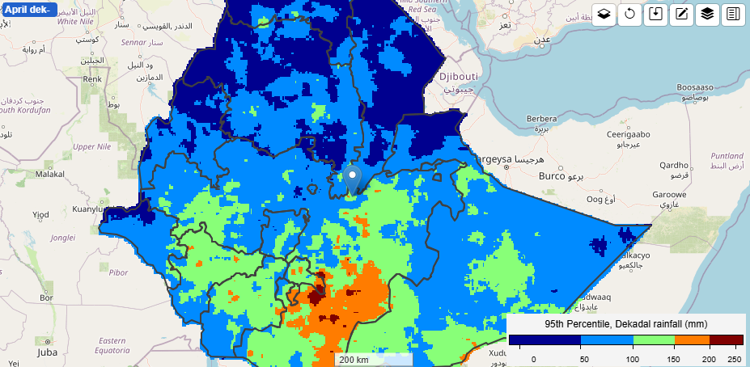
    </td>
  </tr>
</table>

*Figure 3.2. Comparison of average rainfall, frequency of rainfall >= 50 mm, and the 95th percentile. Keep the selected dekad and baseline consistent when comparing these statistics.*

From left to right:

- Average rainfall: The first map displays the mean rainfall amount. Its legend has labeled values from 0 to 140 mm. A location within the 40–60 mm interval has an average dekadal rainfall total between 40 and 60 mm.
- Frequency of rainfall >= 50 mm: The second map displays the percentage of historical values meeting the condition. Its legend runs from 0 to 100%. A frequency of 60%, for example, corresponds to 18 of 30 valid baseline years meeting the threshold.
- 95th percentile: The third map displays an upper-percentile rainfall amount, with labeled values from 0 to 250 mm. A location within the 150–200 mm interval has a 95th-percentile rainfall amount between 150 and 200 mm.

The frequency calculation includes values equal to 50 mm, because the selected operator is >=.

The average and percentile maps express rainfall amounts in mm. The frequency map expresses how often a condition occurred, in %.

Use the average to describe typical rainfall, the frequency to investigate a threshold, and the percentile to examine the upper part of the historical rainfall distribution.

### 3.2. Examine historical rainfall and compare annual cycles

This example follows rainfall from January dekad 1, 2022, through September dekad 3, 2026.

Select a grid point, expand the time-series chart, and choose Rainfall.

Set:

- Start: 2022-01-01.
- End: 2026-09-21.
- Display: One serie.

Continuous dekadal rainfall series from January 2022 through September 2026.

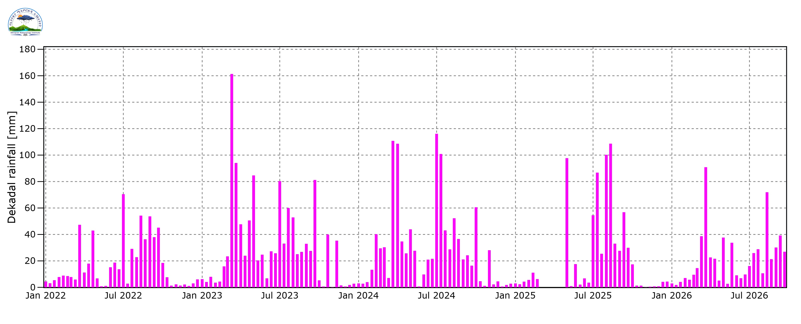

*Figure 3.3. Dekadal rainfall displayed as one chronological series. Each magenta bar represents rainfall accumulated during one dekad.*

The rainfall amounts vary considerably between dekads. Many plotted values are close to zero, while several wet periods exceed 80 mm.

The largest highlighted event reaches 161.3 mm during March dekad 2, 2023, as identified by the tooltip in Figure 3.1.

Other prominent peaks reach approximately:

- 110–115 mm during parts of 2024.
- 100–110 mm during parts of 2025.
- 90 mm during the first half of 2026.

These values represent individual dekadal totals. A bar at 100 mm, for example, means that 100 mm accumulated during that dekad.

To compare the timing of rainfall between annual cycles, change Display to Each year and set Start month to June.

Dekadal rainfall grouped into annual cycles beginning in June.

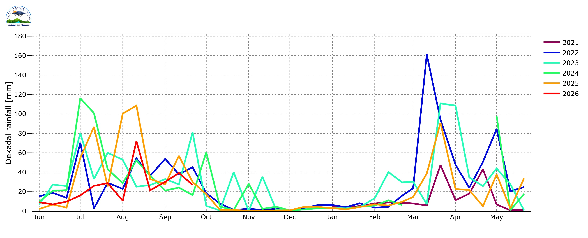

*Figure 3.4. The rainfall record grouped into June–May cycles. The legend identifies each cycle by its starting year.*

The horizontal axis now runs from June to May. Each line represents a cycle beginning in June of its legend year and ending in May of the following year.

For example:

- The line labeled 2022 represents June 2022–May 2023.
- Its large March peak therefore belongs to March 2023, matching the 161.3 mm event in the chronological chart.
- The 2024 line reaches approximately 115 mm near July.
- The 2025 line reaches approximately 110 mm near August.
- The 2026 line reaches approximately 70 mm near August.

The legend also contains 2021, because January–May 2022 belongs to the cycle that began in June 2021.

The first and last cycles are only partly covered by the selected January 2022–September 2026 record. Compare the dekads available in each cycle.

This display helps identify differences in rainfall timing and peak amounts that can be harder to see in a continuous multi-year series.

### 3.3. Examine the annual rainfall and temperature cycle

The annual climatology chart describes how typical conditions vary across the 36 dekads of the year.

Select a location, expand Menu 7, and choose Selected variable with Rainfall.

Annual rainfall climatology showing the mean and the 5th, 50th, and 95th percentiles.

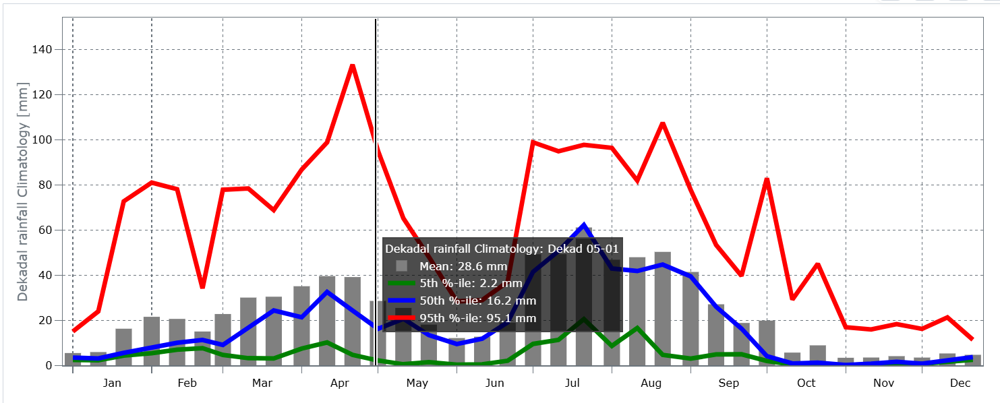

*Figure 3.5. Annual rainfall climatology for the selected location. Gray bars show the mean; green, blue, and red lines show the 5th, 50th, and 95th percentiles.*

Read the chart components as follows:

- Gray bars: Mean rainfall for each recurring dekad.
- Green line: 5th-percentile rainfall.
- Blue line: 50th-percentile rainfall, or median.
- Red line: 95th-percentile rainfall.

At the tooltip position labeled 05-01, representing May dekad 1, the figure reports:

| Statistic | Rainfall |
|---|---:|
| Mean | 28.6 mm |
| 5th percentile | 2.2 mm |
| 50th percentile | 16.2 mm |
| 95th percentile | 95.1 mm |

For this dekad, the mean of 28.6 mm is greater than the median of 16.2 mm. The difference illustrates why the average and median can describe different aspects of the historical distribution.

The 2.2–95.1 mm interval between the 5th and 95th percentiles shows substantial historical variation.

Across the annual cycle, the red 95th-percentile line reaches approximately 130 mm around April and exceeds 100 mm again around July–August. These are upper-percentile amounts, rather than average rainfall totals.

The tooltip illustrates May dekad 1, while the map example in Figure 3.1 selects April dekad 3. Match the dekad when comparing a chart reading directly with a map.

To examine rainfall and temperature together, change Display to Multiple variables.

Annual climatology combining rainfall, minimum temperature, and maximum temperature.

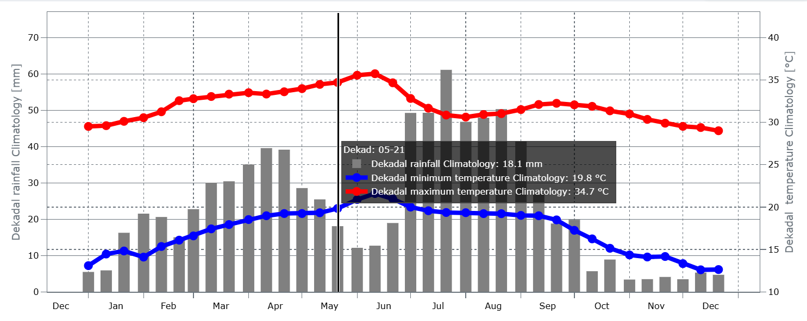

*Figure 3.6. Annual climatology for multiple variables. Gray bars show rainfall, the blue line shows minimum temperature, and the red line shows maximum temperature.*

The chart uses two vertical axes:

- Left axis, in mm: Rainfall climatology.
- Right axis, in °C: Minimum- and maximum-temperature climatologies.

At the tooltip position labeled 05-21, representing May dekad 3, the figure reports:

| Variable | Climatological value |
|---|---:|
| Rainfall | 18.1 mm |
| Minimum temperature | 19.8°C |
| Maximum temperature | 34.7°C |

The difference between the displayed maximum- and minimum-temperature climatologies for that dekad is 14.9°C.

The gray rainfall bars reach approximately 60 mm per dekad around July. Rainfall is much lower toward the end of the year, with several bars around 3–5 mm.

The maximum-temperature curve generally ranges from approximately 29°C to 36°C, while the minimum-temperature curve ranges from approximately 13°C to 22°C.

Use the appropriate axis when reading each variable. A rainfall value of 20 mm and a temperature value of 20°C belong to different scales, even when their plotted positions are similar.

Select Set base period to check the reference years used by the climatology chart. Using the same baseline as the map, such as 1991–2020, supports direct comparisons.

Use Selected variable to examine a variable’s historical distribution in detail. Use Multiple variables to compare the timing of rainfall and temperature conditions throughout the year.

We can do the same application related to the temperature variable. 
