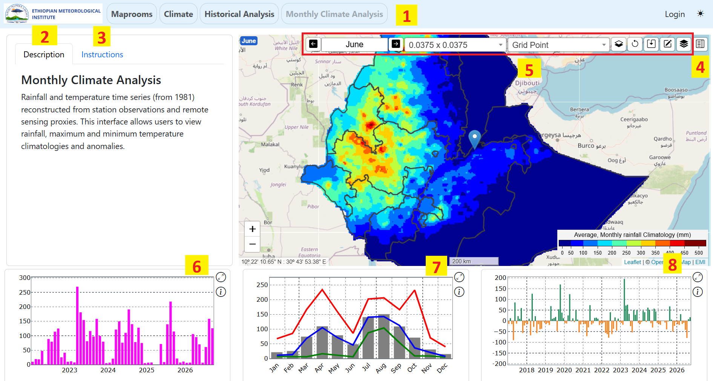
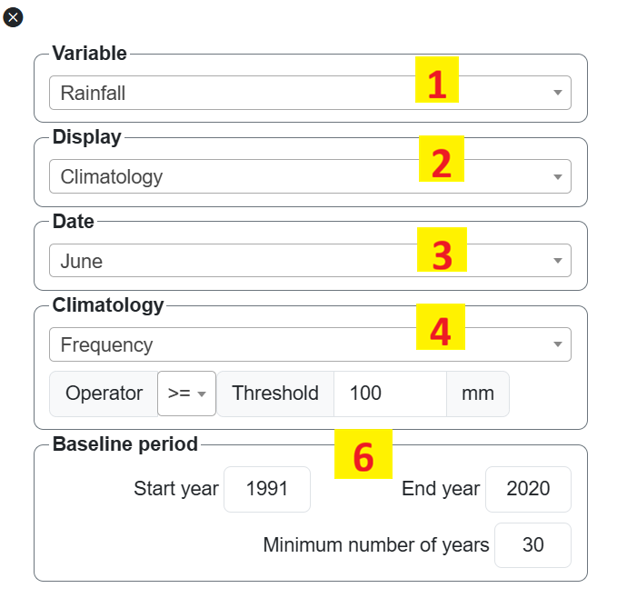
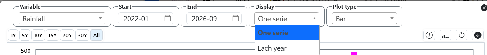
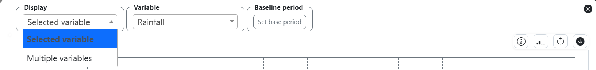
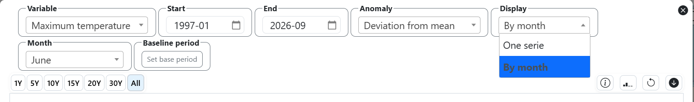
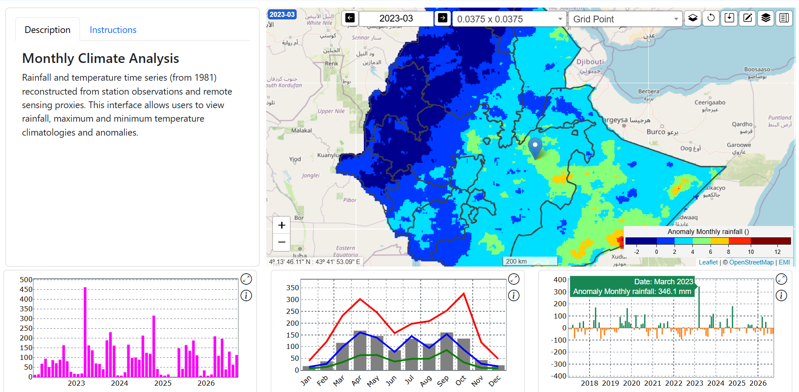
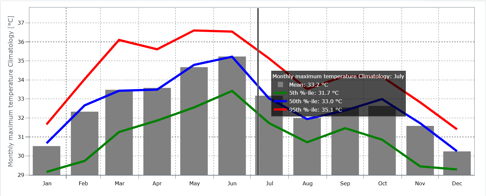
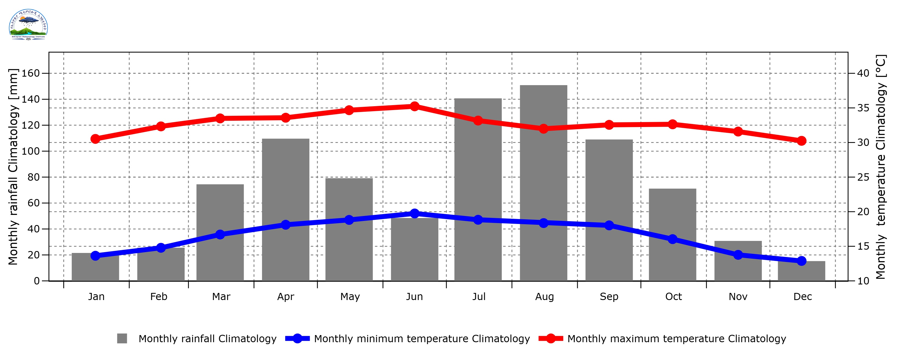
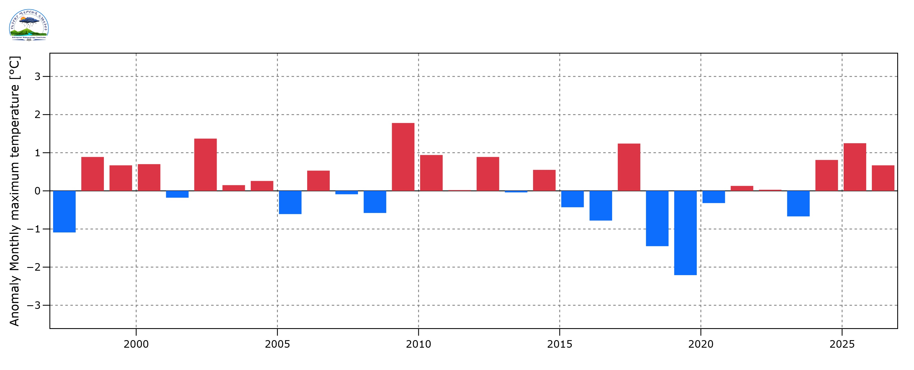
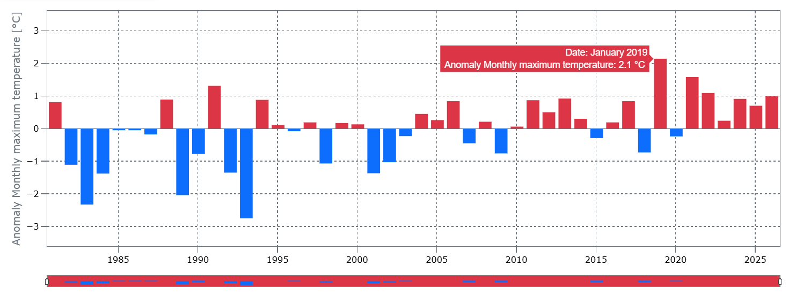

# Monthly Climate Analysis Maproom

## 1. Overview

The Monthly Climate Analysis Maproom allows you to examine historical rainfall, maximum temperature, and minimum temperature from 1981 onward. These records were reconstructed from station observations and remote-sensing proxies.

The analysis uses calendar months:

- Monthly rainfall describes rainfall accumulated during a month, expressed in millimeters.
- Maximum and minimum temperature describe the corresponding monthly temperature records, expressed in degrees Celsius.
- Climatology summarizes conditions for a recurring month across a historical baseline.
- Anomaly describes how a particular month differs from its reference climatology.

Use this Maproom to investigate:

- Geographic differences in rainfall and temperature.
- Average conditions and historical variability for a selected month.
- Rainfall or temperature percentiles.
- The frequency of meeting a selected threshold.
- Differences between individual years.
- Unusually wet, dry, warm, or cool months relative to a reference period.
- The annual rainfall and temperature cycle at a selected location.

The Maproom provides historical analysis rather than forecasts.

Open the Monthly Climate Analysis Maproom (http://213.55.84.78:8484/maproom_pages?maproom=climate&component=analysis&page=monthly).

The main areas of the page are identified below.

*Figure 1.1. Main areas of the Monthly Climate Analysis Maproom. The illustrated map displays average rainfall climatology for June.*

- **Menu 1**: Navigation path to the Monthly Climate Analysis page.
- **Menu 2**: Description of the Maproom and its data.
- **Menu 3**: General instructions for using the Maproom.
- **Menu 4**: Button for opening the map controls.
- **Menu 5**: Toolbar for navigating between months and interacting with the map.
- **Menu 6**: Historical time-series preview, which can be expanded.
- **Menu 7**: Annual climatology preview, which can be expanded.
- **Menu 8**: Anomaly preview, which can be expanded.

The map shows geographic differences for the selected month. The charts describe the selected grid point or geographic area and can cover a longer historical period.

For shared navigation, location selection, map layers, chart appearance, and downloading results, see Navigating Maprooms [Navigating Maprooms](common-navigation.md).

## 2. Settings

### 2.1. Map control

Select Menu 4 to open the map controls.

The available fields depend on the variable and display type. The following example shows Rainfall, Climatology, and Frequency for June.

<table>
  <tr>
    <td width="40%" valign="top">
      
    </td>
    <td width="60%" valign="top">

      
<strong>1. Variable:</strong> Choose <strong>Rainfall</strong>, <strong>Maximum temperature</strong>, or <strong>Minimum temperature</strong>. Rainfall values are expressed in millimeters; temperature values are expressed in degrees Celsius.

      
<strong>2. Display:</strong> Choose <strong>Climatology</strong>, <strong>Anomaly</strong>, or <strong>Monthly data</strong>.

      
<strong>3. Date:</strong> Select the month to display. For Climatology, choose a recurring month such as June. For Monthly data or Anomaly, select a specific year and month, such as 2023-03.

      
<strong>4. Climatology:</strong> Choose <strong>Average</strong>, <strong>Standard deviation</strong>, <strong>Coefficient of variation</strong>, <strong>Percentile</strong>, or <strong>Frequency</strong>. Additional fields appear when a percentile or frequency calculation requires a value.

      
<strong>6. Baseline period:</strong> Set the start year, end year, and minimum number of valid years required for the calculation. The illustrated baseline is <strong>1991–2020</strong>, with a minimum of <strong>30 years</strong>.

    </td>
  </tr>
</table>

*Figure 2.1. Monthly map controls. The example calculates the frequency of June rainfall greater than or equal to 100 mm over 1991–2020.*

The illustrated baseline is 1991–2020, with a minimum of 30 years.

The display choices have different purposes:

| Display | Information shown |
|---|---|
| Climatology | A historical summary for the selected recurring month. |
| Monthly data | The value for a month in a specific year. |
| Anomaly | The selected month’s departure from its reference climatology. |

When Climatology is selected, choose the required statistic:

| Statistic | Interpretation |
|---|---|
| Average | Mean value for the selected month across the baseline years. |
| Standard deviation | Spread of historical values around their mean. |
| Coefficient of variation | Standard deviation expressed relative to the mean, as a percentage. |
| Percentile | A value marking a selected position in the historical distribution. |
| Frequency | Percentage of valid historical values meeting a selected condition. |

For Percentile, enter a percentile such as 95.

For Frequency, choose an operator and threshold. The available operators are >=, >, <=, and <.

In Figure 2.1, the condition is June rainfall >= 100 mm. Months with rainfall equal to 100 mm are included.

For example, if this condition occurred in 18 of 30 valid baseline years, the frequency would be 60%.

With a baseline of 1991–2020 and a minimum of 30 years, all 30 annual occurrences of the selected month must provide valid values.

When Anomaly is selected, an additional control provides Deviation from mean, Standardized anomaly, and Percentage of mean.

Close the panel to update the map. Use Redraw map if another update is required.

### 2.2. Chart control

#### 2.2.1. Time-series chart

*Figure 2.2. Expanded time-series controls. The example selects Rainfall, January 2022–September 2026, One serie, and a Bar plot.*

Select Menu 6 to expand the historical time series.

The controls include:

- Variable: Choose rainfall, maximum temperature, or minimum temperature.
- Start and End: Define the period included in the chart.
- Display: Choose One serie or Each year.
- Plot type: Choose Bar, Line, or Line + Points, where available.

One serie displays the selected months chronologically. Each bar or plotted value represents one month.

Each year places successive annual cycles on the same horizontal axis, making it easier to compare their seasonal patterns. A Start month setting allows the annual comparison to begin in a selected month.

The example uses 2022-01 as the start and 2026-09 as the end, covering January 2022 through September 2026.

The range buttons provide shortcuts such as 1Y, 5Y, 10Y, 15Y, 20Y, 30Y, and All.

#### 2.2.2. Annual climatology chart

*Figure 2.3. Annual climatology controls, with Selected variable and Multiple variables as the available display choices.*

Select Menu 7 to expand the annual climatology.

The chart describes how typical conditions vary across the 12 calendar months, using the baseline configured for the chart.

The display choices are:

- Selected variable: Examine one variable using its mean and 5th, 50th, and 95th percentiles.
- Multiple variables: Display rainfall, minimum temperature, and maximum temperature together.

Use Variable to select the quantity shown in the Selected variable display.

Select Set base period to review or change the reference years and minimum number of valid years. Check these settings separately when comparing the chart with a map.

#### 2.2.3. Anomaly chart

*Figure 2.4. Anomaly controls. The illustrated settings select Maximum temperature, January 1997–September 2026, Deviation from mean, and By month, with June selected.*

Select Menu 8 to expand the anomaly chart.

The controls include:

- Variable: Select the quantity to analyze.
- Start and End: Define the displayed historical period.
- Anomaly: Choose Deviation from mean, Standardized anomaly, or Percentage of mean.
- Display: Choose One serie or By month.
- Month: When By month is selected, choose the calendar month to compare between years.
- Baseline period: Select Set base period to configure the reference calculation.

One serie displays monthly anomalies chronologically.

By month compares the same calendar month between years. For example, selecting January produces a series of January anomalies.

The anomaly methods use different units:

| Method | Interpretation |
|---|---|
| Deviation from mean | Difference from the reference mean, in mm for rainfall or °C for temperature. |
| Standardized anomaly | Difference from the reference mean divided by the reference standard deviation; values have no units. |
| Percentage of mean | In the current calculation, percentage departure from the reference mean, with zero indicating the mean. |

For Deviation from mean, a rainfall anomaly of +50 mm means 50 mm above the reference average for that calendar month. A temperature anomaly of −1°C means 1°C below the corresponding reference average.

For Standardized anomaly, a value of +2 means two reference standard deviations above the mean.

Check the baseline separately from the displayed date range.

## 3. Application

### 3.1. Examine unusually wet conditions in March 2023

This example examines how rainfall during March 2023 differed from historical March conditions.

Map controls configured for standardized March 2023 rainfall anomalies relative to 1991–2020.

*Figure 3.1. March 2023 rainfall analysis. The controls select Rainfall, Anomaly, March 2023, and Standardized anomaly. The baseline is 1991–2020, with a minimum of 30 years.*

The map compares rainfall accumulated during March 2023 with historical March rainfall over 1991–2020.

Because Standardized anomaly is selected, the map expresses departures in units of the reference standard deviation. The values have no physical units.

The legend includes labeled values from −2 to +12:

- 0 indicates rainfall equal to the reference mean.
- +2 indicates rainfall two standard deviations above the reference mean.
- −2 indicates rainfall two standard deviations below the reference mean.
- A location within the +4 to +6 interval has rainfall between four and six reference standard deviations above its March average.

The map shows large positive departures in parts of the central, eastern, and southeastern areas. Read the numerical legend to identify their magnitude.

A grid point is selected on the map. Its chart previews provide three complementary views.

Time-series chart, on the left

The magenta bars show monthly rainfall totals. The March 2023 peak reaches approximately 460 mm, making it one of the most prominent wet months in the displayed record.

Each bar represents rainfall accumulated during a single calendar month.

Annual climatology chart, in the center

The gray bars and colored lines describe the annual rainfall cycle.

The wetter-month mean rainfall bars reach approximately 150–160 mm. The red 95th-percentile line reaches around 300 mm in April and approximately 325 mm in October.

These values describe different calendar months. Compare March 2023 specifically with the March climatology when assessing that event.

Anomaly chart, on the right

The highlighted tooltip reports:

- Date: March 2023.
- Monthly rainfall anomaly: +346.1 mm.

This means that March 2023 rainfall was 346.1 mm above the reference March mean used by the chart.

The map and anomaly preview use different units:

- The map shows a standardized anomaly with no units.
- The preview tooltip shows a rainfall departure in millimeters.

Review the expanded chart’s anomaly method and baseline before comparing its numerical results with the map.

### 3.2. Examine the annual rainfall and temperature cycle

This example first examines maximum-temperature climatology, then combines rainfall and temperature in one annual-cycle chart.

Select a location, expand Menu 7, choose Selected variable, and select Maximum temperature.

*Figure 3.2. Annual maximum-temperature climatology. Gray bars show the mean; green, blue, and red lines show the 5th, 50th, and 95th percentiles.*

Read the components as follows:

- Gray bars: Mean maximum-temperature value for each calendar month.
- Green line: 5th percentile.
- Blue line: 50th percentile, or median.
- Red line: 95th percentile.

At the tooltip position for July, the figure reports:

| Statistic | Maximum temperature |
|---|---:|
| Mean | 33.2°C |
| 5th percentile | 31.7°C |
| 50th percentile | 33.0°C |
| 95th percentile | 35.1°C |

For July, the mean and median are close: 33.2°C and 33.0°C.

The interval between the 5th and 95th percentiles extends from 31.7°C to 35.1°C, a span of 3.4°C. This describes historical variation in July values across the chart’s reference period.

Across the annual cycle:

- The mean is approximately 30.5°C in January.
- It reaches approximately 35.2°C in June.
- It decreases to 33.2°C in July.
- It is approximately 30.2°C in December.

The red 95th-percentile curve reaches approximately 36.6°C around May–June.

To examine rainfall and temperature together, change Display to Multiple variables.

*Figure 3.3. Combined annual climatology for 1991–2020. Gray bars show rainfall, the blue line shows minimum temperature, and the red line shows maximum temperature.*

The chart uses two vertical axes:

- Left axis, in mm: Monthly rainfall climatology.
- Right axis, in °C: Minimum- and maximum-temperature climatologies.

The rainfall cycle includes:

- Approximately 20 mm in January.
- Approximately 110 mm in April.
- Approximately 55 mm in June.
- Approximately 140 mm in July.
- Approximately 150 mm in August.
- Approximately 15 mm in December.

The maximum-temperature curve rises from approximately 30.5°C in January to around 35°C in June, then decreases during July–August.

The minimum-temperature curve rises from approximately 14°C in January to around 20°C in June, before decreasing toward approximately 13°C in December.

The combined chart therefore shows that the highest rainfall occurs around July–August, while the maximum-temperature curve reaches its highest values around May–June.

Read each variable against its own axis. Rainfall values in millimeters and temperature values in degrees Celsius use different scales.

Use Set base period to check the reference years when comparing this chart with another climatology.

### 3.3. Compare maximum-temperature anomalies between years

This example examines how maximum-temperature values for a selected calendar month differed from their historical average.

Expand Menu 8 and select:

- Variable: Maximum temperature.
- Anomaly: Deviation from mean.
- Display: By month.
- Month: The calendar month you want to investigate.

The controls in Figure 2.4 illustrate June. Read the Month selector to identify the calendar month represented by the resulting chart.

Exported maximum-temperature anomalies for the selected calendar month within the January 1997–September 2026 analysis period.

*Figure 3.4. Maximum-temperature anomalies for the month selected in the chart controls, within the January 1997–September 2026 historical window.*

Each bar represents one occurrence of the selected calendar month:

- Red bars above zero indicate maximum-temperature values above the reference average for that month.
- Blue bars below zero indicate values below the reference average.
- Values near zero indicate conditions close to the reference average.

The displayed departures include approximately:

- +1.4°C around 2002.
- +1.8°C around 2009.
- −2.2°C around 2019.
- +1.2°C around 2025.

The visible anomalies span approximately −2.2°C to +1.8°C.

For example, a departure of −2.2°C means that the selected month’s maximum-temperature value was approximately 2.2°C below its reference average.

To examine another month, change Month while retaining the required variable, anomaly method, and baseline.

The following example focuses specifically on January.

*Figure 3.5. January maximum-temperature anomalies. Each bar represents one January, expressed as a departure from the reference January average.*

The highlighted tooltip reports:

- Date: January 2019.
- Maximum-temperature anomaly: +2.1°C.

January 2019 therefore had a maximum-temperature value 2.1°C above the reference January mean used by this chart.

Other visible departures include:

- Approximately −2.3°C around 1983.
- Approximately −2.8°C around 1993.
- Approximately +1.6°C around 2021.

The January anomalies span approximately −2.8°C to +2.1°C.

The negative departure around 1993 indicates a January maximum-temperature value approximately 2.8°C below its reference January average. The positive departure in January 2019 indicates a warmer January relative to that reference.

Each calendar month has its own reference climatology. Check the selected location, month, and baseline when comparing anomaly charts.

Use the annual climatology to examine the seasonal temperature cycle, and the By month anomaly display to investigate departures for one calendar month between years.
