# Seasonal Climate Analysis Maproom

## 1. Overview

The Seasonal Climate Analysis Maproom allows you to examine historical rainfall, maximum temperature, and minimum temperature over a selected number of consecutive months. The records were reconstructed from station observations, remote sensing, and other proxies, with historical data beginning in 1981.

A season is defined by its start month and length in months.

For example:

| Start month | Length | Season |
|---|---:|---|
| June | 3 months | June–August |
| July | 3 months | July–September |
| October | 3 months | October–December |

Rainfall values describe rainfall accumulated during the selected season, expressed in millimeters. Temperature values describe the corresponding seasonal temperature series, expressed in degrees Celsius.

Use this Maproom to investigate:

- Geographic differences in seasonal rainfall and temperature.
- Average conditions and variability across a historical baseline.
- Historical minimum, maximum, and percentile values.
- The frequency or estimated probability of meeting a threshold.
- Changes in seasonal conditions over time.
- Differences between individual years.
- Departures from a reference climatology.

The Maproom provides historical analysis rather than forecasts.

Open the Seasonal Climate Analysis Maproom (http://213.55.84.78:8484/maproom_pages?maproom=climate&component=analysis&page=seasonal).

The main areas of the page are identified below.

Seasonal Climate Analysis page with numbered callouts identifying its main tools.
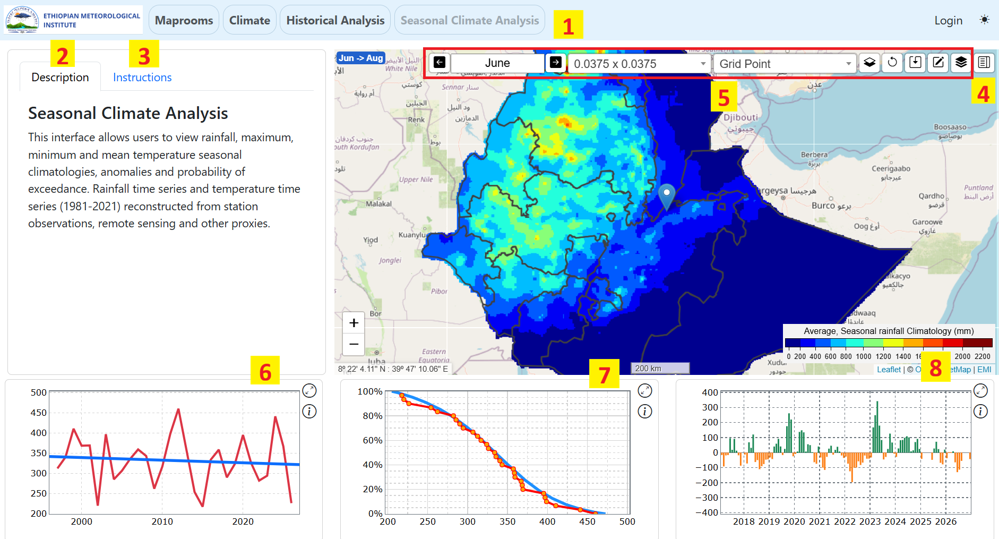

*Figure 1.1. Main areas of the Seasonal Climate Analysis Maproom. The illustrated map displays average rainfall climatology for June–August.*

- Menu 1: Navigation path to the Seasonal Climate Analysis page.
- Menu 2: Description of the Maproom and its data.
- Menu 3: General instructions for using the Maproom.
- Menu 4: Button for opening the map controls.
- Menu 5: Toolbar for navigating between periods and interacting with the map.
- Menu 6: Seasonal time-series preview, which can be expanded.
- Menu 7: Probability chart preview, which can be expanded.
- Menu 8: Anomaly chart preview, which can be expanded.

The map shows geographic differences for the selected season. The charts describe a selected grid point or geographic area.

Check the location, season, and historical period separately in each chart.

For shared navigation, location selection, map layers, chart appearance, and downloading results, see Navigating Maprooms [Navigating Maprooms](common-navigation.md).

## 2. Settings

### 2.1. Map control

Select Menu 4 to open the map controls.

The available fields depend on the variable and display type. The following example shows Rainfall, Climatology, and Probability of exceeding for a three-month season beginning in June.
<table>
  <tr>
    <td width="40%" valign="top">
      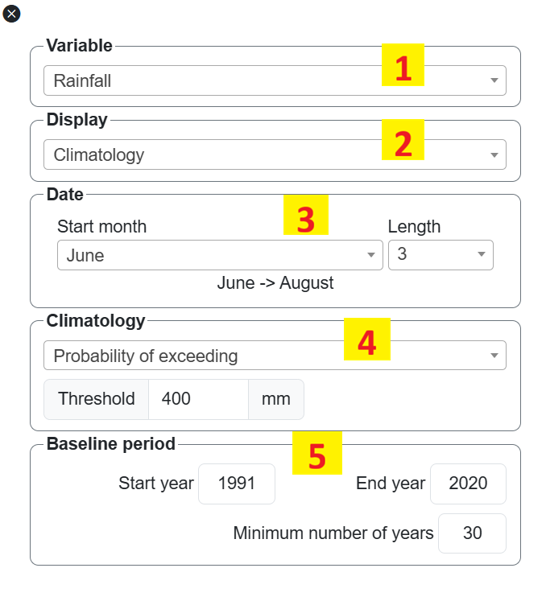
    </td>
    <td width="60%" valign="top">
      <h3>Map control menu</h3>

  
<strong>1. Variable:</strong> Choose <strong>Rainfall</strong>, <strong>Maximum temperature</strong>, or <strong>Minimum temperature</strong>.

  
<strong>2. Display:</strong> Choose <strong>Climatology</strong>, <strong>Anomaly</strong>, or <strong>Selected season</strong>.

  
<strong>3. Date:</strong> Select the season’s start month and length. In this example, <strong>June</strong> and <strong>3 months</strong> define June–August. For a selected season or anomaly, the date also identifies the year.

  
<strong>4. Climatology:</strong> Select the historical summary or analysis to display. Additional settings appear for percentiles, frequencies, probabilities, and trends.

  
<strong>5. Baseline period:</strong> Set the start year, end year, and minimum number of valid years required for the calculation. The illustrated baseline is <strong>1991–2020</strong>, with a minimum of <strong>30 years</strong>.

</td>
  </tr>
</table>

*Figure 2.1. Seasonal map controls. The example estimates the probability of June–August rainfall exceeding 400 mm over 1991–2020.*

The display choices have different purposes:

| Display | Information shown |
|---|---|
| Climatology | A historical summary for the selected recurring season. |
| Selected season | The seasonal value for a specific year. |
| Anomaly | The selected season’s departure from its reference climatology. |

For Climatology, the available analyses include:

| Choice | Interpretation |
|---|---|
| Average | Mean seasonal value across the selected years. |
| Maximum | Highest seasonal value within the selected historical period. |
| Minimum | Lowest seasonal value within the selected historical period. |
| Standard deviation | Spread of seasonal values around their mean. |
| Coefficient of variation | Standard deviation relative to the mean, expressed as a percentage. |
| Percentile | A value marking a selected position in the historical distribution. |
| Frequency | Percentage of valid seasonal values meeting a selected condition. |
| Probability of exceeding | Estimated probability of a seasonal value exceeding a threshold. |
| Probability of non-exceeding | Estimated probability of a seasonal value not exceeding a threshold. |
| Seasonal trends | Fitted change in the seasonal value over the selected years. |

For Percentile, enter a percentile such as 95.

For Frequency, choose an operator and threshold. The available operators are >=, >, <=, and <.

For Probability of exceeding or Probability of non-exceeding, enter the threshold in the displayed units. In Figure 2.1, 400 mm refers to the rainfall total for the entire June–August season.

For Seasonal trends, choose among:

- Trend per year.
- Trend over the period.
- Trend in percentage of mean.

When Anomaly is selected, choose Deviation from mean, Standardized anomaly, or Percentage of mean.

The minimum-year setting determines whether sufficient valid historical values are available. With a baseline of 1991–2020 and a minimum of 30 years, all 30 annual occurrences of the selected season must provide valid values.

Close the panel to update the map. Use Redraw map if another update is required.

### 2.2. Chart control

#### 2.2.1. Seasonal time-series chart

Controls for the expanded seasonal time-series chart.

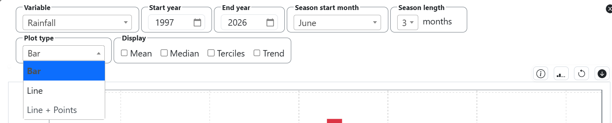

*Figure 2.2. Time-series controls. The example selects Rainfall, 1997–2026, a June start month, and a three-month season.*

Select Menu 6 to expand the seasonal time series.

The controls include:

- **Variable**: Select the quantity to analyze.
- **Start year and End year**: Define the historical period.
- **Season start month**: Choose the first month of the season.
- **Season length**: Choose the number of consecutive months.
- **Plot type**: Select Bar, Line, or Line + Points.
- **Display**: Add Mean, Median, Terciles, or Trend.
- **Season start month:** When **By season** is selected, choose the first month of the recurring season. Together with **Season length**, this defines the window compared between years. For example, **June** and **3 months** compare June–August anomalies.

For June and 3 months, each yearly value represents the June–August season.

The overlays provide reference information:

- Mean: The average of the displayed seasonal values.
- Median: The middle value of their distribution.
- Terciles: Two boundaries dividing the historical distribution into approximately three equal groups.
- Trend: The fitted direction of change over the selected years.

The chart has its own year range and season settings. Check these before comparing it with the map.

#### 2.2.2. Probability chart

Controls for the expanded seasonal probability chart.

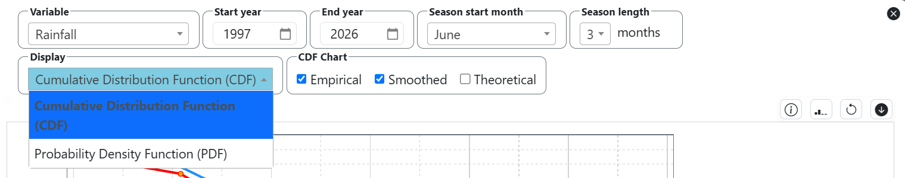

*Figure 2.3. Probability controls. The example selects Rainfall, 1997–2026, June–August, and the CDF display.*

Select Menu 7 to expand the probability chart.

Choose the variable, historical year range, season start month, and season length.

Under Display, select:

- Cumulative Distribution Function (CDF).
- Probability Density Function (PDF).

The CDF controls provide Empirical, Smoothed, and Theoretical curves.

The PDF controls provide Histogram, Density (KDE), and Theoretical components.

In this interface, the CDF display’s vertical axis is labeled Probability of exceeding. Read it as the estimated probability of exceeding the value on the horizontal axis.

The PDF describes where historical seasonal values are concentrated. Its vertical axis represents density.

#### 2.2.3. Anomaly chart

Controls for the expanded seasonal anomaly chart.

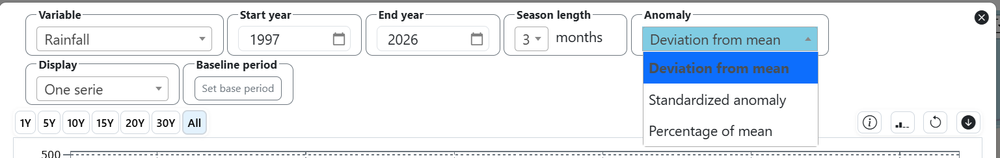

*Figure 2.4. Anomaly controls. The illustrated settings select Rainfall, 1997–2026, a three-month season length, and Deviation from mean.*

Select Menu 8 to expand the anomaly chart.

The controls include:

- Variable: Select the quantity to analyze.
- Start year and End year: Define the displayed historical period.
- Season length: Select the number of months in each seasonal window.
- Anomaly: Choose the method used to express departures.
- Display: Choose One serie or By season.
- Baseline period: Select Set base period to configure the reference calculation.

One serie displays successive seasonal windows chronologically. With a three-month length, these can include January–March, February–April, and subsequent overlapping windows.

By season focuses on a selected recurring season for comparison between years.

The anomaly methods use different units:

| Method | Interpretation |
|---|---|
| Deviation from mean | Difference from the reference mean, in mm for rainfall or °C for temperature. |
| Standardized anomaly | Difference from the mean divided by the reference standard deviation; values have no units. |
| Percentage of mean | In the current calculation, percentage departure from the reference mean, with zero indicating the mean. |

Check the baseline separately from the displayed year range.

## 3. Application

### 3.1. Examine geographic differences and seasonal rainfall trends

This example examines historical rainfall trends for June–August.
<table>
  <tr>
    <td width="35%" valign="top">
      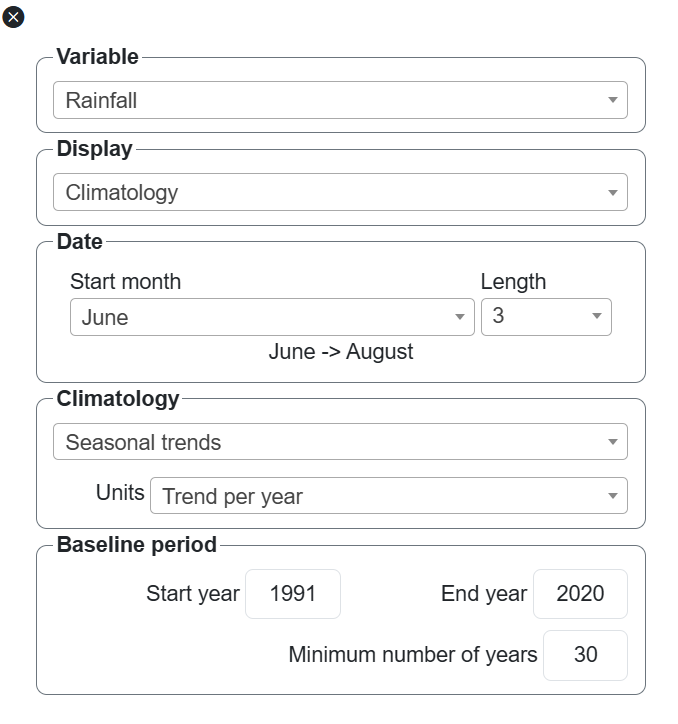
    </td>
    <td width="65%" valign="top">
      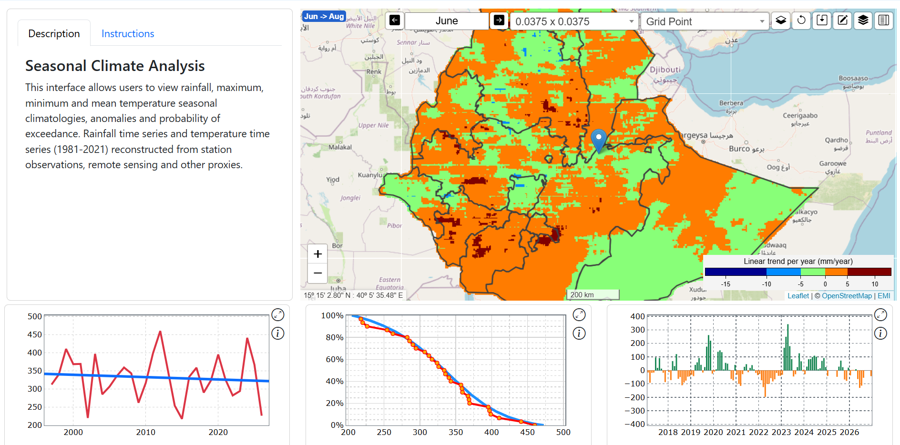
    </td>
  </tr>
</table>

*Figure 3.1. Seasonal rainfall trends. The controls select Rainfall, Climatology, June–August, Seasonal trends, and Trend per year. The historical period is 1991–2020, with a minimum of 30 years.*

The map displays the fitted change in June–August rainfall across 1991–2020.

The legend is expressed in mm/year, with labeled values from approximately −15 to +10 mm/year:

- Positive values indicate an increasing fitted trend.
- Negative values indicate a decreasing fitted trend.
- Values near zero indicate little fitted change over the selected period.

For example, a trend of +5 mm/year represents a fitted increase of 5 mm per year in the seasonal rainfall total. A trend of −5 mm/year represents a fitted decrease of the same magnitude.

The selected grid point’s previews provide additional information:

- Time-series chart: Seasonal totals range approximately from 220 to 460 mm. The blue fitted line decreases slightly, from around 340 mm to approximately 320 mm across the displayed years.
- Probability chart: The estimated exceedance probability decreases as the rainfall threshold increases. Around 450 mm, the curves indicate probabilities of only a few percent.
- Anomaly chart: Departures range approximately from −200 to +350 mm across the displayed seasonal windows.

The map and chart trends can use different historical periods. The map example uses 1991–2020, while the expanded-chart examples use 1997–2026. Match the periods before comparing trends directly.

The following maps show three other summaries of seasonal rainfall.
<table>
  <tr>
    <td width="33%" valign="top">
      
    </td>
    <td width="33%" valign="top">
      
    </td>
    <td width="33%" valign="top">
      
    </td>
  </tr>
</table>

*Figure 3.2. Comparison of average seasonal rainfall, frequency of rainfall >= 400 mm, and maximum historical seasonal rainfall.*

From left to right:

- Average rainfall: The first map shows the mean seasonal rainfall total. Its legend has labeled values from 0 to 2200 mm. A location within the 800–1000 mm interval has an average seasonal total between 800 and 1000 mm.
- Frequency of rainfall >= 400 mm: The second map shows the percentage of valid historical seasons with at least 400 mm of rainfall. Its legend runs from 0 to 100%. A frequency of 80% corresponds to 24 of 30 valid seasons meeting that condition.
- Maximum rainfall: The third map shows the highest seasonal rainfall total within the selected historical period. Its legend has labeled values from 0 to 3000 mm.

To reproduce the middle map, choose Frequency, the >= operator, and a 400 mm threshold.

The average and maximum maps express rainfall amounts in mm. The frequency map expresses how often a condition occurred, in %.

Keep the season and historical period consistent when comparing these summaries.

### 3.2. Compare seasonal rainfall between years

This example examines a June–August rainfall time series for 1997–2026.

Expand Menu 6 and select:

- Variable: Rainfall.
- Start year: 1997.
- End year: 2026.
- Season start month: June.
- Season length: 3 months.
- Plot type: Line + Points.
- Display: Terciles and Trend.

Expanded June–August rainfall time series with tercile boundaries and a fitted trend line.

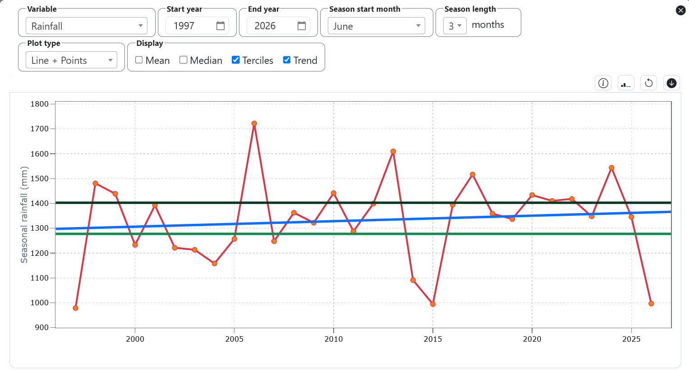

*Figure 3.3. Seasonal rainfall totals for 1997–2026 at the location represented by the chart. The red line and points show yearly totals, the green lines show tercile boundaries, and the blue line shows the fitted trend.*

Each point represents rainfall accumulated during June–August of one year.

The displayed values range approximately from 980 to 1720 mm. Prominent examples include:

- Approximately 1720 mm in 2006.
- Approximately 1610 mm in 2013.
- Approximately 1540 mm in 2024.
- Approximately 1000 mm in 2015.
- Approximately 1000 mm in 2026.

The two green tercile boundaries are approximately:

- Lower boundary: 1275 mm.
- Upper boundary: 1400 mm.

Values below the lower boundary fall within approximately the lower third of the historical distribution. Values between the boundaries fall within the middle third, and values above the upper boundary fall within the upper third.

The Mean and Median options are not selected in this figure. The horizontal green lines therefore represent tercile boundaries.

The blue fitted trend line rises slightly, from approximately 1300 mm near the beginning of the record to around 1360 mm near the end.

This chart illustrates another selected-location example. Confirm the location and period in chart information before comparing its rainfall amounts with another figure.

### 3.3. Examine the historical rainfall distribution

This example examines the distribution of seasonal rainfall using the CDF and PDF displays.

Expand Menu 7 and select the required location, Rainfall, 1997–2026, a June start month, and a season length of 3 months.
<table>
  <tr>
    <td width="50%" valign="top">
      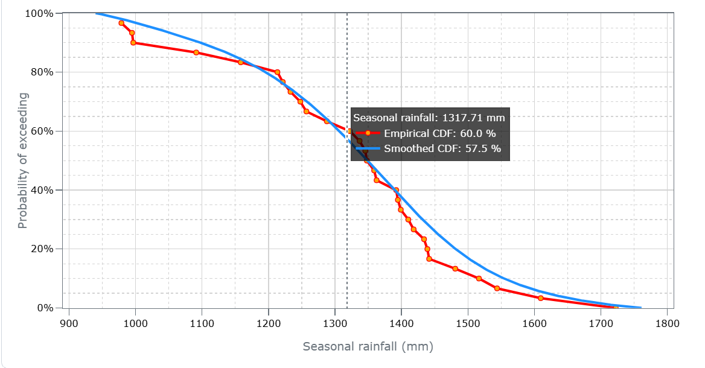
    </td>
    <td width="50%" valign="top">
      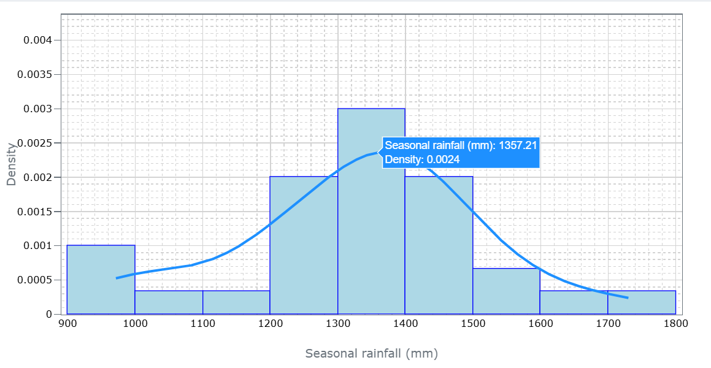
    </td>
  </tr>
</table>

*Figure 3.4. Seasonal rainfall probability displays. The left panel shows exceedance probability; the right panel shows the histogram and probability density curve.*

CDF: probability of exceeding a rainfall amount

In the left panel, the horizontal axis represents seasonal rainfall in millimeters, and the vertical axis represents Probability of exceeding.

At 1317.71 mm, the tooltip reports:

| Curve | Exceedance probability |
|---|---:|
| Empirical CDF | 60.0% |
| Smoothed CDF | 57.5% |

These readings indicate an estimated historical exceedance probability of approximately 58–60% near a seasonal rainfall amount of 1318 mm.

The empirical and smoothed curves provide different representations of the historical distribution.

PDF: concentration of seasonal rainfall values

In the right panel, the horizontal axis again represents seasonal rainfall in millimeters, while the vertical axis represents density.

At 1357.21 mm, the tooltip reports a density of 0.0024.

The tallest histogram interval is approximately 1300–1400 mm, with a density near 0.003. The blue density curve also peaks in this part of the distribution.

These features indicate that rainfall totals around 1300–1400 mm are more concentrated in the historical sample than totals near either end of the displayed range.

The CDF helps answer a threshold question, such as how likely rainfall was to exceed a selected amount. The PDF helps identify the range in which seasonal rainfall values were most concentrated.

The probability associated with a rainfall interval is represented by the area under the density curve over that interval.

### 3.4. Examine seasonal maximum-temperature anomalies

This example examines departures in the seasonal maximum-temperature series using three-month windows.

Expand Menu 8 and select:

- Variable: Maximum temperature.
- Season length: 3 months.
- Anomaly: Percentage of mean.
- Display: One serie.

Review the reference years and minimum number of years using Set base period.

Seasonal maximum-temperature anomalies with a tooltip identifying July–September 2015.

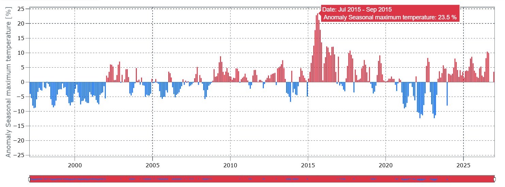

*Figure 3.5. Three-month maximum-temperature anomalies expressed as percentage departures from the reference mean. The highlighted window is July–September 2015.*

The highlighted tooltip reports:

- Season: July 2015–September 2015.
- Maximum-temperature anomaly: +23.5%.

In the current calculation, Percentage of mean expresses percentage departure from the reference mean.

The highlighted value therefore indicates that the July–September 2015 seasonal maximum-temperature value was 23.5% above the corresponding reference average.

Read the bars as follows:

- Red bars above zero: Values above the reference average.
- Blue bars below zero: Values below the reference average.
- Values near zero: Conditions close to the reference average.

The chart contains negative departures approaching approximately −12% around 2022–2023, while the highlighted positive departure reaches +23.5% in 2015.

For example, a departure of −10% indicates a seasonal value 10% below its reference mean.

The vertical axis is expressed in percentages. Select Deviation from mean to express temperature departures in °C, or Standardized anomaly to express them relative to the reference standard deviation.

With One serie selected, the chart contains successive three-month windows. Adjacent windows overlap, and each tooltip identifies the window’s start and end.

The highlighted July–September season differs from the June–August season used in the earlier rainfall examples.

For comparison of one fixed season between years, select By season and choose the required season. Keep the variable, season length, anomaly method, location, and baseline consistent.
