# Climate Teleconnections Maproom

## 1. Overview

The Climate Teleconnections Maproom examines relationships between local rainfall or temperature and large-scale climate patterns.

Teleconnections describe links between climate conditions in geographically separated regions. This Maproom uses historical records to investigate how seasonal conditions vary with phases of indices such as:

- El Niño–Southern Oscillation (ENSO).
- Indian Ocean Dipole (IOD).
- North Atlantic Oscillation (NAO).
- ATL3.

The rainfall and temperature records shown in the interface cover historical conditions from 1981 onward. They were reconstructed from station observations, remote sensing, and other proxies.

Use this Maproom to investigate:

- How seasonal rainfall or temperature differs between climate phases.
- The historical probability of dry, normal, or wet conditions during El Niño or La Niña.
- Whether a rainfall threshold was more frequently exceeded during one phase.
- Historical seasons that provide context for a current climate situation.
- Current ENSO information alongside historical local climate relationships.

The applications below focus on climatology and the relevance of a very strong El Niño outlook for 2026.

Open the Climate Teleconnections Maproom (http://213.55.84.78:8484/maproom_pages?maproom=climate&component=analysis&page=teleconnections).

The main areas of the page are identified below.

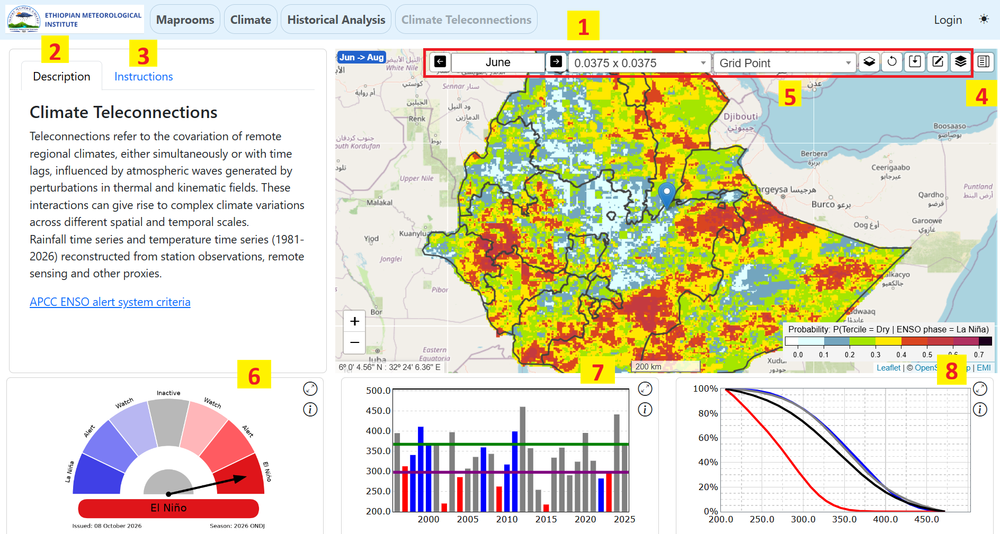

*Figure 1.1. Main areas of the Climate Teleconnections Maproom. The illustrated map shows the historical probability of the dry rainfall tercile during La Niña for June–August.*

- Menu 1: Navigation path to the Climate Teleconnections page.
- Menu 2: Description of the Maproom and its data.
- Menu 3: General instructions for using the Maproom.
- Menu 4: Button for opening the map controls.
- Menu 5: Toolbar for changing the season and interacting with the map.
- Menu 6: Climate-index or ENSO-information preview, which can be expanded.
- Menu 7: Seasonal time-series preview, which can be expanded.
- Menu 8: Probability-of-exceedance preview, which can be expanded.

The map shows historical conditional probabilities across the country. The seasonal and probability charts describe the selected grid point or geographic area.

The climate-index panel provides additional information about the large-scale climate situation. Its forecast issue date and target season should be read separately from the map’s historical analysis period.

For shared navigation, location selection, map layers, chart appearance, and downloading results, see Navigating Maprooms [Navigating Maprooms](common-navigation.md).

## 2. Settings

### 2.1. Map control

Select Menu 4 to open the map controls.

The example below selects Rainfall, Total rainfall, and the historical probability of the Wet tercile during El Niño.

<table>
  <tr>
    <td width="40%" valign="top">
      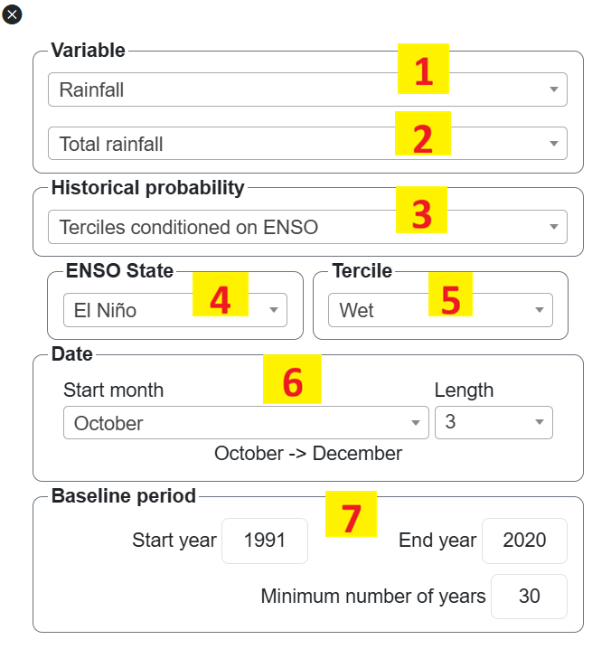
    </td>
    <td width="60%" valign="top">

  
<strong>1. Variable:</strong> Choose <strong>Rainfall</strong> or <strong>Temperature</strong>.

<strong>2. Climate quantity:</strong> For Rainfall, select <strong>Total rainfall</strong>. For Temperature, choose <strong>Maximum temperature</strong>, <strong>Mean temperature</strong>, or <strong>Minimum temperature</strong>.

<strong>3. Historical probability:</strong> Choose <strong>Terciles conditioned on ENSO</strong>, <strong>Terciles conditioned on IOD</strong>, <strong>Terciles conditioned on NAO</strong>, or <strong>Terciles conditioned on ATL3</strong>. Availability depends on the indices enabled for the installation.

<strong>4. Climate-index phase:</strong> For ENSO, choose <strong>La Niña</strong>, <strong>Neutral</strong>, or <strong>El Niño</strong>. For IOD, NAO, or ATL3, choose <strong>Negative</strong>, <strong>Neutral</strong>, or <strong>Positive</strong>. The field label changes with the selected index.

  
<strong>5. Tercile:</strong> For rainfall, choose <strong>Dry</strong>, <strong>Normal</strong>, or <strong>Wet</strong>. For temperature, the choices are <strong>Cold</strong>, <strong>Normal</strong>, or <strong>Hot</strong>.

  
<strong>6. Date:</strong> Select the season’s start month and length. In this example, <strong>October</strong> and <strong>3 months</strong> define October–December.

  
<strong>7. Baseline period:</strong> Set the start year, end year, and minimum number of valid years required for the climate calculation. The illustrated baseline is <strong>1991–2020</strong>, with a minimum of <strong>30 years</strong>.

</td>
  </tr>
</table>

*Figure 2.1. Controls for the historical probability of wet October–December conditions during El Niño.*

The analysis first separates historical seasonal values into terciles:

| Rainfall category | Position in the historical distribution |
|---|---|
| Dry | Approximately the lower third. |
| Normal | Approximately the middle third. |
| Wet | Approximately the upper third. |

For temperature, the equivalent categories are Cold, Normal, and Hot.

These categories are relative to the selected location, season, and historical record. The rainfall amount defining a wet season can therefore differ between locations.

The map then estimates the probability of the selected category among seasons classified in the selected climate phase.

For example:

    P(Wet | El Niño) means the historical probability of
    a wet-category season among the seasons classified as El Niño.

The minimum-year setting applies to the climate record used by the analysis. The phase-conditioned subset contains only the historical seasons matching the selected phase.

Close the panel to update the map. Use Redraw map if another update is required.

### 2.2. Chart control

#### 2.2.1. Climate indices and ENSO information

Climate-index controls showing the available ENSO and other index products.

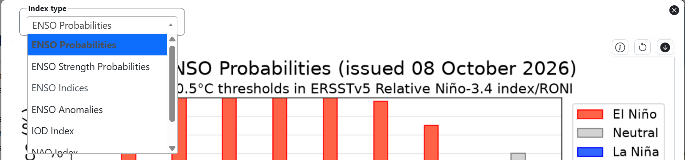

*Figure 2.2. Index-type selection in the expanded climate-information panel.*

Select Menu 6 to expand the climate-information panel.

The available index types include:

- ENSO Probabilities: Probabilities of El Niño, Neutral, and La Niña.
- ENSO Strength Probabilities: Probabilities of different ENSO intensity categories.
- ENSO Indices: Index series such as ONI or RONI.
- ENSO Anomalies: Available sea-surface-temperature anomaly products.
- IOD Index.
- NAO Index.
- ATL3 Index.

Additional controls depend on the selected index type:

| Control | Available options and when they appear |
|---|---|
| ENSO Indices | For ENSO Indices, choose Oceanic Niño Index (ONI) or Relative Oceanic Niño Index (RONI). |
| Temporal Resolution | For ENSO Anomalies, choose Weekly or Monthly. |
| SST Products — weekly anomalies | NOAA CPC OISSTv2.1. |
| SST Products — monthly anomalies | NOAA CPC OISSTv2.1, NOAA CPC ERSSTv5, NOAA NCEI ERSSTv5, or NOAA NCEI ERSSTv6. |
| SST Products — IOD | NOAA NCEI ERSSTv5 or NOAA NCEI ERSSTv6. |
| Anomalies | SST Anomalies or Relative SST Anomalies, subject to availability in the selected product. |
| Niño Region | Niño 1+2, Niño 3, Niño 3.4, or Niño 4, subject to the selected product and anomaly type. |
| Start and End | Select the displayed period for historical index and anomaly series. |
| Display | Choose Interactive Chart or PNG Image for historical index and anomaly series. |
| Display last value | Available when PNG Image is selected; show the latest value on the image. |

The available anomaly types and Niño regions update when the SST product changes. ENSO Probabilities and ENSO Strength Probabilities display the outlook images without these historical-series controls.

Read the index name and product carefully. For example, the strength outlook used in the application below is based on RONI, while the historical teleconnection selector is labeled ENSO – Oceanic Niño Index (ONI).

The following exported figure illustrates the NAO option.

Historical North Atlantic Oscillation index with reference lines at minus 0.5, zero, and plus 0.5.

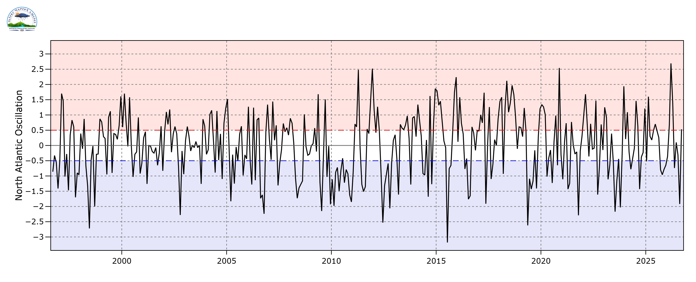

*Figure 2.3. Example of a historical climate-index series: the North Atlantic Oscillation.*

The graph displays reference lines at approximately −0.5, 0, and +0.5. The visible record includes negative excursions near −3.2 and positive excursions around +2.5 to +2.7.

This panel helps examine the selected climate index through time. Check the index type before relating it to a local rainfall or temperature analysis.

#### 2.2.2. Seasonal time-series chart

Controls for the seasonal time series classified by a selected teleconnection index.

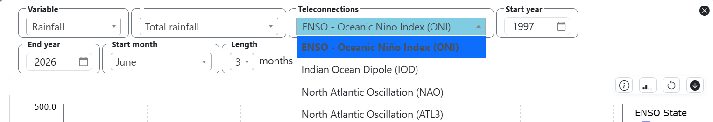

*Figure 2.4. Seasonal time-series controls. The example selects Rainfall, Total rainfall, ENSO–ONI, 1997–2026, and a three-month season beginning in June.*

Select Menu 7 to expand the seasonal time series.

The controls include:

- **Variable**: Rainfall or Temperature.
- **Climate quantity**: Total rainfall or an available temperature quantity.
- **Teleconnections**: Select ENSO, IOD, NAO, or ATL3 where available.
- **Start year and End year**: Define the historical period.
- **Start month and Length**: Define the season.
- **Climate quantity:** For Rainfall, select **Total rainfall**. For Temperature, choose **Maximum temperature**, **Mean temperature**, or **Minimum temperature**.

For ENSO, the bars are classified by phase:

- Blue: La Niña.
- Gray: Neutral.
- Red: El Niño.

The horizontal tercile lines identify the boundaries between the lower, middle, and upper parts of the historical climate distribution.

The chart’s historical period can differ from the map baseline. Check both before comparing their numerical results.

#### 2.2.3. Probability-of-exceedance chart

Controls for the probability-of-exceedance chart conditioned on climate-index phases.

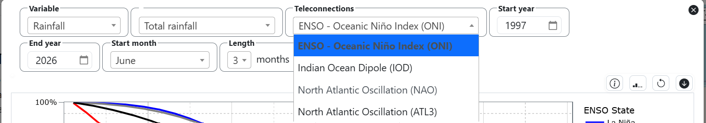

*Figure 2.5. Probability-chart controls. The example selects Rainfall, Total rainfall, ENSO–ONI, 1997–2026, and June–August.*

Select Menu 8 to expand the probability chart.

Choose the variable, climate quantity, teleconnection index, historical years, start month, and season length.

For ENSO, the chart compares:

- Blue curve: La Niña seasons.
- Gray curve: Neutral seasons.
- Red curve: El Niño seasons.
- Black curve: All years combined.

The horizontal axis shows the selected climate quantity. For total rainfall, its units are millimeters.

The vertical axis shows Probability of exceeding, expressed as a percentage.

Move the pointer over the chart to compare the phase-conditioned probabilities at the same rainfall amount.

## 3. Application

### 3.1. Establish the 2026 El Niño context

This application asks:

Given a very strong El Niño outlook for late 2026, what do historical records suggest about local seasonal rainfall?

Begin by reviewing the ENSO information in Menu 6.

Select ENSO Strength Probabilities and read the product’s issue date and target seasons.

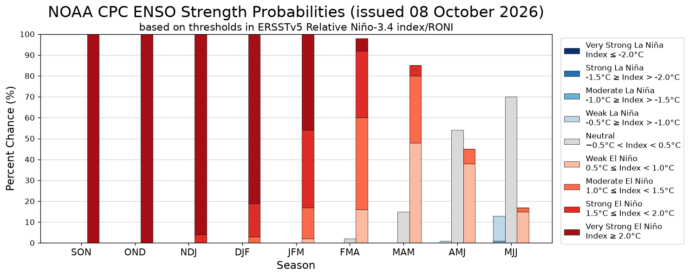

*Figure 3.1. ENSO strength outlook issued on 8 October 2026, based on thresholds in the ERSSTv5 relative Niño-3.4 index, or RONI.*

The legend distinguishes El Niño strength categories:

| Category | Index range shown in the figure |
|---|---|
| Weak El Niño | 0.5°C to below 1.0°C. |
| Moderate El Niño | 1.0°C to below 1.5°C. |
| Strong El Niño | 1.5°C to below 2.0°C. |
| Very Strong El Niño | 2.0°C or greater. |

In this dated outlook, the Very Strong El Niño category accounts for approximately:

- 100% for SON: September–November 2026.
- 100% for OND: October–December 2026.
- 96% for NDJ: November 2026–January 2027.

These are forecast probabilities from the product issued on 8 October 2026. Retain that issue date when interpreting or sharing the figure.

For the local application, the relevant question becomes whether the historical rainfall distribution shifts toward wetter or drier conditions during El Niño for the season of interest.

The map controls select El Niño as a phase. They do not separately filter the historical map to Very Strong El Niño events. The strength outlook provides the 2026 context, while the map examines the historical El Niño-conditioned relationship.

### 3.2. Examine wet-season probability during El Niño

This example focuses on November–January, a three-month season crossing the calendar-year boundary.

For the 2026 application, that target season is November 2026–January 2027.
<table>
  <tr>
    <td width="35%" valign="top">
      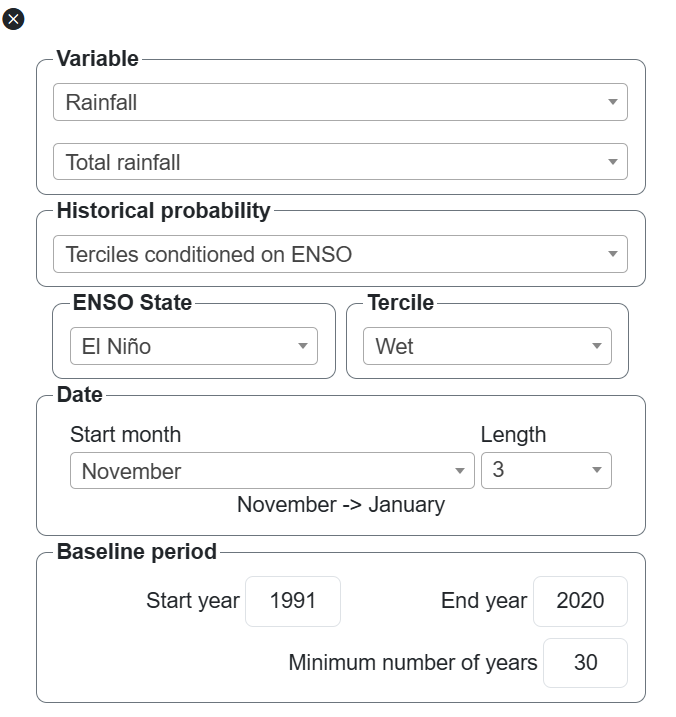
    </td>
    <td width="65%" valign="top">
      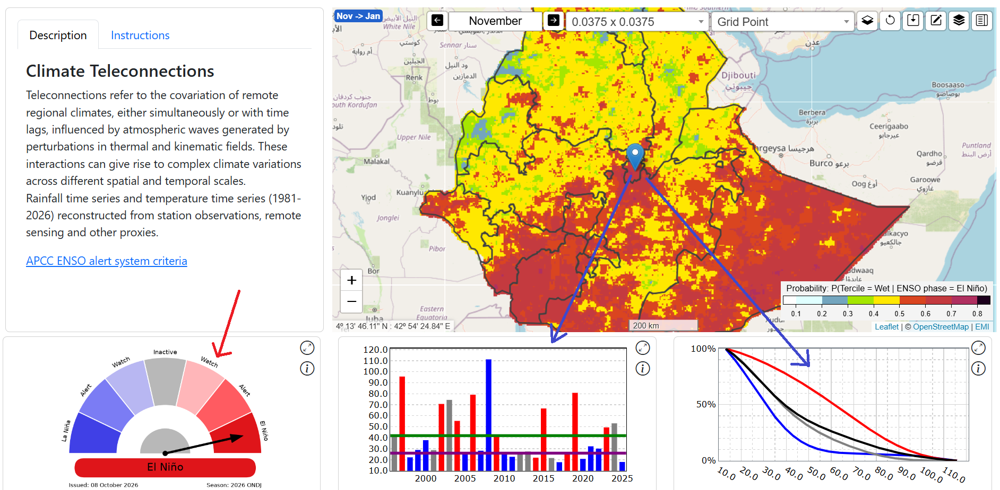
    </td>
  </tr>
</table>

Figure 3.2. Historical wet-tercile probability during El Niño for November–January. The baseline is 1991–2020, with a minimum of 30 years.

Select:

- Variable: Rainfall.
- Climate quantity: Total rainfall.
- Historical probability: Terciles conditioned on ENSO.
- ENSO State: El Niño.
- Tercile: Wet.
- Start month: November.
- Length: 3 months.
- Baseline: 1991–2020.
- Minimum number of years: 30.

The map displays:

P(Wet | El Niño)

for the November–January season.

The legend uses fractions, with labeled values from approximately 0.1 to 0.8:

- 0.3 represents a probability of 30%.
- 0.5 represents 50%.
- 0.6 represents 60%.
- 0.8 represents 80%.

For example, a location within the 0.5–0.6 interval has an estimated historical wet-tercile probability between 50% and 60% during El Niño.

The map shows substantial geographic differences. Some areas have higher wet-tercile probabilities than others, even though the same ENSO phase and season are selected.

The wet category is defined relative to each location’s climatology. A 60% wet-tercile probability describes how often an upper-tercile season occurred during El Niño; it does not specify one rainfall amount applicable across the country.

A grid point is selected on the map. Its seasonal and probability previews provide the local rainfall amounts associated with the historical relationship.

The ENSO gauge shown in the page is dated 8 October 2026 and identifies its own target period. Read that label separately from the map’s November–January season.

### 3.3. Compare historical El Niño seasons and rainfall probabilities

Expand Menu 7 to examine historical seasonal rainfall at the selected location.

Choose Rainfall, Total rainfall, ENSO–ONI, and the required historical period. Keep the season at November–January for comparison with the preceding example.

Historical seasonal rainfall classified by ENSO phase, with annotated El Niño seasons and tercile boundaries.

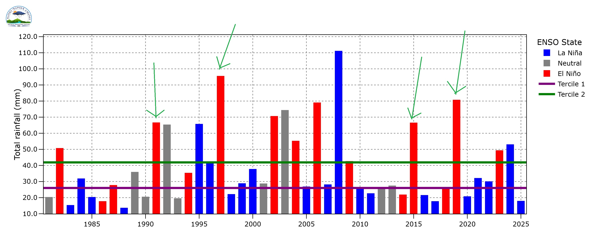

*Figure 3.3. Historical seasonal rainfall classified by ENSO phase. The green annotations highlight selected past El Niño seasons.*

The bar colors identify the ENSO classification:

- Blue: La Niña.
- Gray: Neutral.
- Red: El Niño.

The displayed tercile boundaries are approximately:

- Lower boundary: 26 mm, shown by the purple line.
- Upper boundary: 42 mm, shown by the green line.

For this displayed historical distribution:

- Values below approximately 26 mm fall in the lower rainfall tercile.
- Values between approximately 26 and 42 mm fall in the middle tercile.
- Values above approximately 42 mm fall in the upper rainfall tercile.

The annotated El Niño-classified seasons include approximately:

| Year shown | Seasonal rainfall |
|---|---:|
| 1991 | 67 mm |
| 1997 | 96 mm |
| 2015 | 67 mm |
| 2019 | 81 mm |

These examples exceed the displayed upper-tercile boundary.

The record also contains a La Niña-classified season around 2008 with approximately 111 mm. Individual outcomes therefore vary within each phase.

Use the historical series to examine the range of outcomes, rather than assigning one rainfall amount to every El Niño season.

The export provides historical analogues for interpreting the 2026 situation. Its annotated bars identify past seasons; it does not show a separate numerical 2026 rainfall prediction.

To compare the historical distributions more directly, expand Menu 8.

Rainfall exceedance probabilities for La Niña, Neutral, El Niño, and all years, with a tooltip at 54.16 mm.

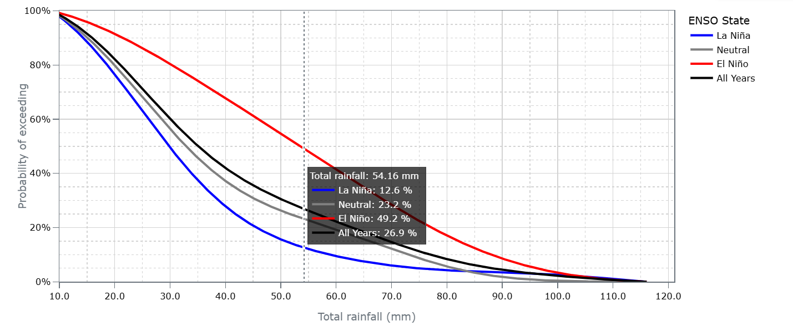

*Figure 3.4. Phase-conditioned rainfall exceedance probabilities at the location represented by the chart.*

At 54.16 mm, the tooltip reports:

| Historical group | Probability of exceeding 54.16 mm |
|---|---:|
| La Niña | 12.6% |
| Neutral | 23.2% |
| El Niño | 49.2% |
| All Years | 26.9% |

At this rainfall threshold, the El Niño-conditioned exceedance probability is approximately 49%, compared with approximately 27% for all years combined.

The difference is 22.3 percentage points.

The El Niño curve is close to 50% at approximately 54 mm, placing this amount near the median of the El Niño-conditioned distribution shown.

This threshold is different from the approximately 42 mm upper-tercile boundary in the historical bar chart. A probability of exceeding a specified amount and a probability of belonging to the wet tercile answer related but distinct questions.

Before comparing the map, bar chart, and probability curves, match their:

- Selected location.
- Climate quantity.
- Season.
- Historical period.
- Climate index and phase definition.

For the 2026 very strong El Niño application, these historical results provide context for how the local rainfall distribution has differed during El Niño. Retain the distinction between the ENSO outlook and the local historical conditional probabilities.

### 3.4. Read supporting historical rainfall-anomaly maps

The following figures illustrate three ways of expressing historical monthly rainfall anomalies.

They provide supporting examples of how departures from climatology can be represented. Their legends identify them as monthly rainfall anomalies, rather than ENSO-conditioned probability maps.
<table>
  <tr>
    <td width="33%" valign="top">
      
    </td>
    <td width="33%" valign="top">
      
    </td>
    <td width="33%" valign="top">
      
    </td>
  </tr>
</table>

*Figure 3.5. Supporting examples of monthly rainfall anomalies: standardized anomaly, departure in millimeters, and percentage departure.*

From left to right:

- Standardized anomaly: The legend includes labeled values from approximately −2 to +12. A value of +2 represents rainfall two reference standard deviations above the mean.
- Departure from mean: The legend includes labeled values from approximately −100 to +400 mm. A value of +200 mm represents rainfall 200 mm above the reference average.
- Percentage departure: The legend includes labeled values from approximately −200 to +1800%. A value of +200% represents rainfall three times the reference mean.

Large percentage departures can occur where reference rainfall is small. Examine the departure in millimeters alongside the percentage when assessing its magnitude.

These anomaly maps describe historical departures. The ENSO-conditioned maps and charts provide the separate analysis of how such climate outcomes vary with the selected climate phase.

