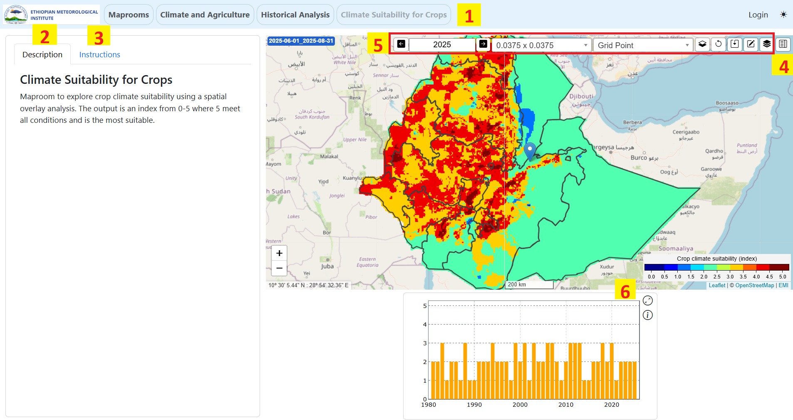
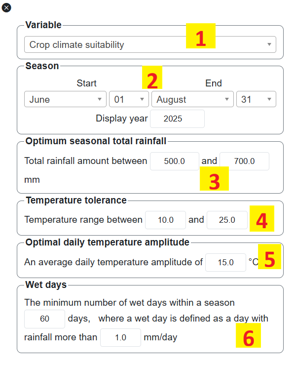
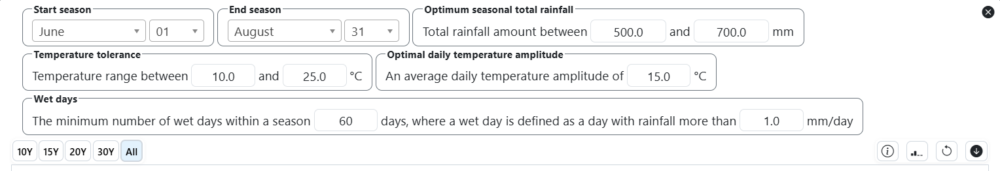
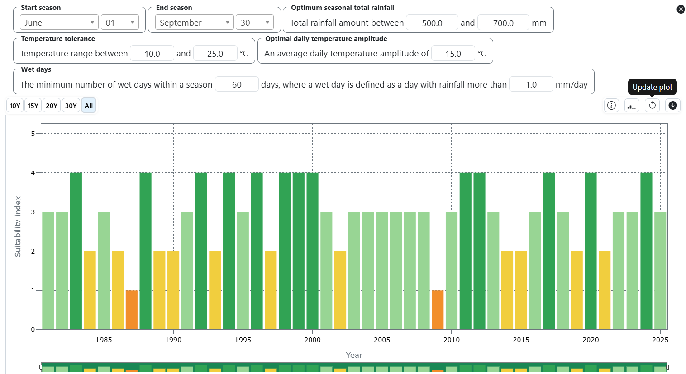

# Climate Suitability for Crops Maproom

## 1. Overview

The Climate Suitability for Crops Maproom, within **Climate and Agriculture → Historical Analysis**, explores whether rainfall and temperature during a selected season meet user-defined climate requirements. It provides a suitability map for a selected year, supporting rainfall and temperature maps, and a historical suitability chart for a selected grid point.

The suitability index ranges from **0 to 5**. Each of five conditions contributes one point when satisfied: seasonal rainfall amount, average daily maximum temperature, average daily minimum temperature, average daily temperature amplitude, and the number of wet days. A score of **5** means all five selected conditions are met.

Use this Maproom to investigate:

- Where a selected season meets the climate requirements entered in the controls.
- How rainfall and temperature help explain geographic differences in suitability.
- How suitability changes between years at a selected grid point.
- How changing the season or climate thresholds changes the result.

The criteria are entered numerically; there is no named-crop selector. Choose values appropriate to the crop and purpose of the assessment. The index counts climate conditions met and does not represent a yield estimate or probability of crop success.

Open the [Climate Suitability for Crops Maproom](http://213.55.84.78:8484/maproom_pages?maproom=agriculture&component=analysis&page=crops-suitability).

*Figure 1.1. Main areas of the Climate Suitability for Crops Maproom. The illustrated map covers June 1–August 31, 2025, with a selected grid point and historical chart preview.*

- **Menu 1:** Navigation path to Climate Suitability for Crops.
- **Menu 2:** Description of the suitability analysis and index.
- **Menu 3:** General instructions for using the Maproom.
- **Menu 4:** Button for opening the map controls.
- **Menu 5:** Toolbar for navigating between years, selecting a grid point, and accessing map tools.
- **Menu 6:** Historical suitability chart preview, which can be expanded.

The illustrated grid resolution is **0.0375° × 0.0375°**. Select a grid point to examine its historical suitability scores. The chart represents that point rather than a zone or regional average.

For shared navigation, map layers, chart appearance, information tools, and downloading results, see [Navigating Maprooms](common-navigation.md).

## 2. Settings

### 2.1. Map control

Select **Menu 4** to choose the mapped variable, season, display year, and climate requirements.

<table>
  <tr>
    <td width="40%" valign="top">
      
    </td>
    <td width="60%" valign="top">
      <h3>Map control menu</h3>
      
<strong>1. Variable:</strong> Choose <strong>Crop climate suitability</strong>, <strong>Rainfall</strong>, <strong>Maximum temperature</strong>, or <strong>Minimum temperature</strong>.

      
<strong>2. Season:</strong> Select the start month and day, end month and day, and <strong>Display year</strong>. The illustration uses <strong>June 1–August 31, 2025</strong>.

      
<strong>3. Optimum seasonal total rainfall:</strong> Enter the lower and upper rainfall totals, in millimeters. The illustrated range is <strong>500–700 mm</strong>.

      
<strong>4. Temperature tolerance:</strong> Enter the lower and upper temperature limits. The illustrated values are <strong>10°C</strong> and <strong>25°C</strong>. These are applied to the seasonal averages of daily minimum and maximum temperature, respectively.

      
<strong>5. Optimal daily temperature amplitude:</strong> Enter the upper limit for the seasonal average of daily maximum minus daily minimum temperature. The illustrated value is <strong>15°C</strong>.

      
<strong>6. Wet days:</strong> Enter the minimum number of wet days and the daily rainfall threshold defining a wet day. The illustration requires at least <strong>60 wet days</strong>, with a threshold of <strong>1.0 mm/day</strong>.

    </td>
  </tr>
</table>

*Figure 2.1. Map controls. The example assesses June–August 2025 using a rainfall range of 500–700 mm, temperature limits of 10°C and 25°C, a daily temperature-amplitude limit of 15°C, and at least 60 wet days.*

#### 2.1.1. All variable choices

| Variable | Information shown | Units |
|---|---|---|
| Crop climate suitability | Number of the five selected conditions met during the season. | Index from **0 to 5**. |
| Rainfall | Rainfall accumulated over the selected season. | **mm**. |
| Maximum temperature | Average of daily maximum temperature over the selected season. | **°C**. |
| Minimum temperature | Average of daily minimum temperature over the selected season. | **°C**. |

The temperature maps show seasonal averages of daily maximum or minimum temperature, rather than the single hottest or coldest day.

The map represents the selected season and year. There is no Climatology, Anomaly, or probability-display selector on this page.

#### 2.1.2. All season and threshold fields

| Group | Field | Illustrated value |
|---|---|---|
| Season | Start month | **June**. |
| Season | Start day | **01**. |
| Season | End month | **August**. |
| Season | End day | **31**. |
| Season | Display year | **2025**. |
| Optimum seasonal total rainfall | Lower rainfall total | **500.0 mm**. |
| Optimum seasonal total rainfall | Upper rainfall total | **700.0 mm**. |
| Temperature tolerance | Lower temperature limit | **10.0°C**. |
| Temperature tolerance | Upper temperature limit | **25.0°C**. |
| Optimal daily temperature amplitude | Average daily amplitude limit | **15.0°C**. |
| Wet days | Minimum wet-day count | **60 days**. |
| Wet days | Daily rainfall threshold | **1.0 mm/day**. |

Choose a calendar month and an available day for each endpoint. The display-year range depends on available data. Use the previous and next arrows in **Menu 5** to examine another year while retaining the seasonal definition.

Both endpoints are included. **June 1–August 31** contains **92 days**. If the end month and day precede the start, the season crosses into the following year. For example, October 1–March 31 with Display year 2025 represents October 2025–March 2026, subject to available data.

#### 2.1.3. Conditional behavior when changing Variable

| Selected variable | Inputs used for the map calculation |
|---|---|
| Crop climate suitability | Season, display year, rainfall limits, temperature limits, temperature-amplitude limit, minimum wet-day count, and wet-day rainfall threshold. |
| Rainfall | Season and display year; the suitability thresholds do not filter or classify the rainfall map. |
| Maximum temperature | Season and display year; the suitability thresholds do not alter the displayed temperature average. |
| Minimum temperature | Season and display year; the suitability thresholds do not alter the displayed temperature average. |

The climate-requirement fields remain visible when a supporting rainfall or temperature variable is selected. They contribute to the suitability index when **Crop climate suitability** is selected; they do not create additional threshold maps for the supporting variables.

No additional probability, crop-name, or baseline-period selector appears after changing Variable. Use **Grid Point** for the suitability chart; administrative-area aggregation is not provided by the current suitability calculation.

Close the panel to update the map. Use **Redraw map** if another refresh is required. Check the legend title and units after changing Variable.

#### 2.1.4. How the five conditions produce the index

For the illustrated controls, each condition contributes either **0** or **1**:

| Condition | Requirement for one point |
|---|---|
| Seasonal total rainfall | Total rainfall is **at least 500 mm and at most 700 mm**. |
| Maximum-temperature tolerance | Average daily maximum temperature is **25°C or lower**. |
| Minimum-temperature tolerance | Average daily minimum temperature is **10°C or higher**. |
| Daily temperature amplitude | Average daily maximum minus daily minimum temperature is **15°C or lower**. |
| Wet-day count | At least **60 days** have rainfall **greater than or equal to 1.0 mm/day**. |

The rainfall range is one condition, despite having two limits. The two temperature-tolerance limits contribute separate points. All five conditions receive equal weight.

The menu describes a wet day using “more than,” but the calculation includes rainfall equal to the entered threshold. With **1.0 mm/day** entered, a day recording exactly **1.0 mm** qualifies.

The temperature-amplitude value is an upper limit in the calculation. It does not require the average amplitude to equal exactly 15°C.

| Score | Interpretation |
|---|---|
| 0 | None of the five conditions is met. |
| 1 | One condition is met. |
| 2 | Two conditions are met. |
| 3 | Three conditions are met. |
| 4 | Four conditions are met. |
| 5 | All five conditions are met. |

The map legend includes half-unit marks, such as **2.5** and **3.5**, to show color intervals. Valid calculated scores are whole numbers. A score of **4** does not identify which condition failed; inspect the supporting climate information and selected criteria.

### 2.2. Chart control

Select a grid point, then expand **Menu 6** to examine its historical suitability scores.

*Figure 2.2. Expanded suitability-chart controls. The illustrated season is June 1–August 31, with the same numerical climate requirements as Figure 2.1.*

The complete analysis controls are:

| Control | Available settings | Illustrated values |
|---|---|---|
| Start season | Start month and day. | **June 01**. |
| End season | End month and day. | **August 31**. |
| Optimum seasonal total rainfall | Lower and upper rainfall totals, in mm. | **500–700 mm**. |
| Temperature tolerance | Lower minimum-temperature limit and upper maximum-temperature limit. | **10–25°C**. |
| Optimal daily temperature amplitude | Upper limit for average daily maximum minus minimum temperature. | **15°C**. |
| Wet days | Minimum wet-day count and daily rainfall threshold. | **60 days**, with rainfall **at least 1.0 mm/day**. |

The expanded chart always calculates the **suitability index** for each available year. It has no separate Variable, Display year, baseline-period, CDF/PDF, or plot-type selector. Its controls define the recurring season and the five scoring conditions.

Review the chart's values independently of the map. The map's Display year selects one mapped season; it does not restrict the historical chart to that year. The expanded chart has its own season and threshold inputs.

After changing a setting, select **Update plot**, represented by the circular-arrow button. Use **10Y**, **15Y**, **20Y**, **30Y**, or **All**, and the slider below the plot, to change the visible historical interval. These tools change the view rather than define a climatological baseline.

Hover over a bar to read its year and exact score. The information, appearance, and download buttons provide the shared chart tools described in [Navigating Maprooms](common-navigation.md).

### 2.3. Interpreting data coverage and climate suitability

The current calculation requires **95% data coverage** for the relevant seasonal inputs. This is a fixed requirement rather than a user-selectable control. Missing or incomplete rainfall and temperature can produce a missing result; distinguish missing data from a valid score of **0**.

Higher scores indicate that more of the selected climate conditions are met. The index does not include every factor affecting crop performance, such as soil fertility, irrigation, pests, or management. Keep the criteria, season, year, and location with each exported result.

## 3. Application

### 3.1. Use rainfall and temperature requirements to map crop suitability

This example follows the process from the rainfall and temperature information to the final crop suitability map for **June 1–August 31, 2025**. The user-defined requirements determine which conditions are satisfied and therefore the suitability score at each location.

Begin by setting the season to **June 01–August 31** and Display year to **2025**. Select **Rainfall**, **Maximum temperature**, and **Minimum temperature** in turn, keeping the same season and year, to examine the three supporting maps.

<table>
  <tr>
    <td width="33%" valign="top">
      <h3>Total rainfall</h3>
      
    </td>
    <td width="33%" valign="top">
      <h3>Maximum temperature</h3>
      
    </td>
    <td width="33%" valign="top">
      <h3>Minimum temperature</h3>
      
    </td>
  </tr>
</table>

*Figure 3.1. Rainfall and temperature information for June–August 2025. The underlying daily rainfall and temperature data are assessed against the selected requirements to calculate the final suitability map.*

The legends provide different physical quantities:

| Map | Visible legend labels | Connection to the suitability criteria |
|---|---|---|
| Total rainfall | **0–1800 mm**, generally in **200 mm** increments. | Compare the local amount with the required **500–700 mm** interval. |
| Maximum temperature | **10–45°C**, in **5°C** increments. | Compare the seasonal average with the upper limit of **25°C**. |
| Minimum temperature | **0–35°C**, in **5°C** increments. | Compare the seasonal average with the lower limit of **10°C**. |

For example, **600 mm** meets the illustrated rainfall condition, while **1000 mm** exceeds its upper limit. Higher rainfall does not automatically increase suitability when a bounded rainfall range is used.

An average daily maximum of **24°C** meets the upper-temperature condition, while **30°C** does not. An average daily minimum of **12°C** meets the lower-temperature condition, while **8°C** does not. These values illustrate the selected rules rather than exact readings for a named location in the figures.

Next, select **Crop climate suitability** and enter the requirements used to assess this rainfall and temperature information:

1. Set the optimum seasonal total rainfall range to **500–700 mm**.
2. Enter **10°C** as the lower temperature-tolerance limit and **25°C** as the upper limit.
3. Set the average daily temperature-amplitude limit to **15°C**.
4. Require at least **60 wet days**, with rainfall **greater than or equal to 1.0 mm/day** defining a wet day.
5. Keep **June 1–August 31, 2025** unchanged and close the panel to update the map.

The application evaluates the underlying daily data against all five conditions: the rainfall range, maximum-temperature limit, minimum-temperature limit, average daily temperature-amplitude limit, and wet-day count. Each condition met contributes one point. The three supporting maps help explain the rainfall and temperature conditions; the daily data also provide the wet-day count and average daily temperature amplitude.

<table>
  <tr>
    <td>
      <h3>Final crop suitability map</h3>
      
    </td>
  </tr>
</table>

*Figure 3.2. Final crop climate suitability map for June–August 2025. Each location's score counts how many of the five user-defined rainfall and temperature conditions are met.*

The map shows higher-score colors across much of the western and central highland areas, with lower-score colors across much of the east. The legend is labeled from **0 to 5**, with intermediate marks every **0.5** units; calculated scores are whole numbers.

A score of **5** means all five requirements are met. A score of **3** means three requirements are met. Two locations with the same score can satisfy different combinations of conditions.

The **60-day** requirement applies within the **92-day** June–August season. It corresponds to approximately **65.2%** of the season's calendar days qualifying as wet days. The count concerns the selected rainfall threshold, not continuous rainfall throughout those days.

Changing a rainfall or temperature requirement changes the assessment and can change the final suitability map. For example, rainfall of **1000 mm** fails the illustrated **500–700 mm** condition but would meet a user-selected range of **500–1200 mm**. If all other settings remain unchanged, satisfying this additional condition increases the location's score by **one point**.

### 3.2. Examine historical suitability for June–September

Select a grid point and expand **Menu 6**. Set **Start season** to **June 01** and **End season** to **September 30**. Retain the rainfall range of **500–700 mm**, temperature limits of **10°C** and **25°C**, amplitude limit of **15°C**, and minimum of **60 wet days** with a **1.0 mm/day** threshold. Select **Update plot**.

<table>
  <tr>
    <td>
      
    </td>
  </tr>
</table>

*Figure 3.3. Expanded historical suitability chart for June 1–September 30. The visible record covers 1981–2025. Its four-month season differs from the June–August map example.*

The chart contains **45 annual bars**, covering **1981–2025**. The vertical axis is labeled from **0 to 5**, while the illustrated annual scores range from **1 to 4**.

Examples readable from the plotted bars include:

| Year | Suitability score | Interpretation |
|---|---|---|
| 1983 | **4**. | Four of the five selected conditions are met. |
| 1987 | **1**. | One condition is met. |
| 2009 | **1**. | One condition is met. |
| 2011 | **4**. | Four conditions are met. |
| 2024 | **4**. | Four conditions are met. |
| 2025 | **3**. | Three conditions are met. |

Counting the visible bars gives **2 years with score 1**, **11 with score 2**, **19 with score 3**, and **13 with score 4**. No visible year reaches **5**. These counts summarize this figure's selected point and criteria, rather than all locations in the country.

The map example covers **92 days**, while June–September covers **122 days**. Keeping the requirement at **60 wet days** changes its share of the seasonal duration from approximately **65.2%** to **49.2%**. The longer window also changes accumulated rainfall and seasonal temperature averages, so the score can change in either direction.

To compare the **2025 chart score** with the **2025 map**, use the same grid point, season endpoints, and all five conditions. Either change the expanded chart back to **August 31**, or extend the map to **September 30** and redraw it.

The expanded chart uses green for higher scores, while the illustrated map uses red and dark red. Read each figure's numerical scale rather than assuming that the same color represents the same score across outputs.

The exported chart does not show exact point coordinates. Numerical reproduction requires the same selected grid point, climate data, seasonal definition, and thresholds.
