# Rainy Season Analysis Maproom

## 1. Overview

The Rainy Season Analysis Maproom, within **Climate and Agriculture → Historical Analysis**, examines the timing and duration of rainy seasons using user-defined rainfall and water-balance criteria. It provides maps and historical charts of **rainy season onset**, **rainy season cessation**, and **rainy season length**.

The definitions determine which rainfall event qualifies as onset and which water-balance conditions qualify as cessation. You can examine typical dates, individual years, departures from average, and the historical probability of an event occurring after a selected date.

Use this Maproom to investigate:

- Spatial differences in typical onset and cessation dates.
- Early or late onset and cessation in a selected year.
- Year-to-year variability in season length.
- The historical frequency of onset or cessation occurring after a chosen date.
- How changing the season definition changes the results.

These analyses characterize historical seasonal conditions relevant to agriculture. A probability calculated from the historical record describes the frequency under the selected definition and location.

Open the [Rainy Season Analysis Maproom](http://213.55.84.78:8484/maproom_pages?maproom=agriculture&component=analysis&page=rainy-season).

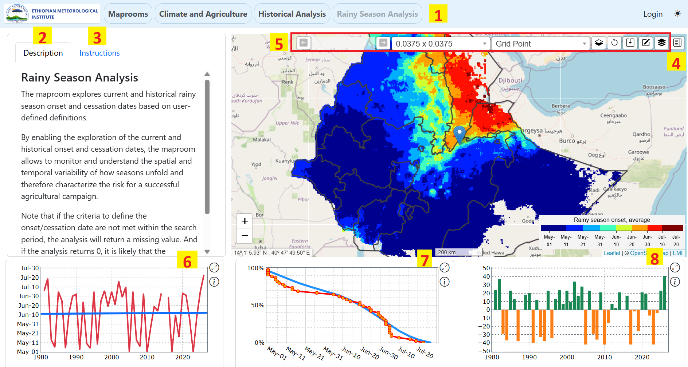

*Figure 1.1. Main areas of the Rainy Season Analysis Maproom. The illustrated map displays average onset dates, with historical time-series, exceedance-probability, and anomaly previews.*

- **Menu 1:** Navigation path to Rainy Season Analysis.
- **Menu 2:** Description of the analysis and its interpretation.
- **Menu 3:** General instructions for using the Maproom.
- **Menu 4:** Button for opening map controls and rainy-season definitions.
- **Menu 5:** Toolbar for selecting locations, navigating available years, and accessing map tools.
- **Menu 6:** Historical time-series preview, which can be expanded.
- **Menu 7:** Historical probability preview, which can be expanded.
- **Menu 8:** Historical anomaly preview, which can be expanded.

Select a grid point or administrative area to examine its charts. The illustrated grid resolution is **0.0375° × 0.0375°**. Record the location and season definition when reporting numerical results.

For shared map navigation, spatial selection, layers, chart appearance, and downloading results, see [Navigating Maprooms](common-navigation.md).

## 2. Settings

### 2.1. Map control

Select **Menu 4** to open the controls. Some fields appear only for particular display or statistic choices.

<table>
  <tr>
    <td width="40%" valign="top">
      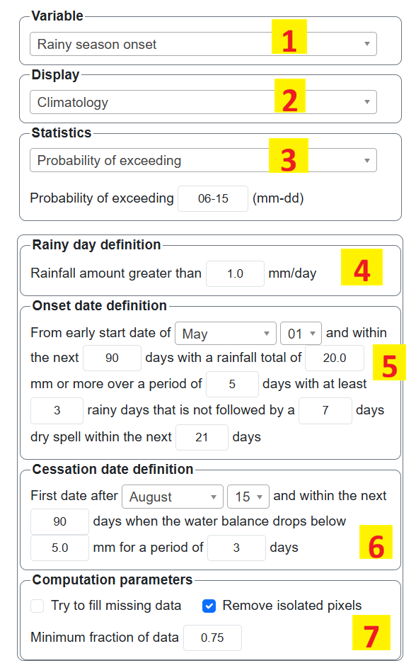
    </td>
    <td width="60%" valign="top">
      <h3>Map control menu</h3>
      
<strong>1. Variable:</strong> Choose <strong>Rainy season onset</strong>, <strong>Rainy season cessation</strong>, or <strong>Rainy season length</strong>.

      
<strong>2. Display:</strong> Choose <strong>Climatology</strong>, <strong>Anomaly</strong>, or <strong>Selected year</strong>. Anomaly and Selected year provide a <strong>Display year</strong> field.

      
<strong>3. Statistics:</strong> For Climatology, choose <strong>Average</strong>, <strong>Median</strong>, <strong>Standard deviation</strong>, <strong>Coefficient of variation</strong>, <strong>Probability of exceeding</strong>, or <strong>Probability of non-exceeding</strong>. Probability choices expose a threshold field.

      
<strong>4. Rainy day definition:</strong> Enter the daily rainfall threshold. The illustration uses <strong>1.0 mm/day</strong>.

      
<strong>5. Onset date definition:</strong> Set the search start month and day, search duration, rainfall total, accumulation-window length, minimum rainy-day count, dry-spell length, and subsequent dry-spell checking period.

      
<strong>6. Cessation date definition:</strong> Set the search start month and day, search duration, water-balance threshold, and number of consecutive days below that threshold.

      
<strong>7. Computation parameters:</strong> Set <strong>Try to fill missing data</strong>, <strong>Remove isolated pixels</strong>, and <strong>Minimum fraction of data</strong>.

    </td>
  </tr>
</table>

*Figure 2.1. Map controls. The illustrated climatology statistic is Probability of exceeding, with June 15 entered as the onset threshold.*

#### 2.1.1. Variables and display choices

| Variable | Output |
|---|---|
| Rainy season onset | Date identified by the onset definition. |
| Rainy season cessation | Date identified by the water-balance cessation definition. |
| Rainy season length | Duration between the calculated onset and cessation, in days. |

| Display | Available settings and interpretation |
|---|---|
| Climatology | Select one of the six Statistics options to summarize valid historical annual results. |
| Selected year | Set Display year to an available year, such as 2025, to display its onset, cessation, or length. |
| Anomaly | Set Display year to show the selected year's difference from its historical average, in days. |

The **Statistics** field is shown for Climatology. It is replaced by the year selection for Anomaly or Selected year. Year navigation is enabled for the year-specific displays and disabled for climatology.

#### 2.1.2. All climatology statistics

| Statistic | Interpretation |
|---|---|
| Average | Mean onset date, cessation date, or season length across valid years. |
| Median | Middle historical date or duration. |
| Standard deviation | Spread of annual values around their mean, expressed in days. |
| Coefficient of variation | Standard deviation relative to the mean calculated value, expressed as a percentage. |
| Probability of exceeding | Estimated historical probability of an annual result later than the specified date, or longer than the specified duration. |
| Probability of non-exceeding | Estimated historical probability of an annual result at or before the date, or at or below the duration. |

For onset and cessation probability statistics, enter a date in **MM-DD** format. The illustrated onset threshold is **06-15**, meaning **June 15**. Another application below uses **06-01**, meaning **June 1**. The cessation threshold can similarly be entered as **09-15** for September 15.

For season length, enter a number of **days**, such as **90**. A probability of exceeding 90 days describes seasons longer than that duration.

For date variables, Average and Median are displayed as calendar dates. The coefficient of variation summarizes the underlying calculated day values relative to their mean; interpret it alongside the search definition and the day-based variability statistics.

#### 2.1.3. All rainy-season definition fields

The illustrated definitions use the following values:

| Group | Field | Illustrated value |
|---|---|---|
| Rainy day | Daily rainfall threshold | 1.0 mm/day. |
| Onset | Search start month and day | May 1. |
| Onset | Search duration | 90 days. |
| Onset | Required rainfall total | At least 20.0 mm. |
| Onset | Rainfall accumulation window | 5 days. |
| Onset | Minimum rainy-day count within that window | 3 days. |
| Onset | Dry-spell length used to reject a candidate onset | 7 days. |
| Onset | Subsequent period checked for that dry spell | 21 days. |
| Cessation | Search start month and day | August 15. |
| Cessation | Search duration | 90 days. |
| Cessation | Water-balance threshold | 5.0 mm. |
| Cessation | Consecutive days below the threshold | 3 days. |

Under this onset definition, the calculation searches for a qualifying rainfall window from May 1, within the specified search period. A qualifying window has at least 20 mm over five days, including at least three rainy days. A candidate is rejected if it is followed by a dry spell lasting at least seven days within the subsequent 21-day checking period.

The menu describes the rainy-day threshold as rainfall “greater than” the entered amount. The current calculation uses **rainfall greater than or equal to the threshold**, so a day with exactly **1.0 mm** qualifies when 1.0 is entered.

Cessation uses a daily water balance incorporating rainfall, reference evapotranspiration, and available water storage. The illustrated definition identifies the first qualifying run of three consecutive days below 5 mm after the selected search start. Its date can differ from the last day with measurable rainfall.

Onset and cessation search settings are entered separately. Review both, especially when calculating season length or investigating locations with more than one rainy season.

#### 2.1.4. All computation options

| Option | Effect |
|---|---|
| Try to fill missing data | Attempts spatial filling of missing calculated season results using nearby valid cells. |
| Remove isolated pixels | Applies isolated-pixel filtering to the mapped season results. |
| Minimum fraction of data | Sets the required fraction of usable data in the relevant calculation window. The illustrated value 0.75 represents 75%. |

Figure 2.1 shows spatial filling **off** and isolated-pixel removal **on**. The first application shows **both options on**, with the same **0.75** minimum fraction. These choices can affect the resulting maps.

The panel uses the available historical rainy-season record for the selected definitions. It does not provide a separate user-selectable baseline-year range. Check the available record when interpreting climatologies and anomalies.

### 2.2. Chart control

All three expanded charts offer the same **Variable** choices: **Rainy season onset**, **Rainy season cessation**, and **Rainy season length**. Each also provides **Rainy season → Definition**, which opens its definition dialog.

#### 2.2.1. Shared Definition dialog

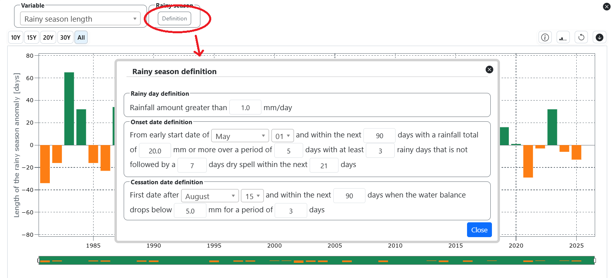

*Figure 2.2. The chart's Rainy season definition dialog. The illustrated variable is Rainy season length.*

The chart dialog contains all of these fields:

- **Rainy day definition:** Daily rainfall threshold, in mm/day.
- **Onset date definition:** Search start month, search start day, search duration, required rainfall total, accumulation-window length, minimum rainy-day count, dry-spell length, and subsequent dry-spell checking period.
- **Cessation date definition:** Search start month, search start day, search duration, water-balance threshold, and consecutive-day requirement.

The illustrated values are those listed in Section 2.1.3. Use **Close** to leave the dialog and the chart's redraw control to refresh results when required.

The dialog contains the season-definition fields rather than the map's computation checkboxes. The current expanded-chart calculations use **Minimum fraction = 0.75**, with **spatial filling off** and **isolated-pixel removal off**. Map and expanded-chart results can therefore differ if the map uses different processing options. Review the definitions separately in each chart when comparing results.

#### 2.2.2. Historical time-series chart

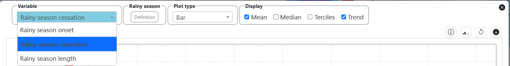

*Figure 2.3. Controls for the historical time-series chart accessed through Menu 6. The illustrated variable is Rainy season cessation.*

The complete options are:

| Control | Available options |
|---|---|
| Variable | Rainy season onset; Rainy season cessation; Rainy season length. |
| Rainy season | Definition dialog containing the fields in Section 2.2.1. |
| Plot type | Bar; Line; Line + Points. |
| Display | Mean; Median; Terciles; Trend. These are individual overlays that can be selected together. |

The vertical axis shows dates for onset and cessation, or days for season length. The horizontal axis identifies years. Hover over a value for its exact year and date or duration.

The mean and median summarize the historical values; terciles mark positions in their distribution, and Trend displays a fitted temporal trend. A visible trend line alone does not establish statistical significance.

#### 2.2.3. Probability chart

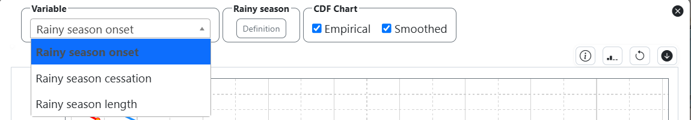

*Figure 2.4. Controls for the historical probability chart accessed through Menu 7.*

The complete options are:

- **Variable:** Rainy season onset, Rainy season cessation, or Rainy season length.
- **Rainy season → Definition:** The shared definition fields.
- **CDF Chart:** **Empirical** and **Smoothed**, with either or both selected.

The plotted vertical axis is **Probability of exceeding**. For onset or cessation, exceeding a date means the event occurs **later than that date**. For length, exceeding a threshold means the season is **longer than that number of days**.

The empirical curve summarizes the valid historical sample. The smoothed curve provides a smoothed representation and can give a different probability at the same threshold. Although the controls call these CDF curves, the displayed curves decrease with the threshold and should be read as exceedance probabilities.

#### 2.2.4. Anomaly chart

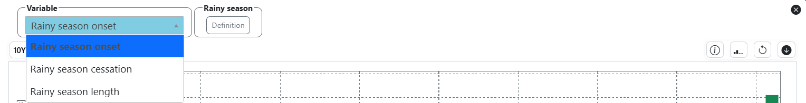

*Figure 2.5. Controls for the anomaly chart accessed through Menu 8.*

The available analysis controls are **Variable** and **Rainy season → Definition**. The chart displays **day differences from the mean of the valid historical results**. It does not provide separate standardized-anomaly or percentage-anomaly selectors.

| Variable | Positive anomaly | Negative anomaly |
|---|---|---|
| Onset | Later onset than average. | Earlier onset than average. |
| Cessation | Later cessation than average. | Earlier cessation than average. |
| Length | Longer season than average. | Shorter season than average. |

Use the available range buttons and slider to focus on part of the chart; the illustrated controls include **10Y**, **15Y**, **20Y**, **30Y**, and **All**. Zooming the plot changes the visible interval, rather than defining a new climatological baseline. Chart tools also provide information, appearance settings, redraw, and download functions.

### 2.3. Interpretation of search limits and missing values

The results depend on the search dates, definitions, and usable data. A missing result can indicate that the criteria could not be resolved with the available data. It should not automatically be interpreted as an absence of rainfall.

Dates concentrated at the search start, such as **May 1** for onset or **August 15** for cessation, deserve closer inspection. They may indicate conditions already present when the search begins. Review an earlier search start before interpreting a boundary date as the actual first onset or cessation of the wider season.

Changing definitions or search periods can change the annual results, climatology, probabilities, and anomalies. Record those settings with the location and displayed period. The probability and anomaly calculations require more than ten valid annual results at the selected location.

## 3. Application

### 3.1. Map the historical probability of onset after June 1

Choose **Rainy season onset**, **Climatology**, and **Probability of exceeding**, then enter **06-01**. Retain the illustrated May 1 onset search, August 15 cessation search, and other definition values.

<table>
  <tr>
    <td width="35%" valign="top">
      <h3>Map controls</h3>
      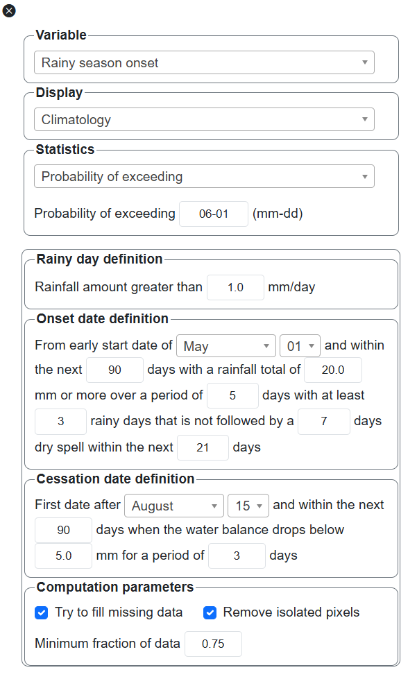
    </td>
    <td width="65%" valign="top">
      <h3>Map and chart previews</h3>
      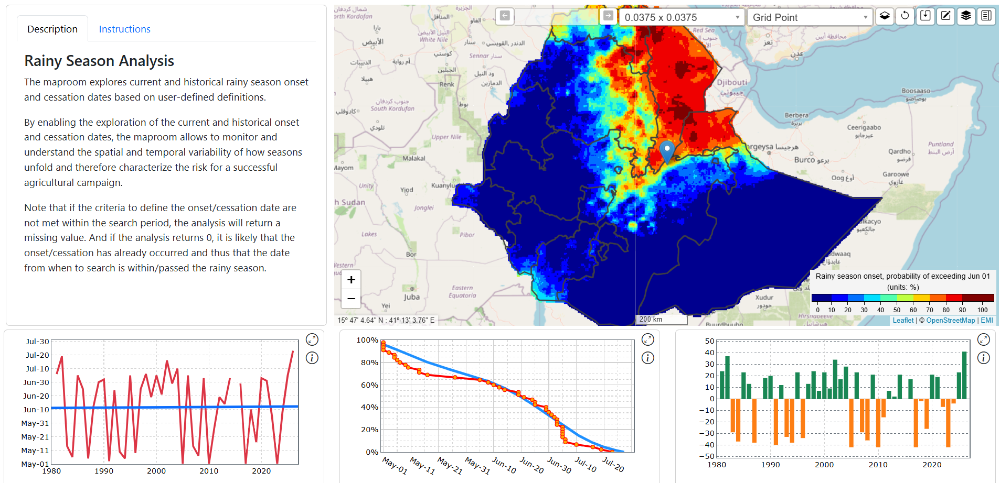
    </td>
  </tr>
</table>

*Figure 3.1. Controls and output for the historical probability of onset later than June 1. Both Try to fill missing data and Remove isolated pixels are selected in the illustrated map controls.*

To reproduce the map settings:

1. Open **Menu 4** and choose **Rainy season onset**.
2. Choose **Climatology**, followed by **Probability of exceeding**.
3. Enter **06-01** as the threshold date.
4. Set the rainy-day threshold to **1.0 mm/day**.
5. Use the onset definition of **20 mm over 5 days**, including **3 rainy days**, with the **7-day** dry-spell rejection criterion checked over the next **21 days**, starting the search on **May 1** for **90 days**.
6. Retain the illustrated cessation definition and select the two map-processing checkboxes, with **Minimum fraction = 0.75**.
7. Close the panel and select a location to inspect its charts.

The map legend runs from **0% to 100%**, with marks every **10 percentage points**. Dark-blue areas indicate low historical probability of onset after June 1; red areas indicate high probability. In the figure, much of the west and southeast is in lower classes, while parts of the northeast reach **80–100%**.

For example, a mapped class of **80–90%** means that approximately 80–90% of valid historical annual onset results fall later than June 1 under the selected definition. The probability concerns onset timing, rather than the chance of rain on June 1.

### 3.2. Compare average onset, onset in 2025, and its anomaly

Keep the location coverage and season definition consistent. Compare **Climatology → Average**, **Selected year → 2025**, and **Anomaly → 2025** for Rainy season onset.

<table>
  <tr>
    <td width="33%" valign="top">
      <h3>Average onset</h3>
      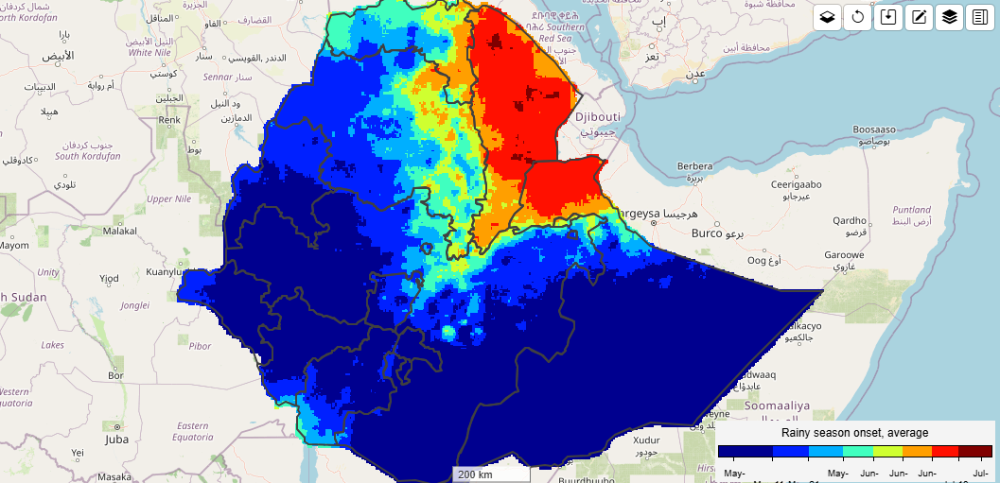
    </td>
    <td width="33%" valign="top">
      <h3>Onset in 2025</h3>
      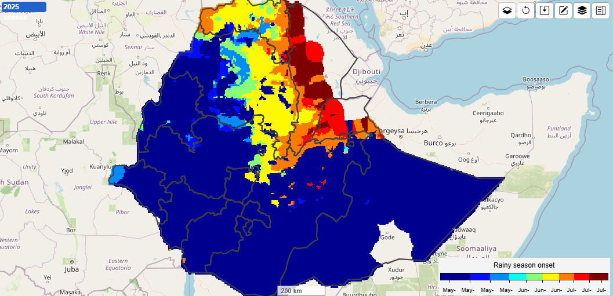
    </td>
    <td width="33%" valign="top">
      <h3>Onset anomaly in 2025</h3>
      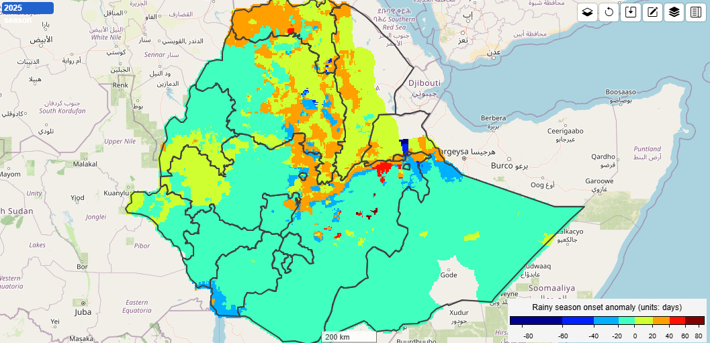
    </td>
  </tr>
</table>

*Figure 3.2. Mean onset, onset in 2025, and its day-based anomaly. Keep the search definition and processing options unchanged when comparing the three views.*

The first two maps display **calendar dates**. The anomaly map displays the difference between the selected year's onset and its historical average, in **days**.

The anomaly legend includes values from approximately **−80 to +80 days**, with marks at **−80, −60, −40, −20, 0, +20, +40, +60, and +80**. A **+20 to +40 day** class indicates onset 20–40 days later than average; a **−20 to 0 day** class indicates onset up to 20 days earlier.

The illustrated 2025 map shows geographic differences in the sign and size of the departure, including later-onset classes in parts of the central and northeastern areas and earlier-onset classes elsewhere. Read the numerical legend and the local map class rather than interpreting a color as inherently favorable or unfavorable.

The exported date legends are partly cropped. Use the full Maproom legend when reporting a calendar-date class. Values at the May 1 search boundary should be interpreted with the search-limit guidance in Section 2.3.

### 3.3. Examine historical cessation and a selected year

Expand **Menu 6**, select **Rainy season cessation**, review **Definition**, and use **Line + Points**. Enable the **Mean** and **Trend** overlays to examine variability and the fitted temporal pattern.

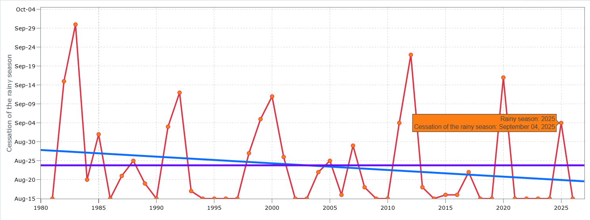

*Figure 3.3. Historical cessation time series. The tooltip gives September 4, 2025, for the rainy season labeled 2025.*

The exact tooltip date is **September 4, 2025**. The horizontal mean line is approximately **August 24**, so the illustrated 2025 cessation is roughly **11 days later** than that plotted average. The mean date and the 11-day comparison are estimates from the axis; use an exact mean reading for a precise departure.

The plotted vertical axis extends from approximately **August 15 to October 4**. Several annual values occur at the **August 15** search start. Review this boundary behavior before interpreting the sequence as the full range of possible cessation dates.

The blue trend line slopes toward earlier cessation across the displayed period. This is a fitted visual summary; the figure does not provide a significance test or establish the cause of the pattern.

### 3.4. Compare onset and cessation exceedance probabilities

Expand **Menu 7**, select each variable in turn, retain the corresponding definitions, and enable both **Empirical** and **Smoothed** curves.

<table>
  <tr>
    <td width="50%" valign="top">
      <h3>Onset probability</h3>
      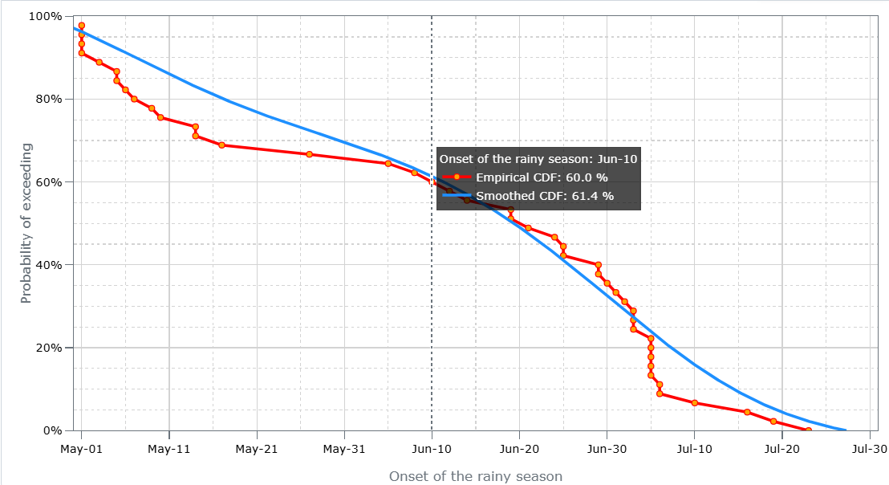
    </td>
    <td width="50%" valign="top">
      <h3>Cessation probability</h3>
      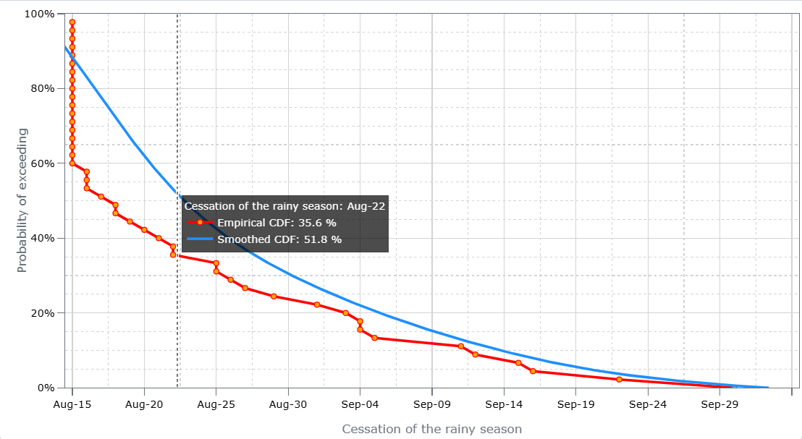
    </td>
  </tr>
</table>

*Figure 3.4. Historical exceedance curves for onset and cessation. The highlighted thresholds are June 10 and August 22, respectively.*

| Event and threshold | Empirical exceedance probability | Smoothed exceedance probability |
|---|---|---|
| Onset later than June 10 | 60.0%. | 61.4%. |
| Cessation later than August 22 | 35.6%. | 51.8%. |

For onset, the empirical curve estimates a **60.0%** probability of onset later than June 10. The corresponding non-exceedance estimate is **40.0%**. The two plotted curve estimates differ by **1.4 percentage points**.

For cessation, the empirical estimate of occurring after August 22 is **35.6%**, while the smoothed estimate is **51.8%**, a difference of **16.2 percentage points**. The corresponding non-exceedance estimates are **64.4%** and **48.2%**.

The cessation plot contains many empirical values at the earliest search date, **August 15**. The shape of this concentrated sample and its smoothing help explain why the curves can give substantially different readings. Report the curve type with a probability, and review the search definition when many results lie on its boundary.

The figures do not identify the selected coordinates. Exact numerical reproduction requires the same location, historical data, definitions, and processing settings.

### 3.5. Identify unusually long and short rainy seasons

Expand **Menu 8**, select **Rainy season length**, and review **Definition**. Both onset and cessation criteria contribute to the calculated duration.

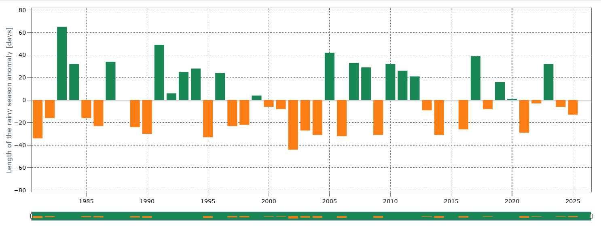

*Figure 3.5. Rainy-season length anomalies relative to the historical mean. Positive values indicate longer seasons; negative values indicate shorter seasons.*

The chart uses a vertical scale of approximately **−80 to +80 days**. The positive bar around **1983** reaches approximately **+65 days**, while the negative bar around **2002** reaches approximately **−44 days**. These are visual estimates rather than tooltip readings.

A **+65-day** length anomaly means a season about 65 days longer than its historical average under the selected definition. A **−44-day** anomaly means a season about 44 days shorter.

Length alone does not identify whether the change came from earlier onset, later cessation, or both. Compare the onset and cessation series for the same location and year, keeping the definitions consistent, to understand the timing behind a long or short season.
