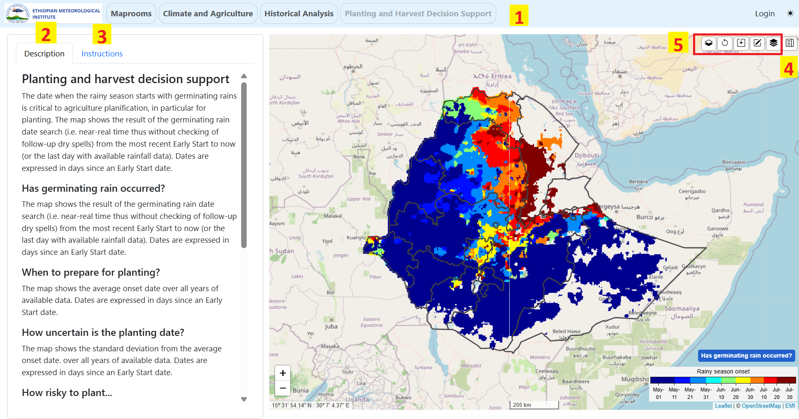
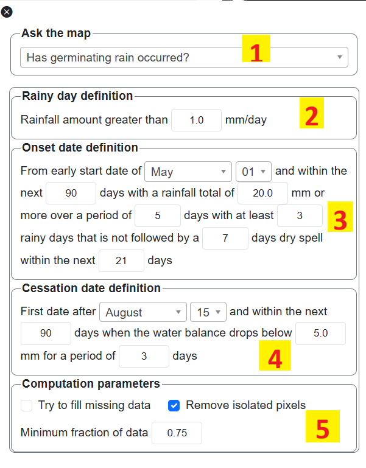

# Planting and Harvest Decision Support Maproom

## 1. Overview

The Planting and Harvest Decision Support Maproom, within **Climate and Agriculture/Historical Analysis**, examines rainfall conditions relevant to agricultural planning. It provides seven map questions about germinating rain, typical onset dates, onset variability, rainy-season duration, and historical probabilities.

The results depend on the selected rainy-day, onset, and cessation definitions. These definitions determine which rainfall conditions qualify as onset and which water-balance conditions qualify as cessation.

Use this Maproom to investigate:

- The calculated onset for the latest available season result.
- When rainy-season onset typically occurs.
- How much onset dates vary between years.
- The historical probability that onset occurs after a proposed planting date.
- The average duration and variability of the rainy season.
- The historical probability that season length does not exceed a selected duration.

Historical averages and probabilities provide context for agricultural planning. They do not specify a crop's maturity requirements or predict an exact planting or harvest date.

Open the [Planting and Harvest Decision Support Maproom](http://213.55.84.78:8484/maproom_pages?maproom=agriculture&component=analysis&page=decision-support).

*Figure 1.1. Main areas of the Planting and Harvest Decision Support Maproom. The illustrated question is Has germinating rain occurred?*

- **Menu 1:** Navigation path to Planting and Harvest Decision Support.
- **Menu 2:** Description of the available questions and their interpretation.
- **Menu 3:** General instructions for using the Maproom.
- **Menu 4:** Button for opening the map controls and season definitions.
- **Menu 5:** Toolbar for interacting with the map, changing its appearance, redrawing it, and downloading results.

This page provides map outputs without historical chart previews. For shared navigation, map layers, appearance settings, and downloading results, see [Navigating Maprooms](common-navigation.md).

## 2. Settings

### 2.1. Map control

Select **Menu 4** to open the controls. Choose a question under **Ask the map**, then review the season definitions and computation parameters. Additional threshold fields appear for the two probability questions.

<table>
  <tr>
    <td width="40%" valign="top">
      
    </td>
    <td width="60%" valign="top">
      <h3>Map control menu</h3>
      
<strong>1. Ask the map:</strong> Choose one of the seven questions listed below. Each question selects its mapped quantity and statistic automatically. The probability questions expose an additional date or duration threshold.

      
<strong>2. Rainy day definition:</strong> Enter the daily rainfall threshold. The illustrated value is <strong>1.0 mm/day</strong>.

      
<strong>3. Onset date definition:</strong> Set the search start month and day, search duration, rainfall total, accumulation-window length, minimum rainy-day count, dry-spell length, and subsequent dry-spell checking period.

      
<strong>4. Cessation date definition:</strong> Set the search start month and day, search duration, water-balance threshold, and consecutive-day requirement.

      
<strong>5. Computation parameters:</strong> Configure <strong>Try to fill missing data</strong>, <strong>Remove isolated pixels</strong>, and <strong>Minimum fraction of data</strong>.

    </td>
  </tr>
</table>

*Figure 2.1. Map controls. The illustrated question is Has germinating rain occurred?, with spatial filling off, isolated-pixel removal on, and Minimum fraction of data set to 0.75.*

#### 2.1.1. All available questions

| Ask the map | Information shown | Additional question-specific input |
|---|---|---|
| Has germinating rain occurred? | Calculated onset for the latest available season result. | None. |
| When to prepare for planting? | Average historical onset date under the selected definition. | None. |
| How uncertain is the planting date? | Standard deviation of historical onset dates, in days. | None. |
| How risky to plant... | Estimated historical probability that onset occurs after a specified date. | **Season onset past:** Date in **MM-DD** format. |
| How long is the rainy season? | Average historical season length, in days. | None. |
| How uncertain is the length of the rainy season? | Standard deviation of historical season lengths, in days. | None. |
| How likely is the rainy season lasting less than... | Estimated historical probability that season length does not exceed a specified duration. | **Season length less than:** Duration in **days**. |

The question determines the statistic automatically. There is no separate Climatology, Anomaly, or Statistics selector on this page.

Onset is calculated as an offset from the selected early search-start date. The map legend formats onset and average-onset results as calendar dates. Standard deviations and season lengths are expressed in **days**; probabilities are expressed in **percent**.

#### 2.1.2. All conditional threshold settings

| Selected question | Field displayed | Required input | Initial value |
|---|---|---|---|
| How risky to plant... | Season onset past | A valid **MM-DD** date, such as **06-15** for June 15. | **06-15**. |
| How likely is the rainy season lasting less than... | Season length less than | A whole number of **days**. | **90 days**. |

The threshold field appears beneath **Ask the map** and is hidden for the other five questions. Switching to a probability question initializes its threshold, so review the value after changing questions.

For **How risky to plant...**, the probability concerns onset occurring **after** the entered date. It describes historical onset timing relative to that date, rather than crop failure directly.

For the season-length question, the legend identifies the output as **probability of non-exceeding**. With **90 days** entered, interpret it as the estimated probability that the rainy season lasts **90 days or less**, despite the shorter wording used by the menu.

The rainy-day, onset, cessation, and computation fields remain available for all questions. Their effects depend on the quantity being calculated; both onset and cessation definitions contribute to season length.

#### 2.1.3. All rainy-season definition fields

The illustrated settings are:

| Group | Field | Illustrated value |
|---|---|---|
| Rainy day | Daily rainfall threshold | **1.0 mm/day**. |
| Onset | Search start month | **May**. |
| Onset | Search start day | **01**. |
| Onset | Search duration | **90 days**. |
| Onset | Required rainfall total | **20.0 mm** or more. |
| Onset | Rainfall accumulation window | **5 days**. |
| Onset | Minimum rainy-day count within the window | **3 days**. |
| Onset | Dry-spell length used to reject a candidate onset | **7 days**. |
| Onset | Subsequent period checked for that dry spell | **21 days**. |
| Cessation | Search start month | **August**. |
| Cessation | Search start day | **15**. |
| Cessation | Search duration | **90 days**. |
| Cessation | Water-balance threshold | **5.0 mm**. |
| Cessation | Consecutive days below the threshold | **3 days**. |

The month selectors provide the calendar months; the day selectors provide the dates available for the selected month. The thresholds, search durations, day counts, and checking periods are entered as numerical values.

Under the illustrated onset definition, the search begins on **May 1** and covers the specified **90-day** period. A qualifying rainfall window contains at least **20 mm over five days**, including at least **three rainy days**. A candidate onset is rejected if a dry spell lasting at least **seven days** occurs during the subsequent **21-day** checking period.

Although the menu describes a rainy day using “greater than,” the current calculation includes rainfall **equal to the threshold**. A day recording exactly **1.0 mm** qualifies when 1.0 is entered.

Cessation uses a daily water balance incorporating rainfall, reference evapotranspiration, and soil water storage. The illustrated definition searches from **August 15** for the first qualifying sequence of **three consecutive days** below **5 mm**, within the specified search period. This date can differ from the last rainy day.

**Germinating-rain interpretation:** The description panel presents this question as a near-real-time search without follow-up dry-spell checks. The current implementation uses the shared rainy-season calculation with the selected dry-spell settings and displays its latest available season result. Review those settings when interpreting the map.

#### 2.1.4. All computation options

| Option | Available setting | Effect |
|---|---|---|
| Try to fill missing data | Checked or unchecked. | Attempts spatial filling of missing calculated season results using nearby valid cells. |
| Remove isolated pixels | Checked or unchecked. | Filters isolated pixels in the calculated season results. |
| Minimum fraction of data | A numerical fraction; the illustration uses **0.75**. | Sets the required usable-data fraction. **0.75** represents **75%**. |

Figure 2.1 shows **Try to fill missing data unchecked** and **Remove isolated pixels checked**. Keep these options consistent when comparing maps.

The historical summaries use the available record and require at least **15 valid annual results** at a location in the current configuration. There is no baseline-year selector or control for changing this minimum-year requirement.

A missing result can occur when the selected criteria cannot be resolved within the search period or usable data are insufficient. It should not automatically be interpreted as an absence of rainfall.

An onset displayed at the search boundary, such as **May 1**, can indicate that suitable conditions were already present when the search began. Review an earlier search start when investigating the wider season.

## 3. Application

### 3.1. Examine the latest available onset result

Select **Has germinating rain occurred?** and review the illustrated definitions.

<table>
  <tr>
    <td width="35%" valign="top">
      <h3>Map controls</h3>
      
    </td>
    <td width="65%" valign="top">
      <h3>Map output</h3>
      
    </td>
  </tr>
</table>

*Figure 3.1. Controls beside the onset output. The map displays calculated onset dates using a calendar-date legend.*

To reproduce the illustrated control settings:

1. Open **Menu 4** and select **Has germinating rain occurred?**.
2. Set the rainy-day threshold to **1.0 mm/day**.
3. Begin the onset search on **May 1**, with a search duration of **90 days**.
4. Require **20 mm over five days**, including at least **three rainy days**.
5. Retain the **seven-day** dry-spell criterion and **21-day** checking period.
6. Use the cessation search beginning on **August 15**, lasting **90 days**, with water balance below **5 mm** for **three consecutive days**.
7. Leave spatial filling off, enable isolated-pixel removal, and use **0.75** for the minimum data fraction.
8. Close the panel to update the map.

The legend has date labels extending from **May 1 to July 30**, generally at ten-day intervals. A location in the **May 11–May 21** color interval has a calculated onset within that interval. A location in the **July 10–July 20** interval has a substantially later calculated onset.

Large parts of the west and south appear in earlier-date colors, while later-date colors occur across parts of the north and northeast. Interpret each location against the legend and the selected definition.

The exported image does not identify a year. Confirm the latest available season in the application before reporting this output as a year-specific result.

### 3.2. Compare typical onset, average duration, and duration variability

Keep the definitions and computation options unchanged, and select the three historical questions in turn.

<table>
  <tr>
    <td width="33%" valign="top">
      <h3>Average onset</h3>
      
    </td>
    <td width="33%" valign="top">
      <h3>Average season length</h3>
      
    </td>
    <td width="33%" valign="top">
      <h3>Season-length variability</h3>
      
    </td>
  </tr>
</table>

*Figure 3.2. Historical average onset, average season length, and standard deviation of season length. The three maps describe different aspects of the rainy season.*

From left to right:

- **When to prepare for planting?** displays average historical onset. Earlier-date colors cover much of the west and south; later-date colors occur across parts of the north and northeast. Some date labels are cropped in this export, so use the complete application legend when reporting an exact interval.
- **How long is the rainy season?** displays average duration. The visible legend is labeled from **0 to 80 days**, in ten-day increments. For example, a **50–60-day** class represents an average calculated duration between 50 and 60 days under the selected definition.
- **How uncertain is the length of the rainy season?** displays standard deviation. Its visible legend is labeled from **0 to 60 days**. A **30–40-day** class indicates substantially greater historical variability than a **0–10-day** class.

Standard deviation describes variability around the average. A standard deviation of **30 days** does not mean that the rainy season lasts 30 days or define a fixed minimum or maximum duration.

Use the maps together to distinguish typical onset timing, average available rainy-season duration, and the consistency of that duration between years. The numerical intervals above illustrate how to read legend classes; they are not exact readings for a named location.

### 3.3. Examine the probability of a season lasting 90 days or less

Select **How likely is the rainy season lasting less than...**. The additional **Season length less than** field appears beneath the question. Enter **90 days**, retain the required definitions, and close the panel.

<table>
  <tr>
    <td width="50%" valign="top">
      <h3>Probability of a short season</h3>
      
    </td>
    <td width="50%" valign="top">
      <h3>Season-length variability</h3>
      
    </td>
  </tr>
</table>

*Figure 3.3. Probability of season length not exceeding 90 days beside historical season-length variability. The variability image is identical to the supplied export used in the right-hand panel of Figure 3.2.*

The probability-map title identifies the event as **rainy-season length not exceeding 90 days**, with units of **percent**. Warmer colors occur across parts of the northeast, while cooler colors cover much of the west and south.

The numerical probability labels are cropped in the supplied image. An exact percentage cannot be read reliably from this export; obtain it from the application or a complete exported legend.

The adjacent variability map has readable labels from **0 to 60 days**. Use it to distinguish locations with relatively consistent durations from those with larger historical fluctuations.

The **90-day threshold** is an analysis choice. It is not a crop maturity value supplied by the Maproom. To explore another duration, change the threshold while retaining the same definitions and computation settings.

### 3.4. Examine onset timing relative to a proposed planting date

This example uses the other conditional probability question:

1. Select **How risky to plant...**.
2. In **Season onset past**, enter **06-15** for June 15.
3. Retain the required rainy-day and onset definitions.
4. Review the cessation and computation settings.
5. Close the panel to update the probability map.

The map estimates the historical probability that calculated onset occurs **after June 15**. A higher probability means that the proposed date more often precedes onset under the selected definition. A lower probability means onset is more likely to have occurred by that date.

Compare this result with **When to prepare for planting?** and **How uncertain is the planting date?**. The average provides typical timing, the standard deviation describes historical variability, and the probability map evaluates the particular date entered.

