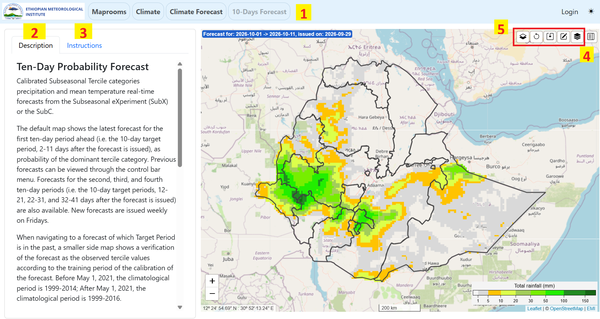
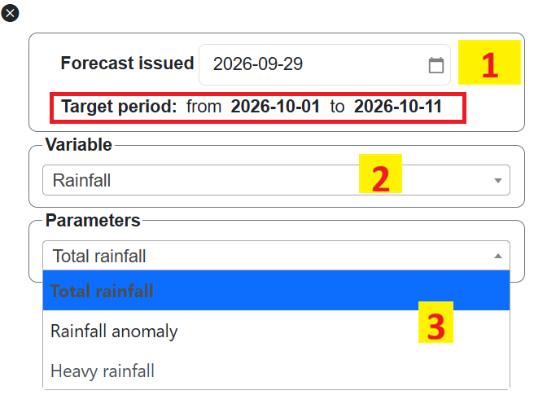

# 10-Day Climate Forecast Maproom

## 1. Overview

The 10-Day Climate Forecast Maproom allows you to examine forecast rainfall and temperature across Ethiopia for the target period associated with a selected forecast issue. You can display total rainfall, rainfall anomalies, heavy-rainfall categories, and temperature products.

The page opens with the most recently available forecast issue. Use the map controls to select an earlier issue or change the variable and parameter displayed.

Two dates are particularly important:

- **Forecast issued:** The date identifying the forecast release.
- **Target period:** The interval covered by that forecast, displayed with its start and end dates.

In the illustrated example, the forecast was issued on **2026-09-29**, and the target period is displayed as **2026-10-01 to 2026-10-11**. Use the dates printed in the panel and map banner when describing the forecast period.

Use this Maproom to investigate:

- Areas forecast to receive higher or lower rainfall totals during the target period.
- Geographic differences in forecast rainfall relative to its reference climatology.
- Areas flagged by the heavy-rainfall product.
- Forecast temperature conditions during the selected target period.
- Differences between available forecast issues, while checking their respective target dates.

Open the [10-Day Climate Forecast Maproom](http://213.55.84.78:8484/maproom_pages?maproom=climate&component=forecast&page=ten-days).

The main areas of the page are identified below.

*Figure 1.1. Main areas of the 10-Day Climate Forecast Maproom. The map displays total rainfall for the target period labeled October 1–11, 2026, from the forecast issued on September 29, 2026.*

- **Menu 1:** Navigation path to the 10-Day Forecast page.
- **Menu 2:** Description of the forecast Maproom.
- **Menu 3:** General instructions for using the Maproom.
- **Menu 4:** Button for opening the forecast map controls.
- **Menu 5:** Toolbar for interacting with the map, adjusting its display, redrawing it, and accessing download tools.

The blue banner above the map identifies the forecast's target period and issue date. The legend in the lower-right corner identifies the displayed parameter, its units, or its categories.

This page presents forecast maps. Its documentation therefore focuses on the forecast controls and map layers. For shared map navigation, layers, appearance, and downloading results, see [Navigating Maprooms](common-navigation.md).

## 2. Settings

### 2.1. Map control

Select **Menu 4** to open the map controls. The following example shows the rainfall parameters for the forecast issued on **September 29, 2026**.

<table>
  <tr>
    <td width="40%" valign="top">
      
    </td>
    <td width="60%" valign="top">
      <h3>Map control menu</h3>

      
<strong>1. Forecast issued and Target period:</strong> Select an available forecast issue using the calendar. The associated target period updates automatically. The example uses an issue date of <strong>2026-09-29</strong>, with a target period displayed as <strong>2026-10-01 to 2026-10-11</strong>.

      
<strong>2. Variable:</strong> Choose <strong>Rainfall</strong> or <strong>Temperature</strong>. The Parameters menu changes to show the products available for that variable.

      
<strong>3. Parameters:</strong> For Rainfall, choose <strong>Total rainfall</strong>, <strong>Rainfall anomaly</strong>, or <strong>Heavy rainfall</strong>. For Temperature, choose <strong>Mean temperature</strong>, <strong>Mean temperature anomaly</strong>, <strong>Minimum temperature</strong>, or <strong>Maximum temperature</strong>.

    </td>
  </tr>
</table>

*Figure 2.1. Forecast map controls. The numbered callouts identify the forecast issue and target period, the variable, and the product to display.*

The parameters have different meanings:

| Variable | Parameter | Information shown | Units or display |
|---|---|---|---|
| Rainfall | Total rainfall | Forecast rainfall accumulated over the target period. | mm |
| Rainfall | Rainfall anomaly | Forecast rainfall total minus the reference rainfall accumulation for the corresponding dates. | mm |
| Rainfall | Heavy rainfall | Locations flagged in the supplied heavy-rainfall categories. | Heavy, Very Heavy, or Extremely Heavy Rainfall. |
| Temperature | Mean temperature | Forecast mean temperature averaged over the target period. | °C |
| Temperature | Mean temperature anomaly | Forecast mean temperature minus its reference mean for the corresponding dates. | °C |
| Temperature | Minimum temperature | Period-average daily minimum temperature product. | °C |
| Temperature | Maximum temperature | Period-average daily maximum temperature product. | °C |

The illustrations in this guide cover the three **Rainfall** parameters. Temperature products use the same issue-date and variable-selection process.

After choosing the issue, variable, and parameter, close the panel to update the map. Use **Redraw map** if another update is required.

The issue calendar provides the releases available in the forecast archive. Selecting an issue determines its associated target period. Check the target dates again after changing the issue.

### 2.2. Map display and legend

Use **Menu 5** to adjust the map display and access its tools. Read the legend each time you change the parameter, because the units and color meanings change between layers.

For **Total rainfall**, the illustrated legend marks are **1, 5, 10, 20, 30, 50, 100, and 150 mm**. These values define classes of rainfall accumulated over the target period.

For **Rainfall anomaly**, the illustrated legend marks are **−300, −200, −150, −100, −50, −20, −10, +10, +20, +50, +100, +200, and +300 mm**. Brown shades indicate negative departures, while turquoise shades indicate positive departures. The central white class spans **−10 to +10 mm**.

For **Heavy rainfall**, the legend uses three named categories:

| Legend color | Category |
|---|---|
| Light cyan | Heavy Rainfall. |
| Blue | Very Heavy Rainfall. |
| Dark blue | Extremely Heavy Rainfall. |

Basemap features, such as green vegetation, roads, and place names, provide geographic context. Interpret the forecast overlay using its own legend.

The figures provide map classes rather than point-value tooltips. Numerical descriptions below therefore use the visible legend intervals. A class identifies a range; an exact rainfall amount at a particular grid point requires a numerical data value.

## 3. Application

### 3.1. Examine rainfall totals for a selected forecast issue

This example uses the forecast issued on **September 29, 2026**, with the target period displayed as **October 1–11, 2026**.

<table>
  <tr>
    <td width="35%" valign="top">
      <h3>Forecast controls</h3>
      
    </td>
    <td width="65%" valign="top">
      <h3>Complete map output</h3>
      
    </td>
  </tr>
</table>

*Figure 3.1. Forecast controls beside the complete total-rainfall output. The issue date is September 29, 2026, and the target period is displayed as October 1–11, 2026.*

To reproduce the selection:

1. Open **Menu 4**.
2. Set **Forecast issued** to **2026-09-29**, if that issue remains available in the archive.
3. Check that **Target period** displays **2026-10-01 to 2026-10-11**.
4. Choose **Rainfall** under **Variable**.
5. Choose **Total rainfall** under **Parameters**.
6. Close the panel and read the map banner and rainfall legend.

The forecast identity is summarized below:

| Setting | Illustrated value |
|---|---|
| Forecast issued | September 29, 2026. |
| Target start date | October 1, 2026. |
| Target end date | October 11, 2026, as displayed by the product. |
| Variable | Rainfall. |
| Parameter | Total rainfall. |
| Units | Millimeters accumulated over the target period. |

Keep the same issue and compare the three rainfall products below.

<table>
  <tr>
    <td width="33%" valign="top">
      <h3>Total rainfall</h3>
      
    </td>
    <td width="33%" valign="top">
      <h3>Rainfall anomaly</h3>
      
    </td>
    <td width="33%" valign="top">
      <h3>Heavy rainfall</h3>
      
    </td>
  </tr>
</table>

*Figure 3.2. Total rainfall, rainfall anomaly, and heavy-rainfall category maps for the forecast issued September 29, 2026. The target period is displayed as October 1–11, 2026.*

The total-rainfall map shows higher accumulations in parts of western and southwestern Ethiopia, together with a smaller area of higher totals in the south-central part of the country. Much of the north and east is shown in lower rainfall classes.

Use the legend to describe the forecast amounts:

| Example class | Interpretation |
|---|---|
| 5–10 mm | Forecast rainfall accumulation between 5 and 10 mm during the target period. |
| 10–20 mm | Forecast accumulation between 10 and 20 mm. |
| 20–30 mm | Forecast accumulation between 20 and 30 mm. |
| 30–50 mm | Forecast accumulation between 30 and 50 mm. |
| 50–100 mm | Forecast accumulation between 50 and 100 mm. |
| 100–150 mm | Forecast accumulation between 100 and 150 mm. |

Several green areas in the western and southwestern part of the map correspond to the higher rainfall classes, including **50–100 mm**, with localized darker areas in the **100–150 mm** class. Describe these as class ranges when using the image alone.

Rainfall amount is one part of the interpretation. Use the anomaly layer to establish how the forecast compares with its reference climatology, and the heavy-rainfall layer to inspect the supplied event categories.

### 3.2. Identify areas with rainfall below or above the reference average

Retain the same forecast issue and choose **Rainfall anomaly** under **Parameters**. Refer to the middle map in Figure 3.2.

The anomaly compares the forecast rainfall accumulation with the reference accumulation for the corresponding target dates:

**Rainfall anomaly = forecast rainfall total − reference rainfall total.**

- **Negative values:** Forecast rainfall is below the reference average.
- **Positive values:** Forecast rainfall is above the reference average.
- **Values near zero:** Forecast rainfall is close to the reference average.

The illustrated map contains extensive brown areas, indicating forecast deficits across much of the country. Smaller turquoise areas indicate positive departures in parts of western and central Ethiopia.

The legend includes these example intervals:

| Anomaly class | Interpretation |
|---|---|
| −50 to −20 mm | Forecast rainfall is between 20 and 50 mm below the reference average. |
| −20 to −10 mm | Forecast rainfall is between 10 and 20 mm below the reference average. |
| −10 to +10 mm | Forecast rainfall is within approximately 10 mm of the reference average. |
| +10 to +20 mm | Forecast rainfall is between 10 and 20 mm above the reference average. |
| +20 to +50 mm | Forecast rainfall is between 20 and 50 mm above the reference average. |

The legend extends to labeled breaks of **−300 and +300 mm**. Those limits describe the color scale; use the mapped colors to identify the classes present in the selected forecast.

Compare the total and anomaly layers at the same location. A location can have a substantial forecast rainfall total and still be below its usual accumulation for that time of year. The amount layer describes how much rain is forecast; the anomaly layer places that amount in its climatological context.

These anomaly values are expressed in **millimeters**. The map controls provide the forecast issue and parameter; the reference climatology used for the anomaly is configured by the Maproom.

### 3.3. Locate areas flagged by the heavy-rainfall product

Retain the same issue and choose **Heavy rainfall** under **Parameters**. Refer to the right-hand map in Figure 3.2.

This layer displays the **Heavy Rainfall**, **Very Heavy Rainfall**, and **Extremely Heavy Rainfall** categories. Read them using the light-cyan, blue, and dark-blue legend swatches.

In the illustrated example, small, scattered light-cyan patches identify areas in the **Heavy Rainfall** category. The green terrain features visible on the basemap provide geographic context and should be distinguished from the cyan and blue forecast-category overlay.

The legend lists all three possible categories. Its presence alone does not establish that all three categories occur within this particular forecast map.

The figures below show category names without numerical rainfall thresholds or probability percentages. Use those category names when reporting the map, and obtain the product's threshold definitions before assigning a millimeter threshold or numerical probability to a category.

For a combined interpretation, examine the three layers for the same issue and location:

1. Use **Total rainfall** to identify the forecast accumulation class.
2. Use **Rainfall anomaly** to compare that accumulation with the reference average.
3. Use **Heavy rainfall** to identify any heavy-rainfall category at that location.

When comparing a later forecast issue, record its new issue date and target period. An archived forecast describes the outlook issued at that time; observed conditions are examined through the climate monitoring tools.
