# Seasonal Climate Forecast Maproom

## 1. Overview

The Seasonal Climate Forecast Maproom provides seasonal rainfall and temperature forecasts through maps and probability charts. Its flexible presentation allows you to examine a forecast amount, its departure from the historical average, or the probability of exceeding a threshold that matters for your application.

The forecasts describe a range of possible seasonal outcomes. The map and charts provide complementary ways to examine that distribution: a central forecast estimate, probabilities for broad climate categories, probabilities for selected thresholds, and the shape of the forecast distribution.

Two settings identify the forecast:

- **Forecast issued:** The month and year when the forecast was issued.
- **Forecast season:** The target sequence of months covered by that forecast.

The figures in this guide use a forecast issued in **September 2026**, with **Oct–Jan** selected as the forecast season. October–January contains **four months** and crosses a calendar-year boundary. Check the complete target interval when reporting the season; the map's **Oct–Jan 2026** label combines the target abbreviation with the selected forecast issue year.

Use this Maproom to investigate:

- Geographic differences in forecast seasonal rainfall or mean temperature.
- Forecast departures from the historical average.
- The probabilities of below-normal, near-normal, and above-normal conditions.
- The probability of rainfall exceeding a selected amount or historical percentile.
- Differences between the forecast distribution and the historical reference distribution.

Open the [Seasonal Climate Forecast Maproom](http://213.55.84.78:8484/maproom_pages?maproom=climate&component=forecast&page=seasonal).

The main areas of the page are identified below.

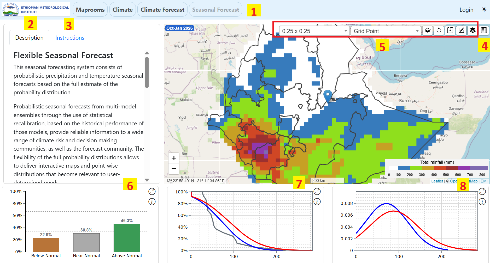

*Figure 1.1. Main areas of the Seasonal Climate Forecast Maproom. The illustrated map displays total rainfall for the Oct–Jan target from the September 2026 issue, with three probability previews for the selected grid point.*

- **Menu 1:** Navigation path to the Seasonal Forecast page.
- **Menu 2:** Description of the forecast Maproom.
- **Menu 3:** General instructions for using the Maproom.
- **Menu 4:** Button for opening the map controls.
- **Menu 5:** Toolbar for selecting and interacting with a forecast grid point, adjusting the map display, and accessing map tools.
- **Menu 6:** Tercile probability preview, which can be expanded.
- **Menu 7:** Probability-of-exceeding preview, which can be expanded.
- **Menu 8:** Probability density preview, which can be expanded.

Click a grid point on the map to update its probability charts. The illustrated forecast grid has a resolution of **0.25° × 0.25°**. The charts describe the selected forecast grid point.

Historical observation curves provide a reference distribution for the corresponding season across past years. They place the forecast in its climatological context.

For shared map navigation, layers, chart appearance, and downloading results, see [Navigating Maprooms](common-navigation.md).

## 2. Settings

### 2.1. Map control

Select **Menu 4** to open the map controls. The following example shows **Rainfall**, **Flexible presentation**, and **Total rainfall** for the September 2026 forecast issue.

<table>
  <tr>
    <td width="40%" valign="top">
      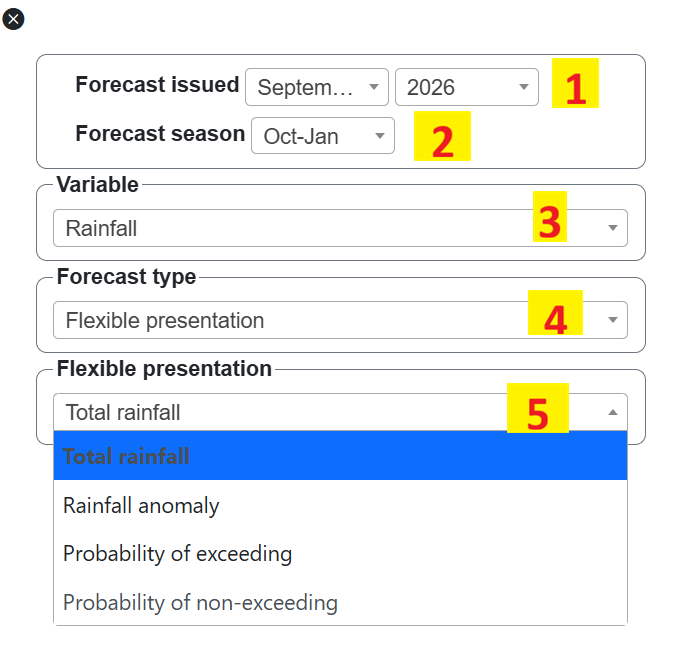
    </td>
    <td width="60%" valign="top">
      <h3>Map control menu</h3>

      
<strong>1. Forecast issued:</strong> Choose an available issue month and year. The illustrated issue is <strong>September 2026</strong>.

      
<strong>2. Forecast season:</strong> Select a target period available for that issue. The illustrated target is <strong>Oct–Jan</strong>.

      
<strong>3. Variable:</strong> Choose <strong>Rainfall</strong> or <strong>Temperature</strong>.

      
<strong>4. Forecast type:</strong> Choose <strong>Flexible presentation</strong> or <strong>Tercile probability</strong>.

      
<strong>5. Flexible presentation:</strong> For Rainfall, choose <strong>Total rainfall</strong>, <strong>Rainfall anomaly</strong>, <strong>Probability of exceeding</strong>, or <strong>Probability of non-exceeding</strong>. For Temperature, the amount and anomaly options become <strong>Mean temperature</strong> and <strong>Mean temperature anomaly</strong>.

      
Additional threshold fields appear when a probability-of-exceeding or non-exceeding parameter is selected.

    </td>
  </tr>
</table>

*Figure 2.1. Seasonal forecast map controls. The numbered callouts identify the forecast issue, target season, variable, forecast type, and flexible presentation parameter.*

The two forecast types provide different views:

| Forecast type | Information shown |
|---|---|
| Flexible presentation | Forecast amounts, anomalies, or probabilities relative to a selected threshold. |
| Tercile probability | The most probable of the below-normal, near-normal, and above-normal categories, together with its probability class. |

For **Flexible presentation**, select the required parameter:

| Variable | Parameter | Interpretation | Units |
|---|---|---|---|
| Rainfall | Total rainfall | Central forecast estimate of rainfall accumulated over the target season. | mm |
| Rainfall | Rainfall anomaly | Forecast rainfall estimate minus the historical reference mean for the same season. | mm |
| Temperature | Mean temperature | Forecast mean temperature for the target season. | °C |
| Temperature | Mean temperature anomaly | Forecast mean temperature minus its historical reference mean. | °C |
| Either variable | Probability of exceeding | Chance that the seasonal value will be greater than the selected threshold. | Fraction from 0 to 1 on the map. |
| Either variable | Probability of non-exceeding | Chance that the seasonal value will be less than or equal to the selected threshold. | Fraction from 0 to 1 on the map. |

For a probability map, choose how to define the threshold:

- **Percentile:** Select a percentile of the fitted historical reference distribution. The menu provides **10 to 90**, in steps of **5 percentile points**. The application maps use **65**.
- **Rainfall:** Enter an amount in **millimeters**.
- **Temperature:** Enter a value in **degrees Celsius** when Temperature is selected.

A percentile defines a reference threshold. At the **65th percentile**, approximately 65% of the fitted historical distribution lies at or below the threshold and 35% lies above it. The forecast probability of exceeding that threshold is calculated from the forecast distribution and can differ from 35%.

The rainfall amount corresponding to the 65th percentile varies between locations. A map using this percentile compares each grid point with its own historical threshold.

Close the panel to update the map. Use **Redraw map** if another update is required. Review the issue and target after changing the variable, because available forecasts depend on the selected product.

### 2.2. Chart control

Use the expand button on each preview to open its detailed chart. All three expanded charts provide **Forecast issued**, **Forecast season**, and **Variable** controls. Check these settings separately when comparing a chart with the map.

#### 2.2.1. Tercile probability chart

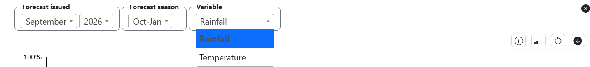

*Figure 2.2. Controls for the expanded tercile probability chart accessed through Menu 6.*

The chart displays probabilities for three categories defined by the historical distribution:

| Category | Historical position |
|---|---|
| Below Normal | Lower third of the distribution. |
| Near Normal | Middle third of the distribution. |
| Above Normal | Upper third of the distribution. |

For rainfall, these categories describe relatively dry, near-normal, and relatively wet seasonal totals. Each category has a climatological probability of approximately **33.3%**. Forecast probabilities can shift toward one or more categories and together sum to approximately **100%**, allowing for rounding.

#### 2.2.2. Probability-of-exceeding chart

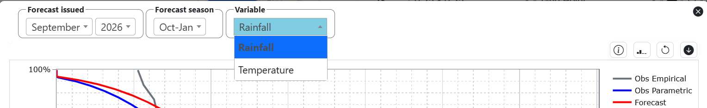

*Figure 2.3. Controls for the probability-of-exceeding chart accessed through Menu 7.*

For rainfall, the horizontal axis shows **Total Rainfall (mm)**, and the vertical axis shows **Probability of exceeding** a selected amount. The curves decrease as the rainfall threshold increases.

The illustrated curves are:

- **Obs Empirical, gray:** Historical exceedance probabilities derived from the observed sample.
- **Obs Parametric, blue:** Exceedance probabilities from a fitted historical reference distribution.
- **Forecast, red:** Exceedance probabilities from the forecast distribution.

Hover over the chart to compare the probabilities at a rainfall threshold. This chart shows an exceedance probability, equivalent to **1 minus the cumulative distribution function**.

#### 2.2.3. Probability density chart

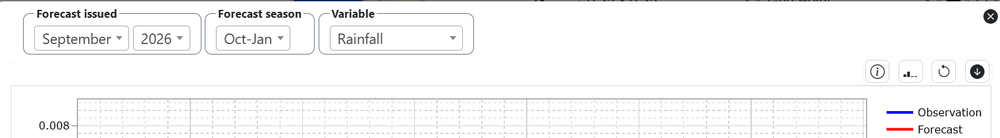

*Figure 2.4. Controls for the probability density chart accessed through Menu 8.*

The probability density function, or **PDF**, shows the shape of the historical and forecast distributions:

- **Observation, blue:** Fitted historical reference distribution.
- **Forecast, red:** Forecast distribution.

For rainfall, the horizontal axis shows the seasonal total in **millimeters**. The vertical axis shows **probability density**, with units of inverse millimeters. Probability over an interval is represented by the area under the curve over that interval.

The height of a density curve is interpreted differently from a percentage probability. Use the exceedance chart or the PDF's probability tooltip to read the chance of rainfall exceeding a selected amount.

## 3. Application

### 3.1. Compare forecast rainfall amounts with tercile probabilities

This example uses the **September 2026** forecast issue and the **Oct–Jan** target. Begin with **Rainfall**, **Flexible presentation**, and **Total rainfall**.

<table>
  <tr>
    <td width="35%" valign="top">
      <h3>Forecast controls</h3>
      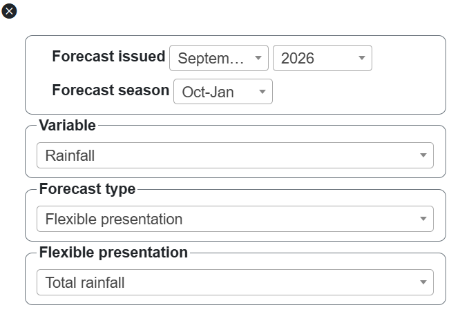
    </td>
    <td width="65%" valign="top">
      <h3>Map and chart previews</h3>
      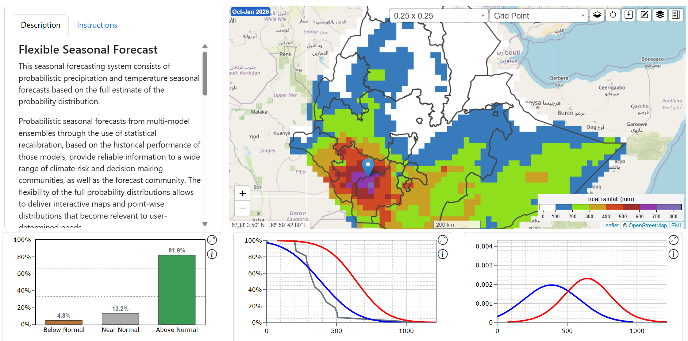
    </td>
  </tr>
</table>

*Figure 3.1. Forecast controls beside the complete seasonal forecast output for the September 2026 issue and Oct–Jan target.*

To reproduce the settings:

1. Open **Menu 4**.
2. Choose **September** and **2026** under **Forecast issued**.
3. Select **Oct–Jan** under **Forecast season**.
4. Choose **Rainfall** under **Variable**.
5. Select **Flexible presentation**, followed by **Total rainfall**.
6. Close the panel and click a grid point to update the probability previews.
7. Change **Forecast type** to **Tercile probability** to examine the category outlook for the same issue and target.

<table>
  <tr>
    <td width="50%" valign="top">
      <h3>Forecast rainfall amount</h3>
      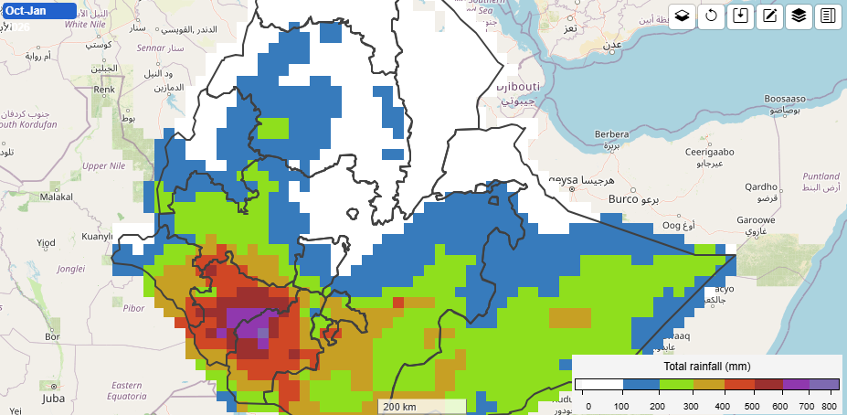
    </td>
    <td width="50%" valign="top">
      <h3>Tercile probability</h3>
      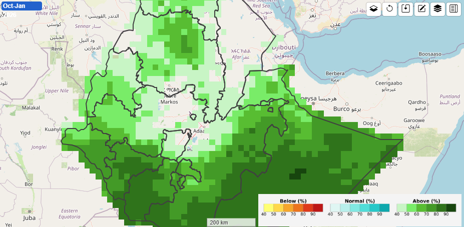
    </td>
  </tr>
</table>

*Figure 3.2. Central rainfall forecast estimate beside the most probable tercile category and its probability. Both maps use the September 2026 issue and Oct–Jan target.*

The amount map uses legend marks at **0, 100, 200, 300, 400, 500, 600, 700, and 800 mm**. Blue areas represent approximately **100–200 mm**, green areas **200–300 mm**, and mustard-colored areas **300–400 mm**. Parts of the southwest reach higher classes, including purple areas in the **600–700 mm** class.

These are central forecast estimates and map classes. The probability charts describe the range of possible outcomes around the forecast.

The tercile map uses separate color families for the winning category:

- **Yellow to red:** Below Normal.
- **Cyan shades:** Near Normal.
- **Green shades:** Above Normal.

Within each family, darker shades represent higher probabilities. The legend labels include **40%, 50%, 60%, 70%, 80%, and 90%**, with the final class extending to **100%**. The map displays a winning category when its probability is at least **40%**. Uncolored cells can therefore include places where no category reaches that display threshold, as well as areas without usable data.

In this example, green areas indicate that **Above Normal** is the most probable category across much of the mapped country. Darker southern and southeastern areas show stronger probabilities than the lighter green areas.

Read the full three-category chart at a selected point to see the probabilities assigned to the other outcomes.

### 3.2. Examine rainfall anomalies and a percentile threshold

Retain the same forecast issue, target, and variable. Under **Flexible presentation**, compare **Rainfall anomaly**, **Probability of exceeding**, and **Probability of non-exceeding**.

For the two probability maps, choose **Percentile** and set the threshold to **65**.

<table>
  <tr>
    <td width="33%" valign="top">
      <h3>Rainfall anomaly</h3>
      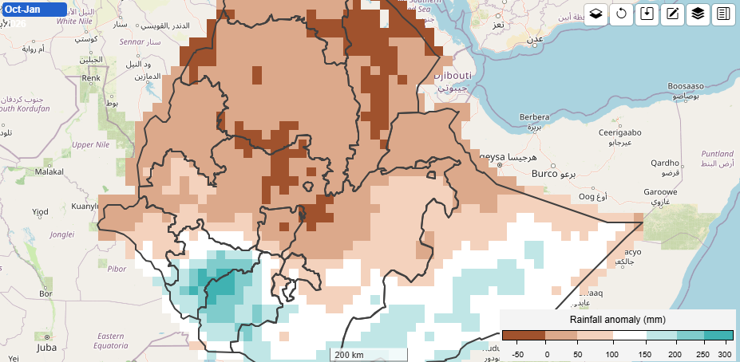
    </td>
    <td width="33%" valign="top">
      <h3>Exceeding the 65th percentile</h3>
      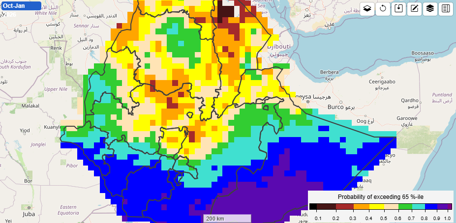
    </td>
    <td width="33%" valign="top">
      <h3>Non-exceeding the 65th percentile</h3>
      
    </td>
  </tr>
</table>

*Figure 3.3. Rainfall anomaly and probabilities of exceeding or non-exceeding the historical 65th-percentile threshold for the September 2026 issue and Oct–Jan target.*

The anomaly is calculated as:

**Rainfall anomaly = forecast rainfall estimate − historical reference mean.**

Positive values indicate rainfall above the reference mean, while negative values indicate rainfall below it. The illustrated legend is labeled **−50, 0, +50, +100, +150, +200, +250, and +300 mm**.

This exported color scale is **not centered on zero**. Some brown shades fall within positive anomaly ranges, and the white band does not identify zero. Read the numeric legend when determining the sign of an anomaly. For example, a class of **+50 to +100 mm** represents rainfall 50–100 mm above the reference mean, whatever its displayed color.

The probability maps answer different threshold questions:

| Product | Question answered |
|---|---|
| Probability of exceeding 65 %-ile | What is the forecast chance that rainfall will be above the historical 65th-percentile amount at this grid point? |
| Probability of non-exceeding 65 %-ile | What is the forecast chance that rainfall will be at or below that same amount? |

The threshold label **65 %-ile** identifies a historical percentile. The map's numerical legend provides the forecast probability:

| Map probability | Percentage interpretation |
|---|---|
| 0.1 | 10%. |
| 0.3 | 30%. |
| 0.5 | 50%. |
| 0.8 | 80%. |
| 0.9 | 90%. |
| 1.0 | 100%. |

The exceedance map shows higher probability classes in much of the south and southeast, including approximately **0.8–1.0**, or **80–100%**. Some northern areas have substantially lower exceedance probabilities.

At the same point and threshold, the two probabilities are complementary:

**Probability of non-exceeding = 1 − probability of exceeding.**

For example, an exceedance probability of **0.8** corresponds to a non-exceedance probability of **0.2**. These maps reverse their color scales, so similar colors across the two panels can represent complementary numerical probabilities. Read each panel's title and legend.

### 3.3. Interpret the three-category outlook at a selected grid point

Expand **Menu 6** and select **September 2026**, **Oct–Jan**, and **Rainfall**. The illustrated expanded chart provides all three category probabilities for its selected grid point.

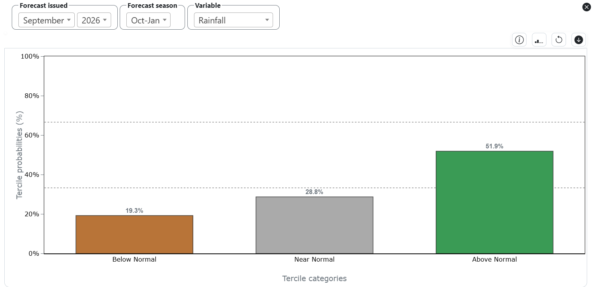

*Figure 3.4. Expanded tercile probability chart for the September 2026 issue and Oct–Jan rainfall target. The displayed probabilities are 19.3% below normal, 28.8% near normal, and 51.9% above normal.*

The homepage preview and the expanded application figure show the following readings:

| Category | Figure 1.1 preview | Figure 3.4 expanded example |
|---|---|---|
| Below Normal | 22.9% | 19.3% |
| Near Normal | 30.8% | 28.8% |
| Above Normal | 46.3% | 51.9% |
| Total | 100.0% | 100.0% |

Use the values from the specific chart being examined after checking its grid point, issue, season, and variable. The figures do not print the selected point's coordinates, and the two sets of displayed probabilities differ.

In the expanded example, **Above Normal** is the most probable category at **51.9%**. This is approximately **18.6 percentage points** above its climatological probability of 33.3%.

The combined probability of **Near Normal or Below Normal** is **28.8% + 19.3% = 48.1%**. The forecast therefore favors above-normal rainfall while retaining substantial probability for the other two outcomes.

Use this chart to communicate the complete categorical outlook. The map displays the leading category, while the chart provides the probabilities for all three categories.

### 3.4. Compare exceedance probabilities and probability density

Use **Menu 7** and **Menu 8** to examine the distribution in more detail. Retain **September 2026**, **Oct–Jan**, and **Rainfall**, and keep the same selected grid point when comparing the charts.

<table>
  <tr>
    <td width="50%" valign="top">
      <h3>Probability of exceeding</h3>
      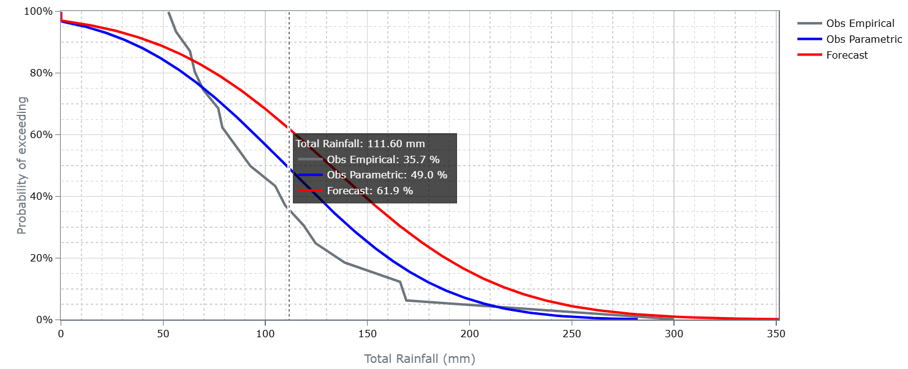
    </td>
    <td width="50%" valign="top">
      <h3>Probability density</h3>
      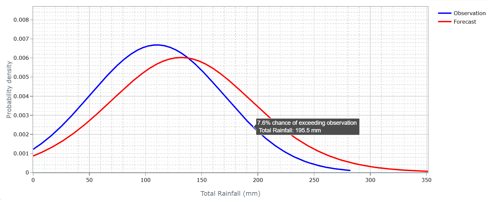
    </td>
  </tr>
</table>

*Figure 3.5. Exceedance-probability and probability-density charts side by side. The exceedance tooltip compares three probabilities at 111.60 mm; the density tooltip describes the historical observation reference at 195.5 mm.*

In the exceedance chart, the tooltip at **111.60 mm** gives:

| Curve | Probability of exceeding 111.60 mm |
|---|---|
| Obs Empirical | 35.7%. |
| Obs Parametric | 49.0%. |
| Forecast | 61.9%. |

The forecast probability of exceeding this amount is **61.9%**, compared with **49.0%** in the fitted historical reference. The increase is **12.9 percentage points**. The corresponding forecast probability of receiving **111.60 mm or less** is **38.1%**.

The empirical and parametric observation curves summarize the historical reference differently: one uses the observed sample, while the other uses a fitted distribution. Their probabilities can differ at the same rainfall amount.

The **111.60 mm** threshold is an amount read from the chart. It is a separate example from the **65th-percentile** threshold used in Figure 3.3.

In the density chart, the blue reference curve peaks at approximately **110 mm**, while the red forecast curve peaks at approximately **130 mm**. Their peak densities are approximately **0.0066 per mm** and **0.0060 per mm**, respectively. These are estimates from the axes. The red curve is shifted toward higher rainfall amounts in this example.

The displayed density tooltip reads **7.6% chance of exceeding observation** at **195.5 mm**. It belongs to the **blue observation reference curve**, so the 7.6% value describes the historical fitted probability of exceeding that amount. To obtain the forecast probability at 195.5 mm, read the **red forecast curve** in the exceedance chart or hover over the corresponding forecast point in the density chart.

Use the two displays together: the exceedance chart answers a threshold-probability question directly, while the density chart shows how the forecast distribution is positioned and spread relative to the historical reference.
