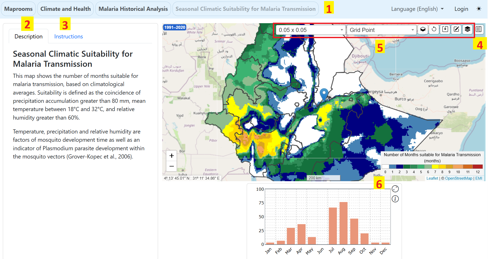
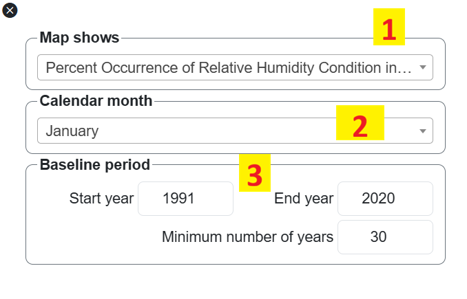
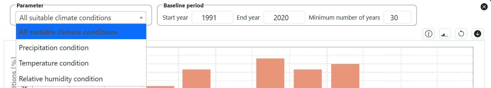
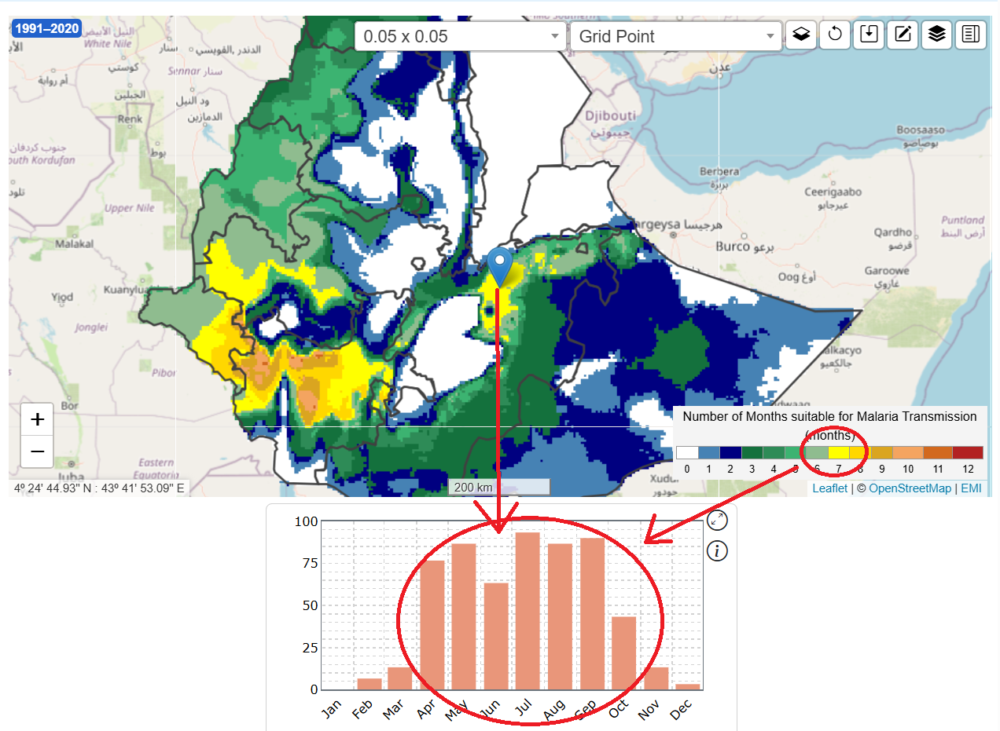

# Seasonal Climatic Suitability for Malaria Transmission Maproom

## 1. Overview

The Seasonal Climatic Suitability for Malaria Transmission Maproom, within **Climate and Health → Malaria Historical Analysis**, examines the seasonal occurrence of climate conditions associated with malaria transmission. It provides a map of the number of suitable months, monthly maps of historical condition frequencies, and a monthly frequency chart for a selected location.

The Description panel defines suitability through the coincidence of three conditions:

| Climate condition | Criterion described by the Maproom |
|---|---|
| Precipitation | Monthly accumulation greater than **80 mm**. |
| Temperature | Monthly mean temperature between **18°C and 32°C**. |
| Relative humidity | Relative humidity greater than **60%**. |

These criteria describe climatic suitability. A mapped value or chart percentage is not a count of malaria cases or the probability that a person will become infected. The climate-based approach is described by [Grover-Kopec and colleagues (2006)](https://pubmed.ncbi.nlm.nih.gov/16689992/).

Use this Maproom to investigate:

- Geographic differences in the number of climatically suitable months.
- Months when the three climate conditions occur together more frequently at a selected location.
- Differences between the precipitation, temperature, and relative-humidity conditions.
- How the selected historical baseline affects the analysis.

Open **Maprooms → Climate and Health → Malaria Historical Analysis → Seasonal Climatic Suitability for Malaria Transmission**.

*Figure 1.1. Main areas of the suitability Maproom. The illustrated map shows the number of suitable months using the 1991–2020 baseline, alongside a monthly frequency chart for the selected grid point.*

- **Menu 1:** Navigation path to the suitability page.
- **Menu 2:** Description of the climate conditions used in the analysis.
- **Menu 3:** General instructions for using the Maproom.
- **Menu 4:** Button for opening the map controls.
- **Menu 5:** Toolbar for location selection and shared map tools.
- **Menu 6:** Monthly condition-frequency chart preview, which can be expanded.

The illustrated spatial selector displays **0.05° × 0.05°** and **Grid Point**. The chart represents the selected location. Check its information window before recording coordinates or describing the location.

For shared navigation, layers, chart appearance, and downloading results, see [Navigating Maprooms](common-navigation.md).

## 2. Settings

### 2.1. Map control

Select **Menu 4** to choose the map output, calendar month, and baseline period.

<table>
  <tr>
    <td width="40%" valign="top">
      
    </td>
    <td width="60%" valign="top">
      <h3>Map control menu</h3>
      
<strong>1. Map shows:</strong> Choose the suitability output to display. The illustration selects the historical occurrence of the relative-humidity condition.

      
<strong>2. Calendar month:</strong> Choose the recurring month for a monthly occurrence map. The illustrated choice is <strong>January</strong>.

      
<strong>3. Baseline period:</strong> Set the start year, end year, and minimum number of valid years. The illustration uses <strong>1991–2020</strong> and a minimum of <strong>30 years</strong>.

    </td>
  </tr>
</table>

*Figure 2.1. Controls for a January relative-humidity occurrence map over 1991–2020.*

The illustrated map products have two different types of units:

| Map output | Information shown | Units |
|---|---|---|
| Number of Months suitable for Malaria Transmission | Number of calendar months meeting the climatological suitability criteria. | Months, from **0 to 12**. |
| Percent Occurrence of All Three Climate Conditions | Historical occurrence of the three conditions together in the selected calendar month. | **%**. |
| Percent Occurrence of Precipitation Condition | Historical occurrence of the precipitation condition in the selected month. | **%**. |
| Percent Occurrence of Temperature Condition | Historical occurrence of the temperature condition in the selected month. | **%**. |
| Percent Occurrence of Relative Humidity Condition | Historical occurrence of the humidity condition in the selected month. | **%**. |

The number-of-months map summarizes the annual climatological pattern. The percentage maps examine one recurring calendar month across the selected historical years. Check the legend title and units after changing the output.

The three climate thresholds are described in the information panel. The illustrated controls provide output, month, and baseline choices; they do not include editable rainfall, temperature, or humidity thresholds.

The period 1991–2020 contains 30 calendar years. Retain the minimum-valid-year setting with the reported baseline, because incomplete records can affect whether a result is available.

Close the panel to update the map. Use **Redraw map** if another update is required.

### 2.2. Chart control

Select a location, then expand **Menu 6** to examine monthly historical frequencies.

*Figure 2.2. Expanded chart controls. The baseline is 1991–2020, with a minimum of 30 valid years.*

The **Parameter** choices are:

- **All suitable climate conditions:** The three conditions occurring together.
- **Precipitation condition:** The rainfall criterion considered separately.
- **Temperature condition:** The temperature criterion considered separately.
- **Relative humidity condition:** The humidity criterion considered separately.

The horizontal axis runs from January to December. The vertical axis expresses historical occurrence as a percentage. For example, **80% for July** means the selected condition occurred in approximately eight out of ten valid Julys within the selected baseline.

The chart has its own baseline fields. Review them when comparing its monthly bars with a map. After changing the parameter or baseline, use the circular-arrow update button where required.

### 2.3. Reading months and percentages

Keep the two summaries separate:

- **6 months** on the annual map describes the length of the climatologically suitable part of the year.
- **60%** on a monthly map or chart describes historical occurrence in a particular calendar month.

A monthly bar above zero does not by itself establish that the month is counted in the climatological map. Use the map's month-count legend for the annual summary and the chart's percentage axis for historical frequency.

The joint occurrence of all three conditions can be lower than the occurrence of any condition considered separately. A frequently satisfied temperature condition does not establish that rainfall and humidity are also suitable at the same time.

## 3. Application

### 3.1. Locate areas with a longer climatically suitable season

Choose **Number of Months suitable for Malaria Transmission** and retain the **1991–2020** baseline.

*Figure 3.1. Number of climatically suitable months over the illustrated historical baseline.*

The legend runs from **0 to 12 months**. White and blue classes indicate shorter suitable periods, green classes indicate intermediate periods, and yellow through warmer colors indicate longer periods.

The illustrated map shows longer suitable periods in parts of western and southwestern Ethiopia and along parts of the central-eastern transition zone. Much of the eastern lowlands and some highland areas appear in shorter-duration classes. Read the local color against the legend rather than assigning one value to an entire administrative region.

To examine a location:

1. Open **Menu 4** and select the number-of-months output.
2. Set the baseline to **1991–2020** and the minimum number of years to **30**.
3. Close the panel and check the legend's units.
4. Select **Grid Point** and click a location within the data coverage.
5. Read the monthly chart and open its information window.

*Figure 3.2. Connecting the annual month-count map with the selected location's monthly historical frequencies.*

At this illustrated location, the higher monthly frequencies are concentrated from approximately **April through September**. July is close to **90–95%**, June is around **60–65%**, and October is around **40–45%**. These are approximate readings from the bars, not exported numerical observations.

The annotated point differs from the point in Figure 1.1, so their monthly profiles need not match. Use chart information to retain the location with an exported result.

### 3.2. Compare the three conditions for January

Keep **January** and the same baseline, then compare the individual conditions with their joint occurrence.

<table>
  <tr>
    <td width="50%" valign="top">
      <h3>Relative humidity condition</h3>
      
    </td>
    <td width="50%" valign="top">
      <h3>Temperature condition</h3>
      
    </td>
  </tr>
  <tr>
    <td width="50%" valign="top">
      <h3>Precipitation condition</h3>
      
    </td>
    <td width="50%" valign="top">
      <h3>All three conditions together</h3>
      
    </td>
  </tr>
</table>

*Figure 3.3. January occurrence maps for the individual climate conditions and their coincidence.*

To reproduce the comparison:

1. Set **Calendar month** to **January**.
2. Retain **1991–2020** and **30 minimum years**.
3. Select each of the three individual-condition outputs in turn.
4. Select the joint-occurrence output.
5. Compare the same locations using each map's percentage legend.

The temperature condition occurs frequently across many areas, while the January precipitation and joint-condition maps show much more restricted higher occurrence. This illustrates why the temperature map alone cannot describe the combined climatic suitability.

The exported percentage legends are partly cropped. Their titles identify the products, but their exact numerical breaks are not fully readable. Use the full interactive legend when reporting a percentage interval.

### 3.3. Examine another month or historical baseline

Select another calendar month while retaining the baseline to compare seasonal changes. At a selected point, expand the chart and switch between the four parameters to identify which condition has lower occurrence during that month.

For a baseline comparison, change the historical years while keeping the output, calendar month, and location fixed. Review the minimum-valid-year requirement for the new period, and record both the baseline and the location with the result.
