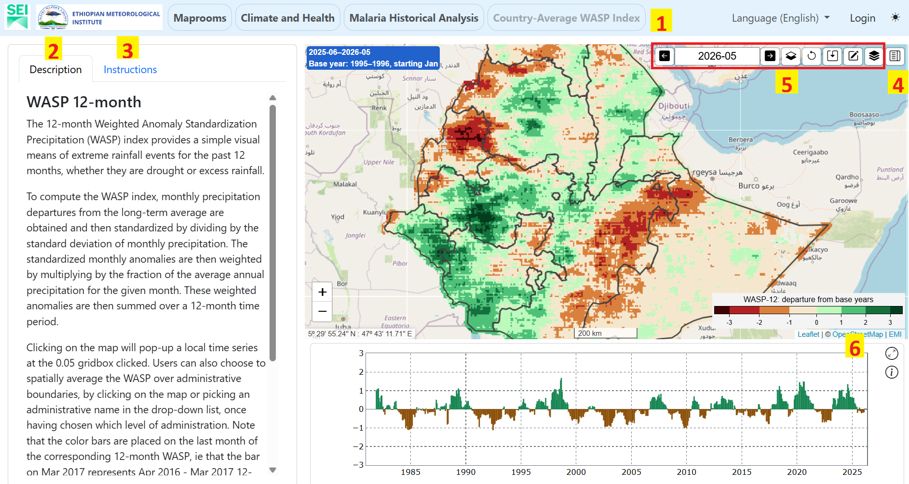
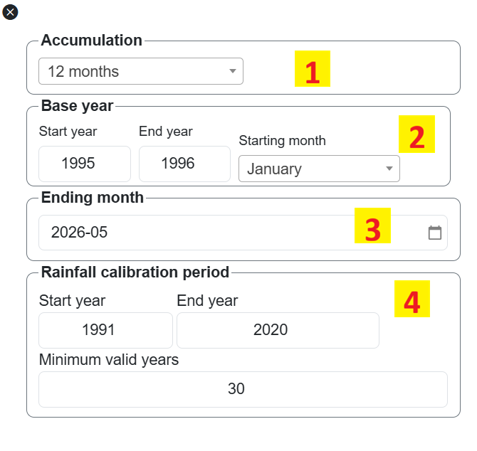
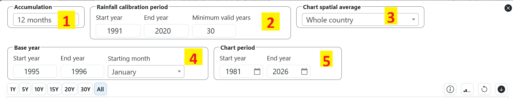
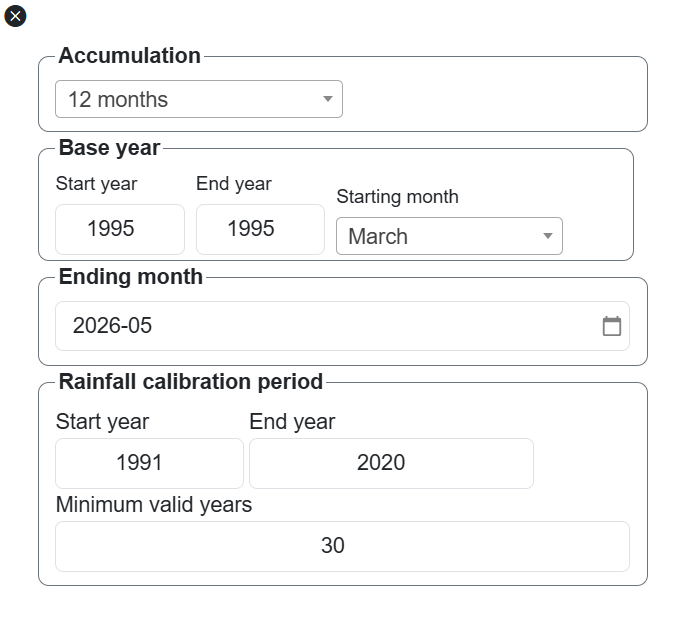
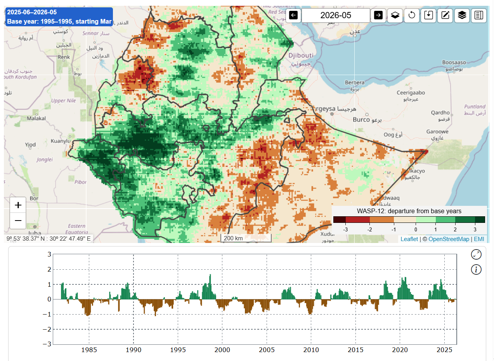
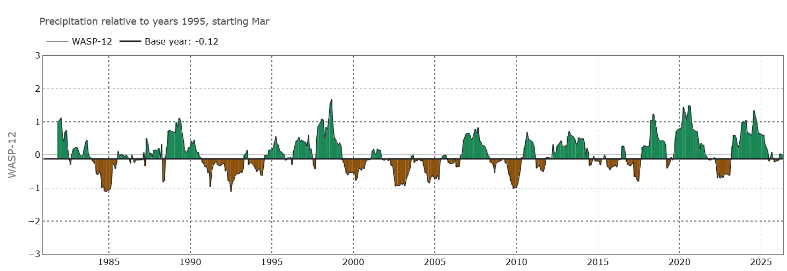

# Country-Average WASP Index Maproom

## 1. Overview

The Country-Average WASP Index Maproom, within **Climate and Health → Malaria Historical Analysis**, examines accumulated rainfall anomalies and compares them with a selected reference episode. It provides a map for an accumulation period ending in a selected month and a historical WASP chart.

**WASP** stands for **Weighted Anomaly Standardized Precipitation**. Monthly rainfall departures are standardized and weighted by each month's contribution to the average annual rainfall before being accumulated. The resulting index has no physical units. The method and its use for historical climate comparisons are introduced in the [IRI WASP training guide](https://iri.columbia.edu/wp-content/uploads/2016/05/wasp_tma.pdf).

The illustrated page uses a **12-month accumulation**. Each chart value is placed at the ending month of its accumulation interval. For example, the value ending in **May 2026** represents **June 2025–May 2026**.

Use this Maproom to investigate:

- Geographic differences in rainfall conditions relative to selected comparison years.
- Historical periods with positive or negative accumulated rainfall anomalies.
- The relationship between a country-average index and local mapped differences.
- How choosing a different comparison episode changes the reference used to describe conditions.

Open **Maprooms → Climate and Health → Malaria Historical Analysis → Country-Average WASP Index**.

*Figure 1.1. Main areas of the WASP Maproom. The map covers June 2025–May 2026 and reports comparison years 1995–1996, starting January.*

- **Menu 1:** Navigation path to the WASP page.
- **Menu 2:** Description of WASP and its historical interpretation.
- **Menu 3:** General instructions for using the Maproom.
- **Menu 4:** Button for opening map controls.
- **Menu 5:** Toolbar for navigating between ending months and accessing map tools.
- **Menu 6:** Historical WASP chart preview, which can be expanded.

Read the map banner, map legend, and chart controls together. The map legend identifies a **departure from base years**, while the expanded chart also displays the WASP series and a reference line for the chosen comparison episode.

For shared navigation, layers, chart appearance, and downloading results, see [Navigating Maprooms](common-navigation.md).

## 2. Settings

### 2.1. Map control

Select **Menu 4** to configure the accumulation, comparison episode, ending month, and rainfall calibration period.

<table>
  <tr>
    <td width="40%" valign="top">
      
    </td>
    <td width="60%" valign="top">
      <h3>Map control menu</h3>
      
<strong>1. Accumulation:</strong> Select an available accumulation length. The illustrated selection is <strong>12 months</strong>.

      
<strong>2. Base year:</strong> Enter the comparison start and end years and the <strong>Starting month</strong>. The illustration uses <strong>1995–1996</strong>, starting in <strong>January</strong>.

      
<strong>3. Ending month:</strong> Select the year and month ending the mapped accumulation. The illustrated value is <strong>2026-05</strong>.

      
<strong>4. Rainfall calibration period:</strong> Enter the historical years used to calibrate rainfall anomalies and the minimum valid-year requirement. The example uses <strong>1991–2020</strong> and <strong>30 minimum valid years</strong>.

    </td>
  </tr>
</table>

*Figure 2.1. WASP map controls for a twelve-month interval ending in May 2026.*

The date groups serve different purposes:

| Setting | Role in the analysis |
|---|---|
| Ending month and accumulation | Define the interval represented by the map. |
| Base year and starting month | Identify the selected comparison episode, reported in the map banner and chart reference. |
| Rainfall calibration period | Defines the historical rainfall reference used to standardize the anomalies. |

The comparison years are separate from the rainfall calibration years. Selecting **1995** as the comparison episode does not replace the illustrated **1991–2020** calibration period.

The screenshots show the accumulation selector closed at 12 months. Use the choices provided by the current page when selecting a different length.

Close the panel to update the map. Read the accumulation dates and comparison settings printed in the banner after each change. Use the previous and next arrows in **Menu 5** to move between ending months.

### 2.2. Chart control

Expand **Menu 6** to inspect the historical series and its reference settings.

*Figure 2.2. Expanded WASP chart controls. The illustrated spatial average is Whole country, and the chart period is 1981–2026.*

| Number | Control | Illustrated value and purpose |
|---|---|---|
| 1 | Accumulation | **12 months**, defining the rainfall interval summarized by each plotted value. |
| 2 | Rainfall calibration period | **1991–2020**, with **30 minimum valid years**. |
| 3 | Chart spatial average | **Whole country**, defining the geographic summary represented by the chart. |
| 4 | Base year | **1995–1996**, starting in **January**, defining the comparison reference. |
| 5 | Chart period | **1981–2026**, defining the historical years shown. |

Review the chart settings independently of the map, particularly after changing the base years or spatial average.

Use the circular-arrow update button after changing settings where required. The year-range buttons and range selector change the visible historical interval. The information button provides the details associated with the plotted result.

The Description panel also describes local grid-point and administrative-area analyses. Where those selections are available, confirm the selected area in the chart controls or information window. A chart labeled **Whole country** describes a national spatial average.

### 2.3. Reading map departures and chart values

The illustrated map legend is labeled **WASP-12: departure from base years**. Brown and red classes indicate negative departures from the selected comparison reference, while green classes indicate positive departures. The labeled breaks include **−3, −2, −1, 0, 1, 2, and 3**.

The exported historical chart displays the **WASP-12 series** and a separate **Base year** reference line. Its positive and negative values are index values, not rainfall totals in millimeters or percentage rainfall anomalies.

Keep the chart's zero level separate from its comparison line. A negative WASP value can still be higher than a negative comparison reference. Read the map's departure label and the chart's reference line before describing a result as wetter or drier than the selected episode.

## 3. Application

### 3.1. Compare June 2025–May 2026 with the selected 1995 episode

This example uses **12 months**, an ending month of **May 2026**, and comparison years **1995–1995**, starting in **March**. Rainfall calibration remains **1991–2020**, with **30 minimum valid years**.

<table>
  <tr>
    <td width="35%" valign="top">
      <h3>Map controls</h3>
      
    </td>
    <td width="65%" valign="top">
      <h3>Map and historical preview</h3>
      
    </td>
  </tr>
</table>

*Figure 3.1. Controls beside the WASP output. The map banner identifies June 2025–May 2026 and base years 1995–1995, starting March.*

To reproduce the selection:

1. Open **Menu 4** and choose **12 months** under **Accumulation**.
2. Under **Base year**, enter **1995** for both start and end year.
3. Set **Starting month** to **March**.
4. Set **Ending month** to **2026-05**.
5. Retain rainfall calibration **1991–2020** and **30 minimum valid years**.
6. Close the panel and check the dates and comparison settings in the banner.

The ending month defines the mapped twelve-month period, **June 2025–May 2026**. The **March** selection belongs to the comparison episode; it does not change the ending month of the displayed accumulation.

The illustrated map contains extensive green areas in parts of the west and southwest, indicating positive departures from the selected comparison reference. Brown and red areas in parts of the east, southeast, and northwest indicate negative departures.

Read individual locations against the map legend. The national chart averages across an area and can conceal contrasting local departures.

### 3.2. Read the historical chart against its reference line

Expand the chart, retain the same comparison episode, and select **Whole country** to examine the national historical series.

*Figure 3.2. Historical WASP-12 series with a comparison line labeled Base year: −0.12.*

The curve alternates between positive and negative periods. The black horizontal comparison line is labeled **−0.12**. Compare each period with that line when describing the selected 1995 reference.

For example, an index value of **−0.05** would be negative relative to zero but higher than **−0.12**. This illustrates why a brown chart segment and a negative departure from the selected comparison episode are not interchangeable descriptions.

The plot shows relatively high positive values around the late 1990s and several positive episodes in the 2020s, with intervening negative periods. Use the interactive tooltip for exact monthly values; the export supports approximate readings from the curve.

The exported chart does not print a spatial-area label. Retain the **Chart spatial average** selection or chart information with the export before attributing it to the whole country or a particular area.

### 3.3. Make a controlled comparison between reference episodes

Keep the accumulation, ending month, rainfall calibration, chart period, and spatial average unchanged. Change only the **Base year** fields and **Starting month**, then update the result.

Record the comparison episode with each map and chart. A different reference can change the departure being described even when the underlying rainfall interval remains the same.

Use the map to inspect geographic differences and the chart to place the selected period within the historical sequence. For comparisons with health outcomes, retain the rainfall and spatial reference settings alongside the outcome data; the WASP output itself is a rainfall index.
