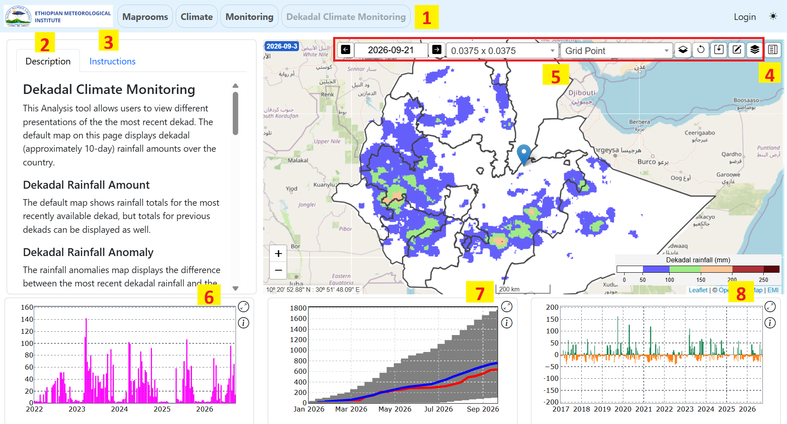
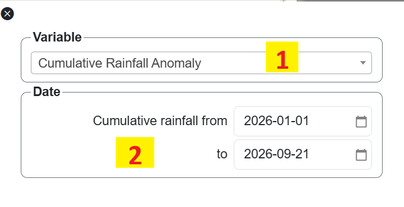
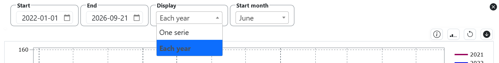
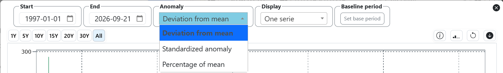
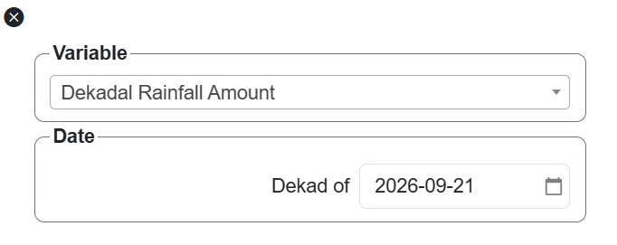
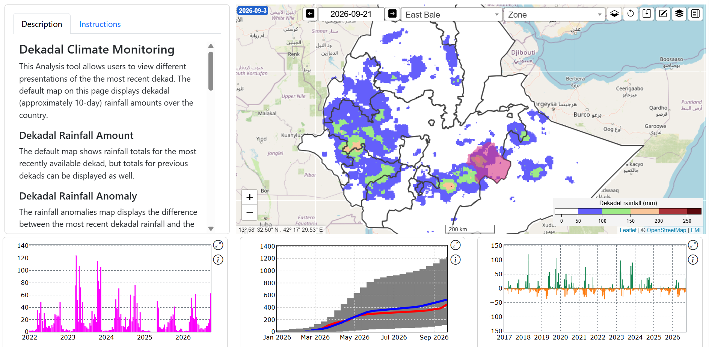
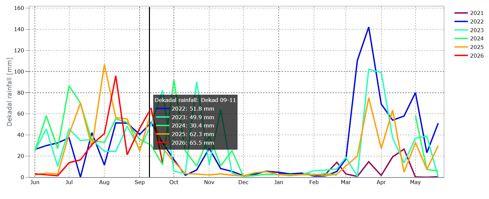
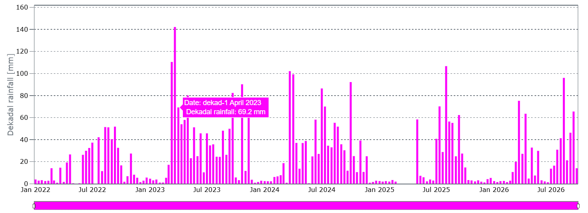
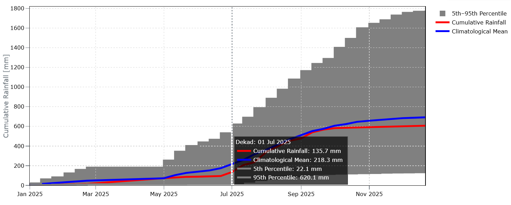
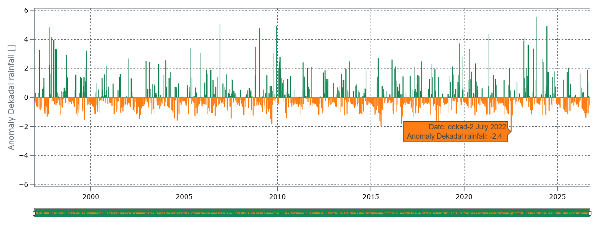

# Dekadal Climate Monitoring Maproom

## 1. Overview

The Dekadal Climate Monitoring Maproom allows you to monitor rainfall across Ethiopia for the most recently available dekad and to examine earlier dekads. You can display rainfall amounts, compare them with their historical average, track accumulated rainfall, and examine the Standardized Precipitation Index (SPI) and the Standardized Precipitation Evapotranspiration Index (SPEI).

A dekad is one of three periods within a calendar month:

| Dekad | Days included | Example for September 2026 |
|---|---|---|
| Dekad 1 | Days 1–10. | September 1–10. |
| Dekad 2 | Days 11–20. | September 11–20. |
| Dekad 3 | Day 21 through the last day of the month. | September 21–30. |

There are **36 dekads per year**. The first two contain ten days each; the third contains between eight and eleven days, depending on the month.

Dates identify dekads by their starting day. For example, **2026-09-21** represents the entire third dekad of September 2026, rather than rainfall on September 21 alone. The map also identifies this period as **2026-09-3**.

Use this Maproom to investigate:

- Where rainfall was highest or lowest during a selected dekad.
- Areas with rainfall above or below the historical average.
- Differences between rainfall departures expressed in millimeters and percentages.
- The distribution of relatively dry and wet conditions using SPI and SPEI.
- Differences in rainfall timing and amounts between years.
- Whether accumulated rainfall is keeping pace with its climatological mean.

Open the [Dekadal Climate Monitoring Maproom](http://213.55.84.78:8484/maproom_pages?maproom=climate&component=monitoring&page=dekadal).

The main areas of the page are identified below.

*Figure 1.1. Main areas of the Dekadal Climate Monitoring Maproom. The illustrated map displays rainfall amounts for September dekad 3, 2026.*

- **Menu 1:** Navigation path to the Dekadal Climate Monitoring page.
- **Menu 2:** Description of the Maproom and the available monitoring products.
- **Menu 3:** General instructions for using the Maproom.
- **Menu 4:** Button for opening the map controls.
- **Menu 5:** Toolbar for navigating between dekads, selecting a location or administrative area, and interacting with the map.
- **Menu 6:** Dekadal rainfall time-series preview, which can be expanded.
- **Menu 7:** Cumulative rainfall preview, which can be expanded to compare accumulated rainfall with climatological reference curves.
- **Menu 8:** Rainfall anomaly preview, which can be expanded.

Select a grid point or an administrative area to update the charts for that location. When an administrative area is selected, the charts describe its spatially averaged rainfall. The map displays geographic differences for the selected period, while the charts can cover a longer interval.

For shared navigation, location selection, map layers, and downloading results, see [Navigating Maprooms](common-navigation.md).

## 2. Settings

### 2.1. Map control

Select **Menu 4** to open the map controls. The panel provides a **Variable** selector and the date fields required for that product.

The following example shows **Cumulative Rainfall Anomaly** for an interval beginning on **2026-01-01** and ending with the dekad starting on **2026-09-21**.

<table>
  <tr>
    <td width="40%" valign="top">
      
    </td>
    <td width="60%" valign="top">
      <h3>Map control menu</h3>

      
<strong>1. Variable:</strong> Choose a rainfall amount, rainfall anomaly, cumulative rainfall product, <strong>SPI</strong>, or <strong>SPEI</strong>. Rainfall amounts and absolute anomalies are expressed in millimeters; percentage anomalies are expressed in percent. SPI and SPEI have no units.

      
<strong>2. Date:</strong> For a single-dekad product, use <strong>Dekad of</strong> to select the required dekad. For a cumulative product, select both <strong>Cumulative rainfall from</strong> and <strong>to</strong>.

      
In this example, the calculation covers rainfall from <strong>January dekad 1 through September dekad 3, 2026</strong>, including both endpoint dekads. The displayed end date, <strong>2026-09-21</strong>, identifies September 21–30.

    </td>
  </tr>
</table>

*Figure 2.1. Map controls for dekadal climate monitoring. Callout 1 identifies the monitoring product; callout 2 identifies its date or accumulation interval.*

The available variables have different purposes:

| Variable | Information shown | Units |
|---|---|---|
| Dekadal Rainfall Amount | Total rainfall during the selected dekad. | mm |
| Dekadal Rainfall Anomaly | Difference between the selected dekad's rainfall and its reference mean. | mm |
| Dekadal Rainfall Anomaly in Percent | Difference from the reference mean, expressed as a percentage of that mean. | % |
| Cumulative Rainfall | Total rainfall accumulated across the selected interval. | mm |
| Cumulative Rainfall Anomaly | Difference between accumulated rainfall and the climatological accumulation for the same interval. | mm |
| Cumulative Rainfall Anomaly in Percent | Difference between accumulated rainfall and the reference accumulation, expressed as a percentage of the reference. | % |
| Standard Precipitation Index (SPI) | Standardized measure of rainfall conditions for the selected dekad. | No units |
| Standardized Precipitation Evapotranspiration Index (SPEI) | Standardized measure of the balance between precipitation and reference evapotranspiration for the selected dekad. | No units |

The rainfall anomaly maps use a **1991–2020** reference climatology. For cumulative anomalies, the reference covers the same sequence of dekads as the selected accumulation interval. The map panel has no baseline-period selector; the expanded cumulative and anomaly charts provide their own **Set base period** controls.

Positive rainfall anomalies indicate wetter conditions than the reference mean; negative values indicate drier conditions. For percentage anomalies, **0%** means rainfall equals the reference mean, **+50%** means rainfall is 50% above it, and **−50%** means rainfall is half the reference mean.

Close the panel to update the map. Use **Redraw map** if another update is required. The previous and next arrows in **Menu 5** allow you to move between dekads.

### 2.2. Chart control

Use the expand button on each chart preview to open its detailed view. The three panels provide rainfall time series, cumulative rainfall, and rainfall anomalies for the selected location.

#### 2.2.1. Dekadal rainfall time-series chart

*Figure 2.2. Controls for the rainfall time-series chart accessed through Menu 6. The illustrated settings select 2022-01-01 through 2026-09-21, Each year, and June as the start month.*

The controls include:

- **Start and End:** Define the dekads included in the chart.
- **Display:** Choose **One serie** or **Each year**.
- **Start month:** When **Each year** is selected, choose the first month of the annual comparison.
- **Plot type:** In **One serie**, choose **Bar**, **Line**, or **Line + Points**.

**One serie** displays rainfall chronologically, with each value representing one dekad's rainfall total.

**Each year** places annual rainfall sequences on the same horizontal axis. With **June** as the start month, each sequence runs from June through May of the following year. Its legend label identifies the year in which that sequence begins.

The first or last sequence may be incomplete if the selected date range begins or ends partway through it. For example, a range starting in January 2022 can include a partial sequence labeled **2021**, representing the January–May 2022 portion of the June 2021–May 2022 cycle.

#### 2.2.2. Cumulative rainfall chart

*Figure 2.3. Controls for the cumulative rainfall chart accessed through Menu 7. The illustrated interval runs from January dekad 1 through September dekad 3, 2026.*

The controls include:

- **Cumulative rainfall from:** Select the first dekad included in the accumulation.
- **to:** Select the last dekad included in the accumulation.
- **Baseline period:** Select **Set base period** to review or change the reference years and minimum number of valid years used for the climatological curves.

The expanded chart contains:

- A **red curve** showing observed rainfall accumulated from the selected starting dekad.
- A **blue curve** showing the climatological mean accumulated over the same sequence of dekads.
- A **gray envelope** labeled **5th–95th Percentile**, providing lower and upper climatological reference curves.

The envelope's limits accumulate the individual dekads' 5th- and 95th-percentile rainfall values. They provide reference bounds rather than a 90% probability interval for the accumulated total.

When the red curve lies below the blue curve, accumulated rainfall is below its climatological mean. A widening gap indicates an increasing accumulated deficit; a narrowing gap indicates that rainfall is catching up with the mean.

After changing the dates or baseline, use the chart's redraw button to refresh the result. Check these settings independently of the map dates.

#### 2.2.3. Rainfall anomaly chart

*Figure 2.4. Controls for the anomaly chart accessed through Menu 8. The illustrated date range is 1997-01-01 through 2026-09-21, and the open menu shows the three anomaly methods.*

The controls include:

- **Start and End:** Define the displayed period.
- **Anomaly:** Choose **Deviation from mean**, **Standardized anomaly**, or **Percentage of mean**.
- **Display:** Choose **One serie** for the chronological series or **By dekad** to compare one recurring dekad between years.
- **Dekad:** When **By dekad** is selected, choose the recurring dekad to compare between years. For example, September dekad 3 compares the final dekad of September across the displayed years.
- **Baseline period:** Select **Set base period** to configure the reference climatology.

| Anomaly method | Interpretation |
|---|---|
| Deviation from mean | Rainfall minus the reference mean for the same dekad, in mm. |
| Standardized anomaly | Rainfall minus the reference mean, divided by the reference standard deviation; values have no units. |
| Percentage of mean | Percentage departure from the reference mean: 100 × (rainfall − mean) / mean. Zero indicates the mean. |

For example, a deviation of **−20 mm** means rainfall was 20 mm below average. A standardized anomaly of **−2** means rainfall was two reference standard deviations below average. A percentage anomaly of **−20%** means rainfall was 20% below average.

The displayed date range and baseline period serve different purposes: the date range selects the observations shown, while the baseline defines the average and variability used for comparison.

## 3. Application

### 3.1. Compare rainfall amounts and anomalies for a selected dekad

This example examines **September dekad 3, 2026**, covering **September 21–30**. It combines the rainfall amount map with absolute and percentage anomalies to show where rainfall occurred and how it differed from the reference climatology.

<table>
  <tr>
    <td width="35%" valign="top">
      <h3>Map controls</h3>
      
    </td>
    <td width="65%" valign="top">
      <h3>Map and chart previews</h3>
      
    </td>
  </tr>
</table>

*Figure 3.1. Map settings beside the complete monitoring output. The controls select Dekadal Rainfall Amount for 2026-09-21, and East Bale is selected at Zone level in the output.*

To reproduce the map selection:

1. Open **Menu 4**.
2. Select **Dekadal Rainfall Amount** under **Variable**.
3. Set **Dekad of** to **2026-09-21**.
4. Close the panel to update the map.
5. Select **Zone** in the spatial-selection toolbar, then choose **East Bale** to obtain the three chart previews for that area.

The pink overlay identifies the selected zone. Read rainfall amounts from the raster colors and legend, rather than from the selection overlay.

Keep the same dekad and compare the three rainfall products below.

<table>
  <tr>
    <td width="33%" valign="top">
      <h3>Rainfall amount</h3>
      
    </td>
    <td width="33%" valign="top">
      <h3>Anomaly in millimeters</h3>
      
    </td>
    <td width="33%" valign="top">
      <h3>Anomaly in percent</h3>
      
    </td>
  </tr>
</table>

*Figure 3.2. Rainfall amount, absolute anomaly, and percentage anomaly for September dekad 3, 2026. The anomaly maps compare rainfall with the 1991–2020 climatology for the same dekad.*

The three maps answer complementary questions:

- **How much rain fell?** The amount map uses legend marks at **0, 50, 100, 150, 200, and 250 mm**. Many blue areas are in the **50–100 mm** class, while light-green areas represent **100–150 mm** and peach-colored patches represent **150–200 mm**. These are rainfall totals for the dekad.
- **How large was the departure in millimeters?** The absolute-anomaly map's central white class spans **−25 to +25 mm**. Brown classes indicate deficits and turquoise classes indicate surpluses. The legend includes **−175, −125, −75, −25, +25, +75, +125, and +175 mm**.
- **How large was the departure relative to the average?** The percentage-anomaly map uses a central class of **−50% to +50%**, with labeled breaks extending to **−550% and +550%**. Green areas indicate rainfall above the mean; the strongest green areas in the southeast reach the upper percentage classes. These are legend classes, rather than exact values at a selected point.

A percentage anomaly of **+150%**, for example, corresponds to rainfall equal to **2.5 times** the reference mean. Percentage departures can become large where the normal rainfall amount is small, so compare them with the amount and millimeter-anomaly maps.

Negative legend breaks below **−100%** arise from the symmetric color scale. With nonnegative rainfall and a positive reference mean, a valid rainfall percentage deficit cannot be less than **−100%**. The legend limits therefore do not establish the minimum and maximum values actually observed.

This comparison helps distinguish a substantial rainfall total from an unusually wet dekad, and a small rainfall total from an unusually dry dekad. Whether an amount is above or below normal depends on the expected rainfall for that location and dekad.

### 3.2. Compare relatively dry and wet conditions using SPI and SPEI

SPI summarizes rainfall conditions relative to their historical distribution. SPEI also includes reference evapotranspiration, allowing you to examine the climatic water balance alongside rainfall alone.

To compare the illustrated maps, retain **2026-09-21** and select **Standard Precipitation Index (SPI)**, followed by **Standardized Precipitation Evapotranspiration Index (SPEI)** under **Variable**. These maps use a **one-dekad** accumulation scale.

<table>
  <tr>
    <td width="50%" valign="top">
      <h3>SPI</h3>
      
    </td>
    <td width="50%" valign="top">
      <h3>SPEI</h3>
      
    </td>
  </tr>
</table>

*Figure 3.3. SPI and SPEI for September dekad 3, 2026. Both maps use a one-dekad scale and legend boundaries of −2, −1.5, −1, +1, +1.5, and +2.*

Read the indices using the following classes:

| Index value | Interpretation |
|---|---|
| Less than −2 | Extremely dry. |
| −2 to less than −1.5 | Severely dry. |
| −1.5 to less than −1 | Moderately dry. |
| −1 to less than +1 | Near normal. |
| +1 to less than +1.5 | Moderately wet. |
| +1.5 to less than +2 | Severely wet. |
| +2 or greater | Extremely wet. |

Both figures show extensive green areas in southeastern Ethiopia, including the darkest green class of **+2 or greater**. This indicates unusually wet conditions on the selected one-dekad scale.

The SPEI map shows more extensive orange and red classes in parts of northern and central Ethiopia. Some areas reach the darkest red class, below **−2**, while the SPI map shows less extensive dry conditions in those areas. The comparison illustrates why rainfall and climatic water-balance indicators can give different pictures of the same dekad.

These indices have no units. A value of **−2** does not mean a 2 mm deficit or a 2% deficit. Also, a one-dekad index describes a short interval; assessing a persistent seasonal deficit requires examining a longer sequence of conditions.

### 3.3. Compare rainfall timing and amounts between years

Use the expanded chart in **Menu 6** to compare rainfall sequences and identify individual wet or dry dekads at a selected location.

For the illustrated annual comparison, set **Start** to **2022-01-01**, **End** to **2026-09-21**, **Display** to **Each year**, and **Start month** to **June**. Switch to **One serie** to examine the same selected period chronologically.

<table>
  <tr>
    <td width="50%" valign="top">
      <h3>Each year</h3>
      
    </td>
    <td width="50%" valign="top">
      <h3>One serie</h3>
      
    </td>
  </tr>
</table>

*Figure 3.4. Two views of dekadal rainfall. The annual comparison aligns June–May sequences, while the chronological view displays successive dekads from 2022 through September 2026.*

In the annual comparison, the tooltip at **Dekad 09-11** identifies **September dekad 2**, covering **September 11–20**. It gives the following rainfall totals:

| Year | September dekad-2 rainfall |
|---|---|
| 2022 | 51.8 mm |
| 2023 | 49.9 mm |
| 2024 | 30.4 mm |
| 2025 | 62.3 mm |
| 2026 | 65.5 mm |

For this dekad, **2026 has the highest rainfall among the five tooltip values**. Its **65.5 mm** total is **3.2 mm** above 2025 and **35.1 mm** above 2024. This comparison concerns one dekad; it does not establish which year was wettest overall.

In the chronological chart, the tooltip identifies **April dekad 1, 2023**, with **69.2 mm** of rainfall. This is the total for **April 1–10, 2023**, rather than a daily amount or a monthly total.

Use the annual view to compare the timing and magnitude of rainfall across years. Use the chronological view to inspect the sequence of wet and dry periods and hover over individual bars for their exact values.

The expanded figures do not display a location label. Check the selected grid point or administrative area before reproducing their numerical results; the **East Bale** selection is explicitly shown in Figure 3.1.

### 3.4. Assess an accumulated rainfall deficit

Use **Menu 7** to determine whether rainfall accumulated from a chosen starting dekad is above or below its climatological mean.

The application figure below shows **2025**. To examine that year, set the chart's accumulation start to **2025-01-01** and its end to **2025-12-21**, which identifies the final dekad of December. Review **Set base period**, redraw the chart, and hover over the first dekad of July.

These dates differ from the **2026** controls illustrated in Figure 2.3. Set the chart dates for this application before comparing the values.

*Figure 3.5. Accumulated rainfall during 2025 compared with its climatological mean and the envelope labeled 5th–95th Percentile. The tooltip identifies the dekad beginning July 1, 2025.*

At **July dekad 1, 2025**, the tooltip shows:

| Quantity | Value |
|---|---|
| Observed cumulative rainfall | 135.7 mm |
| Climatological mean accumulation | 218.3 mm |
| Lower reference curve, labeled 5th Percentile | 22.1 mm |
| Upper reference curve, labeled 95th Percentile | 620.1 mm |

The accumulated departure is **135.7 − 218.3 = −82.6 mm**. Relative to the displayed mean, this is approximately **37.8% below average**. The observed red curve is therefore below the blue mean curve at that dekad.

The red curve remains within the displayed gray envelope at this point. Being inside that envelope does not mean rainfall equals the mean, and the envelope does not assign a probability to the accumulated deficit.

During the later part of the displayed year, the red curve stays below the blue curve. By the end of the chart, observed rainfall is approximately **600 mm**, compared with a climatological mean of approximately **690 mm**. These two end-of-chart amounts are visual estimates; use the tooltip to obtain exact totals.

This application helps you track how a deficit develops or recovers over a sequence of dekads. A single wet dekad may reduce an accumulated deficit without removing it entirely.

### 3.5. Identify an unusually dry dekad in the historical record

Use **Menu 8** to compare individual dekads with the historical mean and variability for the same time of year.

For the illustrated example, select **Standardized anomaly** and **One serie**, and include **1997-01-01 through 2026-09-21** in the displayed range. Review the chart's baseline settings, then hover over **July dekad 2, 2022**.

Figure 2.4 shows the available methods with **Deviation from mean** selected. The application below uses **Standardized anomaly**, which has no units.

*Figure 3.6. Historical standardized dekadal rainfall anomalies. The highlighted July dekad-2 value in 2022 is −2.4. Green bars indicate positive anomalies and orange bars indicate negative anomalies.*

The tooltip gives a standardized anomaly of **−2.4** for **July dekad 2, 2022**, covering **July 11–20**. Rainfall was therefore **2.4 reference standard deviations below the mean for that recurring dekad**. This is a measure of departure relative to historical variability, rather than a rainfall amount in millimeters.

The displayed vertical axis runs from approximately **−6 to +6**. Positive green bars represent wetter-than-average dekads; negative orange bars represent drier-than-average dekads. The **zero** line corresponds to the reference mean.

To express an event's deficit in millimeters, switch to **Deviation from mean** and read the updated tooltip. To express it relative to average rainfall, choose **Percentage of mean**. Keep the location, dekad, and baseline unchanged when comparing these methods.

The standardized anomaly chart and the SPI map are different indicators. The chart directly scales a rainfall departure by the reference standard deviation, while SPI standardizes rainfall using its fitted probability distribution. Do not treat the chart's **−2.4** value as an SPI measurement.
