# Monthly Climate Monitoring Maproom

## 1. Overview

The Monthly Climate Monitoring Maproom allows you to monitor rainfall across Ethiopia for the most recently available month and to examine earlier months. Its rainfall records are reconstructed from station observations and remote-sensing proxies. You can display monthly rainfall totals, compare rainfall with its historical average, and examine the Standardized Precipitation Index (SPI) and the Standardized Precipitation Evapotranspiration Index (SPEI).

Dates use the format **YYYY-MM**. For example, **2026-09** identifies **September 2026**. A monthly rainfall total represents rainfall accumulated throughout that calendar month.

Use this Maproom to investigate:

- Areas where monthly rainfall was above or below average.
- Geographic differences in rainfall amounts and rainfall anomalies.
- Relatively dry and wet conditions identified by SPI and SPEI.
- Differences between rainfall conditions and the climatic water balance.
- Changes in rainfall timing and magnitude between years.
- Unusually wet or dry months in the historical record.

Open the [Monthly Climate Monitoring Maproom](http://213.55.84.78:8484/maproom_pages?maproom=climate&component=monitoring&page=monthly).

The main areas of the page are identified below.

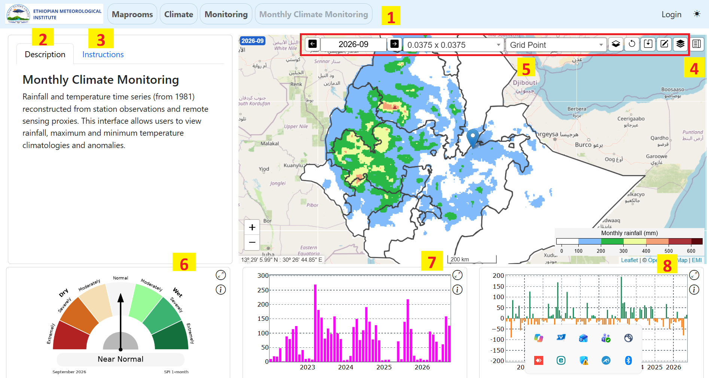

*Figure 1.1. Main areas of the Monthly Climate Monitoring Maproom. The illustrated map displays September 2026 rainfall totals, while the gauge classifies the selected grid point as Near Normal for September 2026.*

- **Menu 1:** Navigation path to the Monthly Climate Monitoring page.
- **Menu 2:** Description of the Maproom and its data.
- **Menu 3:** General instructions for using the Maproom.
- **Menu 4:** Button for opening the map controls.
- **Menu 5:** Toolbar for navigating between months, selecting a location or administrative area, and interacting with the map.
- **Menu 6:** SPI gauge for the latest available month at the selected location. Its expand button opens a historical SPI/SPEI chart.
- **Menu 7:** Monthly rainfall time-series preview, which can be expanded.
- **Menu 8:** Monthly rainfall anomaly preview, which can be expanded.

Select a grid point or an administrative area to update the charts for that location. When an administrative area is selected, the charts describe spatially averaged conditions for that area.

The map date, gauge date, and expanded chart periods should be checked separately. The gauge displays the latest available **one-month SPI** and prints its date below the dial. Selecting an earlier map month does not make the gauge a historical reading for that month; use the expanded index chart to inspect earlier values.

For shared navigation, location selection, map layers, chart appearance, and downloading results, see [Navigating Maprooms](common-navigation.md).

## 2. Settings

### 2.1. Map control

Select **Menu 4** to open the map controls. The panel provides a **Variable** selector and a **Month of** date field.

<table>
  <tr>
    <td width="40%" valign="top">
      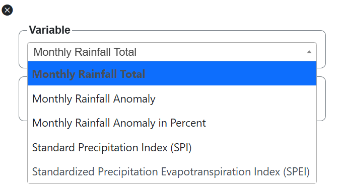
    </td>
    <td width="60%" valign="top">
      <h3>Map control menu</h3>

      
<strong>Variable:</strong> Choose <strong>Monthly Rainfall Total</strong>, <strong>Monthly Rainfall Anomaly</strong>, <strong>Monthly Rainfall Anomaly in Percent</strong>, <strong>Standard Precipitation Index (SPI)</strong>, or <strong>Standardized Precipitation Evapotranspiration Index (SPEI)</strong>.

      
<strong>Date:</strong> Use <strong>Month of</strong> to select a year and month, such as <strong>2026-09</strong> for September 2026. The open variable menu covers the date field in this illustration; Figure 3.1 shows both fields.

      
Rainfall totals and absolute anomalies are expressed in <strong>millimeters</strong>. Percentage anomalies are expressed in <strong>percent</strong>. SPI and SPEI have <strong>no units</strong>.

    </td>
  </tr>
</table>

*Figure 2.1. Monthly monitoring map controls. The open Variable menu shows the five available monitoring products.*

The available variables have different purposes:

| Variable | Information shown | Units |
|---|---|---|
| Monthly Rainfall Total | Rainfall accumulated during the selected calendar month. | mm |
| Monthly Rainfall Anomaly | Difference between the selected month's rainfall and its reference mean. | mm |
| Monthly Rainfall Anomaly in Percent | Difference from the reference mean, expressed as a percentage of that mean. | % |
| Standard Precipitation Index (SPI) | Standardized measure of rainfall conditions relative to their historical distribution. | No units |
| Standardized Precipitation Evapotranspiration Index (SPEI) | Standardized measure of the balance between precipitation and reference evapotranspiration. | No units |

The rainfall anomaly maps use a **1991–2020** reference climatology for the same calendar month. Positive anomalies indicate rainfall above the reference mean; negative anomalies indicate rainfall below it.

For percentage anomalies, **0%** means rainfall equals the reference mean, **+50%** means rainfall is 50% above it, and **−50%** means rainfall is half the reference mean.

The monthly SPI and SPEI maps use a **one-month** accumulation scale. The SPI map uses the **Gamma** distribution, and the SPEI map uses **log-Logistic**. The expanded index chart allows you to inspect the available distribution settings.

Close the panel to update the map. Use **Redraw map** if another update is required. The previous and next arrows in **Menu 5** move between months.

### 2.2. Chart control

Use the expand button on a preview to open its detailed view. The monthly page provides an SPI/SPEI index chart, a rainfall time series, and a rainfall anomaly chart.

#### 2.2.1. SPI and SPEI chart

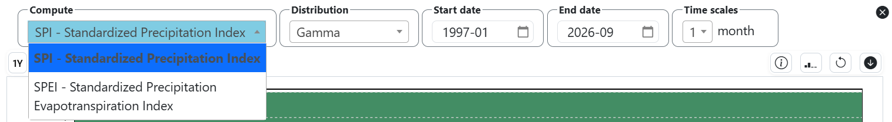

*Figure 2.2. Controls for the expanded index chart accessed through Menu 6. The illustrated settings select SPI, Gamma, January 1997 through September 2026, and a one-month time scale.*

The controls include:

- **Compute:** Choose **SPI – Standardized Precipitation Index** or **SPEI – Standardized Precipitation Evapotranspiration Index**.
- **Distribution:** Choose the distribution used to calculate the selected index.
- **Start date and End date:** Define the period displayed in the historical chart.
- **Time scales:** The monthly page provides **1 month**. Each plotted value describes conditions for one month.

For **SPI**, the distribution menu includes **Gamma**, **log-Logistic**, **Pearson Type III**, and **Z-Score**. When **SPEI** is selected, the available distribution is **log-Logistic**.

To compare the SPI chart with the SPI map, use **Gamma** and **1 month**. To compare the SPEI chart with the SPEI map, use **log-Logistic** and **1 month**. Keep the location and target month the same.

The index chart displays a black time-series line against colored dry and wet classes. Negative values indicate relatively dry conditions, positive values indicate relatively wet conditions, and values around zero indicate conditions near the reference distribution's center.

#### 2.2.2. Monthly rainfall time-series chart

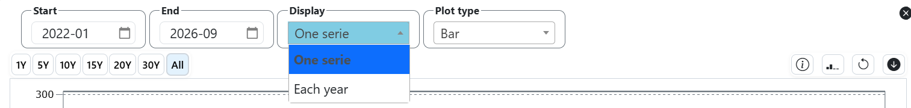

*Figure 2.3. Controls for the rainfall time-series chart accessed through Menu 7. The illustrated range is January 2022 through September 2026, with One serie and Bar selected.*

The controls include:

- **Start and End:** Define the months included in the chart.
- **Display:** Choose **One serie** or **Each year**.
- **Plot type:** In **One serie**, choose **Bar**, **Line**, or **Line + Points**.
- **Start month:** When **Each year** is selected, choose the first month of the annual comparison.

**One serie** displays successive monthly rainfall totals chronologically. Each bar or point represents rainfall for one calendar month.

**Each year** places annual sequences on the same horizontal axis. With **June** selected as the start month, each sequence runs from June through May of the following year. Its legend label identifies the year in which that sequence begins.

The first or last annual sequence may be incomplete. For example, a chart beginning in January 2022 can include a partial sequence labeled **2021**, representing the January–May 2022 portion of the June 2021–May 2022 cycle.

#### 2.2.3. Monthly rainfall anomaly chart

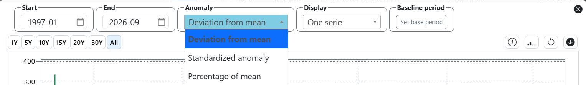

*Figure 2.4. Controls for the anomaly chart accessed through Menu 8. The illustrated settings cover January 1997 through September 2026, and the open menu shows the three anomaly methods.*

The controls include:

- **Start and End:** Define the displayed period.
- **Anomaly:** Choose **Deviation from mean**, **Standardized anomaly**, or **Percentage of mean**.
- **Display:** Choose **One serie** to display all months chronologically or **By month** to compare one recurring calendar month between years.
- **Month:** When **By month** is selected, choose the calendar month to compare.
- **Baseline period:** Select **Set base period** to review or change the reference years and the minimum number of valid years used in the climatology.

| Anomaly method | Interpretation |
|---|---|
| Deviation from mean | Rainfall minus the reference mean for the same calendar month, in mm. |
| Standardized anomaly | Rainfall minus the reference mean, divided by the reference standard deviation; values have no units. |
| Percentage of mean | Percentage departure from the reference mean: 100 × (rainfall − mean) / mean. Zero indicates the mean. |

For example, a deviation of **−20 mm** means rainfall was 20 mm below average. A standardized anomaly of **−2** means rainfall was two reference standard deviations below average. A percentage anomaly of **+100%** means rainfall was twice the reference mean.

The displayed date range selects the observations shown. The baseline period defines the average and variability used for comparison. Check the chart baseline separately when comparing its anomalies with the map.

## 3. Application

### 3.1. Assess the monthly rainfall situation at a selected location

This example examines **September 2026** using the SPI map, the selected location's gauge, and its rainfall and anomaly previews.

<table>
  <tr>
    <td width="35%" valign="top">
      <h3>Map controls</h3>
      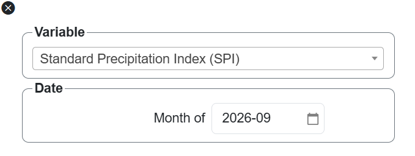
    </td>
    <td width="65%" valign="top">
      <h3>Map and chart previews</h3>
      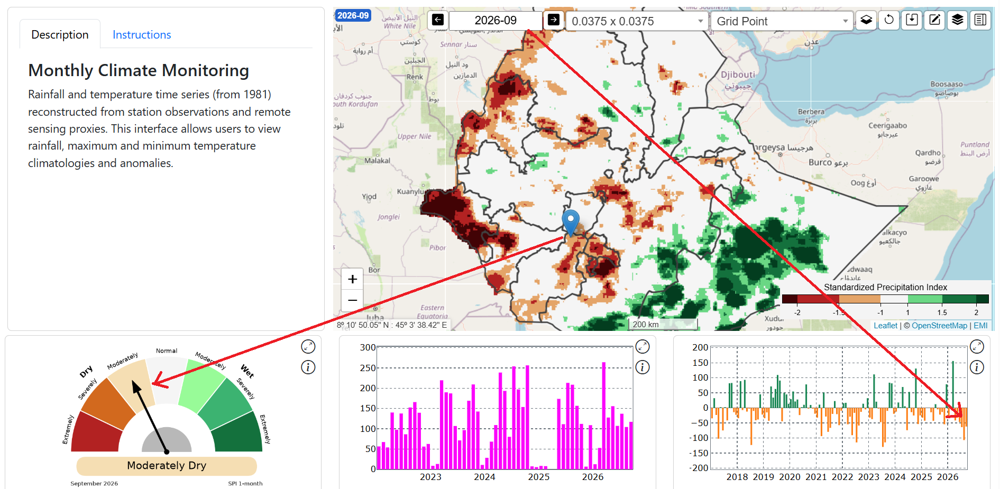
    </td>
  </tr>
</table>

*Figure 3.1. Map controls beside the complete monitoring output for September 2026. The selected grid point is classified as Moderately Dry by the SPI 1-month gauge. The red arrows connect the illustrated month, selected point, and chart information.*

To reproduce the selection:

1. Open **Menu 4**.
2. Select **Standard Precipitation Index (SPI)** under **Variable**.
3. Set **Month of** to **2026-09**.
4. Close the panel to update the map.
5. Select **Grid Point** in the spatial-selection toolbar and click the location of interest.
6. Read the date and classification printed below the gauge, then expand the charts to inspect historical values.

In the illustrated output, the gauge reads **Moderately Dry**, **September 2026**, and **SPI 1-month**. This classification corresponds to an SPI value from **−1.5 to below −1**. The dial provides a category; use the expanded chart's tooltip to obtain the exact index value.

The selected grid point is marked by the blue pin. Its exact coordinates are not printed in these figures, so selecting a nearby point can produce different numerical results. The **Near Normal** gauge in Figure 1.1 belongs to a different selected point.

Use the three previews together: the gauge summarizes the latest SPI category, the rainfall chart shows actual monthly totals through time, and the anomaly chart shows departures from average. A dry SPI category should be interpreted alongside the rainfall amounts and the historical context for that location.

### 3.2. Compare SPI, rainfall anomalies, and SPEI across the country

Retain **September 2026** and compare **SPI**, **Monthly Rainfall Anomaly**, and **SPEI**. This combination shows how rainfall departures in millimeters relate to the standardized rainfall and climatic water-balance indicators.

<table>
  <tr>
    <td width="33%" valign="top">
      <h3>SPI</h3>
      
    </td>
    <td width="33%" valign="top">
      <h3>Rainfall anomaly in millimeters</h3>
      
    </td>
    <td width="33%" valign="top">
      <h3>SPEI</h3>
      
    </td>
  </tr>
</table>

*Figure 3.2. SPI, absolute rainfall anomaly, and SPEI for September 2026. SPI and SPEI use a one-month accumulation scale; the rainfall anomaly compares the monthly total with its 1991–2020 mean.*

The maps provide different information:

- **SPI:** Shows how unusual the month's rainfall was relative to its historical distribution. Orange and red areas indicate relatively dry conditions; green areas indicate relatively wet conditions.
- **Rainfall anomaly:** Shows the difference from average in millimeters. The central white class spans **−25 to +25 mm**. The legend labels extend from **−275 to +275 mm**, with intermediate breaks at **−225, −175, −125, −75, −25, +25, +75, +125, +175, and +225 mm**. Brown classes represent deficits and turquoise classes represent surpluses.
- **SPEI:** Includes reference evapotranspiration as well as precipitation. Its dry and wet classes describe the climatic water balance on the same one-month scale.

Use the following index classes for SPI and SPEI:

| Index value | Interpretation |
|---|---|
| Less than −2 | Extremely dry. |
| −2 to less than −1.5 | Severely dry. |
| −1.5 to less than −1 | Moderately dry. |
| −1 to less than +1 | Near normal. |
| +1 to less than +1.5 | Moderately wet. |
| +1.5 to less than +2 | Severely wet. |
| +2 or greater | Extremely wet. |

Both index maps show areas in southeastern Ethiopia in the darkest green class, **+2 or greater**. Parts of western Ethiopia are in the darkest red class, below **−2**. The SPEI map shows more extensive dry classes in parts of the west and south than the SPI map.

These spatial differences show why rainfall and climatic water-balance indicators should be examined together. A rainfall anomaly measured in millimeters also depends on the local rainfall regime: the same absolute deficit can have different significance in a normally wet location and a normally dry location.

The legend values identify classes, rather than exact measurements at the pin. Hover over the relevant expanded chart to obtain a numerical value for a selected location and month.

### 3.3. Examine the historical sequence of dry and wet months

Expand **Menu 6** to place the latest index category within the historical record.

For the illustrated chart, choose **SPI** under **Compute**, **Gamma** under **Distribution**, **1997-01** as the start date, **2026-09** as the end date, and **1 month** under **Time scales**.

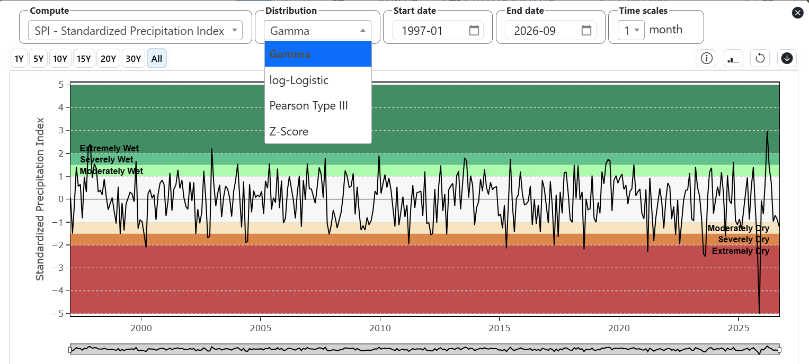

*Figure 3.3. Historical one-month SPI chart with its distribution menu open. The black line shows monthly SPI values against colored dry and wet classes; Gamma is selected.*

The central near-normal band spans **−1 to +1**. Successively darker dry classes begin below **−1**, **−1.5**, and **−2**; wet classes begin at **+1**, **+1.5**, and **+2**. The illustrated vertical axis extends from approximately **−5 to +5**.

The black line crosses the dry and wet thresholds repeatedly, showing that conditions vary between months. Near the end of the displayed record, one sharp downward excursion reaches approximately **−5**, and a later positive peak reaches approximately **+3**. These are visual estimates from the axis; use the tooltip to identify their exact dates and values.

To examine SPEI for the same location and period, change **Compute** to **SPEI**. The distribution menu then provides **log-Logistic**. Keep the displayed dates and one-month scale the same when comparing the two indices.

Use consecutive months to assess whether dry conditions persist or are interrupted by wetter months. Each value on this monthly page describes a one-month period, so a single low value does not by itself summarize an entire season.

### 3.4. Compare monthly rainfall totals between years

Use **Menu 7** to examine actual rainfall amounts and compare the annual rainfall sequence between years.

Set **Start** to **2022-01** and **End** to **2026-09**. Use **One serie** with **Bar** to examine the chronological record. Then select **Each year** and choose **June** as the start month to compare June–May cycles.

<table>
  <tr>
    <td width="50%" valign="top">
      <h3>One serie</h3>
      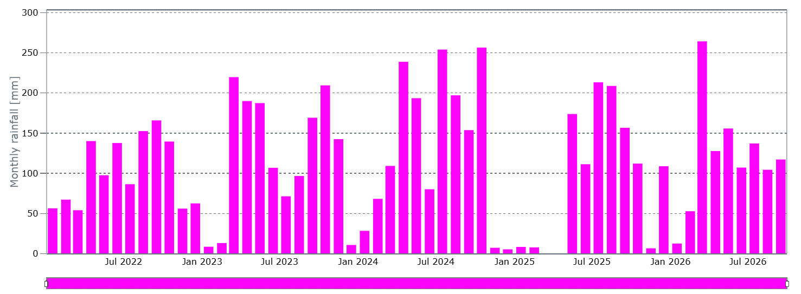
    </td>
    <td width="50%" valign="top">
      <h3>Each year</h3>
      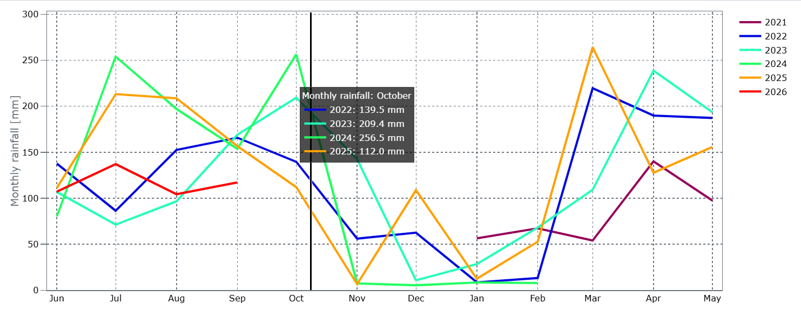
    </td>
  </tr>
</table>

*Figure 3.4. Chronological rainfall totals beside annual June–May comparisons. The tooltip in the annual view compares October rainfall in 2022–2025.*

The chronological chart uses a vertical scale of **0–300 mm**. One of its largest monthly totals occurs around **March 2026**, at approximately **265 mm**. This is an estimate from the bar height; use the tooltip for its exact value.

The annual comparison's **October** tooltip provides these exact totals:

| Year | October rainfall |
|---|---|
| 2022 | 139.5 mm |
| 2023 | 209.4 mm |
| 2024 | 256.5 mm |
| 2025 | 112.0 mm |

Among these four Octobers, **2024** has the highest total and **2025** has the lowest. October 2024 received **144.5 mm more** than October 2025 and **117.0 mm more** than October 2022.

The date range ends in **September 2026**, so the tooltip contains no October 2026 value. The red **2026** sequence stops in September because later months are outside the selected interval.

With a June start month, **March 2026** belongs to the cycle labeled **2025**, which runs from June 2025 through May 2026. The small partial cycle labeled **2021** contains the January–May 2022 portion of the selected data.

Use the annual view to compare the timing of rainfall peaks and the relative amounts in the same month. Use the chronological view to follow the sequence of wet and dry months over the entire selected period.

### 3.5. Compare an unusually wet month with other years

Use **Menu 8** to examine a historical rainfall anomaly and then compare the same calendar month across years.

Select **Percentage of mean** under **Anomaly** and include **1997-01 through 2026-09** in the displayed range. Review the baseline settings. Use **One serie** to inspect the chronological record, then select **By month** and choose **December**.

<table>
  <tr>
    <td width="50%" valign="top">
      <h3>One serie</h3>
      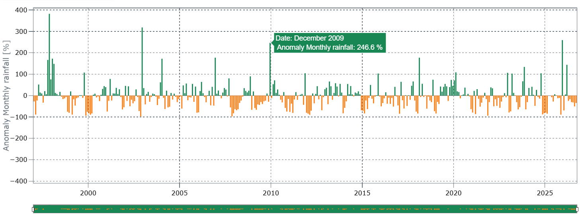
    </td>
    <td width="50%" valign="top">
      <h3>By month: December</h3>
      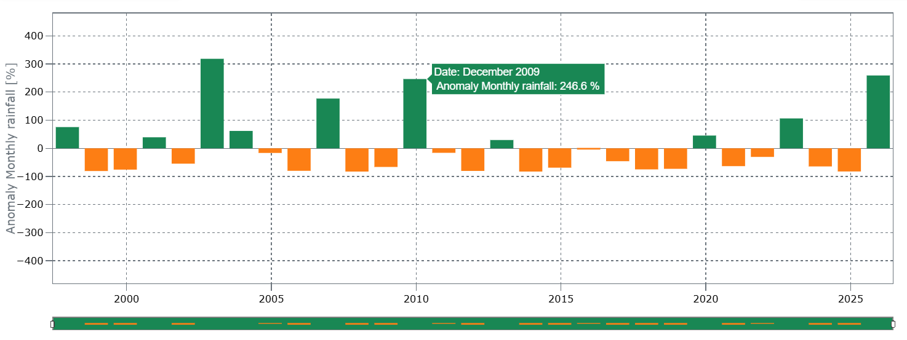
    </td>
  </tr>
</table>

*Figure 3.5. Two views of rainfall percentage anomalies. The chronological view includes all months, while the By month view compares Decembers. Both tooltips identify December 2009 with an anomaly of +246.6%.*

The tooltip reports **+246.6%** for **December 2009**. Using the percentage-departure calculation, rainfall was **246.6% above the reference December mean**, equivalent to **346.6% of that mean**, or approximately **3.47 times the average**.

The two views place that same event in different contexts:

- **One serie:** Shows December 2009 among the surrounding monthly observations, allowing you to examine how conditions changed before and after the event.
- **By month: December:** Shows one December observation per available year, making it easier to compare December 2009 with other Decembers.

Green bars indicate positive anomalies and orange bars indicate negative anomalies. The **zero** line corresponds to the reference mean for the relevant calendar month. The illustrated vertical axes include labels from approximately **−400% to +400%**; these axis limits provide plotting space and do not establish the observed anomaly range.

For nonnegative rainfall and a positive reference mean, a percentage deficit cannot be less than **−100%**. Large positive percentage anomalies can occur when the normal rainfall amount is small, so also examine the actual monthly total.

To obtain December 2009's departure in millimeters, switch to **Deviation from mean** and read the updated tooltip. Use **Standardized anomaly** to express its departure relative to the reference standard deviation. Keep the location, date, and baseline unchanged when comparing the three methods.

A standardized rainfall anomaly and SPI are different calculations. The standardized anomaly directly divides a rainfall departure by its reference standard deviation, while SPI transforms rainfall through its fitted probability distribution. Read each indicator using its own selected method and units.

The expanded chart figures do not print the selected location's coordinates or name. Check the grid point or administrative area before reproducing their numerical examples.
