# Seasonal Climate Monitoring Maproom

## 1. Overview

The Seasonal Climate Monitoring Maproom allows you to examine rainfall accumulated over several months across Ethiopia. You can display seasonal rainfall totals, compare them with their historical average, and examine the Standardized Precipitation Index (SPI) and the Standardized Precipitation Evapotranspiration Index (SPEI).

The rainfall records are reconstructed from station observations and remote-sensing proxies. The monitoring tools help you assess recent conditions and place them within the historical record.

A season is defined by a sequence of consecutive calendar months. For example, a **three-month** season starting in **July 2026** covers **July–September 2026**. A three-month season starting in **September 2019** covers **September–November 2019**.

Use this Maproom to investigate:

- Geographic differences in rainfall accumulated during a selected season.
- Areas with seasonal rainfall above or below the historical average.
- Relatively dry and wet conditions identified by SPI and SPEI.
- Differences between rainfall conditions and the climatic water balance.
- Differences in rainfall totals for the same season between years.
- Unusually wet or dry seasons in the historical record.

Open the [Seasonal Climate Monitoring Maproom](http://213.55.84.78:8484/maproom_pages?maproom=climate&component=monitoring&page=seasonal).

The main areas of the page are identified below.

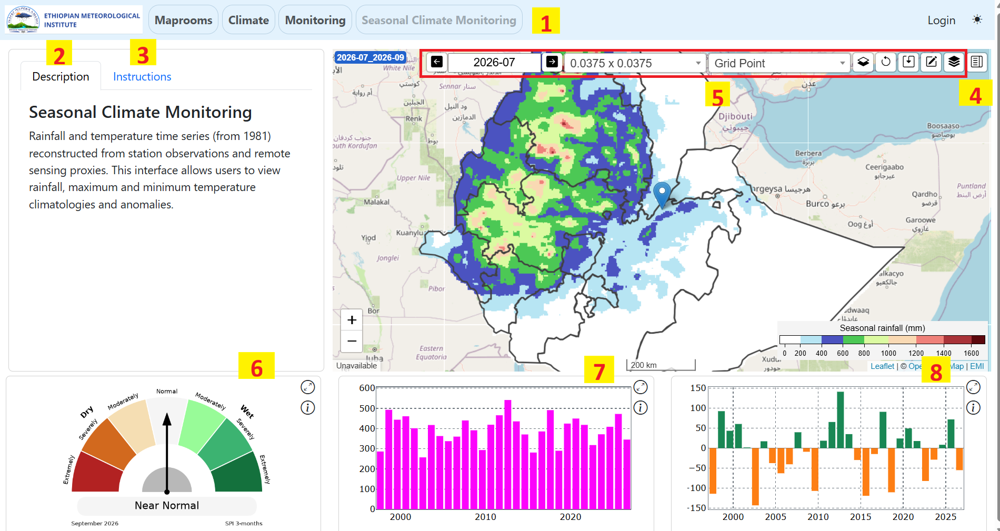

*Figure 1.1. Main areas of the Seasonal Climate Monitoring Maproom. The illustrated map displays July–September 2026 rainfall totals. The selected grid point's gauge reads Near Normal for the three-month SPI ending in September 2026.*

- **Menu 1:** Navigation path to the Seasonal Climate Monitoring page.
- **Menu 2:** Description of the Maproom and its data.
- **Menu 3:** General instructions for using the Maproom.
- **Menu 4:** Button for opening the map controls.
- **Menu 5:** Toolbar for navigating between periods, selecting a location or administrative area, and interacting with the map.
- **Menu 6:** SPI gauge for the latest available ending month at the selected location. Its expand button opens a historical SPI/SPEI chart.
- **Menu 7:** Seasonal rainfall time-series preview, which can be expanded.
- **Menu 8:** Seasonal rainfall anomaly preview, which can be expanded.

Select a grid point or an administrative area to update the charts for that location. When an administrative area is selected, the charts describe spatially averaged conditions for that area.

The gauge prints its ending month and accumulation scale below the dial. In Figure 1.1, **September 2026** and **SPI 3-months** describe rainfall accumulated over **July–September 2026**. The gauge uses the latest available SPI ending month, so check its printed date separately from the map date when examining an earlier season.

For shared navigation, location selection, map layers, chart appearance, and downloading results, see [Navigating Maprooms](common-navigation.md).

## 2. Settings

### 2.1. Map control

Select **Menu 4** to open the map controls. The panel provides a **Variable** selector and fields defining the season or index accumulation period. Available lengths range from **2 to 12 months**.

<table>
  <tr>
    <td width="40%" valign="top">
      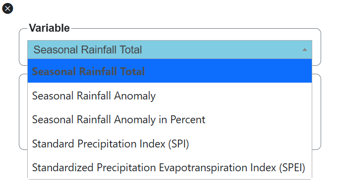
    </td>
    <td width="60%" valign="top">
      <h3>Map control menu</h3>

      
<strong>Variable:</strong> Choose <strong>Seasonal Rainfall Total</strong>, <strong>Seasonal Rainfall Anomaly</strong>, <strong>Seasonal Rainfall Anomaly in Percent</strong>, <strong>Standard Precipitation Index (SPI)</strong>, or <strong>Standardized Precipitation Evapotranspiration Index (SPEI)</strong>.

      
<strong>Rainfall totals and anomalies:</strong> Select a <strong>Start month</strong> and a <strong>Length</strong>. For example, <strong>2026-07</strong> and <strong>3 months</strong> define July–September 2026.

      
<strong>SPI and SPEI:</strong> Select the ending month under <strong>Month of</strong> and an accumulation length under <strong>Time scales</strong>. For example, <strong>2026-09</strong> and <strong>3 months</strong> also define July–September 2026.

      
Rainfall totals and absolute anomalies are expressed in <strong>millimeters</strong>. Percentage anomalies are expressed in <strong>percent</strong>. SPI and SPEI have <strong>no units</strong>.

    </td>
  </tr>
</table>

*Figure 2.1. Seasonal monitoring map controls. The open Variable menu shows the five available products and covers the date fields below it.*

The available variables have different purposes:

| Variable | Information shown | Units |
|---|---|---|
| Seasonal Rainfall Total | Rainfall accumulated over the selected sequence of months. | mm |
| Seasonal Rainfall Anomaly | Difference between the seasonal total and the reference mean for the same season. | mm |
| Seasonal Rainfall Anomaly in Percent | Difference from the reference mean, expressed as a percentage of that mean. | % |
| Standard Precipitation Index (SPI) | Standardized measure of rainfall conditions over the selected accumulation period. | No units |
| Standardized Precipitation Evapotranspiration Index (SPEI) | Standardized measure of the balance between precipitation and reference evapotranspiration over the selected period. | No units |

The date field has a different role for rainfall products and indices. To compare the same period, use equivalent settings:

| Period to examine | Rainfall total or anomaly | SPI or SPEI |
|---|---|---|
| July–September 2026 | Start month **2026-07**; Length **3 months**. | Month of **2026-09**; Time scales **3 months**. |
| September–November 2019 | Start month **2019-09**; Length **3 months**. | Month of **2019-11**; Time scales **3 months**. |
| October 2025–March 2026 | Start month **2025-10**; Length **6 months**. | Month of **2026-03**; Time scales **6 months**. |

Review the date and length after changing the variable. A season can cross the end of a calendar year, as in the six-month example above.

The rainfall anomaly maps use a **1991–2020** reference climatology for the same sequence of months. Positive values indicate rainfall above the reference mean; negative values indicate rainfall below it.

For percentage anomalies, **0%** means rainfall equals the reference mean, **+50%** means rainfall is 50% above it, and **−50%** means rainfall is half the reference mean.

The SPI map uses the **Gamma** distribution. The SPEI map uses **log-Logistic**. Use the same index, accumulation scale, location, and period when comparing a map with an expanded index chart.

Close the panel to update the map. Use **Redraw map** if another update is required. The previous and next arrows in **Menu 5** move the selected period through time.

### 2.2. Chart control

Use the expand button on a preview to open its detailed view. The seasonal page provides a historical SPI/SPEI chart, a seasonal rainfall chart, and a seasonal rainfall anomaly chart. Each expanded chart has its own period settings.

#### 2.2.1. SPI and SPEI chart

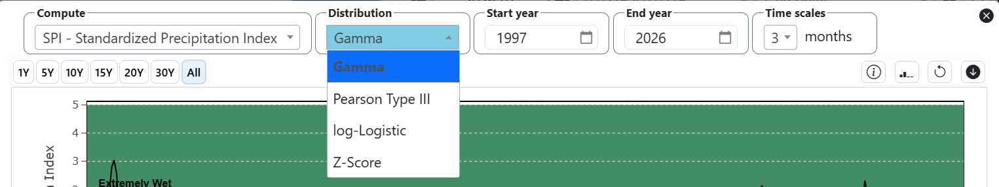

*Figure 2.2. Controls for the expanded index chart accessed through Menu 6. The illustrated settings select SPI, Gamma, 1997–2026, and a three-month accumulation scale.*

The controls include:

- **Compute:** Choose **SPI – Standardized Precipitation Index** or **SPEI – Standardized Precipitation Evapotranspiration Index**.
- **Distribution:** Choose the calculation method available for the selected index.
- **Start year and End year:** Define the period displayed in the historical chart.
- **Time scales:** Choose an accumulation length from **2 to 12 months**. The example uses **3 months**.

For **SPI**, the distribution menu includes **Gamma**, **Pearson Type III**, **log-Logistic**, and **Z-Score**. When **SPEI** is selected, the available distribution is **log-Logistic**.

The index chart displays a black line against colored dry and wet classes. At a **three-month** scale, a September value describes **July–September**, while an October value describes **August–October**. Successive monthly values therefore represent overlapping accumulation periods.

The date associated with an index value is its **ending month**. Read the tooltip and scale together to identify the complete period represented by a point.

#### 2.2.2. Seasonal rainfall time-series chart

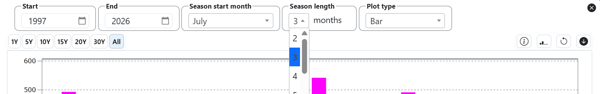

*Figure 2.3. Controls for the rainfall time-series chart accessed through Menu 7. The illustrated settings compare July–September rainfall totals over 1997–2026.*

The controls include:

- **Start and End:** Select the years included in the chart.
- **Season start month:** Choose the first month of the recurring season, such as **July**.
- **Season length:** Choose the number of consecutive months included in each total, from **2 to 12**.
- **Plot type:** Choose **Bar**, **Line**, or **Line + Points**.

With **July** and **3 months** selected, the chart provides one **July–September rainfall total per available year**. This view makes it easier to compare the same season between years.

The vertical axis shows accumulated rainfall in **millimeters**. Hover over a bar or point to read its full seasonal interval and exact total. Check this tooltip when interpreting the calendar ticks on the horizontal axis.

#### 2.2.3. Seasonal rainfall anomaly chart

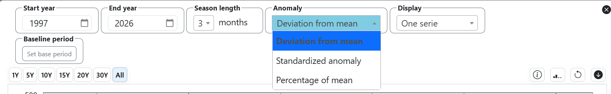

*Figure 2.4. Controls for the anomaly chart accessed through Menu 8. The illustrated settings select a three-month length, and the open menu shows the three anomaly methods.*

The controls include:

- **Start year and End year:** Define the displayed period.
- **Season length:** Choose the number of months included in each seasonal value.
- **Anomaly:** Choose **Deviation from mean**, **Standardized anomaly**, or **Percentage of mean**.
- **Display:** Choose **One serie** or **By season**.
- **Season start month:** When **By season** is selected, choose the first month of the recurring season to compare.
- **Baseline period:** Select **Set base period** to review or change the reference years and the minimum number of valid years used in the climatology.

**One serie** displays the sequence of seasonal anomalies through time. For a three-month length, consecutive values represent overlapping windows such as July–September, August–October, and September–November.

**By season** selects one recurring seasonal window. For example, **September** with a length of **3 months** compares **September–November** across years.

| Anomaly method | Interpretation |
|---|---|
| Deviation from mean | Seasonal rainfall minus the reference mean for the same season, in mm. |
| Standardized anomaly | Rainfall minus the reference mean, divided by the reference standard deviation; values have no units. |
| Percentage of mean | Percentage departure from the reference mean: 100 × (rainfall − mean) / mean. Zero indicates the mean. |

For example, a deviation of **−100 mm** means seasonal rainfall was 100 mm below average. A standardized anomaly of **+2** means rainfall was two reference standard deviations above average. A percentage anomaly of **+100%** means rainfall was twice the reference mean.

The displayed years select the observations shown. The baseline defines the average and variability used for comparison. Check the chart baseline separately when comparing its anomalies with the map.

## 3. Application

### 3.1. Assess July–September rainfall in North Shewa (OR)

This example examines **July–September 2026** in **North Shewa (OR)** at **Zone** level. It combines the seasonal rainfall map with the selected zone's SPI gauge, historical rainfall totals, and anomaly preview.

<table>
  <tr>
    <td width="35%" valign="top">
      <h3>Map variable menu</h3>
      
      
Choose <strong>Seasonal Rainfall Total</strong>, set <strong>Start month</strong> to <strong>2026-07</strong>, and use a <strong>Length</strong> of <strong>3 months</strong>.

    </td>
    <td width="65%" valign="top">
      <h3>Map and chart previews</h3>
      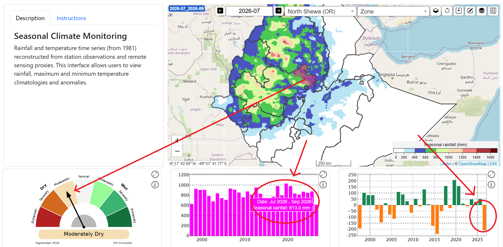
    </td>
  </tr>
</table>

*Figure 3.1. Variable controls beside the complete monitoring output for North Shewa (OR). The map period is July–September 2026, the rainfall tooltip gives 613.0 mm, and the SPI 3-months gauge reads Moderately Dry for September 2026.*

To reproduce the selection:

1. Open **Menu 4** and choose **Seasonal Rainfall Total**.
2. Set **Start month** to **2026-07** and **Length** to **3 months**.
3. Close the panel to update the map.
4. Select **Zone** in the spatial-selection toolbar and choose **North Shewa (OR)**.
5. Read the gauge, hover over the 2026 rainfall bar, and examine the latest seasonal anomaly.

The illustrated output provides the following information:

| Item | Reading in the figure |
|---|---|
| Selected area | North Shewa (OR), at Zone level. |
| Rainfall period | July–September 2026. |
| Seasonal rainfall total | **613.0 mm**, from the rainfall tooltip. |
| SPI period | Three months ending in **September 2026**, corresponding to July–September. |
| SPI classification | **Moderately Dry**, corresponding to an index from **−1.5 to below −1**. |
| Latest rainfall anomaly preview | Approximately **−210 mm**, estimated from the final orange bar and its axis. |

The **613.0 mm** total is the spatially averaged seasonal rainfall for the selected zone. The pink overlay identifies the selected administrative area; use the raster legend to interpret rainfall colors elsewhere on the map.

The orange anomaly bar shows a seasonal deficit relative to the preview's reference mean. Its approximate **−210 mm** value is an axis reading; hover over the bar to obtain the exact departure. The SPI gauge provides a standardized dry category for the same three-month accumulation in this illustrated output.

The **Near Normal** gauge in Figure 1.1 describes a different selected grid point. Location selection changes the chart results.

The exported maps below illustrate three complementary monitoring products.

<table>
  <tr>
    <td width="33%" valign="top">
      <h3>Seasonal rainfall total</h3>
      
    </td>
    <td width="33%" valign="top">
      <h3>Rainfall anomaly in millimeters</h3>
      
    </td>
    <td width="33%" valign="top">
      <h3>SPI</h3>
      
    </td>
  </tr>
</table>

*Figure 3.2. Exported seasonal rainfall total, rainfall anomaly, and SPI maps. The SPI export's complete season label is cropped; verify its ending month and accumulation scale before comparing it directly with the rainfall maps.*

Read the legends according to the selected product:

- **Seasonal rainfall total:** Legend marks run from **0 to 1,600 mm** in **200 mm** steps. Dark-blue areas represent **400–600 mm**, green areas **600–800 mm**, light-green areas **800–1,000 mm**, and peach-colored areas **1,000–1,200 mm**. These are accumulated seasonal totals.
- **Rainfall anomaly:** The central white class spans **−50 to +50 mm**. Brown classes indicate deficits, while turquoise classes indicate surpluses. The labeled breaks extend from **−650 to +650 mm**. A class such as **−150 to −50 mm** indicates rainfall between 50 and 150 mm below the reference mean.
- **SPI:** Red classes indicate relatively dry conditions and green classes relatively wet conditions. In this exported figure, extensive dark-green areas are in the **+2 or greater** class, while dark-red areas are below **−2**. The complete period is needed to relate this pattern to a specific rainfall season.

For a matched July–September 2026 comparison, set the rainfall products to **Start month 2026-07** and **Length 3**, then set SPI to **Month of 2026-09** and **Time scales 3**. Check the displayed period after each change before interpreting agreement or differences between the maps.

### 3.2. Compare historical SPI and SPEI

Use **Menu 6** to inspect how rainfall conditions and the climatic water balance vary through time.

Start with **1997–2026** and a **three-month** scale, as illustrated in Figure 2.2. Select **SPI** with **Gamma**, then change **Compute** to **SPEI**, which provides **log-Logistic**. Keep the selected location, displayed years, and accumulation scale the same for a paired comparison.

<table>
  <tr>
    <td width="50%" valign="top">
      <h3>SPI</h3>
      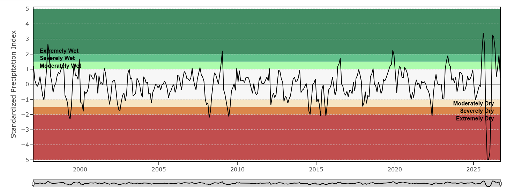
    </td>
    <td width="50%" valign="top">
      <h3>SPEI</h3>
      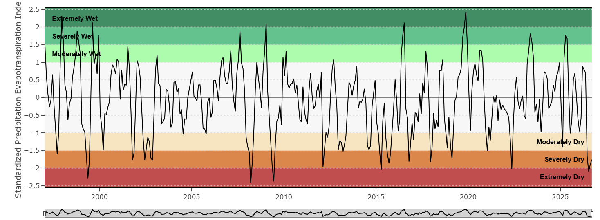
    </td>
  </tr>
</table>

*Figure 3.3. Historical SPI and SPEI displays with their classification bands. The exported plots omit their location and accumulation-scale controls; check those settings when reproducing a paired comparison.*

Use the following classification for either index:

| Index value | Interpretation |
|---|---|
| Less than −2 | Extremely dry. |
| −2 to less than −1.5 | Severely dry. |
| −1.5 to less than −1 | Moderately dry. |
| −1 to less than +1 | Near normal. |
| +1 to less than +1.5 | Moderately wet. |
| +1.5 to less than +2 | Severely wet. |
| +2 or greater | Extremely wet. |

The central near-normal band spans **−1 to +1**. Progressively darker dry classes begin below **−1**, **−1.5**, and **−2**. Wet classes begin at **+1**, **+1.5**, and **+2**.

The SPI example uses a vertical axis of approximately **−5 to +5**, while the SPEI example uses approximately **−2.5 to +2.5**. Compare the numerical values and class boundaries rather than the apparent height of peaks between the two panels.

Near the end of the SPI example, a downward excursion reaches the lower plotting boundary near **−5**, and positive peaks exceed **+3**. The SPEI example includes peaks around **+2.4** and deficits around **−2.4**. These are visual estimates; use the tooltips to obtain exact dates and values.

SPI describes the unusualness of rainfall alone. SPEI includes reference evapotranspiration, so it can show a different sequence or severity of water-balance conditions. Each value describes the accumulation scale selected in the controls.

Successive three-month index values overlap. For example, July–September and August–October share two months, so neighboring points represent related accumulation periods.

### 3.3. Compare July–September rainfall totals between years

Use **Menu 7** to compare the same recurring season across the historical record.

For the North Shewa (OR) example, select **Start 1997**, **End 2026**, **Season start month July**, **Season length 3 months**, and **Plot type Bar**. These settings produce one July–September total for each available year.

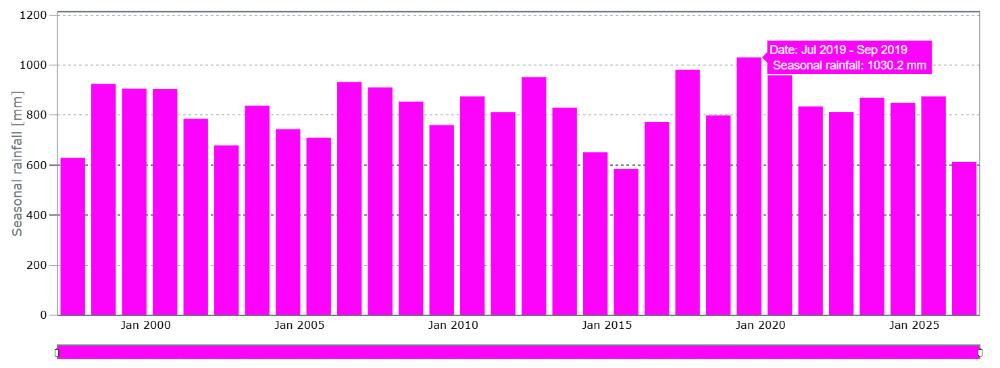

*Figure 3.4. Historical July–September rainfall totals. The tooltip identifies July–September 2019 with a total of 1,030.2 mm.*

The chart's vertical axis extends from approximately **0 to 1,200 mm**. The tooltip gives an exact total of **1,030.2 mm** for **July–September 2019**. Figure 3.1 gives **613.0 mm** for **July–September 2026**.

| Season | Rainfall total |
|---|---|
| July–September 2019 | 1,030.2 mm |
| July–September 2026 | 613.0 mm |
| 2026 minus 2019 | −417.2 mm |

The 2026 total is therefore **417.2 mm lower** than the 2019 total, or approximately **40.5% lower relative to 2019**. This percentage compares the two illustrated years. Use the anomaly chart to examine departure from the historical baseline mean.

Hover over other bars to compare their totals. Keep the same location, start month, and season length when comparing years. Changing July to September changes the seasonal window and the climatology relevant to its interpretation.

### 3.4. Examine an unusually wet September–November season

This application examines **September–November**, using a **standardized rainfall anomaly**. The highlighted event is **September–November 2019**.

Expand **Menu 8**, set **Season length** to **3 months**, choose **Standardized anomaly**, and include **1997–2026** in the displayed range. Review **Set base period** before interpreting the values.

Use **One serie** to inspect all successive three-month windows. Then select **By season** and set **Season start month** to **September** to compare September–November across years.

<table>
  <tr>
    <td width="50%" valign="top">
      <h3>One serie</h3>
      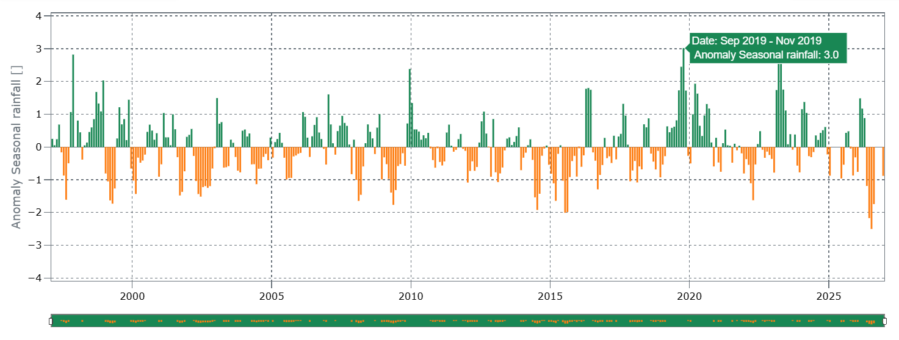
    </td>
    <td width="50%" valign="top">
      <h3>By season: September–November</h3>
      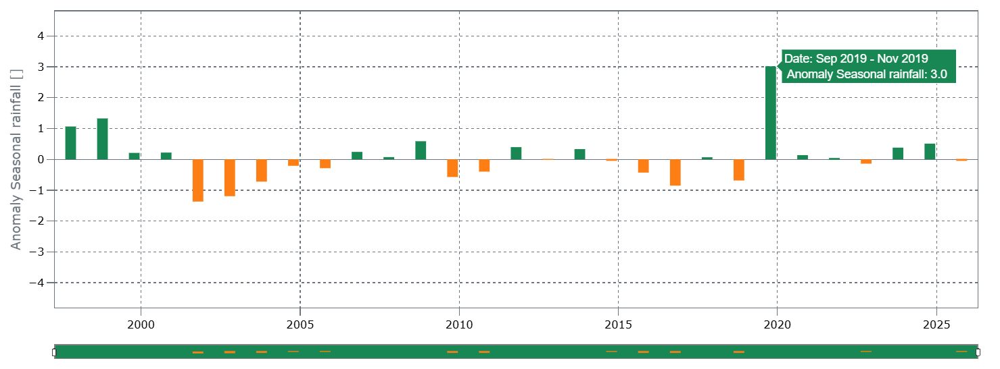
    </td>
  </tr>
</table>

*Figure 3.5. Chronological and By season views of standardized rainfall anomalies. Both tooltips identify September–November 2019 with an anomaly of +3.0.*

The tooltip gives a standardized anomaly of **+3.0** for **September–November 2019**. Rainfall was therefore **three reference standard deviations above the mean for September–November**. Standardized anomalies have no units.

The two views provide complementary information:

- **One serie:** Shows the highlighted event among the surrounding three-month windows, allowing you to examine how conditions developed before and after it.
- **By season: September–November:** Shows one value for that recurring season per available year, making it easier to compare 2019 with other September–November seasons.

Green bars indicate rainfall above the reference mean and orange bars indicate rainfall below it. The **zero** line corresponds to the mean. Both panels include axis labels from approximately **−4 to +4**.

Figure 2.4 shows **Deviation from mean** selected in the controls. Choose **Standardized anomaly** to obtain the unitless display illustrated here. To express an event's departure in millimeters, choose **Deviation from mean**; to express it relative to average rainfall, choose **Percentage of mean**.

Keep the season, location, and baseline unchanged when switching anomaly methods. The September–November 2019 anomaly and the July–September 2019 rainfall total in Figure 3.4 describe different seasonal windows, each with its own reference climatology.

A standardized rainfall anomaly and SPI are different calculations. The standardized anomaly directly divides a rainfall departure by its reference standard deviation, while SPI transforms rainfall through its fitted probability distribution. Interpret the **+3.0** tooltip using the anomaly method selected for this chart.
