# Navigating Maprooms

## 1. Overview

When you open the Maprooms website, the homepage introduces the available climate information services. From there, you can select a theme or sector, choose a product group where one is provided, and open an individual product page.

This guide explains that navigation process and the features commonly shared across product pages. It covers the page layout, map controls, location selection, layer settings, chart previews, expanded charts, chart information, and saving results.

Some products include additional controls or omit tools that are not relevant to their analysis. Use this guide for common navigation and consult the individual product guide for the meaning of its data, calculations, and specialized settings.

## 2. Settings

### 2.1. General navigation sequence

Navigation generally follows the sequence below. Some implementations open a product directly from a theme, without an intermediate product group.

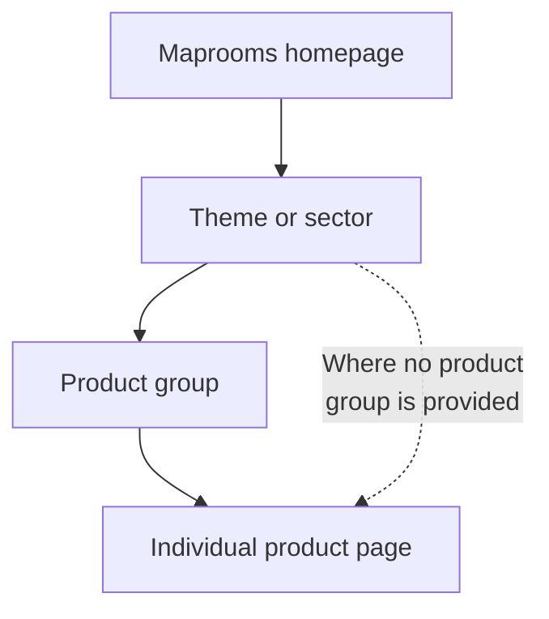

*Figure 1.1. General navigation from the Maproom homepage to a Maproom page.*

To access a specific product, user can select its title or image to continue to the corresponding section or product.

### 2.2. Homepage

The homepage introduces Maprooms and provides access to the available themes or sectors.

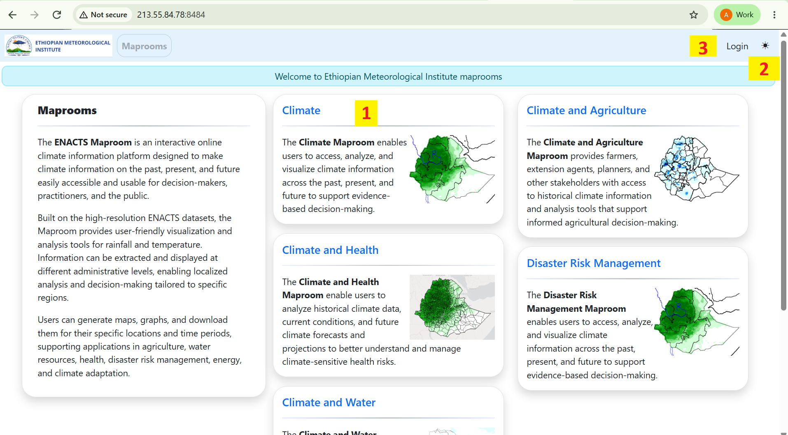

*Figure 1.2. Maprooms homepage. Callout 1 identifies access to a theme or sector: Select its title or image to open the corresponding section, callout 2 identifies the light/dark appearance button to Switch between light and dark display modes, and callout 3 identifies Login: Sign in to access account features or services that require authentication.*

Changing the appearance affects the interface, not the data values.

If a service requires authentication, select **Login** and enter the credentials supplied for your account. The features available after signing in depend on your permissions.

### 2.3. Choose a maproom component

A theme or sector page introduces the available groups of products. Review the descriptions to identify the group that matches your question.

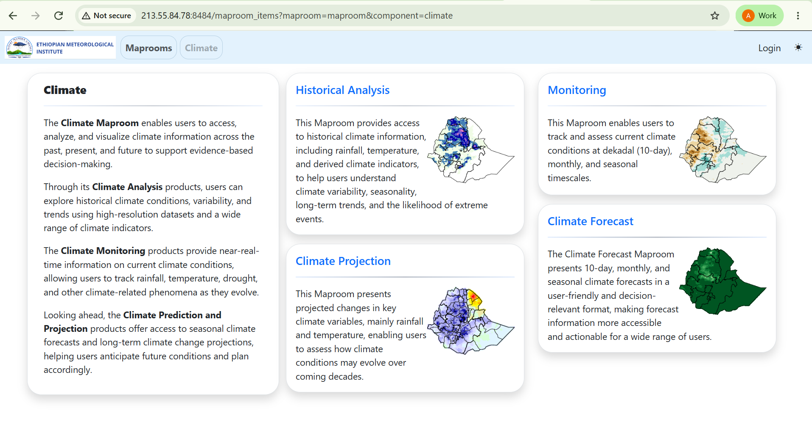

*Figure 1.3. Example of a theme page. The illustrated Climate section provides access to Historical Analysis, Monitoring, Climate Forecast, and Climate Projection.*

For example, historical analysis products describe the available climate record, while forecast products describe a future target period. Read the product description to establish which type of information is provided.

### 2.4. Choose a specific maproom page

A maproom component lists the maproom page available within that section.

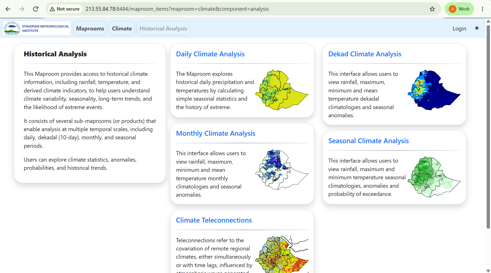

*Figure 1.4. Example of a Maproom component. Select a Maproom page title or image to open its interactive page.*

The example shows several historical analysis. Other themes or groups can contain different products and navigation levels.

### 2.5. Open the Maproom Page

The selected page opens with explanatory information, an interactive map, and the available chart previews.

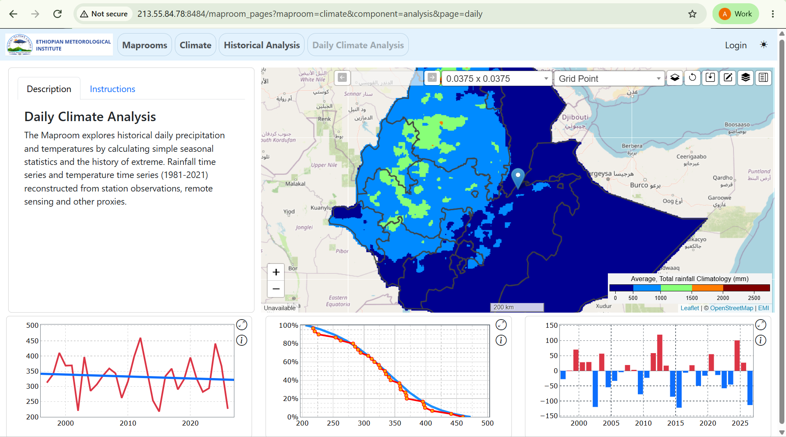

*Figure 1.5. Example of an interactive Maproom page. The illustrated page is Daily Climate Analysis; the general page arrangement is shared by many other products.*

Read **Description** before changing settings. Open **Instructions** to identify the tools available on that page.

The navigation screenshots show the progression between pages. They are examples of the interface, rather than instructions to use the same Maproom page or settings for every task. Each page have each own navigation documentation as seen in the outline.

### 2.6. Return to an earlier section

The navigation path near the top of a page shows your position within Maprooms.

Earlier items provide links back to broader sections. The final item identifies the current page and may not be clickable.

To open another product:

1. Select an earlier section in the navigation path.
2. Review the available cards.
3. Select another Maproom page title or image.

The institution's logo normally provides a route back to the application homepage.

On smaller screens, the navigation can collapse into a menu button. Open that menu to access the available items. Page sections may also appear vertically rather than side by side.

Where a language menu is available, use it to select the interface language.

## 3. Application

### 3.1. The main page areas

Most product pages combine explanatory information, an interactive map, and one or more chart previews.

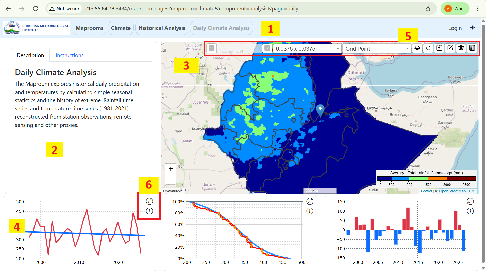

***Figure 1.6**. Main areas of an interactive product page. 1: **Navigation title:** Shows the current product and provides links back to earlier sections. 2: **Description and Instructions**: Explains the product and how to use its available controls. 3 : **Interactive map** : Displays the geographic distribution of the selected information. 4:  **Chart previews** : Summarizes information for the selected point or geographic area. A page may contain one or several charts. 5:  **Map toolbar**: Provides data settings, spatial selection, time navigation where supported, and map display tools. 6: **Chart buttons**: Opens chart information or expands the associated chart into a larger window.*

The map shows information across a geographic area. Charts generally describe a selected point or area within it.

Moving or zooming the map does not necessarily change the location represented by a chart. Check the marker, highlighted area, or chart information to confirm the selection.

### 3.2. Read the Description and Instructions tabs

**Description** explains the purpose of the selected product and the information it provides.

**Instructions** explains the buttons and interactions available on that page.

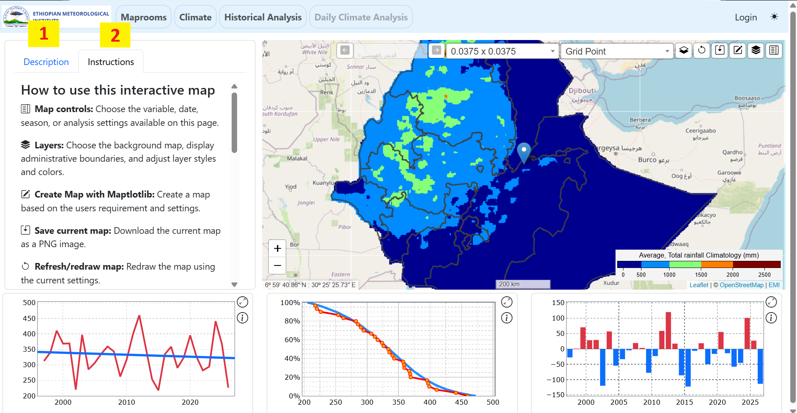

*Figure 1.7. Description and Instructions tabs. Callout 1 identifies Description, and callout 2 identifies Instructions.*

The information panel may have its own scrollbar. Scroll within it to read text below the visible area.

### 3.3. Map tools icons

On a computer, move the pointer over an icon to display its tooltip. Use the tooltip to identify the associated action.

| Tool | Purpose |
|---|---|
| Map control | Select the variable, date, season, statistic, and other analysis settings available on the page. |
| Layers control | Adjust geographic display, boundary layers, background map, opacity, and colorbar. |
| Redraw map | Draw the map again using the current settings. |
| Save current map | Download the displayed map as a PNG image. |
| Remove marker or selected polygon | Remove the visible point marker or clear an area highlight. |
| Previous and Next | Move between time steps on products that support time navigation. |
| Zoom in and Zoom out | Change the geographic extent visible on screen. |

Some pages also display **Create map with Matplotlib**. Its available functions depend on the application version and product. If the window provides instructions without a map-generation action, use **Save current map** to export the displayed map.

**Redraw map** uses the current settings. It does not restore every setting to its original value.

### 3.4. Select a point or geographic area

The spatial selection menu determines whether the available charts describe a grid point or a geographic area, such as a zone or region.

Available geographic levels depend on the country, dataset, and product.

**To select a grid point:**

1. Close any open map control panel.
2. Select **Grid Point** in the map toolbar.
3. Click a location inside the data coverage.
4. Wait for the marker and chart previews to update.
5. Check the location using chart information.

The marker identifies the selected point. Click another location or drag the marker and release it to explore a different point.

Dragging the map background changes the view. Dragging the marker changes the selected point.

A grid-point result represents information from a gridded dataset. It should not automatically be interpreted as a weather-station measurement at that exact location.

**To select an area:**

1. Choose an available geographic level in the spatial selection menu.
2. Select the area from the adjacent list, or click its polygon on the map.
3. Wait for the chart previews to update.
4. Check the area name in chart information.

Displaying administrative boundaries does not automatically select an area for analysis. Use the spatial selection menu to make that selection.

**To remove a selection indicator:**

Select **Remove marker or selected polygon**. This removes the visible marker or clears the highlight. Existing charts may remain until another location is selected.

Check chart information before interpreting a chart that remains on screen.

### 3.5. Configure the map information

Select **Map control** to open the analysis settings panel.

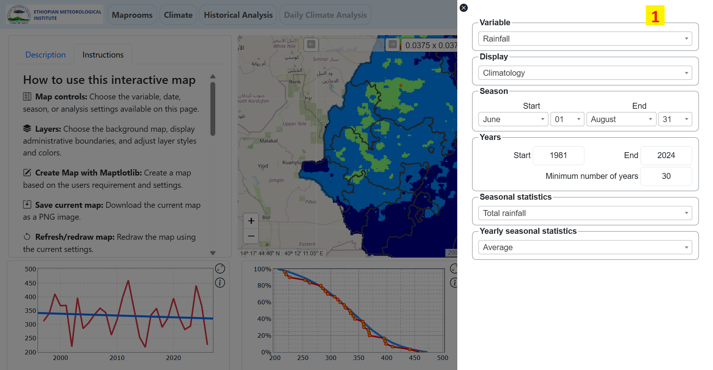

*Figure 1.8. Map control panel. Callout 1 identifies Variable. Other fields depend on the product and display type.*

| Setting | What it controls |
|---|---|
| Variable | The quantity being analyzed, such as rainfall or temperature. |
| Display | The information shown, such as climatology, selected-period data, or anomalies. |
| Date or season | The period or part of the year used by the analysis. |
| Years or reference period | The years included in a calculation or used as a comparison baseline. |
| Statistical options | The summary or analysis calculated from the selected data. |
| Thresholds and additional parameters | Product-specific event definitions and comparison values. |

To configure the map:

1. Choose the variable.
2. Select the display type.
3. Choose a supported date or season.
4. Review the year range or reference period, where provided.
5. Select the available statistic and additional parameters.
6. Close the panel and wait for the map to update.
7. Use **Redraw map** if another update is required.

Read the updated legend, units, and period before interpreting the map.

Changing a variable or display type may reveal additional fields or hide settings that no longer apply. Review the panel after making those changes.

A reference period is different from the period being displayed. It supplies the comparison used for climatologies, anomalies, and some other statistics.

Use the individual product guide for the exact meaning of each statistic and parameter.

### 3.6. Navigate through time

Where available, **Previous** and **Next** move between the product's time steps.

A step may represent a day, dekad, month, season, or another defined interval. Read the displayed date or season after each update.

If a date field is provided, enter or select a supported date using its displayed format.

The map can show one period while a chart displays a longer history. Review the chart controls separately when a specific chart period is required.

### 3.7. Configure layers and map appearance

Select **Layers control** to adjust how the map and its geographic reference layers are displayed.

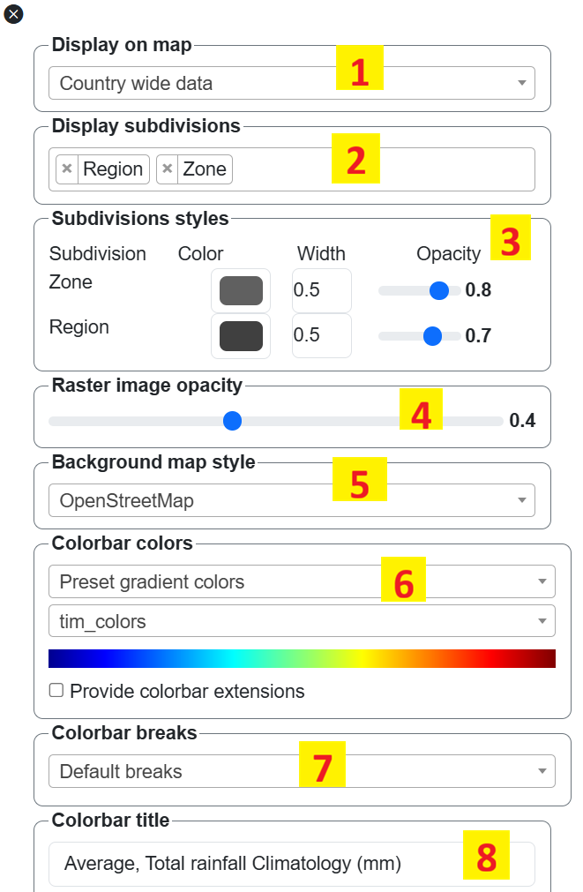

***Figure 1.9**. Layers control panel. The numbers identify the geographic display, boundary, opacity, background, and colorbar settings. 1:  **Display on map**  : Show country-wide information or focus the display on an available region or watershed. 2:  **Display subdivisions**  : Add or remove available geographic boundary layers. 3:  **Subdivisions styles**:  Adjust the color, line width, and opacity of displayed boundaries. 4:  **Raster image opacity** : Change the visibility of the climate layer over the background map. 5 : **Background map style** : Choose an available background, such as OpenStreetMap or another configured style, including imagery where offered. 6:   **Colorbar colors** : Select a preset palette or provide customized colors. 7:  **Colorbar breaks**: Use the default color intervals or enter customized intervals. 8:  **Colorbar title** : Edit the title displayed with the color legend.* 

**Display on map**

Choose country-wide data to show the broader coverage. To focus on an available region, choose the regional option and select the required area.

This changes the geographic display and may restrict the location choices in the toolbar. It is different from selecting an area summary for a chart.

**Display subdivisions and boundary styles**

Choose the boundary levels to display. Where multiple selections are supported, more than one level can be shown.

Adjust line color, width, and opacity so the boundaries remain visible without obscuring the climate information.

**Raster image opacity**

Increase opacity to emphasize the climate layer. Reduce it to reveal more of the background.

Opacity changes visibility, not the underlying values.

**Background map style**

Choose a background that helps identify the relevant locations. A simpler background can make climate colors easier to distinguish, while a background with place names can provide additional context.

**Colorbar colors**

Choose a preset palette or use the custom-color option where available. Select **Preview**, if provided, to inspect a custom palette before redrawing the map.

The colorbar extension option, where available, controls the appearance of values below or above the defined colorbar range.

**Colorbar breaks**

Breaks define the intervals represented by the colors. Enter custom values in the requested format and in increasing order.

When comparing maps, check their intervals. Similar colors can represent different values when different breaks are used.

**Colorbar title**

Keep the variable and units clear when editing the title. Editing the title does not change or convert the data.

Close the panel when finished. Use **Redraw map** if a change has not yet been applied.

### 3.8. Customize expanded chart appearance

Select **Expand Chart** beside the preview you want to explore.

Select **Chart settings** in the expanded-chart toolbar to change the available presentation options.

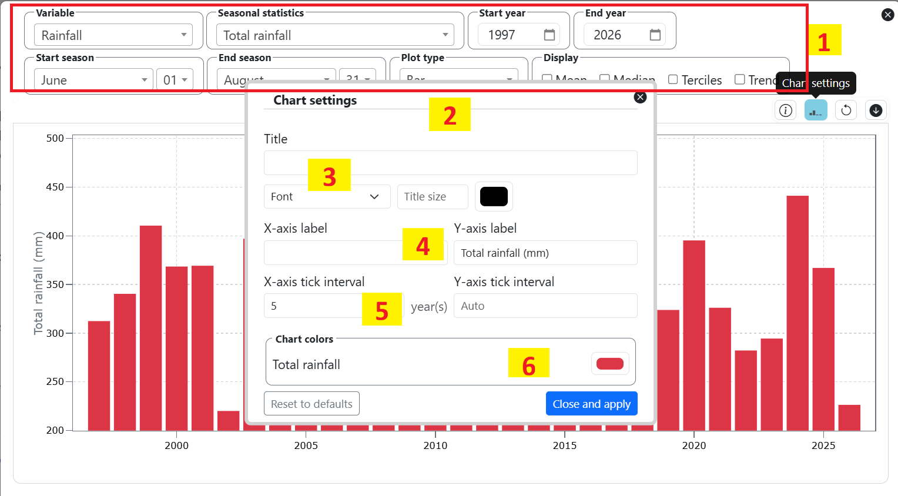

*Figure 1.12*. Expanded chart with Chart settings open. 1:  **Chart analysis controls** Choose the variable, statistic, period, season, plot type, and other options available for the chart. The expanded chart can also use settings that differ from those currently used by the map. 2 :**Chart settings window** Edit the chart's presentation. Open it with the Chart settings button. 3 : **Title settings** Add or edit the title and change its font, size, and color. 4:  **Axis labels**  Edit the horizontal and vertical axis labels.  5:  **Axis tick intervals**  Change the spacing between labels or marks on the axes. 6:  **Chart colors**  Change colors for the available bars, lines, or other plotted series. 

After editing, select **Close and apply** to apply the changes and return to the expanded chart.

The close button at the top of the Chart settings window discards unapplied edits.

Select **Reset to defaults** to restore the chart's default presentation.

Keep the variable and units clear when editing labels. Changing a label does not convert the data.

A tick interval changes label spacing. For example, choosing labels every five years does not combine observations into five-year averages.

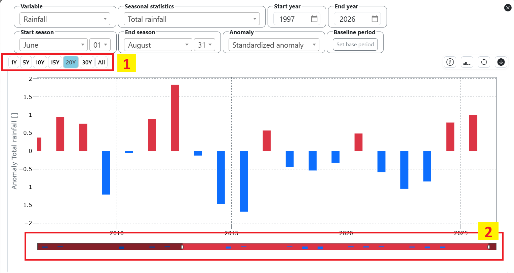

ON the extended chart itself, we can view only the latest years by using the years in this figure, those years are related to the latest years: All, 30 years, 20 years ... and we can use as well the buttoon on the bottom of the chart to manipulate the date to be shown by adjusting and moving this accordinly. 

### 3.9. Read chart information

Select **Information about this chart**, represented by an information symbol, to review the details associated with a preview or expanded chart.

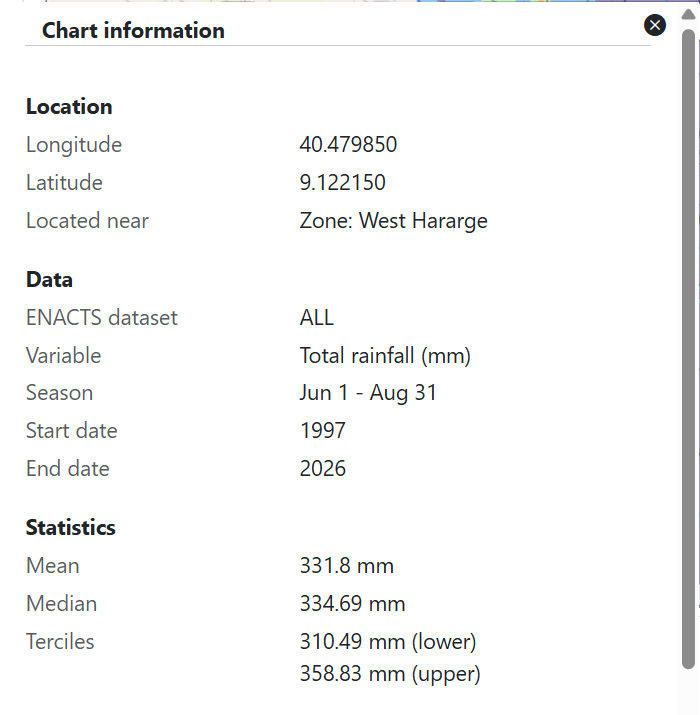

*Figure 1.13. Chart information window. Available details can include the selected location, dataset, variable, period, and summary statistics.*

Depending on the chart, the window can provide:

- Coordinates or geographic area name.
- Nearby administrative information.
- Dataset name or identifier.
- Variable and units.
- Season or date range.
- Reference period.
- Summary statistics.
- Trend information.

Use these details to confirm what the chart represents before interpreting or sharing it.

Scroll within the window to read information below the visible area.

### 3.10. Save maps and charts

**To save a map:**

1. Select the required map settings.
2. Check the variable, displayed period, legend, and units.
3. Adjust the map view and appearance.
4. Close panels covering the map.
5. Wait for the display to finish loading.
6. Select **Save current map**.
7. Inspect the downloaded PNG image.

**To save a chart:**

1. Select the required point or area.
2. Expand the chart.
3. Choose its analysis settings.
4. Update the chart when necessary.
5. Apply any presentation changes.
6. Check chart information.
7. Select **Download as image**.
8. Inspect the downloaded file.

Interactive chart exports commonly use JPEG; some chart displays use PNG. The available output depends on the chart.

