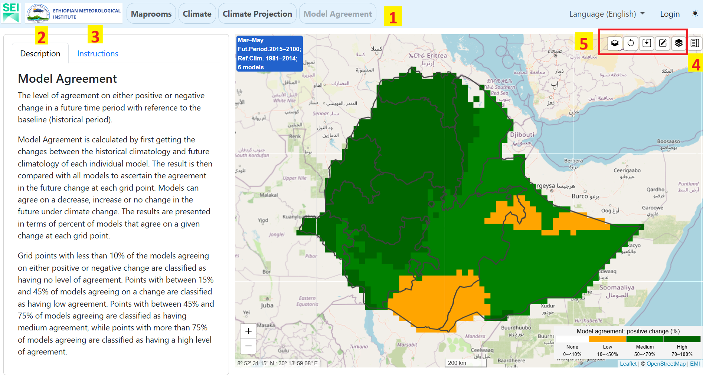
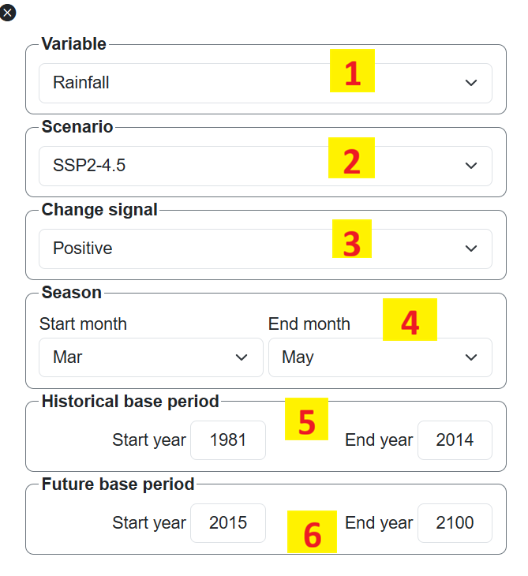
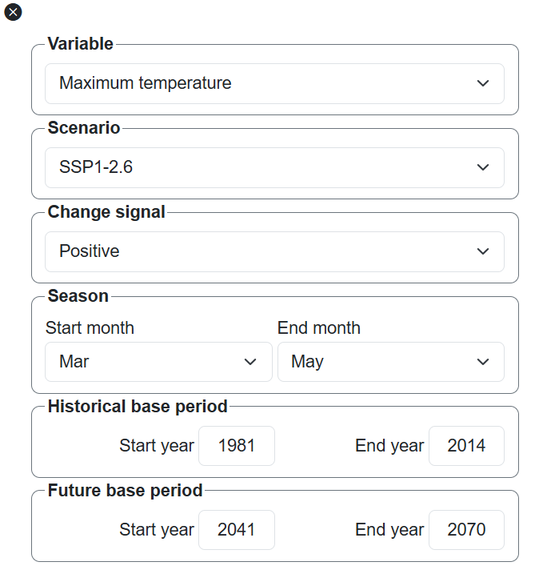
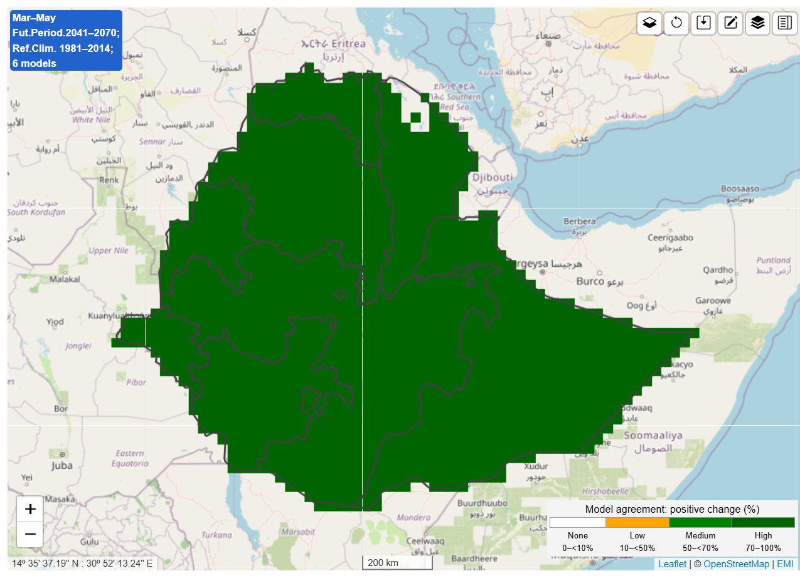

# Climate Projection Model Agreement Maproom

## 1. Overview

The Model Agreement Maproom shows how consistently climate models project the direction of seasonal change relative to a historical reference. For each model, the Maproom calculates the difference between its future and historical seasonal climatological means. It then compares those differences across models at each grid point and displays the **percentage of valid models matching the selected positive or negative change signal**.

This provides a spatial summary of where models agree more strongly or differ in their projected direction of change. You can examine rainfall, minimum temperature, or maximum temperature under a selected scenario, season, and pair of historical and future periods.

The calculation has two stages:

1. **Individual model change = future seasonal mean − historical seasonal mean.**
2. **Agreement (%) = 100 × number of valid models matching the selected signal / number of valid models.**

For rainfall, a positive signal represents an increase in seasonal rainfall, while a negative signal represents a decrease. For temperature, positive and negative signals correspond to warming and cooling, respectively. The current calculation includes an exactly zero change in either selected signal.

**The output is a percentage of models.** It describes agreement on the direction of change. Use the Seasonal Changes Maproom to examine the magnitude of the projected change in temperature or precipitation units.

Use this Maproom to investigate:

- Where models agree on increasing or decreasing seasonal rainfall.
- Where models agree on warming or cooling.
- Geographic differences in agreement under a selected scenario.
- Differences in agreement between future periods, seasons, or scenarios.

Open the [Model Agreement Maproom](http://213.55.84.78:8484/maproom_pages?maproom=climate&component=projection&page=model-agreement).

*Figure 1.1. Main areas of the Model Agreement Maproom. The example shows agreement on positive change for March–May, comparing 2015–2100 with 1981–2014. The banner reports six contributing models.*

- **Menu 1:** Navigation path to the Model Agreement page.
- **Menu 2:** Description of the purpose and calculation of model agreement.
- **Menu 3:** General instructions for using the Maproom.
- **Menu 4:** Button for opening the agreement map controls.
- **Menu 5:** Toolbar for adjusting the map display, redrawing the map, and accessing map tools.

The blue banner identifies the season, future period, historical reference, and model count. The legend identifies the selected direction and the agreement classes.

For shared map navigation, layers, appearance, and downloading results, see [Navigating Maprooms](common-navigation.md).

## 2. Settings

### 2.1. Map control

Select **Menu 4** to open the map controls.

<table>
  <tr>
    <td width="40%" valign="top">
      
    </td>
    <td width="60%" valign="top">
      <h3>Map control menu</h3>
      
<strong>1. Variable:</strong> Choose <strong>Rainfall</strong>, <strong>Minimum temperature</strong>, or <strong>Maximum temperature</strong>. The illustrated choice is Rainfall.

      
<strong>2. Scenario:</strong> Choose the future simulation scenario. The illustrated choice is <strong>SSP2-4.5</strong>.

      
<strong>3. Change signal:</strong> Select <strong>Positive</strong> or <strong>Negative</strong> to count models matching the direction of interest.

      
<strong>4. Season:</strong> Select its start and end months. The example uses <strong>Mar</strong> through <strong>May</strong>, defining March–May.

      
<strong>5. Historical base period:</strong> Enter the reference start and end years. The example uses <strong>1981–2014</strong>.

      
<strong>6. Future base period:</strong> Enter the future start and end years. The example uses <strong>2015–2100</strong>.

    </td>
  </tr>
</table>

*Figure 2.1. Controls for agreement on positive March–May rainfall change under SSP2-4.5, comparing 2015–2100 with 1981–2014.*

The scenario choices are **SSP1-2.6**, **SSP2-4.5**, **SSP3-7.0**, and **SSP5-8.5**, subject to available model data.

Historical years can be selected within **1981–2014**, and future years within **2015–2100**. Start and end years are specified independently. The illustrated periods contain **34 historical years** and **86 future years**.

The Maproom combines available models with both historical and selected-scenario data. There is no individual-model selector on this page. The model count can change with the variable, scenario, and available data.

Close the panel to update the map. Use **Redraw map** if another update is required. Check the banner and legend after changing the signal or comparison periods.

### 2.2. Agreement classes and model counts

The current map legend uses these classes:

| Class | Percentage of valid models matching the selected signal | Color |
|---|---|---|
| None | 0% to less than 10%. | White. |
| Low | 10% to less than 50%. | Orange. |
| Medium | 50% to less than 70%. | Green. |
| High | 70% to 100%. | Dark green. |

The description panel contains older percentage boundaries. The intervals above follow the **current map legend and calculation display**, including the **10%, 50%, and 70%** boundaries.

The illustrated banner reports **6 models**. Where all six provide valid values, the possible agreement percentages are:

| Models matching the signal | Agreement | Current class |
|---|---|---|
| 0 of 6 | 0%. | None. |
| 1 of 6 | Approximately 16.7%. | Low. |
| 2 of 6 | Approximately 33.3%. | Low. |
| 3 of 6 | 50.0%. | Medium. |
| 4 of 6 | Approximately 66.7%. | Medium. |
| 5 of 6 | Approximately 83.3%. | High. |
| 6 of 6 | 100.0%. | High. |

The denominator is the number of models with valid change values **at each grid point**. Some cells may have fewer valid models than the total reported in the banner. The table therefore applies specifically where all six models are valid.

Model changes are placed on a common grid before the agreement count is calculated. The block-shaped map cells represent that comparison grid.

### 2.3. Interpreting the selected change signal

| Variable | Positive signal | Negative signal |
|---|---|---|
| Rainfall | Future seasonal rainfall at least as high as the historical mean. | Future seasonal rainfall at most as high as the historical mean. |
| Minimum temperature | Future seasonal mean minimum temperature at least as high as the historical mean. | Future seasonal mean minimum temperature at most as high as the historical mean. |
| Maximum temperature | Future seasonal mean maximum temperature at least as high as the historical mean. | Future seasonal mean maximum temperature at most as high as the historical mean. |

The calculation counts changes **greater than or equal to zero** for Positive and **less than or equal to zero** for Negative. An exactly zero change is included in both, so the two percentages need not sum to exactly 100% where zero changes occur.

Low agreement on the selected signal can coexist with stronger agreement on the opposite signal. For example, where six models are valid and none has exactly zero change, **two positive changes** give **33.3% positive agreement**, while **four negative changes** give **66.7% negative agreement**.

A result such as **83.3% agreement** describes the fraction of models matching the selected direction. It does not establish the probability of a future event or the size of a rainfall or temperature change.

## 3. Application

### 3.1. Assess agreement on increasing March–May rainfall

This example uses **Rainfall**, **SSP2-4.5**, and **Positive** change for **March–May**, comparing **2015–2100** with **1981–2014**.

<table>
  <tr>
    <td width="35%" valign="top">
      <h3>Agreement controls</h3>
      
    </td>
    <td width="65%" valign="top">
      <h3>Complete map output</h3>
      
    </td>
  </tr>
</table>

*Figure 3.1. Controls beside the complete Model Agreement output. The map classifies agreement on positive change, with six models reported for the illustrated selection.*

### 3.2. Compare spatial patterns of positive-change agreement

The three exported map are for the **March–May**, the future period **2015–2100**, the reference **1981–2014**, **6 models**, and **positive change**.

<table>
  <tr>
    <td width="33%" valign="top">
      <h3>SSP-1</h3>
      
    </td>
    <td width="33%" valign="top">
      <h3>SSP-3</h3>
      
    </td>
    <td width="33%" valign="top">
      <h3>SSP-5</h3>
      
    </td>
  </tr>
</table>

*Figure 3.2. Three positive-change agreement exports using the displayed periods and six-model ensemble with the same periode but different scenarios.*

The first export shows low agreement in a broad southern and southeastern area. The second shows a different distribution of high and medium agreement, with low agreement still visible in parts of the south and southeast. The third shows extensive medium/high agreement and a more localized orange area in the east.

The colors have the same meaning in every panel: **orange is 10–<50%**, **green is 50–<70%**, and **dark green is 70–100%** agreement on the selected positive signal.

Use these figures to inspect spatial differences, while retaining the original variable and scenario information when attributing a map to a particular projection. The images alone do not identify the settings changed between all three exports.

For your own controlled comparison, keep the variable, season, reference period, and change signal fixed, then change only the scenario or future period. Record the model count after each change, because model availability can affect the comparison.

To investigate decreasing rainfall instead, choose **Negative** with the other settings unchanged. Read the updated legend as agreement on negative or zero change, then compare it with the positive-change map at the same locations.
