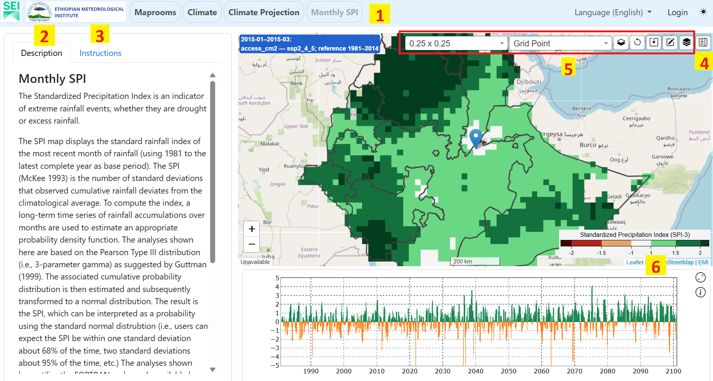
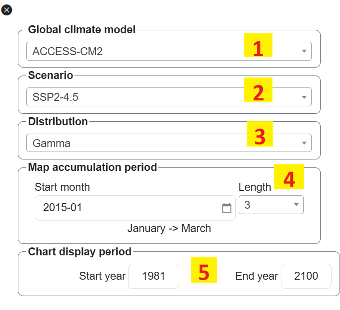
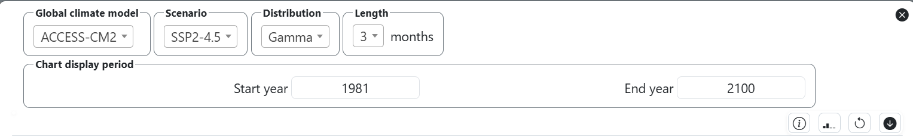
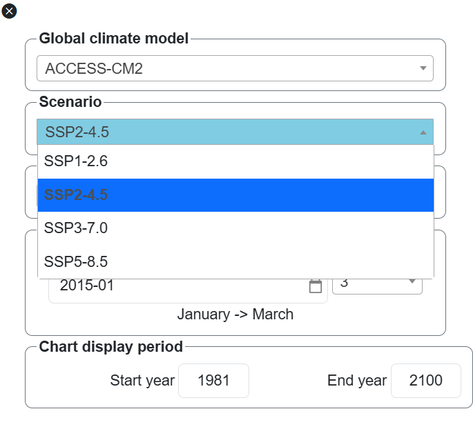
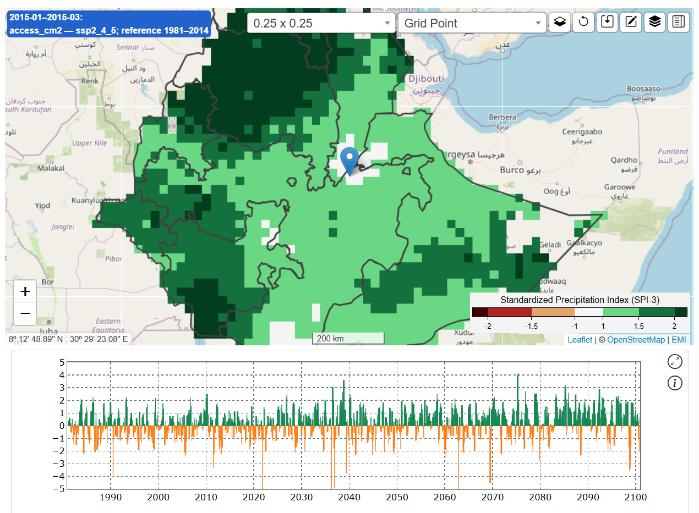
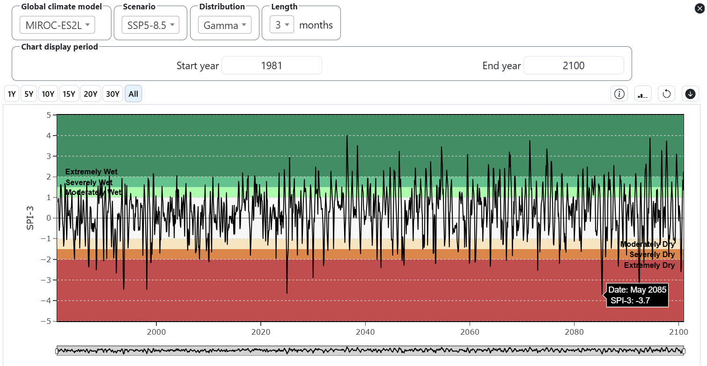

# Monthly SPI Climate Projection Maproom

> **Remark — Monthly SPI:** This component is dedicated to the **Standardized Precipitation Index (SPI)**. All map and chart outputs represent **SPI**, with **no physical units**. Rainfall is the input used to calculate the index. **Monthly** describes the frequency of the output; with **Length = 3**, each monthly value is **SPI-3**, calculated from a three-month rainfall accumulation.

## 1. Overview

The Monthly SPI Climate Projection Maproom allows you to examine relatively dry and wet conditions in historical climate-model simulations and future scenario simulations. You can select a global climate model, a scenario, a probability distribution, and an accumulation length, then display an SPI map and a monthly SPI time series.

SPI describes where accumulated rainfall lies within a fitted reference distribution, transformed to a standard normal scale. Negative values indicate relatively dry conditions, positive values indicate relatively wet conditions, and values around zero indicate conditions near the center of the reference distribution.

The reference period is **1981–2014**, using the **selected model's historical simulation**. This reference remains fixed when future SPI values are calculated. The chart can display historical simulation values from **1981–2014** and scenario simulation values from **2015 onward**, up to the available coverage within **2100**.

Use this Maproom to investigate:

- Geographic differences in simulated SPI for a selected accumulation period.
- Differences between scenarios for the same model and time window.
- Differences between climate models for the same scenario and accumulation scale.
- The sequence of relatively dry and wet conditions in a monthly SPI series.
- Simulated extremes relative to the model's historical reference distribution.

Open the [Monthly SPI Climate Projection Maproom](http://213.55.84.78:8484/maproom_pages?maproom=climate&component=projection&page=spi-monthly).

The main areas of the page are identified below.

*Figure 1.1. Main areas of the Monthly SPI Climate Projection Maproom. The illustrated map shows ACCESS-CM2 under SSP2-4.5 for January–March 2015, with SPI-3 evaluated against the 1981–2014 historical model reference.*

- **Menu 1:** Navigation path to the Monthly SPI page within Climate Projection.
- **Menu 2:** Description of the Maproom.
- **Menu 3:** General instructions for using the Maproom.
- **Menu 4:** Button for opening the model, scenario, SPI, and period controls.
- **Menu 5:** Toolbar for selecting a grid point or administrative area, checking the model grid resolution, and interacting with the map.
- **Menu 6:** Monthly SPI time-series preview, which can be expanded.

Click a location or select an administrative area to update the SPI chart. The illustrated ACCESS-CM2 grid resolution is **1.875° longitude × 1.25° latitude**. Grid resolution depends on the selected model.

These outputs describe model simulations under the selected scenario. A dated future SPI value represents a simulated outcome within that run; use the series to examine projected variability and extremes in its model and scenario context.

For shared map navigation, location selection, layers, chart appearance, and downloading results, see [Navigating Maprooms](common-navigation.md).

## 2. Settings

### 2.1. Map control

Select **Menu 4** to open the map controls. The following example uses **ACCESS-CM2**, **SSP2-4.5**, **Gamma**, and a **three-month** accumulation starting in **January 2015**.

<table>
  <tr>
    <td width="40%" valign="top">
      
    </td>
    <td width="60%" valign="top">
      <h3>Map control menu</h3>

      
<strong>1. Global climate model:</strong> Choose the model used for the historical reference and future simulation. The illustrated model is <strong>ACCESS-CM2</strong>.

      
<strong>2. Scenario:</strong> Select the scenario for the future simulation. The example uses <strong>SSP2-4.5</strong>.

      
<strong>3. Distribution:</strong> Choose <strong>Gamma</strong> or <strong>Pearson Type III</strong> for the SPI calculation. The example uses <strong>Gamma</strong>.

      
<strong>4. Map accumulation period:</strong> Select a <strong>Start month</strong> and a <strong>Length</strong> in months. The example uses <strong>2015-01</strong> and <strong>3</strong>, covering <strong>January–March 2015</strong> and producing an <strong>SPI-3</strong> map.

      
<strong>5. Chart display period:</strong> Set the first and last years included in the monthly time series. The illustrated range is <strong>1981–2100</strong>. These fields select the chart period; the SPI reference remains <strong>1981–2014</strong>.

    </td>
  </tr>
</table>

*Figure 2.1. Monthly SPI map controls. The numbered callouts identify the model, scenario, distribution, map accumulation window, and chart display period.*

The model menu includes **ACCESS-CM2**, **INM-CM5-0**, **MIROC-ES2L**, **MPI-ESM1-2-HR**, **MPI-ESM1-2-LR**, **MRI-ESM2-0**, and **NorESM2-MM**. Select a model and scenario with available data.

The scenario choices are **SSP1-2.6**, **SSP2-4.5**, **SSP3-7.0**, and **SSP5-8.5**. Keep the model, distribution, and accumulation window unchanged when comparing scenarios.

The accumulation length can range from **2 to 12 months**. The entire map window must fall within **January 2015–December 2100**.

The map's date field identifies the **starting month** of the accumulation. Chart dates identify the **ending month**:

| Display or setting | Meaning with Length = 3 |
|---|---|
| Map Start month = 2015-01 | SPI calculated from January–March 2015 rainfall. |
| Chart point dated March 2015 | SPI calculated from January–March 2015 rainfall. |
| Chart point dated May 2085 | SPI calculated from March–May 2085 rainfall. |

Close the panel to update the map and preview. Use **Redraw map** if another update is required. Check the banner above the map for its complete accumulation window, model, scenario, and reference period.

### 2.2. Chart control

Expand **Menu 6** to inspect the monthly SPI time series.

*Figure 2.2. Controls for the expanded monthly SPI chart. The illustrated settings use ACCESS-CM2, SSP2-4.5, Gamma, Length 3 months, and the display period 1981–2100.*

The controls include:

- **Global climate model:** Select the model whose SPI series is displayed.
- **Scenario:** Select the future simulation pathway.
- **Distribution:** Choose Gamma or Pearson Type III.
- **Length:** Select the rainfall accumulation length used for each monthly SPI value.
- **Chart display period:** Choose start and end years within **1981–2100**, subject to available data.

The expanded chart initially receives the map's model, scenario, distribution, length, and chart-period settings. Review these fields after making changes inside the chart before comparing it with the map.

Use the range buttons, such as **1Y**, **5Y**, **10Y**, **15Y**, **20Y**, **30Y**, and **All**, or the slider below the chart to focus on part of the series. Hover over the line to read an exact month and SPI value.

With **Length = 3**, consecutive values represent overlapping windows. For example, the April value describes February–April and the May value describes March–May. The series remains monthly even though each value incorporates three months of rainfall.

### 2.3. Reference period, spatial selection, and SPI classes

The historical reference covers **1981–2014**, a span of **34 calendar years**. The calculation requires at least **30 valid reference values** for the relevant calendar ending month. The selected distribution is fitted to the accumulated rainfall from the **same model's historical simulation**.

Changing the chart display years selects which model SPI values are shown; it does not refit the reference to the displayed future period. Changing the model changes the historical model data used for that reference.

For an administrative-area selection, the application averages the monthly rainfall over the selected area before calculating SPI. The resulting chart represents SPI derived from that area-average rainfall series.

Interpret valid SPI values using the following classes:

| SPI value | Interpretation |
|---|---|
| Less than −2 | Extremely dry. |
| −2 to less than −1.5 | Severely dry. |
| −1.5 to less than −1 | Moderately dry. |
| −1 to less than +1 | Near normal. |
| +1 to less than +1.5 | Moderately wet. |
| +1.5 to less than +2 | Severely wet. |
| +2 or greater | Extremely wet. |

The map uses orange and red shades for dry classes, a pale central class for near-normal conditions, and green shades for wet classes. Its legend boundaries are **−2, −1.5, −1, +1, +1.5, and +2**.

Some cells may have no valid SPI because reference coverage, rainfall variability, or data completeness is insufficient. Distinguish missing or masked cells from valid values in the pale near-normal class.

All numerical readings from these maps and charts are **unitless SPI scores**. The colors classify relative precipitation conditions; they do not express rainfall totals or forecast probabilities.

## 3. Application

### 3.1. Compare SPI-3 maps across scenarios

This example compares **January–March 2015** under three scenarios for **ACCESS-CM2**. Each map uses a **three-month** accumulation and the **1981–2014** historical model reference.

<table>
  <tr>
    <td width="35%" valign="top">
      <h3>Map controls</h3>
      
    </td>
    <td width="65%" valign="top">
      <h3>Map and monthly SPI preview</h3>
      
    </td>
  </tr>
</table>

*Figure 3.1. Controls beside the complete ACCESS-CM2 SPI-3 output. The initial scenario is SSP2-4.5, and the accumulation window is January–March 2015.*

To reproduce the initial settings:

1. Open **Menu 4**.
2. Select **ACCESS-CM2** under **Global climate model**.
3. Choose **SSP2-4.5** under **Scenario**.
4. Select **Gamma** under **Distribution**.
5. Set **Start month** to **2015-01** and **Length** to **3**.
6. Keep the chart display period at **1981–2100**, then close the panel.
7. Confirm that the map banner identifies **2015-01–2015-03**, the selected model and scenario, and **reference 1981–2014**.

Change only **Scenario** to compare the three maps below.

<table>
  <tr>
    <td width="33%" valign="top">
      <h3>SSP2-4.5</h3>
      
    </td>
    <td width="33%" valign="top">
      <h3>SSP3-7.0</h3>
      
    </td>
    <td width="33%" valign="top">
      <h3>SSP5-8.5</h3>
      
    </td>
  </tr>
</table>

*Figure 3.2. ACCESS-CM2 SPI-3 maps for January–March 2015 under SSP2-4.5, SSP3-7.0, and SSP5-8.5. All three use the 1981–2014 historical model reference.*

The comparison settings are:

| Setting | Value |
|---|---|
| Model | ACCESS-CM2. |
| Scenarios shown | SSP2-4.5, SSP3-7.0, and SSP5-8.5. |
| Distribution | Gamma. |
| Accumulation window | January–March 2015. |
| SPI scale | SPI-3. |
| Reference | Same-model historical simulation, 1981–2014. |
| Illustrated grid resolution | 1.875° longitude × 1.25° latitude. |

In the **SSP2-4.5** map, extensive green areas fall in wet classes. Light green represents SPI from **+1 to below +1.5**, darker green **+1.5 to below +2**, and the darkest green **+2 or greater**.

The **SSP3-7.0** map shows fewer green wet-class cells across much of Ethiopia. Valid cells in the pale central class have SPI between **−1 and +1**. Some green cells remain in the northwest.

The **SSP5-8.5** map shows a different spatial pattern, with wet classes in parts of northern, eastern, and southern Ethiopia. Read the same SPI class boundaries in all three panels.

The map images provide classes rather than exact point-value tooltips. Describe their values as intervals unless a numerical value is available for the selected grid cell.

These maps compare one simulated three-month window. To examine projected changes more broadly, compare longer sequences and multiple models while retaining the same SPI accumulation scale and reference convention.

### 3.2. Examine an extremely dry simulated SPI-3 event

This application uses **MIROC-ES2L** under **SSP5-8.5**, with **Gamma** and a **three-month** accumulation. It differs from the ACCESS-CM2 map example above.

Expand **Menu 6** and select:

- **Global climate model:** MIROC-ES2L.
- **Scenario:** SSP5-8.5.
- **Distribution:** Gamma.
- **Length:** 3 months.
- **Chart display period:** 1981–2100.

*Figure 3.3. Monthly SPI-3 series for MIROC-ES2L under SSP5-8.5. The tooltip identifies May 2085 with an SPI-3 value of −3.7.*

The illustrated event can be summarized as follows:

| Item | Reading |
|---|---|
| Model | MIROC-ES2L. |
| Scenario | SSP5-8.5. |
| Distribution | Gamma. |
| Chart range | 1981–2100. |
| Accumulation length | 3 months. |
| Tooltip month | May 2085. |
| Rainfall window represented | March–May 2085. |
| SPI-3 value | −3.7. |
| SPI classification | Extremely dry. |

The value **−3.7** lies below the **−2** extremely dry threshold. It indicates a very low accumulated-rainfall position on the standardized reference scale for that calendar window. Its interpretation is an **SPI score**, with no rainfall or percentage units.

The expanded chart has a vertical scale of approximately **−5 to +5**. Its central near-normal band spans **−1 to +1**. Dry classes begin below **−1**, **−1.5**, and **−2**, while wet classes begin at **+1**, **+1.5**, and **+2**.

The black line shows monthly SPI-3 values. Neighboring points share two months of rainfall, so a sequence of low values can represent overlapping dry accumulation windows. Use the range buttons or slider to inspect the period around 2085 and hover over adjacent months for their values.

The **1981–2014** portion of the series comes from the selected model's historical simulation. The **2015 onward** portion comes from its selected scenario simulation, standardized against the historical reference. The May 2085 tooltip describes an event within that simulation; interpreting a future projection requires considering the model, scenario, and longer sequence of variability.

The figure does not print the selected location's coordinates or administrative name. Exact numerical reproduction depends on selecting the same model grid point or area as well as the same calculation settings.

When comparing another model or scenario, retain **Length = 3** and the same distribution, location, and display years. Record the SPI class and value for each comparison, remembering that each model uses its own historical reference data over **1981–2014**.
