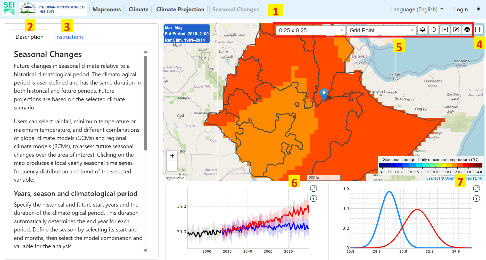
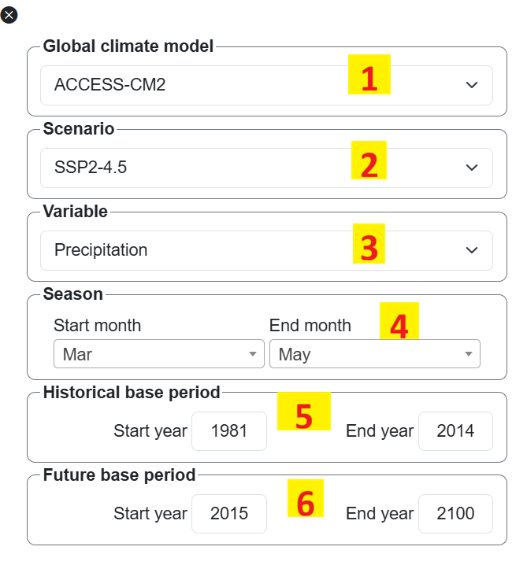
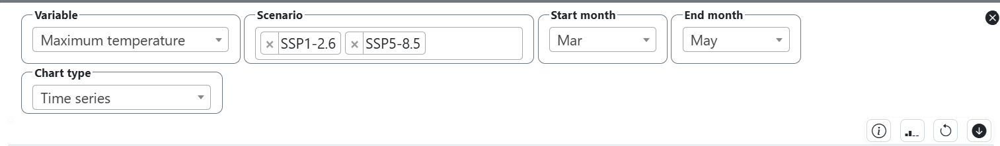
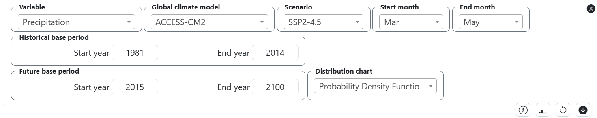
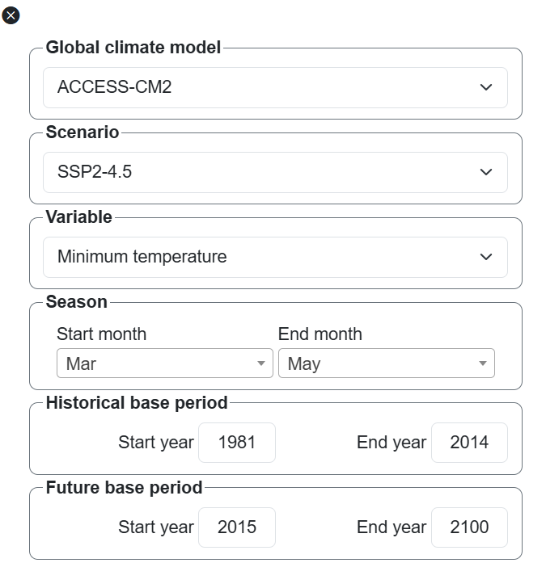
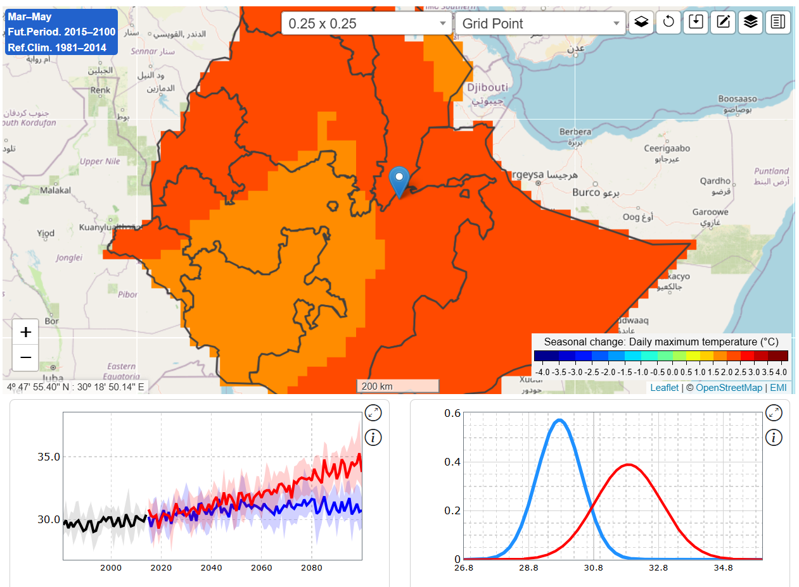
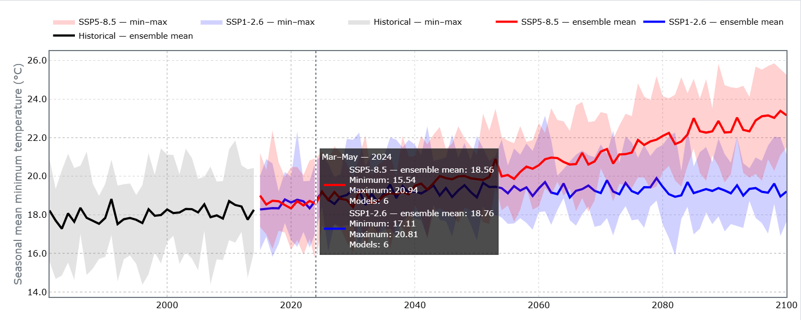
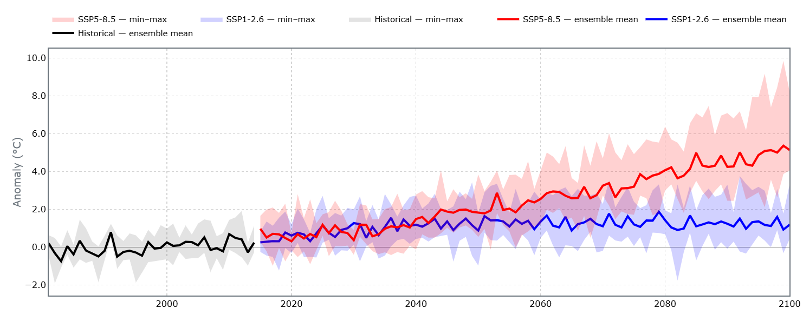
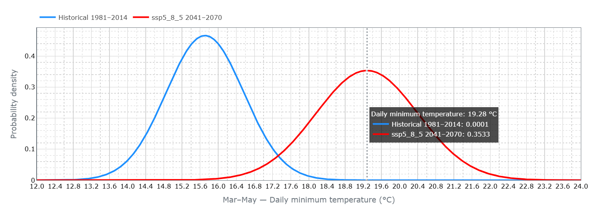
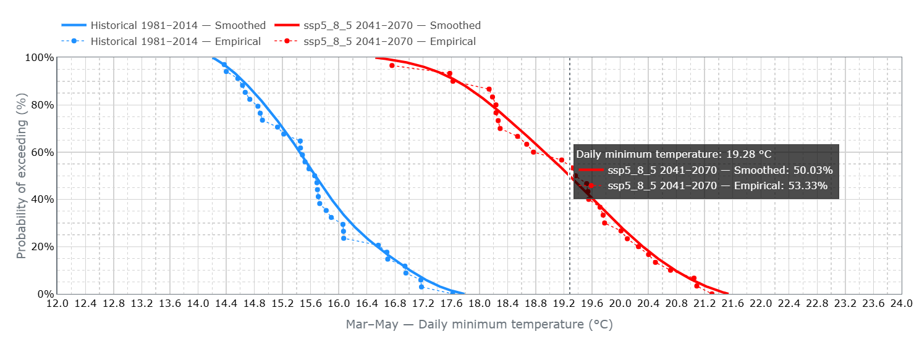

# Seasonal Climate Change Projection Maproom

## 1. Overview

The Seasonal Changes Maproom compares simulated future seasonal climate with a historical model reference. You can examine precipitation, minimum temperature, and maximum temperature, select a climate model and scenario, and investigate differences between historical and future periods.

The map displays a change in the seasonal climatological mean:

**Seasonal change = future seasonal mean − historical seasonal mean.**

Temperature changes are expressed in **degrees Celsius**. A positive temperature change indicates warming relative to the selected historical reference. The temperature variables describe seasonal averages of daily minimum or maximum temperatures.

The time-series and distribution charts provide additional information at the selected location. They show seasonal values, departures from historical means, model spread, and changes in the distribution of seasonal conditions.

Use this Maproom to investigate:

- Geographic differences in projected seasonal temperature or precipitation changes.
- Differences between climate models under the same scenario.
- Differences between future periods relative to a common historical reference.
- How scenario ensemble means and model ranges evolve through time.
- Changes in the frequency of exceeding a selected seasonal temperature or rainfall threshold.

Open the [Seasonal Changes Maproom](http://213.55.84.78:8484/maproom_pages?maproom=climate&component=projection&page=seasonal-change).

*Figure 1.1. Main areas of the Seasonal Changes Maproom. The illustrated map shows March–May maximum-temperature change for 2015–2100 relative to 1981–2014.*

- **Menu 1:** Navigation path to the Seasonal Changes page.
- **Menu 2:** Description of the Maproom.
- **Menu 3:** General instructions for using the Maproom.
- **Menu 4:** Button for opening the map controls.
- **Menu 5:** Toolbar for selecting a location or administrative area, inspecting the model grid resolution, and accessing map tools.
- **Menu 6:** Seasonal time-series preview, which can be expanded.
- **Menu 7:** Historical and future distribution preview, which can be expanded.

Click a grid point or select an administrative area to update the charts. The illustrated ACCESS-CM2 grid resolution is **1.875° longitude × 1.25° latitude**; resolution varies between models.

These are climate-model projections. Interpret dated values and period averages in the context of their model, scenario, season, and reference period.

For shared navigation, spatial selection, map layers, chart appearance, and downloading results, see [Navigating Maprooms](common-navigation.md).

## 2. Settings

### 2.1. Map control

Open **Menu 4** to select the model, scenario, variable, season, and comparison periods.

<table>
  <tr>
    <td width="40%" valign="top">
      
    </td>
    <td width="60%" valign="top">
      <h3>Map control menu</h3>
      
<strong>1. Global climate model:</strong> Select the model used for the historical and future comparison. The illustrated choice is <strong>ACCESS-CM2</strong>.

      
<strong>2. Scenario:</strong> Select the future simulation scenario. The example uses <strong>SSP2-4.5</strong>.

      
<strong>3. Variable:</strong> Choose <strong>Precipitation</strong>, <strong>Minimum temperature</strong>, or <strong>Maximum temperature</strong>.

      
<strong>4. Season:</strong> Choose the first and last months included in each season. <strong>Mar</strong> through <strong>May</strong> defines March–May.

      
<strong>5. Historical base period:</strong> Enter the reference start and end years. The illustrated reference is <strong>1981–2014</strong>.

      
<strong>6. Future base period:</strong> Enter the future start and end years. The illustrated period is <strong>2015–2100</strong>.

    </td>
  </tr>
</table>

*Figure 2.1. Map controls. This control screenshot selects Precipitation; the homepage illustration selects Maximum temperature, and Application 3.1 selects Minimum temperature.*

The model choices include **ACCESS-CM2**, **INM-CM5-0**, **MIROC-ES2L**, **MPI-ESM1-2-LR**, **MRI-ESM2-0**, and **NorESM2-MM**, subject to available data. Scenario choices are **SSP1-2.6**, **SSP2-4.5**, **SSP3-7.0**, and **SSP5-8.5**.

The current controls provide separate start and end years for each period. Historical years fall within **1981–2014**, and future years within **2015–2100**. Periods can have different durations: the illustrated historical reference contains **34 years**, while 2015–2100 contains **86 years**.

Keep the same season and historical reference when comparing future periods. For a season crossing December, check that the selected years contain complete seasons.

Close the panel to update the map. Use **Redraw map** if another update is required. The map banner identifies the season, future period, and historical reference; the legend identifies the variable and units.

For temperature, the map shows a **difference in °C**. A mapped change of **+2°C** means that the future seasonal mean is 2°C warmer than the historical seasonal mean.

For precipitation, check the map's displayed units before interpreting changes. The time-series and distribution charts calculate **seasonal rainfall totals in mm**; these should be distinguished from a map expressed in precipitation-rate units.

### 2.2. Chart control

#### 2.2.1. Seasonal time series and anomalies

*Figure 2.2. Controls for the seasonal series accessed through Menu 6. The illustrated variable is Maximum temperature; the application charts below use Minimum temperature.*

The controls include:

- **Variable:** Choose precipitation, minimum temperature, or maximum temperature.
- **Scenario:** Select one or more scenarios for comparison.
- **Start month and End month:** Define the recurring season.
- **Chart type:** Choose **Time series** or **Anomaly**.

This chart compares **model ensembles**, rather than only the single model selected for the map. The ensemble uses models with historical data and data for all selected scenarios.

The historical series covers **1981–2014**, and the scenario series cover **2015–2100**, subject to valid seasonal data. Lines show ensemble means. Shaded bands show the **minimum–maximum range across contributing models** in each year. They describe model spread, rather than a statistical confidence interval.

**Time series** displays seasonal values in physical units. **Anomaly** subtracts each model's historical seasonal mean over 1981–2014 before calculating the ensemble statistics. Temperature anomalies are in °C, and rainfall-total anomalies are in mm.

Hover over a year to read the ensemble mean, minimum, maximum, and number of contributing models.

#### 2.2.2. Historical and future distributions

*Figure 2.3. Controls for the distribution chart accessed through Menu 7. Application 3.5 changes the variable to Minimum temperature, the scenario to SSP5-8.5, and the future period to 2041–2070.*

The controls provide **Variable**, **Global climate model**, **Scenario**, the season's start and end months, historical and future start and end years, and **Distribution chart**.

Choose between:

- **Probability Density Function (PDF):** Compare the shape, location, and spread of the historical and future distributions.
- **Cumulative Distribution Function (CDF):** Inspect the displayed **probability of exceeding** a threshold, including smoothed and empirical curves.

Although the menu calls the second option CDF, the illustrated vertical axis is **Probability of Exceeding (%)**. Read it as the chance of values greater than the horizontal-axis threshold.

The density chart's vertical values are densities, not percentages. For temperature, density has units of **inverse °C**. A probability over an interval is represented by area under the density curve.

Unlike the ensemble time series, this distribution comparison uses the **selected individual model**. Check its model, location, scenario, and years before comparing numerical results between charts.

## 3. Application

### 3.1. Examine projected March–May minimum-temperature change

Select **ACCESS-CM2**, **SSP2-4.5**, and **Minimum temperature**. Define **March–May**, the historical period **1981–2014**, and the future period **2015–2100**.

<table>
  <tr>
    <td width="35%" valign="top">
      <h3>Map controls</h3>
      
    </td>
    <td width="65%" valign="top">
      <h3>Map and chart output</h3>
      
    </td>
  </tr>
</table>

*Figure 3.1. March–May minimum-temperature change for ACCESS-CM2 under SSP2-4.5, with local chart previews.*

To reproduce the map:

1. Open **Menu 4** and select **ACCESS-CM2**.
2. Select **SSP2-4.5**, followed by **Minimum temperature**.
3. Set **Start month** to **Mar** and **End month** to **May**.
4. Enter **1981** and **2014** for the historical period.
5. Enter **2015** and **2100** for the future period, then close the panel.
6. Click a location to inspect the charts, reviewing each chart's own selections.

The map's temperature-change legend runs from **−4 to +4°C**, with **0.5°C** intervals and end colors for values beyond the interior scale. Much of the illustrated country is orange or red, indicating positive minimum-temperature changes. The dominant orange/red classes are approximately **+2 to +3°C**.

These numbers describe a difference between period means. For example, a **+2.5 to +3°C** class indicates future March–May minimum temperatures averaging between 2.5 and 3°C above the historical reference. It is distinct from an absolute seasonal temperature such as 19°C.

The supplied map contains no numerical point tooltip, so use class intervals when reporting changes from the image alone.

### 3.2. Compare climate models for the same future period

The following exports compare March–May minimum-temperature changes for **2041–2070**, relative to **1981–2014**, using three models.

<table>
  <tr>
    <td width="33%" valign="top">
      <h3>ACCESS-CM2</h3>
      
    </td>
    <td width="33%" valign="top">
      <h3>MIROC-ES2L</h3>
      
    </td>
    <td width="33%" valign="top">
      <h3>NorESM2-MM</h3>
      
    </td>
  </tr>
</table>

*Figure 3.2. Three-model comparison for March–May minimum temperature.*

For this comparison, set **SSP1-2.6**, **Minimum temperature**, **March–May**, historical years **1981–2014**, and future years **2041–2070**, then change only the model. Verify the selected model and scenario in the controls when reproducing the exports.

ACCESS-CM2 shows predominantly orange and red classes, approximately **+2 to +3°C**. MIROC-ES2L shows mainly yellow classes around **+1 to +1.5°C**, with some lower and higher classes. NorESM2-MM shows a mixed pattern, including yellow/orange classes and localized values near zero.

The **2041–2070** future interval contains **30 years**, while the historical interval contains **34 years**. Each model's change is calculated relative to its own historical simulation for the selected reference years.

The differences between panels illustrate model spread. Keep the comparison settings consistent and inspect several models when describing the range of projected changes.

### 3.3. Compare near-, middle-, and late-century periods

The following maps show **March–May minimum-temperature changes** for three future intervals, all relative to **1981–2014**.

<table>
  <tr>
    <td width="33%" valign="top">
      <h3>2025–2040</h3>
      
    </td>
    <td width="33%" valign="top">
      <h3>2041–2060</h3>
      
    </td>
    <td width="33%" valign="top">
      <h3>2081–2100</h3>
      
    </td>
  </tr>
</table>

*Figure 3.3. Minimum-temperature change maps for three future periods. The exported banners show the periods and reference; the model and scenario are not printed.*

To make a controlled comparison, retain the same **model**, **scenario**, **Minimum temperature**, **March–May** season, and **1981–2014** reference, changing only the future years. Review the original model and scenario selections before attributing these exports to a particular simulation.

| Future period | Duration | Approximate classes visible in the export |
|---|---|---|
| 2025–2040 | 16 years. | Predominantly yellow/orange, approximately +1 to +2°C. |
| 2041–2060 | 20 years. | Predominantly orange/red, approximately +2 to +3.5°C. |
| 2081–2100 | 20 years. | Dark red at the upper end of the displayed scale, around +4°C or higher. |

These readings are color-class estimates. The late-century map's saturated end color does not provide an exact maximum; numerical data are needed to distinguish values above the legend's upper boundary.

The first interval is shorter than the other two. Record those durations alongside the reference period when reporting the comparison.

### 3.4. Compare scenario ensemble time series and anomalies

Expand **Menu 6**, choose **Minimum temperature**, select **SSP1-2.6** and **SSP5-8.5**, and retain **March–May**. Compare **Time series** with **Anomaly**.

<table>
  <tr>
    <td width="50%" valign="top">
      <h3>Seasonal temperatures values</h3>
      
    </td>
    <td width="50%" valign="top">
      <h3>Seasonal temperatures anomalies</h3>
      
    </td>
  </tr>
</table>

*Figure 3.4. March–May minimum-temperature ensemble series and anomalies. Lines represent ensemble means; shaded bands show model minimum–maximum ranges.*

The tooltip for **March–May 2024** reports:

| Quantity | SSP5-8.5 | SSP1-2.6 |
|---|---|---|
| Ensemble mean | 18.56°C. | 18.76°C. |
| Minimum across models | 15.54°C. | 17.11°C. |
| Maximum across models | 20.94°C. | 20.81°C. |
| Contributing models | 6. | 6. |
| Minimum–maximum width | 5.40°C. | 3.70°C. |

For this particular simulated year, the SSP5-8.5 ensemble mean is **0.20°C lower** than the SSP1-2.6 mean. A single year's ordering does not describe the longer-term separation between the scenario curves.

Toward **2100**, the red SSP5-8.5 mean reaches approximately **23°C**, while the blue SSP1-2.6 mean remains around **19°C**. In the anomaly view, the corresponding endpoints are approximately **+5°C** and **+1°C**. These endpoint readings are estimates from the axes.

The black historical line fluctuates around its reference level. In anomaly mode, each model's 1981–2014 mean is removed before its contribution enters the ensemble calculation.

The shaded ranges describe the minimum and maximum among contributing models. They provide a measure of model spread; they should not be read as a 95% probability interval or as the annual minimum and maximum daily temperatures.

### 3.5. Examine a shift in the distribution of seasonal minimum temperature

Expand **Menu 7** and choose **Minimum temperature**, **March–May**, historical years **1981–2014**, and future years **2041–2070** under **SSP5-8.5**. Retain the intended individual model and location when comparing the two chart types.

The exported application plots do not print a model name or location, so check these selections before reproducing their exact values.

<table>
  <tr>
    <td width="50%" valign="top">
      <h3>Probability density</h3>
      
    </td>
    <td width="50%" valign="top">
      <h3>Probability of exceeding</h3>
      
    </td>
  </tr>
</table>

*Figure 3.5. Historical and future minimum-temperature distributions. Blue represents 1981–2014 and red represents SSP5-8.5 for 2041–2070. The comparison uses a threshold of 19.28°C.*

The density peaks occur at approximately **15.7°C** historically and **19.3°C** in the future, a visual shift of about **3.6°C**. These are estimates from the curve peaks.

At **19.28°C**, the density tooltip gives:

| Distribution | Probability density at 19.28°C |
|---|---|
| Historical 1981–2014 | 0.0001 per °C. |
| SSP5-8.5, 2041–2070 | 0.3533 per °C. |

These numbers are densities. Use the exceedance chart to read probabilities at this threshold:

| Future curve | Probability of exceeding 19.28°C |
|---|---|
| Smoothed | 50.03%. |
| Empirical | 53.33%. |

The smoothed future curve indicates approximately a **one-in-two chance** that a simulated March–May seasonal mean minimum temperature exceeds **19.28°C** within the selected future sample. The empirical estimate is **3.30 percentage points** higher, reflecting the different representations of the sample.

The historical curve is close to zero exceedance probability around this threshold, showing that the selected temperature lies much farther into the historical warm tail than into the future distribution.

The threshold applies to a **seasonal mean of daily minimum temperatures**. It does not describe the probability of an individual night exceeding 19.28°C. Read the season, variable, model, scenario, and periods together when communicating these results.

