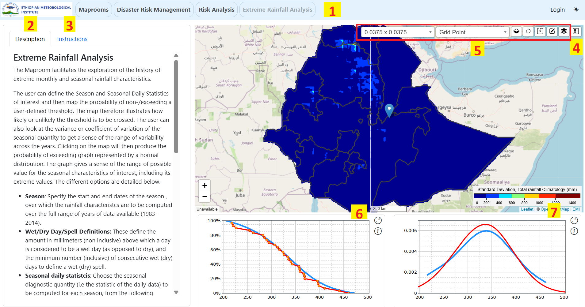
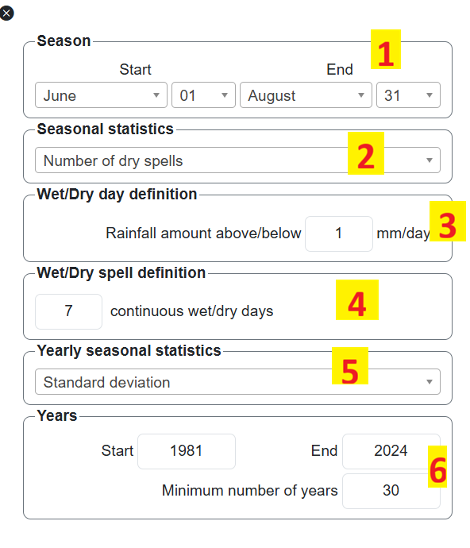
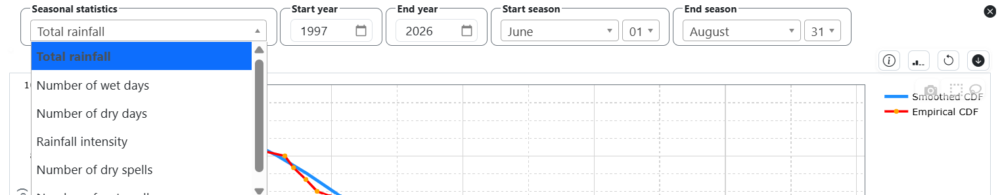
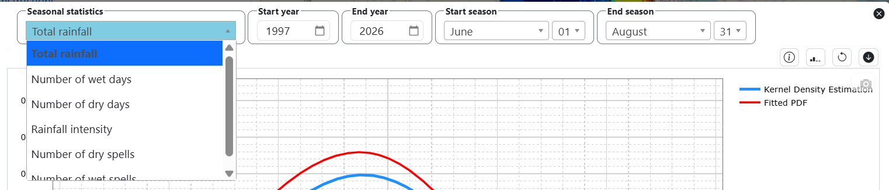
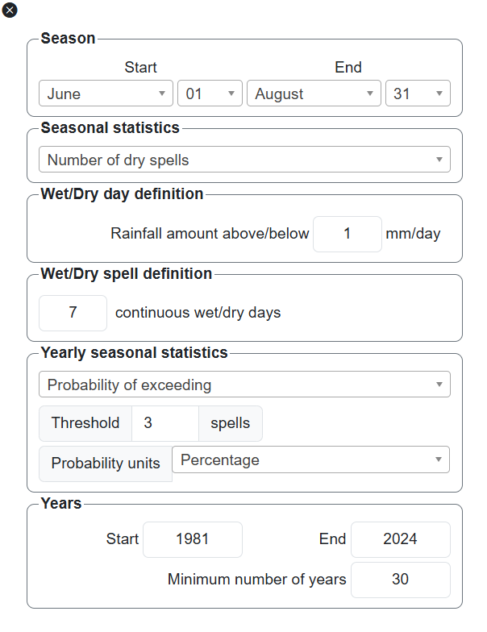
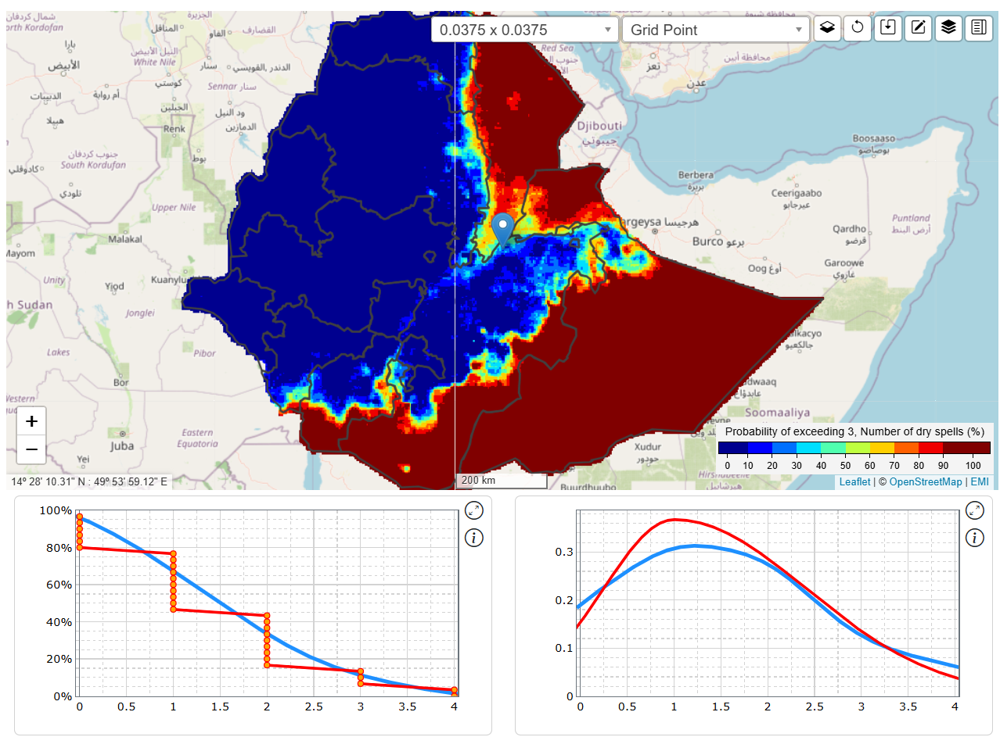
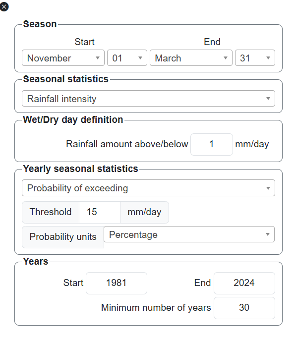
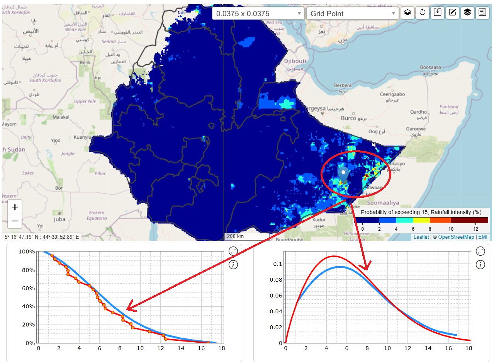

# Extreme Rainfall/Temperature Analysis Maproom

## 1. Overview

The Extreme Rainfall/Temperature Analysis Maproom, within **Disaster Risk Management / Risk Analysis**, examines the historical distribution of seasonal rainfall characteristics. You can define a season, select a rainfall or spell statistic, and map its variability or the probability of exceeding a chosen threshold.

The calculation has two distinct stages:

1. Calculate the selected rainfall characteristic for each historical season, such as the number of dry spells.
2. Summarize those seasonal values across years, for example using standard deviation or the probability of exceeding three spells.

Use this Maproom to investigate:

- Geographic differences in historical rainfall variability.
- The historical probability of exceeding a seasonal rainfall or spell threshold.
- The distribution of seasonal rainfall intensity at a selected location.
- Differences between empirical, smoothed, and fitted representations of the historical sample.

Open **Maprooms/Disaster Risk Management/Risk Analysis/Extreme Rainfall Analysis**.

*Figure 1.1. Main areas of the Extreme Rainfall Analysis Maproom. The illustrated map legend identifies the standard deviation of total-rainfall climatology, in millimeters.*

- **Menu 1:** Navigation path to Extreme Rainfall Analysis.
- **Menu 2:** Description of the seasonal rainfall analysis.
- **Menu 3:** General instructions for using the Maproom.
- **Menu 4:** Button for opening the map controls.
- **Menu 5:** Toolbar for selecting a location and accessing map tools.
- **Menu 6:** Historical exceedance-probability chart preview, which can be expanded.
- **Menu 7:** Historical probability-density chart preview, which can be expanded.

The illustrated spatial selector displays **0.0375° × 0.0375°** and **Grid Point**. Select a location to examine its historical distributions.

The figures illustrate several different selections. Read each map's legend and each chart's controls when identifying the statistic and historical period represented.

For shared navigation, layers, chart appearance, and downloading results, see [Navigating Maprooms](common-navigation.md).

## 2. Settings

### 2.1. Map control

Select **Menu 4** to choose the season, rainfall characteristic, yearly summary, and historical period.

<table>
  <tr>
    <td width="40%" valign="top">
      
    </td>
    <td width="60%" valign="top">
      <h3>Map control menu</h3>
      
<strong>1. Season:</strong> Select the start and end month and day. The illustration uses <strong>June 01–August 31</strong>.

      
<strong>2. Seasonal statistics:</strong> Select the rainfall characteristic calculated within each season. The illustrated choice is <strong>Number of dry spells</strong>.

      
<strong>3. Wet/Dry day definition:</strong> Enter the daily rainfall threshold used to distinguish wet and dry days. The illustrated value is <strong>1 mm/day</strong>.

      
<strong>4. Wet/Dry spell definition:</strong> Enter the required number of continuous wet or dry days. The illustrated value is <strong>7 days</strong>.

      
<strong>5. Yearly seasonal statistics:</strong> Select how the seasonal results are summarized across years. The illustration selects <strong>Standard deviation</strong>.

      
<strong>6. Years:</strong> Set the historical start year, end year, and minimum valid-year requirement. The illustration uses <strong>1981–2024</strong> and <strong>30 minimum years</strong>.

    </td>
  </tr>
</table>

*Figure 2.1. Example map controls for the standard deviation of June–August dry-spell counts. This selection differs from the total-rainfall map in Figure 1.1.*

#### 2.1.1. Seasonal rainfall characteristics

The illustrated seasonal-statistic menu includes:

| Statistic | Quantity represented | Units |
|---|---|---|
| Total rainfall | Rainfall accumulated during the season. | **mm**. |
| Number of wet days | Count of days satisfying the wet-day definition. | **days**. |
| Number of dry days | Count of days satisfying the dry-day definition. | **days**. |
| Rainfall intensity | Average wet-day rainfall amount during the season. | **mm/day**. |
| Number of dry spells | Count of dry spells using the selected day and spell definitions. | **spells**. |
| Number of wet spells | Count of wet spells using the selected day and spell definitions. | **spells**. |

The general meanings of these rainfall diagnostics are described in the [ENACTS Extreme Rainfall Analysis documentation](https://map.meteomadagascar.mg/maproom/Climatology/Climate_Analysis/extRainfall.html). Use the Ethiopian page's current controls and labels for the examples here.

The day threshold and spell length define the event being counted. The probability threshold defines the seasonal result being assessed. For example, **1 mm/day**, **7 continuous days**, and **3 spells** are three different settings.

A rainfall-intensity threshold of **15 mm/day** concerns the seasonal average over wet days. It does not mean that every day, or a specified number of individual days, exceeded 15 mm.

#### 2.1.2. Summarizing the seasonal values across years

The illustrated controls are **Standard deviation** and **Probability of exceeding**:

| Summary | Interpretation | Output units |
|---|---|---|
| Standard deviation | Spread of the seasonal values around their historical mean. | Same units as the seasonal characteristic. |
| Probability of exceeding | Historical probability associated with crossing the selected threshold. | The selected probability units; **Percentage** is illustrated. |

For probability maps, enter a **Threshold** in the units printed beside the field and review **Probability units**. The examples use **3 spells** and **15 mm/day**.

The probability threshold is not an observed value for a selected year. It is applied to the distribution of seasonal historical values.

Retain the selected historical years and minimum valid-year requirement with each result. Close the panel to update the map, and use **Redraw map** if another update is required.

### 2.2. Chart control

Select a location, then expand **Menu 6** or **Menu 7** to examine the historical distributions.

#### 2.2.1. Exceedance-probability chart

*Figure 2.2. Expanded exceedance-chart controls. The illustration selects total rainfall for June–August over 1997–2026.*

The chart provides **Seasonal statistics**, **Start year**, **End year**, **Start season**, and **End season**. Review any additional day or spell definitions required by the chosen statistic.

The map example uses **1981–2024**, while this chart-control illustration uses **1997–2026**. Align the historical period and seasonal definitions before directly comparing a map probability with a chart reading.

The legend calls the curves **Smoothed CDF** and **Empirical CDF**, but the illustrated curves decrease as the horizontal threshold increases. Read them as **exceedance-probability curves**: move from the threshold on the horizontal axis to the curve, then read the probability on the vertical axis.

The preview can display percentages, while the expanded chart can display fractions. A fraction of **0.20** corresponds to **20%**. Check the axis format.

#### 2.2.2. Probability-density chart

*Figure 2.3. Expanded probability-density chart controls for the selected seasonal characteristic.*

The illustrated curves are **Kernel Density Estimation**, in blue, and **Fitted PDF**, in red. They provide different representations of the historical distribution.

The horizontal axis uses the units of the selected characteristic. The vertical axis shows density. For rainfall intensity in **mm/day**, density has inverse units, **(mm/day)⁻¹**. The area under a density curve over an interval represents a probability; the curve's height at one value is not itself a percentage.

For spell counts, historical results are discrete counts. A smooth density curve provides an approximation to their distribution.

Use the chart legend to identify each curve. The illustrated controls do not expose a choice of fitted distribution family.

### 2.3. Reading the map and local distributions together

The map describes geographic differences at the chosen threshold. The charts describe a range of possible seasonal values at the selected location.

Keep these settings consistent when comparing them:

- Seasonal statistic and its units.
- Start and end month and day.
- Wet/dry-day threshold and spell definition, where relevant.
- Historical years and spatial selection.

Empirical, smoothed, and fitted curves can give different readings at the same threshold. Identify the curve used when reporting a probability and use the interactive values for an exact numerical result.

## 3. Application

### 3.1. Map the probability of exceeding three dry spells

This example assesses **June 1–August 31** dry-spell counts using a **1 mm/day** day-definition threshold and a spell definition of **7 continuous dry days**. The mapped probability threshold is **3 spells**.

<table>
  <tr>
    <td width="35%" valign="top">
      <h3>Dry-spell controls</h3>
      
    </td>
    <td width="65%" valign="top">
      <h3>Map and local distributions</h3>
      
    </td>
  </tr>
</table>

*Figure 3.1. Controls beside the probability map and selected-point distributions for June–August dry spells.*

To reproduce the selection:

1. Open **Menu 4** and set **Season** to **June 01–August 31**.
2. Choose **Number of dry spells** under **Seasonal statistics**.
3. Set the daily rainfall threshold to **1 mm/day**.
4. Set the spell definition to **7 continuous wet/dry days**.
5. Choose **Probability of exceeding** and enter **3** under **Threshold**, in spells.
6. Choose **Percentage**, retain **1981–2024**, and set minimum years to **30**.
7. Close the panel, then select a grid point to update the distributions.

The map legend is labeled **Probability of exceeding 3, Number of dry spells (%)**, with labeled breaks from **0 to 100%**. Much of the west and north appears in low blue classes, while large eastern and southeastern areas appear in high red classes. Transitional colors mark intermediate probabilities.

At the selected point, the preview curves around a threshold of **3 spells** are approximately of the order of **one chance in ten**. The empirical and smoothed curves differ, so this is an approximate reading rather than an exact probability from the screenshot.

The density chart places more of the selected point's historical distribution near lower spell counts. Read its horizontal axis in **spells**, and use the exceedance chart to assess the chosen probability threshold.

### 3.2. Examine rainfall intensity above 15 mm/day

This example examines the season **November 1–March 31**, using **Rainfall intensity**, a wet/dry-day threshold of **1 mm/day**, and a probability threshold of **15 mm/day**.

<table>
  <tr>
    <td width="35%" valign="top">
      <h3>Rainfall-intensity controls</h3>
      
    </td>
    <td width="65%" valign="top">
      <h3>Map and local distributions</h3>
      
    </td>
  </tr>
</table>

*Figure 3.2. Rainfall-intensity probability map and selected-point distributions. The mapped threshold is 15 mm/day; the red arrows highlight a different horizontal value, around 8 mm/day, in the charts.*

To reproduce the selection:

1. Set **Season** to **November 01–March 31**.
2. Choose **Rainfall intensity**.
3. Set the day-definition threshold to **1 mm/day**.
4. Choose **Probability of exceeding**, with a threshold of **15 mm/day**.
5. Choose **Percentage** and retain **1981–2024** with **30 minimum years**.
6. Close the panel and select a location in the southeastern area highlighted in the figure.

This season crosses the calendar-year boundary. Retain both seasonal endpoints with the historical-year selection when reporting the result.

The map is predominantly in low blue classes, with localized higher classes in parts of the east and southeast. The visible legend has labeled breaks from **0 to 12%**. The palette differs from the 0–100% legend in Figure 3.1, so similar colors do not necessarily represent the same probability.

The red arrow on the exceedance plot points near **8 mm/day**, where the smoothed curve is approximately **30%**. To examine the mapped threshold, follow the curve farther right to **15 mm/day**, where the illustrated exceedance probability is only a few percent.

The arrow on the density plot also points near **8 mm/day**. Its vertical value is a density, approximately **0.08 (mm/day)⁻¹**, rather than an 8% probability. Use the exceedance curve or an area under the density curve for a probability statement.

The selected point's exact coordinates and expanded historical chart settings are not printed in this output. Confirm them using chart information and the expanded controls before reporting a precise local probability.

**Application are the same for temperature variable but the definition and the related variable only change accordinly.** 