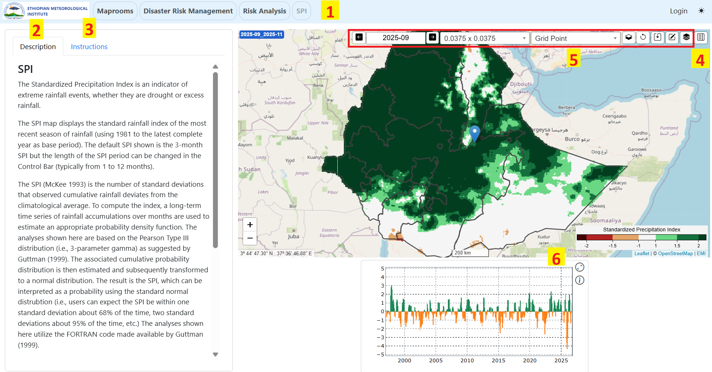
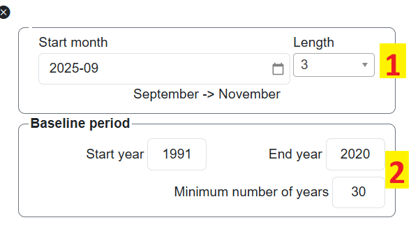
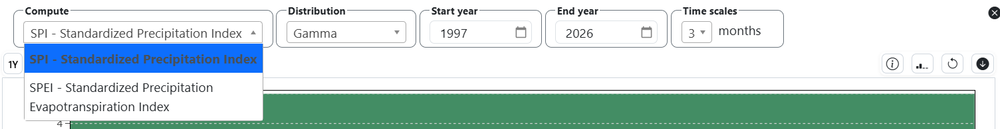
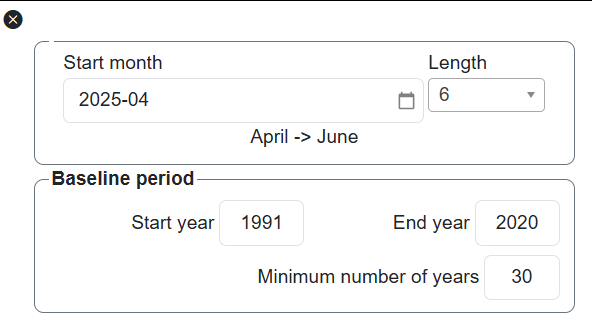
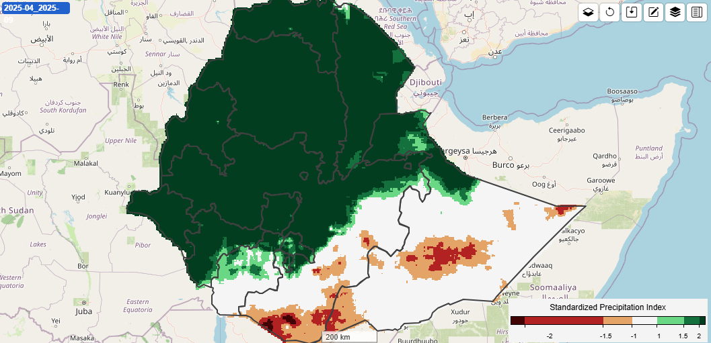
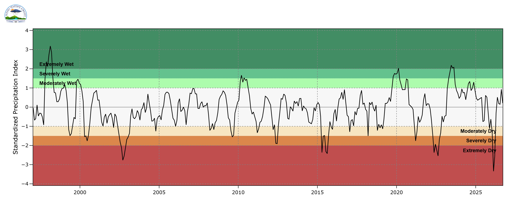
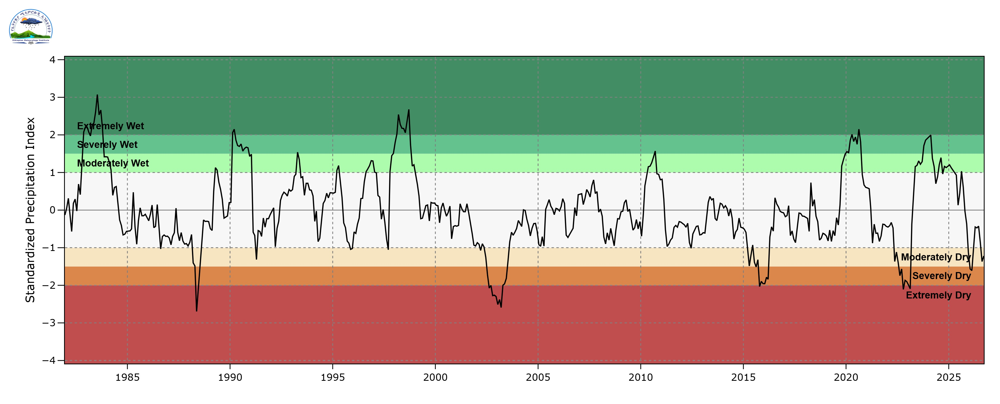
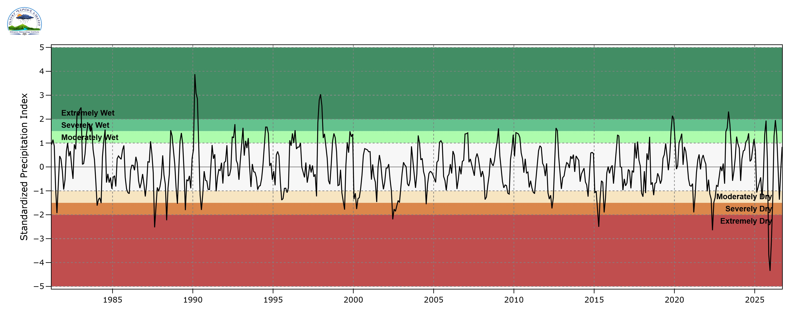

# Standardized Precipitation Index Risk Analysis Maproom

## 1. Overview

The SPI Maproom, within **Disaster Risk Management → Risk Analysis**, examines unusually dry or wet accumulated rainfall conditions. It provides a spatial SPI map for a selected period and a historical index chart for a selected location.

The **Standardized Precipitation Index (SPI)** compares accumulated precipitation with its historical distribution for the corresponding time of year. Positive values describe relatively wet conditions and negative values describe relatively dry conditions. SPI is dimensionless; it does not express a rainfall amount or percentage rainfall anomaly. The general calculation and interpretation are described in the [WMO Standardized Precipitation Index User Guide](https://www.droughtmanagement.info/literature/WMO_standardized_precipitation_index_user_guide_en_2012.pdf).

Use this Maproom to investigate:

- Geographic differences in relatively dry and wet conditions for a selected accumulation period.
- Historical episodes reaching the displayed dry or wet categories.
- Differences between shorter and longer accumulation scales.
- Historical SPI and the SPEI option provided by the expanded chart.

Open **Maprooms → Disaster Risk Management → Risk Analysis → SPI**.

*Figure 1.1. Main areas of the SPI Risk Analysis Maproom. The map banner identifies September–November 2025, while the chart preview shows a longer historical series.*

- **Menu 1:** Navigation path to SPI under Risk Analysis.
- **Menu 2:** Description of SPI and its historical interpretation.
- **Menu 3:** General instructions for using the Maproom.
- **Menu 4:** Button for opening map controls.
- **Menu 5:** Toolbar for moving between selected periods, choosing a location, and accessing map tools.
- **Menu 6:** Historical index chart preview, which can be expanded.

The illustrated map selector displays **0.0375° × 0.0375°** and **Grid Point**. Select a point to examine its history, then use chart information to confirm the location.

For shared navigation, location selection, layers, chart appearance, and downloading results, see [Navigating Maprooms](common-navigation.md).

## 2. Settings

### 2.1. Map control

Select **Menu 4** to choose the start of the accumulation period, its length, and the baseline.

<table>
  <tr>
    <td width="40%" valign="top">
      
    </td>
    <td width="60%" valign="top">
      <h3>Map control menu</h3>
      
<strong>1. Start month and Length:</strong> Select a start year and month and the number of months to accumulate. The illustration uses <strong>2025-09</strong> and <strong>3 months</strong>, corresponding to <strong>September–November 2025</strong>.

      
<strong>2. Baseline period:</strong> Enter the start year, end year, and minimum number of years used by the historical reference. The illustrated selection is <strong>1991–2020</strong>, with <strong>30 minimum years</strong>.

    </td>
  </tr>
</table>

*Figure 2.1. SPI map controls for a three-month period starting in September 2025.*

The map field is **Start month**, rather than the ending month of an accumulation:

| Start month | Length | Accumulation interval |
|---|---|---|
| September 2025 | 3 months | September–November 2025. |
| April 2025 | 6 months | April–September 2025. |

Record the entire interval when describing an SPI map. For example, SPI-6 for April–September 2025 refers to six months of accumulated rainfall rather than April rainfall alone.

The page description refers to an older baseline convention, while the illustrated controls explicitly select **1991–2020**. Retain the selected controls with a reported result. The minimum-year requirement is distinct from the accumulation length.

Close the panel to update the map and read its banner and legend. Use the previous and next arrows in **Menu 5** to move between available period selections.

### 2.2. Chart control

Expand **Menu 6** to inspect the historical index settings.

*Figure 2.2. Expanded index-chart controls. The illustrated selection uses SPI, Gamma distribution, 1997–2026, and a three-month time scale.*

| Control | Illustrated settings and purpose |
|---|---|
| Compute | Select **SPI – Standardized Precipitation Index** or **SPEI – Standardized Precipitation Evapotranspiration Index**. |
| Distribution | Select a distribution supported by the chosen index. **Gamma** is shown for SPI. |
| Start year and End year | Define the historical years included in the chart. The illustration uses **1997–2026**. |
| Time scales | Defines the accumulation length in months. The illustration uses **3 months**. |

SPI summarizes precipitation, while SPEI includes the climatic water balance involving precipitation and evapotranspiration. Review the available distribution choices after changing **Compute**.

The page's older description mentions Pearson Type III, but the expanded chart visibly selects **Gamma**. Report the chart's selected distribution. The map-control screenshot does not expose a distribution selector, so it does not establish that the map uses the same fitted distribution as the expanded chart.

Changing the map's **Length** does not establish which **Time scales** value is selected in the expanded chart. Review both before comparing a mapped period with a point in the historical series.

Use the circular-arrow button to update the chart where required. The information and download buttons provide the shared chart tools described in [Navigating Maprooms](common-navigation.md).

### 2.3. Reading index categories

The map legend uses boundaries at **−2, −1.5, −1, 1, 1.5, and 2**. The exported charts label the wet and dry bands as follows:

| Index interval | Interpretation |
|---|---|
| −2 or lower | Extremely dry. |
| Greater than −2, up to −1.5 | Severely dry. |
| Greater than −1.5, up to −1 | Moderately dry. |
| Greater than −1 and less than +1 | Near normal. |
| +1 to less than +1.5 | Moderately wet. |
| +1.5 to less than +2 | Severely wet, as labeled in the exported charts. |
| +2 or higher | Extremely wet. |

Read the line against the horizontal category boundaries. A value around **−2.5** lies in the extremely dry band, while a value around **+1.2** lies in the moderately wet band.

These labels describe standardized rainfall conditions. A high SPI value alone does not give a rainfall total or establish that flooding occurred.

## 3. Application

### 3.1. Examine the six-month period April–September 2025

This example selects **Start month: April 2025**, **Length: 6**, and baseline **1991–2020**, with **30 minimum years**.

<table>
  <tr>
    <td width="35%" valign="top">
      <h3>SPI-6 map controls</h3>
      
    </td>
    <td width="65%" valign="top">
      <h3>Six-month map</h3>
      
    </td>
  </tr>
</table>

*Figure 3.1. Controls beside the six-month SPI map. The selected length and map banner identify April–September 2025.*

To reproduce the selection:

1. Open **Menu 4**.
2. Set **Start month** to **2025-04**.
3. Select **6** under **Length**.
4. Set the baseline to **1991–2020** and minimum years to **30**.
5. Close the panel and check the complete period in the map banner.

The helper text in the illustrated control still reads **April → June**, which is inconsistent with the selected six-month length. The map banner identifies **April–September**. Retain the start month, length, and map dates together when documenting this example.

The illustrated map shows extensive wet classes in northern and western areas, with dry classes in parts of the south and southeast. Dark green areas lie in the highest displayed wet category, while orange and red areas lie in the dry categories. Read the legend at the location of interest.

To examine the historical context, select a grid point and expand its chart. Choose **SPI** and a **6-month** time scale, then review the distribution and chart years before interpreting the selected period.

*Figure 3.2. Historical index export supplied with the six-month example. The curve crosses several wet and dry categories.*

This export shows a pronounced positive peak early in the record and strong negative episodes later in the record. The line reaches below **−3** near the end of the visible period. These are approximate graphical readings; use the chart tooltip for the exact month and value.

The exported image does not print its accumulation length, distribution, or selected coordinates. Preserve those settings with the image, and verify them in the expanded chart before treating a plotted value as a direct match to the map.

### 3.2. Examine historical dry and wet episodes

Extend the chart period to examine the longer available record, retaining the selected location and index settings.

*Figure 3.3. Historical SPI export showing alternating dry and wet periods over a longer record.*

The illustrated curve contains strongly negative episodes around the late 1980s, early 2000s, and early 2020s, as well as positive episodes reaching wet categories. The horizontal bands identify severity; the date axis identifies when an episode occurred.

To inspect an episode:

1. Retain the same location and **Compute: SPI**.
2. Select the desired accumulation scale and review the distribution.
3. Choose the historical chart years.
4. Update the plot and zoom to the episode.
5. Read its dates and numerical values using the tooltip.

The image supports an approximate description of the curve. Exact dates, accumulation settings, and location should accompany any reported episode.

### 3.3. Compare three-month and twelve-month accumulations

Keep the location, index, distribution, and historical period fixed. Change **Time scales** from **3 months** to **12 months**, updating and saving each selection separately.

*Figure 3.4. Additional historical index export for examining changes between wet and dry categories. A single curve is shown, and its accumulation scale is not printed.*

Figures 3.3 and 3.4 show separate historical curves. Their images do not identify which accumulation scale each uses, so they do not by themselves establish a controlled SPI-3 versus SPI-12 comparison.

For your own comparison, retain the selected time scale with each export and align the accumulation ending months. In this Maproom, a three-month map starting in **July** and a twelve-month map starting in the preceding **October** both end in **September**. This allows the two scales to describe a common endpoint while summarizing different rainfall intervals.

Use the paired chart selections to examine changes in the timing, persistence, and severity of the dry or wet categories, while checking that the location and reference settings remain comparable.
