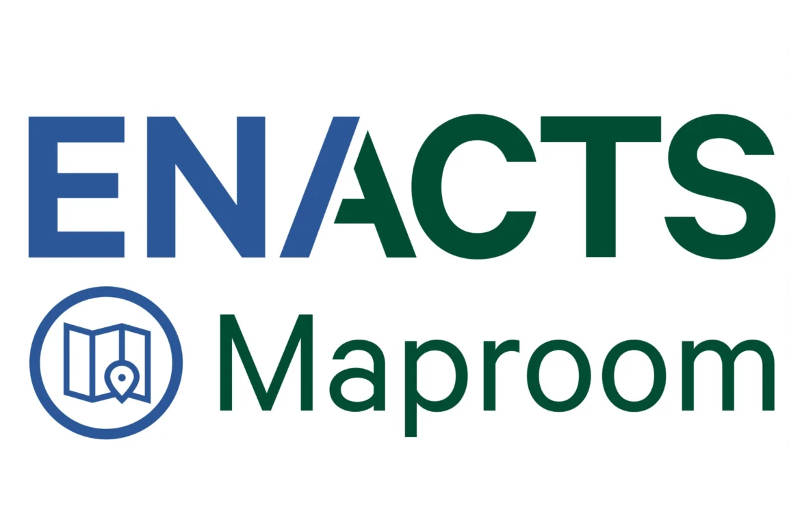

Welcome to the Maprooms user documentation

# Maprooms User Documentation

Explore climate information through interactive maps and charts.

[Get started](common-navigation.md){ .md-button .md-button--primary }
[Explore the guide](outline.md){ .md-button }

  

  

  

  

  

  

## About Maprooms

The ENACTS Maproom is an interactive online climate information platform designed to make climate information easily accessible and usable for decision-makers, practitioners, and the general public.

Built on the high-resolution ENACTS datasets, the Maproom provides user-friendly visualization and analysis tools for rainfall, temperature, drought, onset and cessation of rainy seasons, extreme events, and other climate indicators at national and sub-national scales. Users can generate maps, graphs, and download them for their specific locations and time periods, supporting applications in agriculture, water resources, health, disaster risk management, energy, and climate adaptation planning.

The Maproom is developed in close collaboration with National Meteorological and Hydrological Services (NMHSs) to ensure national ownership and operational sustainability, while recent transitions toward Python-based platforms are further enhancing performance, flexibility, interoperability, and user experience.

## About this guide

This guide helps you find the climate information you need in Maprooms and understand what its maps and charts are showing. It explains how to choose a product, select a location and period, adjust the settings, and download your results.

Start with [Navigating Maprooms](common-navigation.md), or explore the
[documentation outline](outline.md).

  

  

  

  <!-- *Countries and regions where ENACTS has been implemented.* -->

  

  

